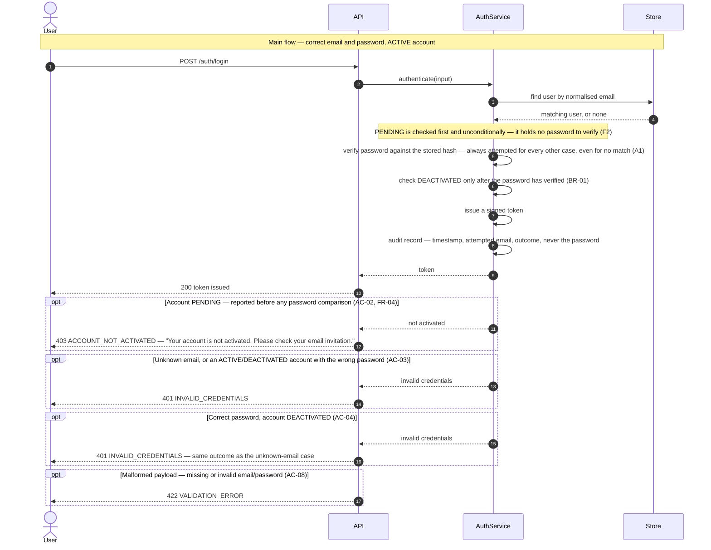
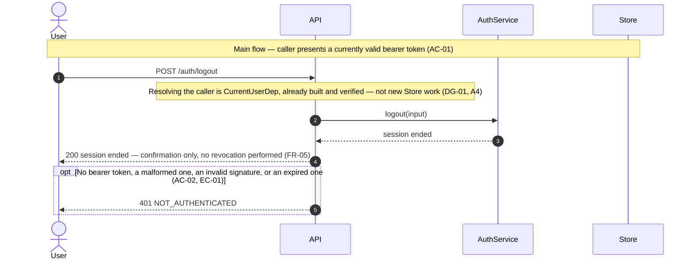
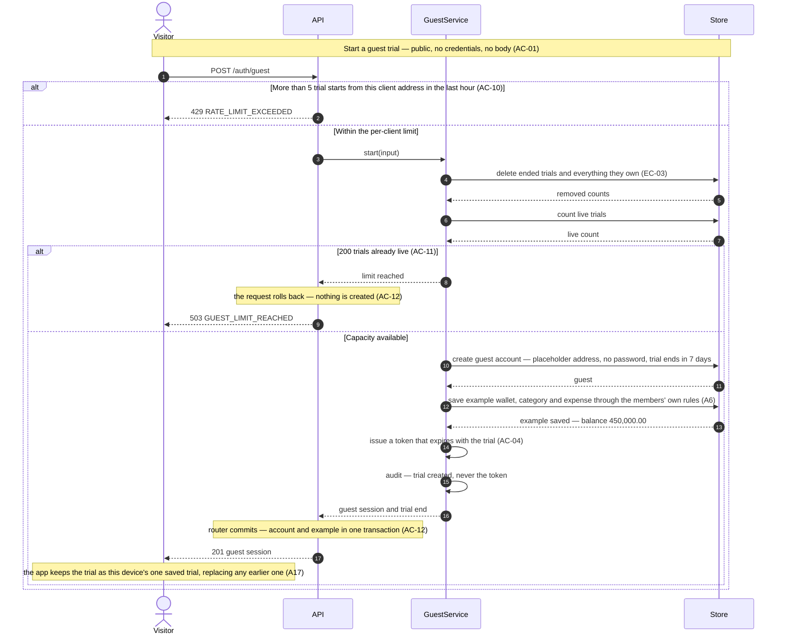
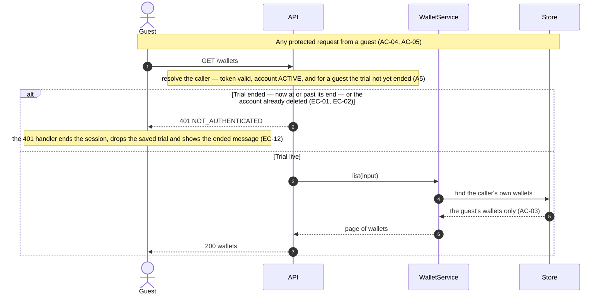
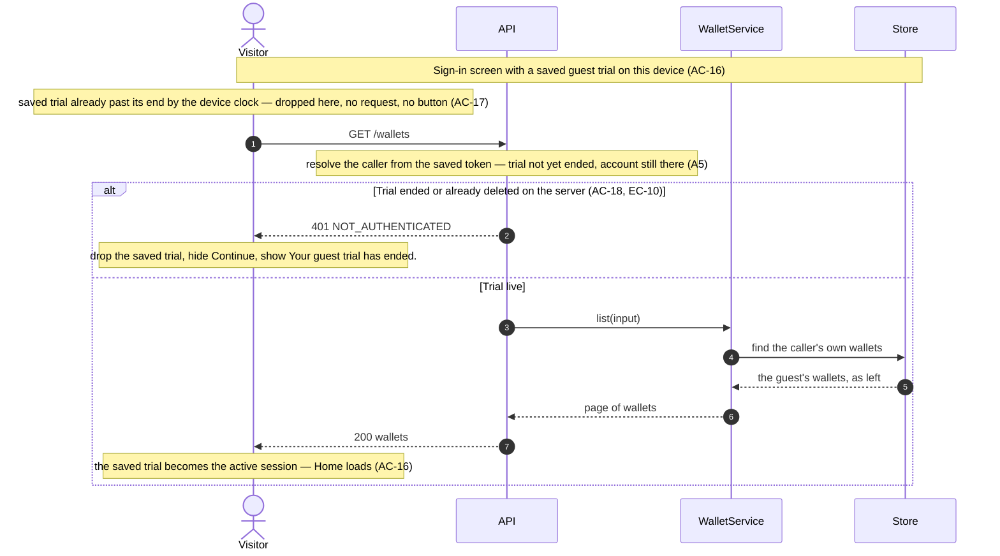
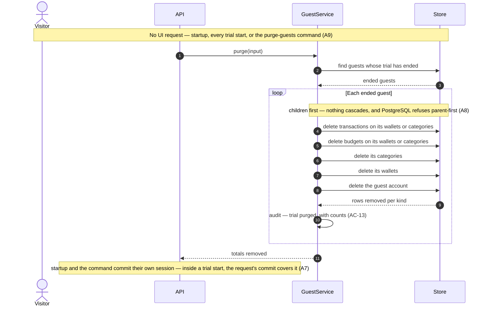

# Technical Plan: System Security (SS)

> **Feature:** SRS §6 Feature-02 · SDS §5.1 (SS)
> **Spec:** [spec.md](spec.md)
> **Stories in this file:** SS-US-01 *(implemented, verified — 14 tests, 100% coverage on new code)* · SS-US-02 *(implemented, verified — TC-12…TC-15, 4/4 PASS)* · SS-US-03 *(implemented, verified — TC-58…TC-96, 39/39 PASS)*

---

## SS-US-01: Login

### Gaps & Decisions (Resolved)

| ID | Area | Decision | Status |
|----|------|----------|--------|
| A1 | Security | **Password check precedes account-state check, but only for accounts that hold a password** (spec BR-01, FR-05). `PENDING` is checked *first and unconditionally* (FR-04) — its `password_hash` is `NULL`, so there is nothing to verify, and checking password-first there would make AC-02's SRS-mandated message unreachable (spec's own reconciling note after EC-03, added after a first draft got this wrong). For `ACTIVE`/`DEACTIVATED`/unknown-email, the service loads by normalised email and, if no row exists, still runs `security.verify_password()` against a **pre-computed dummy hash** rather than short-circuiting — so the two failure paths (unknown email vs known email/wrong password) take the same code shape and cost roughly the same wall-clock time. The dummy-hash step is not itself a spec requirement (neither SRS nor SDS names timing), but it is the cheapest way to keep AC-03's "indistinguishable" promise from leaking through a side channel the same AC already forbids in spirit. | ✅ Resolved |
| A2 | API | **Reuses `core/security.py` and `core/deps.py` wholesale — no new crypto.** `encode_jwt()`, `verify_password()` already exist, built by UM-US-01 (`plan.md` A11) precisely so this story would not need to reinvent them. This story adds the one thing that was missing: the endpoint that calls `encode_jwt()` after a real credential check, rather than the dev-only `mint-token` CLI standing in for it. | ✅ Resolved |
| A3 | Security | **`DEACTIVATED` login is folded into the generic refusal**, per spec AC-04/FR-07. Same shape as UM-US-02 EC-07's treatment of a `DEACTIVATED` user's invitation token. No new precedent — an existing one, reapplied. | ✅ Resolved |
| A4 | Code | **`get_current_user`/`require_admin` are untouched.** This story only adds what issues a token; nothing about verifying one changes. Confirmed by re-running the full UM-US-01/UM-US-02 suite unmodified once this story's code lands — a regression there would mean this assumption broke. | ✅ Resolved |
| A5 | Code | **The dummy-hash comparison (A1) uses a hash of a fixed placeholder string, computed once at import time**, not a fresh `bcrypt.gensalt()` per request — bcrypt's own cost factor already dominates the timing, so a per-request salt buys nothing and only adds needless work to every failed lookup. | ✅ Resolved |
| F1 | Finding | **Neither `SRS.md` nor `SDS.md` names what happens to a `DEACTIVATED` login attempt** — only `PENDING` is named (spec Assumptions). A3's ruling is derived from constitution SEC-10 and UM-US-02's own EC-07 precedent, not from an anchored AC. Recorded so the gap stays visible; extending the SRS to name it explicitly is a requirements change the product owner would need to make, not an AI alignment (`CLAUDE.md` §1). | ✅ Resolved *(recorded, not closed)* |
| F2 | Finding | **A first design pass made AC-02 permanently unreachable.** It generalised UM-US-02's "state check comes after the relevant secret check" pattern into one blanket rule — *password verification always precedes any account-state check* — without checking whether the analogy held. It did not: a `PENDING` account's `password_hash` is `NULL` (UM-US-01 AC-07), so under that rule a `PENDING` login could only ever fail password verification and land on the generic refusal, never reaching AC-02's SRS-mandated named message at all. Caught by tracing through what `authenticate()` would actually do for a `PENDING` row **before any code was written** — exactly the point of the design step. Fixed by narrowing BR-01 (spec's own reconciling note after EC-03) to the accounts that hold a password to check; `PENDING` is checked first and unconditionally instead. Recorded here because it is a correction to this story's own design, not an inherited gap. | ✅ Resolved |

---

### Architecture

**Package layout** (additions only; UM-US-01/UM-US-02's foundation is reused as-is).

```text
backend/app/
├── core/
│   ├── errors.py                     # update: add InvalidCredentialsError, AccountNotActivatedError
│   ├── security.py                   # reuse — verify_password, encode_jwt already exist
│   ├── audit.py                      # reuse — record() emitter
│   └── deps.py                       # reuse, unchanged — get_current_user/require_admin untouched (A4)
├── schemas/
│   └── auth.py                       # NEW  LoginRequest, TokenResponse
├── services/
│   └── auth_service.py               # NEW  authenticate()
└── api/v1/
    ├── auth.py                       # NEW  POST /auth/login
    └── router.py                     # update: mount auth.router

backend/tests/
└── integration/test_ss_us_01_login.py   # NEW  written at the Implement step from test_cases.md
```

No Alembic migration: no schema change. No new settings: `jwt_secret`/`jwt_ttl_minutes`/
`jwt_algorithm` already exist in `core/config.py`, added by UM-US-01 for token *verification* and
now used for token *issuance* too — the same values, the same seam.

**DTOs** (`app/schemas/auth.py`)

```python
class LoginRequest(BaseModel):
    email: EmailStr
    password: str = Field(min_length=1)

class TokenResponse(BaseModel):
    access_token: str
    token_type: Literal["bearer"]
    expires_in: int          # seconds, for a client to know when to re-authenticate
    role: Literal["ADMIN", "USER"]
```

`LoginRequest` carries no `max_length` on `password` — unlike activation, login only *compares*
against an existing hash; it never derives a new one, so bcrypt's 72-byte truncation risk (VL-04)
does not apply here. `TokenResponse` has no field for the password or the stored hash — the
structural guard, same technique as `InvitationRead`/`ActivationResult`.

**Business rules enforced in service layer**

| Rule | Source | Enforcement |
|------|--------|--------------|
| Payload validated before any lookup | AC-08, FR-02 | `LoginRequest` — `EmailStr` + non-empty password; a failure is `422` from Pydantic, service never runs |
| Email normalised before lookup | EC-01, FR-03, BR-04 | `user_repo.normalize_email()`, reused unchanged from UM-US-01 |
| **`PENDING` checked first, unconditionally — no password comparison** | AC-02, FR-04, EC-03, F2 | If the matched user's status is `PENDING`, `auth_service.authenticate()` raises `AccountNotActivatedError` immediately. Its `password_hash` is `NULL`, so there is nothing to compare (F2's correction) |
| Password verified before any further state check, for every other case | AC-05, FR-05, BR-01, A1 | For `ACTIVE`, `DEACTIVATED`, or no match at all, `security.verify_password()` runs next — against the real hash if the user exists and is past the `PENDING` check, against a fixed dummy hash if not — before any other branch runs |
| Unknown email or wrong password (on a non-`PENDING` account) → one generic outcome | AC-03, FR-06 | `InvalidCredentialsError` (401), raised identically whether `user is None` or the password failed |
| DEACTIVATED account, password correct → generic refusal | AC-04, FR-07, BR-02, A3 | `InvalidCredentialsError` (401) — same code and message as FR-06, never a distinct one |
| Token issued on success | AC-01, FR-08 | `security.encode_jwt(subject=user.id, role=user.role.value, ...)`, reused unchanged from UM-US-01 |
| Credential never exposed | AC-06, BR-03 | `TokenResponse` has no password/hash field; audit call passes neither |
| Audit on every attempt | AC-07, FR-10 | `audit.record()` on the success path and every refusal branch, result `SUCCESS`/`FAILURE`, target the attempted email, never the password |
| No authentication required to call this endpoint | AC-09 | Router declares no `AdminDep`/`CurrentUserDep` — the third public route alongside `POST`/`GET /users/activate` |

**Sequence diagram — Login**

Drawn to `constitution.md` DG-01…DG-07.



**Error flows**

| Scenario | HTTP | Error Code |
|----------|------|------------|
| Malformed or missing email/password (AC-08) | 422 | `VALIDATION_ERROR` |
| Unknown email, or known email with wrong password (AC-03), or DEACTIVATED account (AC-04) | 401 | `INVALID_CREDENTIALS` |
| Account PENDING — reported regardless of what password was submitted (AC-02) | 403 | `ACCOUNT_NOT_ACTIVATED` |
| Unexpected server error | 500 | `INTERNAL_ERROR` |

All in the flat envelope `{"error_code", "message", "details"}` (SDS §6.6, API-02). No CSRF concern
— stateless bearer auth, no cookie issued (SDS §7.1.9).

**Constitution notes**

| Rule | Status | Note |
|------|--------|------|
| AR-01 Service owns business rules | Required | Lookup, password check, state check, and token issuance all live in `auth_service.authenticate()` |
| AR-02 Thin router | Required | Router binds the payload, calls the service, formats the response — no branching on business state |
| AR-05 No framework objects in services | Required | `authenticate()` takes plain values; no `Request`/`Response` |
| AR-06 One transaction per request | N/A | Read-only — no write, nothing to commit |
| API-01 Versioned plural path | Required | `POST /api/v1/auth/login` (SDS §6.3 SS-API-01) |
| API-02 Flat error envelope | Required | Reused `main.py` handlers, unchanged |
| API-03 Status codes | Required | `200` success · `401` invalid credentials · `403` not activated · `422` validation |
| API-04 Prefixed error codes | Required | `INVALID_CREDENTIALS`, `ACCOUNT_NOT_ACTIVATED` |
| API-07 Explicit response_model | Required | `response_model=TokenResponse`, `status_code=200` |
| API-08 Public endpoint list | Required | This route is exactly the one API-08 already names as `/auth/login` |
| NC-02 Naming | Required | `LoginRequest` / `TokenResponse`; no new model or table |
| VL-01 Pydantic source of truth | Required | `EmailStr` + non-empty password on `LoginRequest` |
| VL-02 Errors grouped | Required | Reused `RequestValidationError` handler |
| SEC-01 One-way password hash | Required (reused) | `security.verify_password()`, unchanged |
| SEC-06 JWT parameters | Required | HS256, 60-minute expiry, `sub` = user id — `security.encode_jwt()`, unchanged |
| SEC-07 Authz proven by test | N/A | This route issues a credential; it does not itself require one |
| SEC-10 No enumeration | Required | AC-03/AC-04 collapse unknown-email, wrong-password, and DEACTIVATED into one outcome; A1's dummy-hash comparison closes the timing side channel the same guarantee implies |
| LA-01 No secrets in logs | Required | Audit passes the attempted email, never the password; `audit.record()`'s forbidden-key guard backstops it |
| LA-02 Audit five fields | Required | actor (the matched user's id where one exists, `None` for an unknown email), timestamp, action, target (attempted email), result |
| LA-04 Login is auditable | Required | SDS §7.1.10 names login success *and* failure explicitly |
| PF-01 300 ms p95 | Required | One indexed lookup, one bcrypt compare, no I/O beyond the database — well inside budget |
| PF-02 Indexed lookups | Required | `users.email` unique index, already in place |
| PF-03 DTO projection | Required | `TokenResponse` — four fields, no ORM graph |
| TST-01/02 AC→TC coverage | Required | Every AC and EC mapped in `test_cases.md` before any test code |
| DOD-03 Coverage > 80% | Required | Measured at the Implement step |

**Element IDs**

| Element | ID | Status | File |
|---------|----|--------|------|
| — | — | **N/A (mobile deferred)** | `mobile/app/(auth)/login.tsx` already exists as a fixture-driven prototype from UM-US-01's round; wiring it to this real endpoint is Phase 5's job, not a new screen build. |

**Open tasks**

| ID | Task | File | Status |
|----|------|------|--------|
| T-01 | `schemas/auth.py`: `LoginRequest`, `TokenResponse` | `backend/app/schemas/auth.py` | ✅ Done |
| T-02 | `errors.py`: `InvalidCredentialsError` (401), `AccountNotActivatedError` (403) | `backend/app/core/errors.py` | ✅ Done |
| T-03 | `auth_service.py`: `authenticate()` — PENDING checked first and unconditionally (F2), password-before-state for every other case (A1), dummy-hash timing guard (A1/A5) | `backend/app/services/auth_service.py` | ✅ Done |
| T-04 | `POST /api/v1/auth/login` router + mount in `router.py` | `backend/app/api/v1/auth.py`, `backend/app/api/v1/router.py` | ✅ Done |
| T-05 | Integration tests written from `test_cases.md` | `backend/tests/integration/test_ss_us_01_login.py` | ✅ Done — TC-01…TC-11, `134 passed`, one pre-existing UM-US-02 test flakiness found and fixed along the way (see `test_cases.md`'s Test Implementation Map) |

---

## SS-US-02: Logout

> **IDs in this section are local to SS-US-02**, matching `spec.md`'s convention. Only `TC-NN` in
> `test_cases.md` runs continuously across the epic.

### Gaps & Decisions (Resolved)

| ID | Area | Decision | Status |
|----|------|----------|--------|
| A1 | API | **Response shape is a confirmation body, `LogoutResult { status, message }`, not `204 No Content`.** This codebase already has a precedent for exactly this choice — `ActivationResult` (`schemas/activation.py`) returns a confirmation body for another security-relevant, no-session-issued action rather than an empty `204`. Reusing that shape costs nothing extra (one small DTO, same technique as `TokenResponse`/`ActivationResult` as a structural guard against ever adding a credential field by accident) and keeps the convention consistent across the two DTOs a client sees around a session's edges (`TokenResponse` in, `LogoutResult` out). A `204` was considered and rejected: it would be the only no-body success response in the API surface, breaking that consistency for no benefit, since AC-01 explicitly asks for "a success response confirming the session has ended" — a confirmation is the literal ask, not just a status code. | ✅ Resolved |
| A2 | Logging | **No new audit event for logout.** Constitution LA-04 enumerates exactly three audit-worthy actions for this epic and its sibling: "invitations sent, activations completed, and logins (success and failure)." Logout is not named. No AC or EC in this story's `spec.md` requires a logout audit trail either — AC-01/AC-02 ask only for a response and a refusal, never a log entry. This is the same reasoning UM-US-03's `plan.md` A5 already applied to list-reads: LA-04 is a closed enumeration for this epic, not an open invitation to audit every new endpoint. Revisit if a future story needs a "who signed out and when" trail. | ✅ Resolved |
| A3 | Testing | **EC-02 (the presented token remains valid after logout until its own natural expiry) is covered by a positive test, not left as a documentation-only note.** `TC-15` calls logout, then re-presents the same token against a protected route and asserts it still succeeds. This proves the documented scope is real — a token that is still cryptographically valid keeps working, exactly as `spec.md`'s Assumptions & Dependencies section says — rather than merely asserting the absence of a defect nobody could otherwise observe. | ✅ Resolved |
| A4 | Code | **No new dependency, no new error class.** `CurrentUserDep` (`core/deps.py`) already resolves *any* authenticated caller — not `AdminDep`, since SRS names the caller "an Authenticated User," not an ADMIN (spec Assumptions). Its single failure mode, `NotAuthenticatedError` (401 `NOT_AUTHENTICATED`), already covers every case AC-02/EC-01 name (absent header, malformed token, bad signature, expired token) uniformly, because `get_current_user` folds all of them into one outcome by design (SEC-10). Nothing about `get_current_user`/`require_admin` changes — confirmed by the existing UM-US-01/UM-US-02/SS-US-01 suites running unmodified once this story's code lands, the same check A4 in SS-US-01's own table performed for itself. | ✅ Resolved |

---

### Architecture

**Package layout** (additions only; UM-US-01/SS-US-01's foundation is reused as-is).

```text
backend/app/
├── core/
│   ├── deps.py                       # reuse, unchanged — CurrentUserDep already resolves any ACTIVE caller
│   ├── errors.py                     # reuse, unchanged — NotAuthenticatedError already exists (A4)
│   └── audit.py                      # reuse, unchanged — not called by this story (A2)
├── schemas/
│   └── auth.py                       # update: add LogoutResult
├── services/
│   └── auth_service.py               # update: add logout()
└── api/v1/
    └── auth.py                       # update: add POST /auth/logout

backend/tests/
└── integration/test_ss_us_02_logout.py   # NEW  written at the Implement step from test_cases.md
```

No Alembic migration: no schema change, no new table, no new column — there is nothing server-side
for this story to persist (spec FR-05). No new settings: `jwt_secret`/`jwt_ttl_minutes`/
`jwt_algorithm` are unchanged, reused exactly as SS-US-01 configured them. No new error class: the
one refusal this route can produce is `NotAuthenticatedError`, already shipped.

**DTOs** (`app/schemas/auth.py`)

```python
class LogoutResult(BaseModel):
    status: Literal["SUCCESS"]
    message: str
```

Same technique as `ActivationResult` (A1): no field exists for a token, a credential, or any
session identifier, so there is nothing to accidentally leak even if a future edit tried (spec
FR-04, AC-01).

**Business rules enforced in service layer**

| Rule | Source | Enforcement |
|------|--------|--------------|
| Logout requires being authenticated; no unauthenticated path exists | BR-01, AC-02 | Router declares `current_user: CurrentUserDep` — `get_current_user` raises `NotAuthenticatedError` before `logout()` ever runs. Nothing inside `logout()` re-checks this; the dependency **is** the enforcement point (A4), matching SS-US-01's own table entry for "no authentication required" being the *absence* of a dependency, mirrored here by its *presence* |
| A caller with no token, a malformed one, an invalid signature, or an expired one is refused generically | AC-02, EC-01 | `CurrentUserDep` folds every failure mode into one `NotAuthenticatedError` (401), unchanged from how it already serves every other protected route (SEC-10) |
| A success response confirms the session ended | AC-01, FR-02 | `auth_service.logout()` returns `LogoutResult(status="SUCCESS", message=...)` once `CurrentUserDep` has already resolved the caller |
| The response excludes the caller's token and any credential | FR-04, LA-01 | `LogoutResult` has no such field — structural guard (A1) |
| No server-side revocation record is written | FR-05, EC-02 | `logout()` performs no repository call and no write of any kind — there is no revocation store to write to, by design (see spec Assumptions & Dependencies) |
| A bearer token's validity is unaffected by a prior logout call | BR-02, EC-02 | Nothing this story adds touches `get_current_user`, `decode_jwt`, or any token-validity check — proven by `TC-15` re-using the same token against a protected route after logout (A3) |

**Sequence diagram — Logout**

Drawn to `constitution.md` DG-01…DG-07. Four lanes per DG-01 even though this story does no Store
work — `Store` appears only to keep the fixed lane shape; the caller-resolution step it might
otherwise suggest is `CurrentUserDep`, already built by SS-US-01/UM-US-01 (plan.md A11), not a new
query this story adds.



**Error flows**

| Scenario | HTTP | Error Code |
|----------|------|------------|
| Valid bearer token presented (AC-01) | 200 | *(success — `LogoutResult`)* |
| No bearer token, malformed, invalid signature, or expired (AC-02, EC-01) | 401 | `NOT_AUTHENTICATED` |

All in the flat envelope `{"error_code", "message", "details"}` (SDS §6.6, API-02) for the 401 case.
No CSRF concern — stateless bearer auth, no cookie issued (SDS §7.1.9). No new error code: this
story emits only the already-catalogued `NOT_AUTHENTICATED`.

**Constitution notes**

| Rule | Status | Note |
|------|--------|------|
| AR-01 Service owns business rules | Required | `logout()` is the one place that assembles the confirmation, even though there is no branching to do — keeps the router thin and the shape consistent with every other route |
| AR-02 Thin router | Required | Router binds `CurrentUserDep`, calls the service, formats the response — no branching on business state |
| AR-05 No framework objects in services | Required | `logout()` takes plain values (the resolved user), not `Request`/`Response` |
| AR-06 One transaction per request | N/A | No write of any kind — nothing to commit (FR-05) |
| API-01 Versioned plural path | Required | `POST /api/v1/auth/logout`, alongside `POST /api/v1/auth/login` |
| API-02 Flat error envelope | Required | Reused `main.py` handlers, unchanged |
| API-03 Status codes | Required | `200` success · `401` unauthenticated |
| API-04 Prefixed error codes | Required (exempt) | No new error code — reuses `NOT_AUTHENTICATED`, already catalogued by SS-US-01/UM-US-01 |
| API-07 Explicit response_model | Required | `response_model=LogoutResult`, `status_code=200` |
| API-08 Public endpoint list | Required | This route is **not** on the public list — it requires a bearer token, unlike `/auth/login` |
| NC-02 Naming | Required | `LogoutResult`; no new model or table |
| VL-01 Pydantic source of truth | N/A | This route takes no request body to validate |
| SEC-06 JWT parameters | Required (reused) | HS256, 60-minute expiry — unchanged, this story issues nothing |
| SEC-07 Authz proven by test | Required | Route resolves the caller through `CurrentUserDep`, proven by a test expecting `401` (`TC-13`/`TC-14`) |
| SEC-10 No enumeration | N/A | No account-existence question is being answered here |
| LA-01 No secrets in logs | Required | `LogoutResult` carries no credential; nothing is logged by this story at all (A2) |
| LA-02 Audit five fields | N/A | No audit event is emitted by this story (A2) |
| LA-04 Logout is auditable | N/A | LA-04's enumeration for this epic names invitations, activations, and logins only — logout is not listed (A2) |
| PF-01 300 ms p95 | Required | No I/O at all — well inside budget |
| PF-03 DTO projection | Required | `LogoutResult` — two fields, no ORM graph |
| TST-01/02 AC→TC coverage | Required | Every AC and EC mapped in `test_cases.md` before any test code |
| DOD-03 Coverage > 80% | Required | Measured at the Implement step |

**Element IDs**

| Element | ID | Status | File |
|---------|----|--------|------|
| — | — | **N/A (mobile deferred)** | No logout screen exists in `mobile/` this round — `mobile/src/store/auth.ts`'s `signOut()` is a fixture-driven client action from UM-US-01's round, not wired to any real endpoint yet (spec *Out of scope*). Element IDs are defined when the mobile round reaches this story. |

**Open tasks**

| ID | Task | File | Status |
|----|------|------|--------|
| T-01 | `schemas/auth.py`: add `LogoutResult` | `backend/app/schemas/auth.py` | Done |
| T-02 | `auth_service.py`: add `logout()` | `backend/app/services/auth_service.py` | Done |
| T-03 | `POST /api/v1/auth/logout` router, guarded by `CurrentUserDep` | `backend/app/api/v1/auth.py` | Done |
| T-04 | Integration tests written from `test_cases.md` | `backend/tests/integration/test_ss_us_02_logout.py` | Done |

---

## SS-US-03: Guest trial

> **IDs in this section are local to SS-US-03**, matching `spec.md`'s convention. Only `TC-NN` in
> `test_cases.md` runs continuously across the epic.

### Gaps & Decisions (Resolved)

| ID | Area | Decision | Status |
|----|------|----------|--------|
| A1 | Data | **`UserRole.GUEST` needs no schema change; `users.expires_at` does.** `users.role` is `Enum(UserRole, native_enum=False, length=10)` — a `VARCHAR(10)` with no `CHECK` constraint (`c9d6ddbb50f4` creates none), so `"GUEST"` fits as a new enum member only. Trial end is a new nullable, timezone-aware, **indexed** `users.expires_at` (indexed because purge and the cap both filter on it, PF-02), added by an Alembic migration that copies `e7a1c3f9b2d4`'s `batch_alter_table` add-column pattern. `NULL` for every member — no backfill. Name follows NC-04 (`expires_at`, as on `invitations`). SDS §2.2/§2.3/§4.3.3 aligned at v1.6.0. | ✅ Resolved |
| A2 | Security | **Placeholder address `guest-<uuid4>@guest.invalid`.** `.invalid` is reserved (RFC 2606, RFC 6761) and can never resolve, so a guest is never mailable (SEC-12) while `users.email` stays `NOT NULL` + unique with no change anywhere. **Second, structural guard found while designing:** Pydantic's `EmailStr` already rejects special-use domains — checked 2026-10-26 with `uv run python -c …` in `backend/`: `guest-1234@guest.invalid REJECT … "The part after the @-sign is a special-use or reserved name that cannot be used with email."` — so no request body anywhere (login, invite) can even name a guest's address; it fails at `422` before any service runs. | ✅ Resolved |
| A3 | API | **`POST /api/v1/auth/guest`, public, no body, `201`.** `201` because it creates an account (API-03); login stays `200` because it creates nothing. Response `GuestSessionRead` = `TokenResponse` + `expires_at` (tz-aware, `clock.ensure_aware`); `TokenResponse.role` widens to `Literal["ADMIN", "USER", "GUEST"]` so the subclass need not override it. `expires_in` = seconds until `expires_at` (604800). **This is the ADR API-08 requires for a new public route:** the route must be public because a visitor by definition holds no credential; its exposure is bounded by A10/A12 and SEC-12. Registered as `SS-API-03` (SDS §6.3/§6.5, v1.6.0). | ✅ Resolved |
| A4 | Security | **The guest token's `exp` is the trial end**, via the existing `security.encode_jwt(..., ttl_minutes=guest_ttl_days * 24 * 60)` — no signature change. `encode_jwt` reads `clock.utcnow()` itself, so `exp` and `expires_at` come from two clock reads microseconds apart, and JWT `exp` is whole seconds. That is acceptable because the token's `exp` is only a backstop: the **authoritative** check is A5's comparison against the stored `expires_at`, which is what EC-01's boundary is tested against. This is SEC-12's one exception to SEC-06's 60 minutes (spec AC-04), and it is also what lets a saved trial be continued days later (A17). | ✅ Resolved |
| A5 | Security | **`get_current_user` refuses a `GUEST` whose `expires_at` has passed** — `clock.utcnow() >= clock.ensure_aware(user.expires_at)` → `NotAuthenticatedError`, the existing single `401` (spec AC-05, EC-01, EC-02; SEC-10). This *does* change already-verified code that SS-US-01 A4 and SS-US-02 A4 recorded as untouched: stated here rather than done silently, and bounded by re-running every existing suite unmodified (T-11). A purged guest needs no new check — its row is gone, so `get_by_id` already returns `None` → `401`. | ✅ Resolved |
| A6 | Code | **The example is created by calling the existing services, not by writing rows directly.** `wallet_service.create_wallet(owner=guest, name="Example wallet", wallet_type="Cash", currency="VND", initial_balance=Decimal("500000.00"))`, `category_service.create_category(owner=guest, name="Food", category_type=EXPENSE)`, `transaction_service.create_transaction(owner=guest, …, amount=Decimal("50000.00"), type=EXPENSE, note="Example: lunch")` — so ownership, type agreement, and the conditional balance decrement are the members' own rules, and the balance reads 450,000.00 because the same code that serves a member put it there (spec FR-03). A category is required because `transactions.category_id` is `NOT NULL`. Wallet type `"Cash"` is chosen from the client's own type list (`WalletsPage.tsx` `TYPES`) and SRS FR-03's examples; no rule names one. | ✅ Resolved |
| A7 | Code | **One request, one transaction** (NFR-05, AR-06). `guest_service.start()` flushes only; the router commits. The lazy purge runs first **inside the same transaction**, so a `503` refusal rolls the purge back too — harmless, since a purge that freed a place would have left the count under the cap and no refusal would have happened. A failure anywhere in seeding rolls back the guest row with it (spec AC-12). | ✅ Resolved |
| A8 | Data | **Purge deletes child-first, explicitly, inside `purge_expired()`.** No foreign key declares `ondelete`, no ORM relationship cascades, and SQLite does not enforce foreign keys here — nothing removes a guest's rows unless the purge does. Per ended guest, in order: transactions whose wallet **or** category is the guest's · budgets whose wallet or category is the guest's · the guest's categories · the guest's wallets · the guest's `users` row. "Or category" is defensive — the services already refuse cross-owner references — and costs nothing. Child-first is also the only order PostgreSQL (FK-enforcing) accepts, so the same code is correct on both (ENV-03). Each entity's repository gets one bulk `delete_all_for_owner(user_id)` returning its row count (AR-03, NC-01) — no `guest_repo` that would reach into four tables. The purge is the **only** caller (sign-out deletes nothing, A17), so no separate shared deletion function is introduced. Members' and live guests' rows are untouched because every predicate is ownership by an *ended* guest's id. | ✅ Resolved |
| A9 | Code | **Purge runs at three points and nowhere else** (spec FR-07): a new FastAPI `lifespan` in `main.py` at startup (own session, commits — EC-04); lazily at the start of every `guest_service.start()` (EC-03); and a new CLI `python -m app.cli purge-guests` (own session, commits, prints the counts). No background scheduler — none exists in this codebase and SDS §2.4.2 already says "no sweeper in the MVP"; A5 is what makes the gap between trial end and deletion safe (EC-02). | ✅ Resolved |
| A10 | Security | **Per-client rate limit with `slowapi`** — the library SDS §7.3 already names; new dependency. `Limiter(key_func=get_remote_address)`, decorator on `POST /auth/guest` only, limit string from a new setting `guest_rate_limit = "5/hour"`. Its exception is mapped to the flat envelope `429 RATE_LIMIT_EXCEEDED` (the code `main.py`'s `_HTTP_ERROR_CODES` already lists) — slowapi's default handler returns its own body, which would break API-02. In-memory storage: per process and reset on restart, which is acceptable for one uvicorn process on one laptop (ENV-06). **Configurable for one reason only:** the dev backend that `mobile/e2e/` runs against sees every e2e request from `127.0.0.1`, and the guest e2e tests start more than 5 trials an hour across the desktop and phone projects — so the dev `.env` raises it; production keeps 5/hour. Tests reset the limiter's storage between tests (TST-08). | ✅ Resolved |
| A11 | Environment | **Assumption — the client address behind Funnel is the visitor's, to be confirmed at Implement/Deploy (T-15).** `scripts/serve.sh` runs uvicorn with defaults: `--proxy-headers` on, `forwarded_allow_ips=127.0.0.1`. Funnel reaches uvicorn from `127.0.0.1` (Windows forwards into WSL), so uvicorn should replace the peer address with the `X-Forwarded-For` client. `backend/var/live/backend.log` supports this: public remote addresses such as `45.138.12.65` and `45.138.12.6`, and the tailnet's `100.116.139.73`, all logged with port `0` — the signature of proxy-header rewriting. If confirmation fails, the limiter would count every visitor as one client (a 5-per-hour limit for the whole internet) and `key_func` must read the forwarded client from the trusted proxy explicitly — a plan change made before code, not after. Whether a visitor can spoof `X-Forwarded-For` through Funnel is part of the same confirmation. | ✅ Resolved *(assumption, confirmation is T-15)* |
| A12 | Security | **Global cap: `guest_max_active = 200`, refused `503 GUEST_LIMIT_REACHED`** (new `GuestLimitReachedError`). Counted *after* the lazy purge, as all `GUEST` rows (every remaining one is live). `503`, not `409`/`429`: the condition is the server's capacity, not the caller's state or rate. Soft under concurrency — two simultaneous starts at 199 could both pass — bounded by the number of concurrent requests to one process, with SQLite serialising writers; accepted. A saved trial a device has replaced (spec AC-19) still holds a place until its own end — bounded by A10's per-client limit. | ✅ Resolved |
| A13 | Security | **Guests are invisible to, and inert towards, the family.** `user_repo.list_users` adds `role != GUEST` to **both** the page query and the count (spec AC-08). Invite: A2 already refuses a `@guest.invalid` address at `422`; `invitation_service.create_invitation` adds a defensive check on the normalised address (suffix `@guest.invalid`) raising the same `ValidationError` (`422`), so the two layers cannot disagree if `EmailStr` ever changes. `cli promote-admin` refuses a row whose role is `GUEST` (exit `1`, message on stderr, row unchanged). Invite and list are already `AdminDep` → `403` for a guest (spec AC-09). | ✅ Resolved |
| A14 | Logging | **Two audit events** (spec AC-13): `GUEST_CREATED` — actor and target the guest's id, result `SUCCESS`, plus `expires_at`; `GUEST_PURGED` — one per ended guest, actor `None` (the system), target the guest's id, result `SUCCESS`, plus `wallets`, `categories`, `budgets`, `transactions` counts. None of those keys contains `token`/`password`/`hash`/`secret`, so `audit.record()`'s guard admits them; the token itself is never passed. Refused starts (`429`, `503`) are not audited — LA-03 covers only `401`/`403`, and no AC asks. A guest's sign-out emits nothing, exactly as SS-US-02 A2 decided for every sign-out. | ✅ Resolved |
| A15 | Client | **Session changes are additive.** `UserRole` gains `'GUEST'`; `api/auth.ts` `guestLogin()`; `store/auth.ts` `signInAsGuest()` reuses `signIn`'s set-and-store path and also stores `expires_at`, exposing `isGuest` and `trialEndsAt` from `useAuth()`. Banner under the header with `testID="guest-banner"`, SRS text unchanged. **Sign-out is unchanged for a guest** — the same one-tap `signOut()` a member uses, calling `POST /auth/logout` then clearing the active session; no confirmation dialog, because nothing is lost (spec AC-15). A `429`/`503` from the guest button shows the envelope's message. The Family tab is already hidden for every non-ADMIN (`index.tsx` `TAB_ADMIN_ONLY`). | ✅ Resolved |
| A16 | Config | **Three new settings, each justified by an AC:** `guest_ttl_days = 7` (BR-01), `guest_max_active = 200` (AC-11), `guest_rate_limit = "5/hour"` (AC-10). `.env.example` documents all three. | ✅ Resolved |
| A17 | Client | **The saved guest trial lives only on the device; the server is unchanged for it.** `session-storage.ts` gains a second slot beside the active session — `pfm.guest_trial.token` and `pfm.guest_trial.expires_at` — with the same platform split as the existing keys (`expo-secure-store` on Android, `localStorage` on web), and `getSavedGuestTrial()` / `setSavedGuestTrial()` / `clearSavedGuestTrial()`. **Written when a trial starts**, not at sign-out: `signInAsGuest()` stores the new trial in both the active session and the saved slot, overwriting any earlier saved trial — that is BR-08's one-per-device and AC-19's replacement, with no extra step at sign-out. `signOut()` clears only the active session, so the slot survives a guest's sign-out (AC-15), a member's sign-in and sign-out (AC-20), and a failed logout request (EC-11). The server keeps nothing about it: `POST /auth/logout` stays exactly as SS-US-02 built it — stateless, deletes nothing — for members and guests alike, and a guest's token stays valid until `expires_at` (A4/A5), which is all continuing needs. | ✅ Resolved |
| A18 | Client | **Continuing confirms with the server first, through an existing route.** On "Continue guest trial", `continueGuestTrial()` sends one `GET /api/v1/wallets?page=1&page_size=1` with the saved token — any `CurrentUserDep` route would do; the Wallets list is what Home loads anyway, so no new endpoint and no API change. `200` → the saved token becomes the active session (role `GUEST`, its `expires_at`) and Home loads. `401` → the saved slot is cleared, the button disappears, and `"Your guest trial has ended."` is shown (`testID="guest-trial-ended"`, spec AC-18). Any other failure (network, `5xx`) keeps the saved trial and shows the usual connection message, since nothing says the trial has ended. A saved trial whose `expires_at` is already past by the device's clock is cleared when the sign-in screen renders, **without** a request and without a message (spec AC-17 — the ruling names a message only for the server's refusal). The existing 401 handler additionally clears the saved slot when the session it ends was a guest's, and the sign-in screen then shows the same ended message (spec EC-12). | ✅ Resolved |
| A19 | Client | **N = whole days left, rounded down, never below 1 while live:** `max(1, floor((expires_at − now) / 1 day))`, computed on the device from the saved `expires_at` (spec EC-07). Right after a trial starts that reads "6 days left" — the literal reading of the ruling's "whole days until expires_at, at least 1"; the label is "1 day left" when N is 1. Shown as "Continue guest trial — N days left" (`testID="guest-continue"`), below "Try as a guest" (`testID="login-guest"`). | ✅ Resolved |
| A20 | Security | **Whoever holds the device can continue its saved trial — accepted.** The saved token is a 7-day bearer credential kept after sign-out. The product owner chose this (2026-10-26): a trial holds only trial data, ends on its own, and a visitor can always start a new one; only invited members get permanent accounts. It sits in the same storage the active session already uses (SDS §7.4), so it adds no new exposure *class*, only a longer-lived instance — and it can never reach a member's data (SEC-08). | ✅ Resolved |
| F1 | Finding | **A latent login hole, found by tracing `auth_service.authenticate()` for a guest row.** It verifies `security.verify_password(password, hash_to_check or _DUMMY_PASSWORD_HASH)`. For any matched user whose `password_hash` is `NULL` and who is not `PENDING`, that compares the submitted password against the **dummy** hash — whose plaintext, `"dummy-placeholder-for-timing-parity"`, is in the source. Until now unreachable: every non-`PENDING` account had a hash. A guest is the first `ACTIVE` account without one, so `{guest address, dummy plaintext}` would be issued a token. Today only A2's `EmailStr` rejection stands in the way — one layer, and not one this service owns. **Fixed in design:** the password counts as verified only when the matched user has a real hash, and a `GUEST` account is refused with the generic `INVALID_CREDENTIALS` (SEC-10 — no new outcome), the dummy-hash comparison still running for timing parity (SS-US-01 A1). This **contradicts the brief's settled fact** "password_hash NULL so password login can never match a guest" — it could, through the dummy hash; recorded rather than assumed. Proven by `TC-77`, which calls the service directly because the API boundary (A2) would hide it. | ✅ Resolved |
| F2 | Finding | **What a guest's sign-out does to its trial.** The first design left sign-out unspecified for a guest (data deleted only at expiry, with a confirmation dialog warning that leaving was final), and the question was raised at the design review. **Final product-owner ruling, 2026-10-26: sign-out does not delete the trial.** The device keeps it, and the sign-in screen offers "Continue guest trial — N days left" beside "Try as a guest", which always starts a new trial and replaces the saved one on that device; one saved trial per device; a member's sign-in does not discard it; data is deleted only when the 7 days end. Carried into spec AC-15…AC-20, BR-07, BR-08, FR-15…FR-17, EC-07, EC-10…EC-12; SRS US-02-03 (v2.4.0); SDS §2.2/§2.4.1/§5.1.3 (v1.6.0); SEC-12; designed as A15, A17–A20. | ✅ Resolved |

---

### Architecture

**Package layout** (additions and changes only; everything else reused as-is).

```text
backend/
├── pyproject.toml                       # update: add slowapi (A10)
├── .env.example                         # update: GUEST_TTL_DAYS, GUEST_MAX_ACTIVE, GUEST_RATE_LIMIT
├── migrations/versions/
│   └── <rev>_add_expires_at_to_users.py # NEW  down_revision e7a1c3f9b2d4 — nullable tz DateTime + index (A1)
└── app/
    ├── core/
    │   ├── config.py                    # update: guest_ttl_days, guest_max_active, guest_rate_limit (A16)
    │   ├── deps.py                      # update: get_current_user refuses an ended GUEST (A5)
    │   ├── errors.py                    # update: GuestLimitReachedError (503)
    │   └── rate_limit.py                # NEW  the slowapi Limiter instance (A10)
    ├── models/user.py                   # update: UserRole.GUEST, UserModel.expires_at
    ├── repositories/
    │   ├── user_repo.py                 # update: add_guest_user, list_ended_guests, count_guests,
    │   │                                #         delete_user; list_users excludes GUEST (A13)
    │   ├── transaction_repo.py          # update: delete_all_for_owner (A8)
    │   ├── budget_repo.py               # update: delete_all_for_owner
    │   ├── category_repo.py             # update: delete_all_for_owner
    │   └── wallet_repo.py               # update: delete_all_for_owner
    ├── schemas/auth.py                  # update: TokenResponse.role + GUEST, GuestSessionRead (A3)
    ├── services/
    │   ├── guest_service.py             # NEW  start(), purge_expired()
    │   ├── auth_service.py              # update: F1 — no NULL-hash or GUEST login (logout() unchanged)
    │   └── invitation_service.py        # update: refuse @guest.invalid (A13)
    ├── api/v1/auth.py                   # update: POST /auth/guest, rate-limited (logout route unchanged)
    ├── cli.py                           # update: purge-guests command; promote-admin refuses GUEST
    └── main.py                          # update: lifespan purge, limiter state, 429 envelope handler

backend/tests/integration/test_ss_us_03_guest_trial.py   # NEW  written at the Implement step

mobile/
├── src/api/types.ts                     # update: UserRole + 'GUEST', GuestSessionResponse
├── src/api/auth.ts                      # update: guestLogin()
├── src/store/session-storage.ts         # update: the trial end; the saved guest trial slot (A17)
├── src/store/auth.ts                    # update: signInAsGuest(), continueGuestTrial(), isGuest,
│                                        #         trialEndsAt, savedGuestTrial; 401 handler clears it (A18)
├── src/components/wallet/LoginPanel.tsx # update: "Try as a guest", "Continue guest trial — N days left",
│                                        #         the ended message (A18, A19)
├── src/components/AppHeader.tsx         # update: guest banner (sign-out button unchanged)
└── e2e/auth.spec.ts                     # update: TC-86…TC-95 appended at the Implement step (SS's e2e file)
```

**Domain objects**

| Entity | Table | Key Fields | Notes |
|--------|-------|------------|-------|
| `UserModel` | `users` | `role` (+ `GUEST`), `expires_at` (new, nullable, indexed) | A guest: `status=ACTIVE`, `role=GUEST`, `email=guest-<uuid4>@guest.invalid`, `password_hash=NULL`, `full_name=NULL`, `expires_at=created + 7 days`. Members: `expires_at=NULL`. |
| `WalletModel`, `CategoryModel`, `BudgetModel`, `TransactionModel` | unchanged | — | Owned by a guest exactly as by a member; removed child-first by the purge (A8). |
| Saved guest trial | *none — device storage* | `token`, `expires_at` | One per device, written when a trial starts, kept through sign-out (A17). Not a server entity. |

**DTOs** (`app/schemas/auth.py`)

```python
class TokenResponse(BaseModel):
    access_token: str
    token_type: Literal["bearer"] = "bearer"
    expires_in: int
    role: Literal["ADMIN", "USER", "GUEST"]      # widened (A3) — login itself never returns GUEST (F1)

class GuestSessionRead(TokenResponse):
    expires_at: datetime                         # the trial end, tz-aware (clock.ensure_aware)
```

No request DTO — the route takes no body. `GuestSessionRead` has no field for the placeholder email,
a password or a hash: the structural guard, same technique as `TokenResponse`/`LogoutResult`.
`LogoutResult` and the logout route are untouched (A17).

**API contract — `SS-API-03`**

| | |
|---|---|
| Route | `POST /api/v1/auth/guest` — public (API-08, A3), no request body |
| Success | `201` `GuestSessionRead` — `{"access_token": "…", "token_type": "bearer", "expires_in": 604800, "role": "GUEST", "expires_at": "2026-11-02T09:00:00+00:00"}` |
| Limits | `5/hour` per client address → `429`; 200 live trials → `503` |
| Afterwards | The token works on every `CurrentUserDep` route exactly as a `USER`'s, until `expires_at`; `AdminDep` routes `403` |
| Sign-out | `POST /api/v1/auth/logout` (`SS-API-02`) unchanged — `200`, nothing deleted, the token keeps working, so the device can continue the trial (A17) |

**Business rules enforced in service layer**

| Rule | Source | Enforcement |
|------|--------|-------------|
| No credentials needed to start | AC-01, FR-01 | Router declares no `CurrentUserDep`/`AdminDep` — the fifth public route (A3) |
| Per-client limit before anything else | AC-10, FR-10, BR-06 | `@limiter.limit(settings.guest_rate_limit)` on the route; `429` before the service runs (A10) |
| Ended trials deleted before the cap is counted | EC-03, FR-07 | `guest_service.start()` calls `purge_expired()` first, same transaction (A7) |
| Cap of 200 live trials | AC-11, FR-11, BR-06 | `user_repo.count_guests()` ≥ `guest_max_active` → `GuestLimitReachedError` (A12) |
| Guest has no real email, no password, 7-day end | AC-01, AC-07, FR-02, BR-01, BR-03 | `user_repo.add_guest_user(email=f"guest-{uuid4()}@guest.invalid", expires_at=clock.utcnow() + timedelta(days=guest_ttl_days))`, `password_hash=None`, `status=ACTIVE`, `role=GUEST` (A2) |
| Exactly one example, through members' rules | AC-02, FR-03 | `wallet_service` → `category_service` → `transaction_service`, owner = the new guest (A6) |
| Session as long as the trial | AC-04, FR-04 | `encode_jwt(ttl_minutes=guest_ttl_days*24*60)`; `expires_in` = seconds to `expires_at` (A4) |
| All-or-nothing | AC-12, FR-12 | Service flushes only; router commits once (A7) |
| Audit on creation | AC-13, FR-13 | `audit.record(action="GUEST_CREATED", actor_id=guest.id, target=guest.id, result="SUCCESS", expires_at=…)` (A14) |
| Ended guest refused everywhere | AC-05, EC-01, EC-02, FR-05 | `get_current_user`: `GUEST` and `utcnow() >= expires_at` → `NotAuthenticatedError` (A5) |
| Ended trial deleted with all its data, nothing else | AC-06, FR-06 | `purge_expired()`: per guest from `list_ended_guests(now)` (`expires_at <= now`), the five child-first deletes of A8 |
| Deletion audited with counts | AC-13, FR-13 | `GUEST_PURGED` per guest, counts from the bulk deletes (A14) |
| Deletion at startup and on command | AC-06, EC-04, FR-07 | `main.py` lifespan and `cli purge-guests`, each with its own session and commit (A9) |
| Sign-out never deletes a trial | AC-15, FR-15, BR-07 | `auth_service.logout()` unchanged — no repository call, no write, for any role (SS-US-02 FR-05) |
| No sign-in to a guest by credentials | AC-07, EC-09, FR-08 | `EmailStr` refuses the address at `422` (A2); `auth_service.authenticate()` refuses a NULL-hash or `GUEST` row with `INVALID_CREDENTIALS` (F1) |
| No invite or promotion of a guest | AC-07, FR-08 | `invitation_service` `422` on `@guest.invalid`; `cli promote-admin` refuses `GUEST` (A13) |
| Guests absent from the family list | AC-08, FR-09, BR-05 | `user_repo.list_users` filters `role != GUEST` in page and count (A13) |
| Guest is not an ADMIN | AC-09, BR-05 | Existing `AdminDep` → `403 FORBIDDEN` |
| Guest data is the guest's own | AC-03, BR-04, EC-05 | Existing ownership filters (SEC-08) — unchanged |

**Client rules** (the saved trial is a device concern — no server enforcement exists or is needed)

| Rule | Source | Enforcement |
|------|--------|-------------|
| One saved trial per device, the newest started | AC-19, FR-16, BR-08 | `signInAsGuest()` overwrites the saved slot (A17) |
| Sign-out keeps it — guest or member | AC-15, AC-20, EC-11, FR-16 | `signOut()` clears only the active session (A17) |
| Offered while live, with N days | AC-16, EC-07, FR-17 | `LoginPanel` reads the slot; `max(1, floor(days left))` (A19) |
| Ended by the device's clock → dropped silently | AC-17, EC-10, FR-16 | Cleared on render, no request (A18) |
| Server refuses → dropped with a message | AC-18, EC-10, EC-12, FR-16 | `continueGuestTrial()` `401`, or the 401 handler for a guest session (A18) |

**Sequence diagram — Start a guest trial**

Drawn to `constitution.md` DG-01…DG-07.



**Sequence diagram — A guest's request, before and after the trial ends**

The Wallets list stands for every protected route; the guest-specific part is the caller check, which
the auth dependency performs inside `API` (DG-01, A5).



**Sequence diagram — Continue a saved guest trial**

After a guest signs out — `POST /auth/logout`, unchanged from SS-US-02 and drawn there — the device
still holds the trial (A17). Continuing confirms with the server through the Wallets list (A18).



**Sequence diagram — Delete ended trials**

No visitor request drives this flow: it runs at application startup, as the first step of every trial
start (the first diagram's step 3), and from the `purge-guests` command (A9). `API` here is the
application process; there is no `UI → API` arrow to answer.



**Error flows**

| Scenario | HTTP | Error Code |
|----------|------|------------|
| Trial started (AC-01) | 201 | *(success — `GuestSessionRead`)* |
| Sixth start from one client address within an hour (AC-10) | 429 | `RATE_LIMIT_EXCEEDED` |
| 200 trials already live (AC-11) | 503 | `GUEST_LIMIT_REACHED` *(new)* |
| Unexpected failure while seeding — everything rolled back (AC-12) | 500 | `INTERNAL_ERROR` |
| *Other routes:* a guest whose trial has ended, or was deleted — including continuing a saved trial (AC-05, AC-18) | 401 | `NOT_AUTHENTICATED` |
| *Other routes:* a guest calling invite or list-users (AC-09) | 403 | `FORBIDDEN` |
| *Other routes:* a login or invite naming a `@guest.invalid` address (AC-07, A2, A13) | 422 | `VALIDATION_ERROR` |
| *Service level, unreachable through the API:* login against a guest row (F1) | 401 | `INVALID_CREDENTIALS` |
| *Logout (`SS-API-02`, unchanged):* a guest signs out — nothing deleted (AC-15) | 200 | *(success — `LogoutResult`)* |

All in the flat envelope `{"error_code", "message", "details"}` (SDS §6.6, API-02) — including the
`429`, whose slowapi default body is replaced (A10). No CSRF concern — stateless bearer auth, no
cookie (SDS §7.1.9). `GUEST_LIMIT_REACHED` and `RATE_LIMIT_EXCEEDED` added to SDS §6.6 at v1.6.0.

**Constitution notes**

| Rule | Status | Note |
|------|--------|------|
| AR-01 Service owns business rules | Required | Cap, seeding, expiry, purge order all in `guest_service`; the F1 refusal in `auth_service` |
| AR-02 Thin router | Required | Route binds settings and the limiter, calls `start()`, commits, returns — no branching |
| AR-03 Repository isolation | Required | Bulk deletes and guest queries in each entity's own repo (A8) — no business rule in them |
| AR-04 DTO mapping | Required | `GuestSessionRead` built in `guest_service` |
| AR-05 No framework objects in services | Required | The limiter reads the `Request` in the router decorator only; `start()` takes plain values |
| AR-06 One transaction per request | Required | Router commits once (A7); startup and CLI own their sessions (A9); logout writes nothing (A17) |
| AR-07 Call chain | Required | `guest_service` → other services → repos; never router → repo |
| DG-01…DG-07 Diagrams | Required | Four diagrams, four lanes each, intent-only `Store` arrows, every `UI→API` request answered in every branch; parsed clean (step 2 evidence) |
| API-01 Versioned path | Required | `POST /api/v1/auth/guest`, beside `/auth/login` and `/auth/logout` |
| API-02 Flat envelope | Required | Including the `429` (A10) |
| API-03 Status codes | Required | `201` creation · `429` · `503` · reused `401`/`403`/`422` |
| API-04 Prefixed codes | Required | `GUEST_LIMIT_REACHED` new; `RATE_LIMIT_EXCEEDED` already in `main.py`'s map — both catalogued in SDS §6.6 v1.6.0 |
| API-05 Explicit transitions | Required | Starting a trial is its own route; no status field anywhere |
| API-07 Explicit response_model | Required | `response_model=GuestSessionRead`, `status_code=201`; logout untouched |
| API-08 Public endpoint list | Required | The fifth public route — A3 is its ADR; `constitution.md` API-08 updated |
| NC-02/NC-04/NC-05 Naming | Required | `GuestSessionRead`; `expires_at`; `"GUEST"` |
| NC-06 Concise service methods | Required | `guest_service.start`, `guest_service.purge_expired` |
| VL-01 Pydantic source of truth | N/A | The route takes no body |
| VL-07 Decimal money | Required | Example amounts are `Decimal("500000.00")`/`Decimal("50000.00")` |
| SEC-01 Password hashing | Required (reused) | A guest has no hash; F1 makes that a refusal, never a dummy-hash match |
| SEC-06 JWT parameters | Required (exempt) | HS256 and `sub` unchanged; expiry is the trial end — SEC-12's stated exception (A4) |
| SEC-07 Authz proven by test | Required | Guest `403` on invite/list (`TC-83`), ended or deleted guest `401` (`TC-65`, `TC-66`, `TC-67`) |
| SEC-08 Ownership filters | Required (reused) | Guest data isolation is the existing filter (`TC-63`, `TC-64`); a saved trial reaches only its own data (A20) |
| SEC-10 No enumeration | Required | Ended/purged guest gets the generic `401`; F1 uses the generic `INVALID_CREDENTIALS` |
| SEC-11 Rate limiting | Required | Implemented for this route, not deferred (A10); the invite/activate deferrals are unchanged |
| SEC-12 Guest containment | Required | This story is its origin: A2, A13, F1, A8; never deleted on sign-out (A17) |
| LA-01 No secrets in logs | Required | Token never passed to `audit.record()`; placeholder address not logged (id instead) |
| LA-02 Audit five fields | Required | `GUEST_CREATED`, `GUEST_PURGED` (A14) |
| LA-04 Audited events | Required (spec-stricter) | LA-04 names invitations, activations and logins; spec AC-13 adds trial creation and deletion |
| PF-01 300 ms p95 | Required | One count, a handful of writes, no SMTP, no bcrypt — the token is signed, no password hashed |
| PF-02 Indexed lookups | Required | `users.expires_at` indexed (A1); wallet/category `user_id` already indexed |
| PF-03 DTO projection | Required | `GuestSessionRead` — five fields |
| TST-01/02 AC→TC coverage | Required | Every AC/EC mapped in `test_cases.md` before code |
| TST-05 Boundaries | Required | Trial end exactly and one second before (`TC-66`); the 5th/6th start (`TC-75`); a full cap (`TC-74`); N days at the edges (`TC-90`, `EC-07`) |
| DOD-02 Migration ships | Required | T-01; `alembic upgrade head` on an empty database |
| DOD-03 Coverage > 80% | Required | Measured at the Implement step |
| ENV-03 SQLite/PostgreSQL parity | Required | Child-first deletes (A8); `ensure_aware` on `expires_at` (A5) |
| ENV-05 Android primary | Required | Saved trial in `expo-secure-store` on Android, `localStorage` on web (A17); verified by hand on a phone at Deploy |
| ENV-06 Live server | Required | A11's confirmation is against the live Funnel address |

**Element IDs**

| Element | ID | Status | File |
|---------|----|--------|------|
| "Try as a guest" button, under Sign in | `login-guest` | Present | `mobile/src/components/wallet/LoginPanel.tsx` |
| "Continue guest trial — N days left" button | `guest-continue` | Present | `mobile/src/components/wallet/LoginPanel.tsx` |
| "Your guest trial has ended." message | `guest-trial-ended` | Present | `mobile/src/components/wallet/LoginPanel.tsx` |
| Guest trial banner, under the header | `guest-banner` | Present | `mobile/src/components/AppHeader.tsx` |
| Sign out | `sign-out` | Present | `mobile/src/components/AppHeader.tsx` |
| Family tab | `tab-family` | Present | `mobile/src/components/TabBar.tsx` (absent for non-ADMIN) |
| Wallet form and submit | `add-wallet-form`, `wallet-name`, `wallet-balance`, `wallet-submit` | Present | `mobile/src/components/pages/WalletsPage.tsx` |

**Open tasks**

| ID | Task | File | Status |
|----|------|------|--------|
| T-01 | Migration: nullable tz-aware `users.expires_at` + index, `down_revision = "e7a1c3f9b2d4"`, batch pattern (A1) | `backend/migrations/versions/<rev>_add_expires_at_to_users.py` | Done — `c9b32a49eaf6_add_expires_at_to_users.py`; upgrade, downgrade, upgrade on an empty database clean |
| T-02 | Model: `UserRole.GUEST`, `UserModel.expires_at` | `backend/app/models/user.py` | Done |
| T-03 | Settings `guest_ttl_days`, `guest_max_active`, `guest_rate_limit`; `.env.example`; `uv add slowapi` (A10, A16) | `backend/app/core/config.py`, `backend/.env.example`, `backend/pyproject.toml` | Done — `slowapi 0.1.10` |
| T-04 | Repositories: `user_repo.add_guest_user`/`list_ended_guests`/`count_guests`/`delete_user`, `list_users` excludes `GUEST`; `delete_all_for_owner` in transaction/budget/category/wallet repos (A8, A13) | `backend/app/repositories/*.py` | Done |
| T-05 | `GuestLimitReachedError` (503); `TokenResponse.role` widened; `GuestSessionRead` (A3, A12) | `backend/app/core/errors.py`, `backend/app/schemas/auth.py` | Done |
| T-06 | `auth_service.authenticate()`: NULL-hash or `GUEST` row → `INVALID_CREDENTIALS`, dummy comparison kept for timing (F1). `logout()` untouched | `backend/app/services/auth_service.py` | Done — F1 hole confirmed real (`test_cases.md` note 2) |
| T-07 | `get_current_user`: ended `GUEST` → `NotAuthenticatedError` (A5) | `backend/app/core/deps.py` | Done |
| T-08 | `guest_service.start()` and `purge_expired()` (A6, A7, A8, A12, A14) | `backend/app/services/guest_service.py` | Done |
| T-09 | `invitation_service` refuses `@guest.invalid` (422); `cli promote-admin` refuses `GUEST`; new `cli purge-guests` (A9, A13) | `backend/app/services/invitation_service.py`, `backend/app/cli.py` | Done |
| T-10 | Router `POST /auth/guest` (`201`, `GuestSessionRead`, rate-limited); `main.py` lifespan purge, `app.state.limiter`, `429` envelope handler (A3, A9, A10) | `backend/app/api/v1/auth.py`, `backend/app/core/rate_limit.py`, `backend/app/main.py` | Done — the limit is read from the app's own settings through `rate_limit.configure()`; startup purge logs and continues on failure (access already ends at `expires_at`, A5) |
| T-11 | Integration tests from `test_cases.md` TC-58…TC-85, seen failing first; full existing suite re-run unmodified (A5) | `backend/tests/integration/test_ss_us_03_guest_trial.py` | Done — 28 tests seen failing, then green; full suite 660 passed unmodified |
| T-12 | Client session: `UserRole` + `'GUEST'`, `guestLogin()`, `signInAsGuest()` writing the active session and the saved slot, `continueGuestTrial()`, `isGuest`/`trialEndsAt`/`savedGuestTrial`, 401 handler clears a guest's saved slot; saved-slot storage with the SecureStore/`localStorage` split (A15, A17, A18) | `mobile/src/api/types.ts`, `mobile/src/api/auth.ts`, `mobile/src/store/session-storage.ts`, `mobile/src/store/auth.ts` | Done |
| T-13 | Client screens: "Try as a guest", "Continue guest trial — N days left" (A19), the ended message, the guest banner, `429`/`503` message | `mobile/src/components/wallet/LoginPanel.tsx`, `mobile/src/components/AppHeader.tsx` | Done |
| T-14 | E2E tests TC-86…TC-95; dev `.env` raises `GUEST_RATE_LIMIT` (and, if e2e runs accumulate, `GUEST_MAX_ACTIVE`) for the e2e backend only (A10) | `mobile/e2e/auth.spec.ts` (appended) | Done — 22 e2e (11 × desktop + phone); limits raised by **environment variables** on the e2e backend, not in `.env`, which the live server also reads (`test_cases.md`) |
| T-15 | Confirm the client address behind Funnel is the visitor's, and whether `X-Forwarded-For` can be spoofed through it (A11) — before relying on the limiter live; evidence pasted at the Deploy gate | live server, `scripts/serve.sh` | Done 2026-10-26 — the limiter keys on the real visitor behind Funnel, and a forged `X-Forwarded-For` is ignored (`test_cases.md` note 3) |
