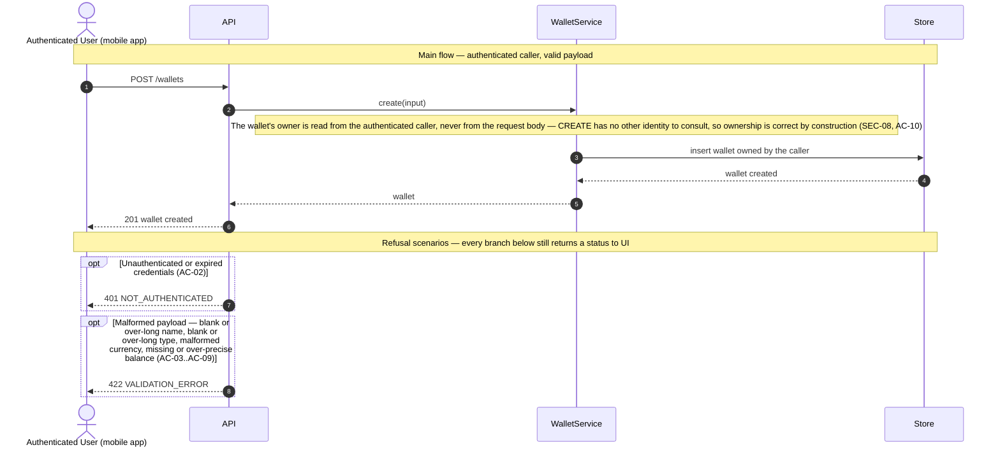
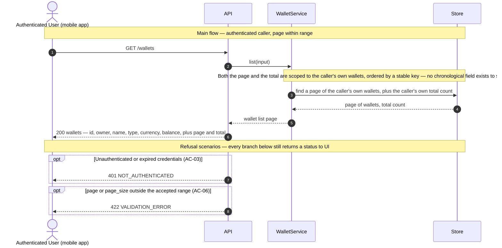
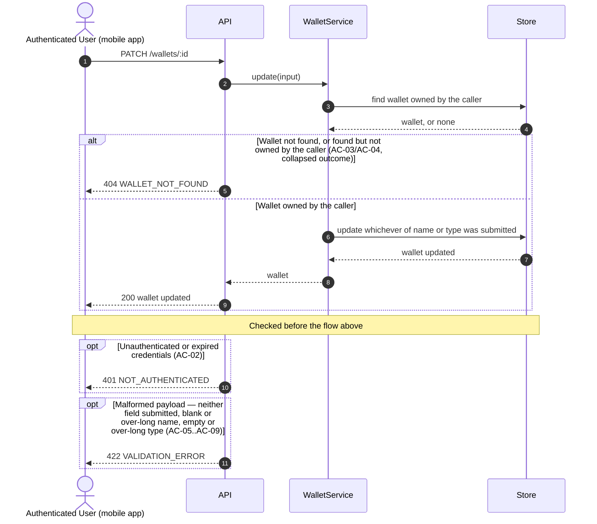
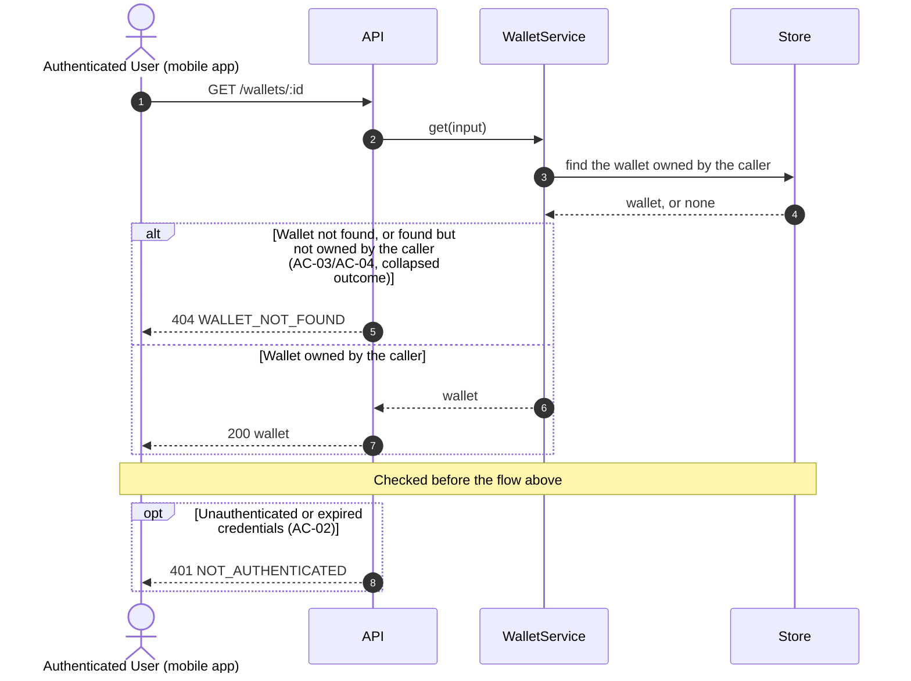
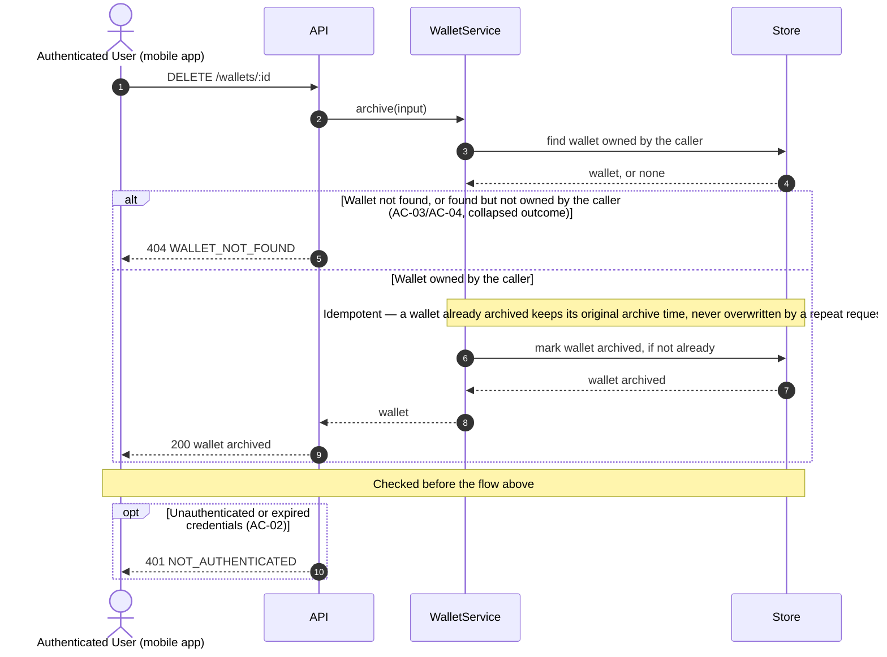

# Technical Plan: Wallet Management (WM)

> **Feature:** SRS §6 Feature-03 · SDS §5.3 (WM)
> **Spec:** [spec.md](spec.md)
> **Stories in this file:** WM-US-01 *(implemented, verified — 198 passed, 98% coverage)* · WM-US-02 *(implemented, verified — 302 passed, 99% coverage)* · WM-US-04 *(implemented, verified — 526 total passing)* · WM-US-03 *(implemented, verified — 581 total passing, 99% coverage)* · WM-US-05 *(design'd — artifacts phase only, not yet implemented)*

---

## WM-US-01: Create a Wallet

### Gaps & Decisions (Resolved)

Code and architecture decisions settled during design. Spec-level findings were folded back into `spec.md` before this step closed.

| ID | Area | Decision | Status |
|----|------|----------|--------|
| A1 | Domain | **`type` is a free-text bounded string, not a closed enum.** No SRS or SDS source names a fixed vocabulary — the Gherkin uses `"BANK"`, SDS §5.3.1's prose uses `"Checking, Cash, Credit Card"`, and the two are not even in the same casing convention. Inventing a closed enum (the way `UserStatus`/`UserRole`/`InvitationStatus` are modelled) would mean choosing the exact member set on the product owner's behalf, which is an extension, not an alignment (`CLAUDE.md` §1 "They are references, not contracts"). `WalletModel.type` is therefore `String(50)` with no `Enum`/`native_enum` column, and `WalletCreate.type` is a plain bounded `str` — no `native_enum=False` pattern applies because there is no enum to declare. Revisit if a future story specifies the real vocabulary. | ✅ Resolved |
| A2 | Domain | **`currency` is validated for ISO-4217 *shape* only — three uppercase letters — not against the real ISO-4217 list.** The only example either document gives is `"USD"`, which is consistent with the shape rule but does not by itself justify building or maintaining a currency table this story never asked for. `WalletCreate.currency: str = Field(pattern=r"^[A-Z]{3}$")`. No case-folding is applied (unlike `users.email`'s `normalize_email` — an email's casing is not part of its identity, but `"usd"` is not a currency code at all under this shape rule, so folding it would silently accept something that was never valid). | ✅ Resolved |
| A3 | Money | **`initial_balance` is a Pydantic `Decimal` field with `max_digits=15, decimal_places=2`, accepting either a JSON number or a JSON string** (Pydantic v2's default "smart" `Decimal` handling, which converts a JSON number via `Decimal(str(value))` rather than `Decimal(float_value)` — the step that would otherwise reintroduce binary floating-point artifacts). `decimal_places=2` is enforced by Pydantic's own constraint, which **rejects** an over-precise value (`decimal_max_places`) rather than rounding it — matching this codebase's standing precedent of reject-don't-truncate for every other bounded field (UM-US-01 EC-04, UM-US-02 EC-03, UM-US-03 A2). `max_digits=15` mirrors constitution VL-07's `DECIMAL(15,2)` exactly, so the DTO bound and the column bound cannot silently drift apart. | ✅ Resolved |
| A4 | Domain | **No sign constraint on `initial_balance`.** Neither the SRS Gherkin nor SDS §5.3.1 requires a positive balance, and a `"CREDIT"`-type wallet (A1 — type is free text, so nothing stops a User naming one this way) legitimately starts already in debt. Adding a `> 0` or `>= 0` check would be inventing a business rule no source states. Recorded rather than assumed, because every other bounded field in this story *does* reject out-of-range input, and a reader could otherwise wonder whether the omission here was intentional. | ✅ Resolved |
| A5 | Domain / ERD | **No `created_at` column is added to `wallets`.** SDS §4.3.3's ERD lists `wallets` with exactly `id`, `user_id`, `name`, `type`, `balance`, `currency` — no timestamp, unlike `users` and `invitations`, which both have one. This reads as a plausible oversight, but adding a column the ERD does not list is a domain-model change, which `CLAUDE.md` §1 requires stopping to ask about rather than deciding unilaterally ("changes the domain model or ERD" is one of the named break conditions). This story therefore ships **without** `created_at`: `WalletModel` has no such column, `WalletRead` has no such field, and there is no ordering guarantee for a future list story to rely on. If WM-US-02 (List Wallets) needs creation-order pagination, adding the column is that story's own decision to raise — not something inherited silently from here. | ✅ Resolved *(flagged, not closed — see spec.md Assumptions)* |
| A6 | Domain | **No uniqueness constraint on `wallets.name`**, not even scoped to one User. No AC, EC, or BR requires it (spec EC-07), so no unique index and no service-layer duplicate check are added — unlike `users.email` (UM-US-01 VL-05), which has an explicit uniqueness requirement this story's wallet name does not share. | ✅ Resolved |
| A7 | Security | **A client-supplied `user_id` in the request body is structurally impossible, not merely rejected.** `WalletCreate` declares no `user_id` field at all — the wallet's owner comes only from `CurrentUserDep`, resolved by the router exactly as every other protected route already does. An extra `user_id` key in the submitted JSON is silently ignored by Pydantic's default `BaseModel` behaviour (no `model_config = {"extra": "forbid"}` is set here, matching every existing schema in this codebase, none of which sets it either) — ownership is enforced by the DTO's shape, not by a validation rule that could be forgotten (constitution SEC-08, spec AC-10, BR-01). | ✅ Resolved |
| A8 | Security | **No role restriction.** `CurrentUserDep` — not `AdminDep` — guards this route. SRS §6 US-03-01 names the actor "Authenticated User" with no role qualifier, and SDS §5.3.1 tags the story "(USER)", meaning any authenticated account, not an ADMIN-only action the way UM-US-01/UM-US-03 are. An ADMIN account may also create its own wallet through this route; nothing in either reference document forbids it, and inventing a restriction would itself be scope creep. | ✅ Resolved |
| A9 | Architecture | **No audit event.** Constitution LA-04 enumerates exactly three audited event families — invitations sent, activations completed, logins — and wallet creation is not among them. No AC or FR in `spec.md` asks for one either. Adding a fourth audited event type here would be extending constitution LA-04 on this story's own authority, which is out of scope; a future story that wants wallet-creation auditing should amend LA-04 explicitly rather than inherit a precedent nobody asked for. | ✅ Resolved |

---

### Architecture

**Package layout** (additions only — every foundation module below already exists and is reused unchanged).

```text
backend/app/
├── models/
│   └── wallet.py                     # NEW  WalletModel (SDS §2.1, §2.2, §4.3.3)
├── schemas/
│   └── wallet.py                     # NEW  WalletCreate, WalletRead
├── repositories/
│   └── wallet_repo.py                # NEW  add_wallet()
├── services/
│   └── wallet_service.py             # NEW  create_wallet()
└── api/v1/
    ├── wallets.py                    # NEW  POST /wallets
    └── router.py                     # update: mount wallets.router

backend/migrations/versions/
└── <rev>_create_wallets.py           # NEW  wallets table (DOD-02)

backend/tests/
└── integration/test_wm_us_01_create_wallet.py   # NEW  written at the Implement step from test_cases.md
```

No change to `core/deps.py` — `CurrentUserDep` (`get_current_user`) already resolves any authenticated `ACTIVE` User of either role and is reused exactly as-is (A8).

**Domain objects**

| Entity | Table | Key Fields | Notes |
|--------|-------|------------|-------|
| `WalletModel` | `wallets` | `id` PK, `user_id` FK→`users.id` (indexed), `name`, `type`, `currency`, `balance` | No `created_at` (A5). `id` is `String(36)` UUID text, matching `UserModel`/`InvitationModel` (constitution ENV-03). `user_id` carries an index — every future query on this table filters by owner (constitution SEC-08, PF-02), even though this story only ever writes one row per request. |
| — | — | *(no new enum)* | `type` and `currency` are plain bounded strings, not `Enum` columns (A1, A2) — the first Wallet-adjacent field in this codebase with no closed vocabulary behind it. |

**DTOs** (`app/schemas/wallet.py`)

```python
class WalletCreate(BaseModel):
    # Trimmed and required non-empty after trimming (spec AC-03, EC-04);
    # bounded at the column width (spec AC-04).
    name: str = Field(min_length=1, max_length=100)

    # Free text, no enum (A1); bounded the same way as name (spec AC-05, AC-06).
    type: str = Field(min_length=1, max_length=50)

    # ISO-4217 shape only, no case-folding (A2; spec AC-07, EC-03).
    currency: str = Field(pattern=r"^[A-Z]{3}$")

    # Decimal(15,2), reject-don't-round (A3; spec AC-08, AC-09, constitution VL-07).
    initial_balance: Decimal = Field(max_digits=15, decimal_places=2)

class WalletRead(BaseModel):
    id: str
    user_id: str
    name: str
    type: str
    currency: str
    balance: Decimal
```

`name`'s trim is a `field_validator`, the same opt-in-per-field technique UM-US-02's `ActivateRequest.full_name` used — no model-wide `str_strip_whitespace`, so a future field that must **not** be trimmed (none exists yet in this story) stays safe by default. A trimmed-to-empty name still fails `min_length=1` inside the same validator, matching spec AC-03's "empty or only whitespace" wording.

**Business rules enforced in service layer**

| Rule | Source | Enforcement |
|------|--------|--------------|
| Authenticated User of any role may create a wallet | AC-01, FR-01, A8 | `POST /api/v1/wallets` accepting `WalletCreate`, guarded by `CurrentUserDep` — not `AdminDep` |
| Unauthenticated caller denied before the payload is evaluated | AC-02, FR-02 | `CurrentUserDep` resolves before FastAPI validates the body — identical ordering to every existing protected route |
| Name required, trimmed, bounded | AC-03, AC-04, EC-04, FR-03 | `WalletCreate` field validator: strip, reject empty, `max_length=100` |
| Type required, bounded, no enum | AC-05, AC-06, EC-05, FR-04, A1 | `Field(min_length=1, max_length=50)` — no `Enum`, so any non-empty value within the bound passes |
| Currency shape validated, no folding | AC-07, EC-03, FR-05, A2 | `Field(pattern=r"^[A-Z]{3}$")` — a lowercase or wrong-length value is a `422` before the service runs |
| Balance required, `Decimal(15,2)`, reject not round | AC-08, AC-09, EC-08, FR-06, A3, constitution VL-07 | `Field(max_digits=15, decimal_places=2)` — Pydantic's own constraint rejects both over-precise and over-wide input |
| No sign constraint | EC-01, EC-02, FR-07, A4 | No `gt=0` / `ge=0` on `initial_balance` — zero and negative values pass validation unchanged |
| Owner is always the caller, never client input | AC-10, FR-08, A7, constitution SEC-08 | `wallet_service.create_wallet(db, owner=current_user, ...)` reads `owner.id`; `WalletCreate` has no `user_id` field to read from instead |
| `initial_balance` maps to the stored `balance` column | FR-09 | `wallet_repo.add_wallet(..., balance=initial_balance)` — the DTO field and the column are different names for the same value, by design (SDS §6.2.1 vs §2.2) |
| Response exposes exactly six fields | AC-11, FR-10, constitution PF-03 | `WalletRead` — no ORM graph, no extra field |
| Every validation failure reported together | EC-06, FR-11, constitution VL-02 | Reuses the existing `RequestValidationError` handler in `main.py` — unchanged, no new wiring |
| No uniqueness constraint on name | EC-07, FR-12, A6 | No unique index on `wallets.name`; no service-layer duplicate check |
| No audit event | A9 | `wallet_service.create_wallet()` calls no `audit.record()` |

**Sequence diagram — Create a Wallet**

Drawn to `constitution.md` DG-01…DG-07: four lanes only, no SQL, no parameter lists, every request into `API` answered back to `UI` with a status code.



Only one workflow is drawn (DG-07) — there is no recovery path, supersession, or background step analogous to UM-US-01's re-invite or delivery-failure branches, because creating a wallet has no prior state to reconcile against.

**Error flows**

| Scenario | HTTP | Error Code |
|----------|------|------------|
| No or invalid bearer credentials (AC-02) | 401 | `NOT_AUTHENTICATED` |
| Blank or over-long name, blank or over-long type, malformed currency, missing or over-precise initial balance (AC-03..AC-09) | 422 | `VALIDATION_ERROR` |
| Unexpected server error | 500 | `INTERNAL_ERROR` |

All in the flat envelope `{"error_code", "message", "details"}` (SDS §6.6, constitution API-02) — reused unchanged from `main.py`. No `403` (A8: no role restriction) and no `409` (A6: no uniqueness to conflict on).

**Constitution notes**

| Rule | Status | Note |
|------|--------|------|
| AR-01 Service owns business rules | Required | `wallet_service.create_wallet()` is the only place that decides the owner and assembles the persisted row |
| AR-02 Thin router | Required | Router binds the payload, resolves `CurrentUserDep`, calls the service, commits, formats the response — no branching on business state |
| AR-03 Repository isolation | Required | `wallet_repo.add_wallet()` persists only; every validation rule already ran in the Pydantic layer or the service before it is called |
| AR-04 DTO ↔ model mapping outside routers/repos | Required | Field mapping (`initial_balance` → `balance`) happens in the service, not the router |
| AR-05 No framework objects in services | Required | `create_wallet()` takes plain values (`owner: UserModel`, `name`, `type`, `currency`, `initial_balance`); no `Request`/`Response` |
| AR-06 One transaction per request | Required | Service flushes; the router commits once — a single-row insert, but the same shape as every other story for consistency |
| AR-08 Module layout | Required | `backend/app/{models,schemas,repositories,services,api}` — no new top-level package |
| API-01 Versioned plural path | Required | `POST /api/v1/wallets` |
| API-02 Flat error envelope | Required | Reused from `main.py`, unchanged |
| API-03 Status codes | Required | `201` create · `401` · `422` validation |
| API-04 Prefixed error codes | N/A | This story introduces no new error code — `NOT_AUTHENTICATED` and `VALIDATION_ERROR` already exist |
| API-05 No generic status endpoint | Required | `/wallets` is a plain resource-creation `POST`, not a status-transition endpoint |
| API-06 Pagination | N/A | Single-resource creation; no list in this story |
| API-07 Explicit response_model | Required | `response_model=WalletRead`, `status_code=201` |
| API-08 Public endpoint list | Required | This route is **protected** — not added to the public list |
| NC-01 Module naming | Required | `wallet_repo.py`, `wallet_service.py` — singular, matching `user_repo.py`/`invitation_service.py` |
| NC-02 Naming | Required | `WalletModel`; `WalletCreate` / `WalletRead` (SDS §2.1); table `wallets` |
| NC-04 Column naming | Required | snake_case; `user_id` FK. No `created_at`/`updated_at` this story (A5) |
| NC-05 Enum serialisation | N/A | `type` and `currency` are plain strings, not enum columns (A1, A2) — there is no enum literal to serialise |
| NC-06 Concise service methods | Required | `WalletService.create`, matching `InvitationService.create_invitation`'s concision within its own module |
| VL-01 Pydantic is the source of truth | Required | Every bound (length, pattern, decimal shape) lives on `WalletCreate` |
| VL-02 Errors grouped | Required | Reused `RequestValidationError` handler (EC-06) |
| VL-07 Decimal money | Required | `Decimal`, `max_digits=15, decimal_places=2` on the DTO; `Numeric(15, 2)` on the column — first story in this codebase to touch money |
| SEC-06 JWT parameters | N/A | Consumed via `CurrentUserDep`, not defined here — reused unchanged from SS-US-01 |
| SEC-07 Authz proven by test | Required (partial) | `401` gets a dedicated test; there is no `403` case to test (A8) |
| SEC-08 Ownership filter | Required | The one row this story ever writes is scoped to the caller by construction (A7) — the read-side half of SEC-08 (filtering a *query* by `user_id`) has no query to filter yet and becomes real only with WM-US-02 |
| SEC-09 Secrets from .env | N/A | No secret is introduced by this story |
| SEC-10 No enumeration | N/A | No existence check against another User's data occurs here |
| SEC-11 Rate limiting | N/A | Scoped by its own text to the invitation and activation endpoints; nothing here brings this route into that scope |
| LA-01 No secrets in logs | N/A | No credential or token is handled by this story |
| LA-02 / LA-04 Audit | N/A (by decision) | Wallet creation is not one of LA-04's three named audited events, and no AC/FR asks for a fourth (A9) |
| PF-01 300 ms p95 | Required | No I/O off the request path is needed — a single insert, no SMTP, no `BackgroundTasks` |
| PF-02 Indexed lookups | Required | `wallets.user_id` indexed now, ahead of WM-US-02's need for it (PF-02's "columns used in WHERE… carry an index") |
| PF-03 DTO projection | Required | `WalletRead` — six fields, no ORM graph |
| TST-01/02 AC→TC coverage | Required | Every AC and EC mapped in `test_cases.md` before any test code |
| DOD-02 Migration | Required | One Alembic revision creating `wallets` |
| DOD-03 Coverage > 80% | Required | Measured at the Implement step |

**Element IDs**

| Element | ID | Status | File |
|---------|----|--------|------|
| — | — | **N/A (mobile deferred)** | No wallet-creation screen exists this round. `mobile/`'s fixture-driven prototype covers only UM-US-01's invite screen (`CLAUDE.md` §5); a wallet-creation screen is not part of Round 1's mobile scope and no SRS UXR names one. |

**Open tasks**

| ID | Task | File | Status |
|----|------|------|--------|
| T-01 | `WalletModel` (`id`, `user_id` FK indexed, `name`, `type`, `currency`, `balance` — no `created_at`, A5) | `backend/app/models/wallet.py` | Open |
| T-02 | Alembic revision creating `wallets` with its FK and index | `backend/migrations/versions/` | Open |
| T-03 | Schemas `WalletCreate`, `WalletRead` | `backend/app/schemas/wallet.py` | Open |
| T-04 | `wallet_repo.add_wallet(db, *, user_id, name, wallet_type, currency, balance)` | `backend/app/repositories/wallet_repo.py` | Open |
| T-05 | `wallet_service.create_wallet(db, *, owner, name, wallet_type, currency, initial_balance)` | `backend/app/services/wallet_service.py` | Open |
| T-06 | `POST /api/v1/wallets` router; mount `wallets.router` in `api/v1/router.py` | `backend/app/api/v1/wallets.py`, `backend/app/api/v1/router.py` | Open |
| T-07 | Integration tests written from `test_cases.md` | `backend/tests/integration/test_wm_us_01_create_wallet.py` | Open |

---

## WM-US-02: List Wallets

> **IDs in this section are local to WM-US-02** (`A*`/`T-NN`), matching `spec.md`'s convention. Only
> `TC-NN` and `QF-NN` in `test_cases.md` run continuously across **this epic file** — this story
> continues from `TC-22`/`QF-04`. (Note: `specs/001-user-onboarding/test_cases.md` resets `QF-NN`
> per story instead; each epic file's own header states which convention it uses — see
> `test_cases.md`'s note for why this file continues it.)

### Gaps & Decisions (Resolved)

| ID | Area | Decision | Status |
|----|------|----------|--------|
| A1 | Domain / ERD | **Ordering with no `created_at`: order by the primary key `id` ascending (`ORDER BY id ASC`), no schema change.** SDS §4.3.3's ERD lists `wallets` with exactly `id`, `user_id`, `name`, `type`, `balance`, `currency` — WM-US-01 `plan.md` A5 already flagged the missing timestamp and left it unfixed, since adding a column the ERD does not list is a domain-model change reserved for the user's own decision (`CLAUDE.md` §1). That still holds here, and unlike UM-US-03 (which reused a `created_at` column that already existed for unrelated reasons), no AC in either reference document asks for chronological order — only *a* list. Ordering by `id` gives a total, stable, gap-free, duplicate-free order across pages at zero schema cost, at the accepted cost of carrying no chronological meaning (full rationale: `spec.md` Assumptions; risk of a false impression of meaningful order: `test_cases.md` QF-06). A future story wanting creation-order is where `created_at` (or another explicit sort key) gets raised, per WM-US-01 A5's own anticipation. | ✅ Resolved |
| A2 | API | **New envelope `WalletListRead { items, total, page, page_size }`**, mirroring `UserListRead` (UM-US-03 A6) exactly. `WalletRead` itself is reused unchanged as the per-item shape — SDS §6.2.1 never enumerated its fields directly, but §2.1's traceability row already names it as Wallet's read DTO, and WM-US-01 is where its six fields were actually settled. | ✅ Resolved |
| A3 | Security / Architecture | **Pagination and ownership filtering combined for the first time in this codebase.** Both the bounded page query and the total-count query in `wallet_repo.list_owned()` carry the identical `WHERE user_id = :owner_id` predicate — copying UM-US-03's two-query shape (one count, one bounded select) but adding the ownership predicate WM-US-01's single-row lookup already established (`get_owned_by_id`). Scoping only one of the two queries would either leak a system-wide count next to a caller-scoped list, or scope the count but not the items — both wrong in different ways, which is why this is recorded as its own decision rather than assumed obvious (`test_cases.md` QF-05). | ✅ Resolved |
| A4 | Architecture | **The router issues no `db.commit()`.** Pure read, nothing to commit — mirrors `GET /users` (UM-US-03 A4) and `GET /users/activate`. | ✅ Resolved |
| A5 | Logging | **No new audit event for a list view.** Constitution LA-04 names exactly three audited event families (invitations sent, activations completed, logins); wallet creation itself was already excluded by WM-US-01 A9, and reading a list is further still from anything LA-04 enumerates. No AC or FR here asks for one. | ✅ Resolved |
| A6 | Security | **No role restriction — `CurrentUserDep` guards the route, not `AdminDep`.** SDS §5.3.2 tags this story "(USER)", identical to WM-US-01's own "(USER)" tag: any authenticated account, scoped to what it owns — not an ADMIN-wide view the way UM-US-03 is. An ADMIN caller who also owns wallets sees, through this route, only their own (spec EC-04, BR-01; `test_cases.md` QF-07); nothing elevates an ADMIN's visibility here, and inventing such an elevation would itself be scope creep no source document asks for. | ✅ Resolved |

---

### Architecture

**Package layout** (additions/updates only — WM-US-01's foundation is reused as-is unless noted;
**no new Alembic migration this story** — see note below).

```text
backend/app/
├── schemas/
│   └── wallet.py                     # update: add WalletListRead (A2)
├── repositories/
│   └── wallet_repo.py                # update: add list_owned(db, *, user_id, page, page_size)
└── services/
    └── wallet_service.py             # update: add list_wallets()

backend/app/api/v1/
└── wallets.py                        # update: add GET /wallets (list)

backend/tests/
└── integration/test_wm_us_02_list_wallets.py   # NEW  written at the Implement step from test_cases.md
```

No change to `core/deps.py` — `CurrentUserDep` is reused exactly as WM-US-01 already established
(A6). **No new Alembic revision**: this story adds no column and needs no new index —
`wallets.user_id` already carries one (WM-US-01 T-01/T-02), and ordering by the primary key `id`
needs nothing beyond what every table already has (constitution PF-02 — a primary key is indexed by
construction on both SQLite and PostgreSQL).

**Domain objects**

| Entity | Table | Fields touched | Notes |
|--------|-------|-----------------|-------|
| `WalletModel` | `wallets` | none (read-only) | This story only reads. No new column — ordering uses the existing `id` primary key (A1), not a new `created_at`. |
| `WalletRead` (DTO) | — | `id`, `user_id`, `name`, `type`, `currency`, `balance` | Reused unchanged from WM-US-01 — the same six fields; no list-specific per-item variant (A2). |
| `WalletListRead` (DTO) | — | `items: WalletRead[]`, `total`, `page`, `page_size` | New envelope (A2), mirrors `UserListRead` (UM-US-03 A6) — not in SDS's registry. |

**DTOs** (`app/schemas/wallet.py`, addition)

```python
class WalletListRead(BaseModel):
    """New envelope (A2) — mirrors UserListRead (UM-US-03 plan.md A6). Not in
    SDS's DTO registry, which names only WalletCreate directly in §6.2.1;
    WalletRead's own six fields were settled in WM-US-01, reused unchanged here.
    """

    items: list[WalletRead]
    total: int
    page: int
    page_size: int
```

**Business rules enforced in service layer**

| Rule | Source | Enforcement |
|------|--------|--------------|
| Any authenticated User of any role may list their own wallets | AC-01, FR-01, A6 | `GET /api/v1/wallets` guarded by `CurrentUserDep` — not `AdminDep`, mirrors WM-US-01's own route guard |
| Unauthenticated caller denied before any query parameter is evaluated | AC-03, FR-03 | `CurrentUserDep` resolves before FastAPI validates `page`/`page_size` — identical ordering to `GET /users` (UM-US-03 TC-61) |
| Every wallet query scoped to the caller — items and total alike | AC-07, FR-07, FR-10, A3, constitution SEC-08 | `wallet_repo.list_owned()` — both queries carry `WHERE user_id = :owner_id` |
| Bounded, paginated results | AC-04, AC-05, AC-06, API-06, PF-04 | Router declares `Query(page, ge=1)` / `Query(page_size, ge=1, le=100)` — out-of-range is `422`, not clamped, matching UM-US-03 A2's precedent |
| Stable, deterministic order | AC-08, EC-03, BR-03, A1 | `ORDER BY id ASC` in `wallet_repo.list_owned()` — the one column guaranteed unique and present without a schema change |
| Accurate, caller-scoped total | AC-01, AC-02, AC-04, AC-05, EC-01, A3, BR-04 | `wallet_repo.list_owned()` computes the count under the identical `user_id` predicate as the page query |
| Projection reused unchanged | AC-09, FR-02, PF-03 | `WalletRead` — the same six fields WM-US-01 defined, no new or missing field |
| Pure read, no commit | A4 | Router issues no `db.commit()` — mirrors `GET /users` |

**Repository** (`app/repositories/wallet_repo.py`, addition)

```python
def list_owned(
    db: Session, *, user_id: str, page: int, page_size: int
) -> tuple[Sequence[WalletModel], int]:
    """A page of wallets owned by `user_id`, plus that owner's own total count
    (spec AC-01, AC-04, AC-05, AC-07; plan.md A1, A3).

    Both queries carry the identical `user_id` predicate (constitution SEC-08)
    — the total is the caller's own wallet count, never the system-wide row
    count (test_cases.md QF-05). Ordered by `id`, the one column guaranteed to
    exist and be unique without a schema change (A1); this order carries no
    chronological meaning.
    """
    total = db.scalar(
        select(func.count())
        .select_from(WalletModel)
        .where(WalletModel.user_id == user_id)
    ) or 0
    items = db.scalars(
        select(WalletModel)
        .where(WalletModel.user_id == user_id)
        .order_by(WalletModel.id.asc())
        .offset((page - 1) * page_size)
        .limit(page_size)
    ).all()
    return items, total
```

**Service** (`app/services/wallet_service.py`, addition)

```python
def list_wallets(db: Session, *, owner: UserModel, page: int, page_size: int) -> WalletListRead:
    """Assemble a page of the caller's own wallets into the WalletListRead
    envelope (A2, A3).

    Unlike `user_service.list_users`, this calls no `clock.ensure_aware()` —
    `WalletRead` carries no datetime field to normalise (WM-US-01 A5).
    """
    items, total = wallet_repo.list_owned(db, user_id=owner.id, page=page, page_size=page_size)
    return WalletListRead(
        items=[
            WalletRead(
                id=w.id,
                user_id=w.user_id,
                name=w.name,
                type=w.type,
                currency=w.currency,
                balance=w.balance,
            )
            for w in items
        ],
        total=total,
        page=page,
        page_size=page_size,
    )
```

**Router** (`app/api/v1/wallets.py`, addition)

```python
@router.get(
    "",
    response_model=WalletListRead,
    status_code=status.HTTP_200_OK,
    summary="List the caller's wallets",
    description=(
        "Returns every wallet owned by the authenticated caller, paginated, "
        "with an accurate total scoped to that caller."
    ),
    responses={
        401: {"description": "NOT_AUTHENTICATED"},
        422: {"description": "VALIDATION_ERROR"},
    },
)
def list_wallets(
    db: DbDep,
    current_user: CurrentUserDep,
    page: int = Query(1, ge=1),
    page_size: int = Query(25, ge=1, le=100),
) -> WalletListRead:
    """Pure read — no `db.commit()` (A4)."""
    return wallet_service.list_wallets(db, owner=current_user, page=page, page_size=page_size)
```

**Sequence diagram — List Wallets**

Drawn to `constitution.md` DG-01…DG-07: four lanes only, no SQL, no parameter lists, every request
into `API` answered back to `UI` with a status code.



Only one workflow is drawn (DG-07) — there is no recovery path or background step, the same shape
WM-US-01's own diagram already established for a story with no prior state to reconcile against.

**Error flows**

| Scenario | HTTP | Error Code |
|----------|------|------------|
| No or invalid bearer credentials (AC-03) | 401 | `NOT_AUTHENTICATED` |
| `page` or `page_size` not a positive integer, or `page_size` > 100 (AC-06) | 422 | `VALIDATION_ERROR` |
| Unexpected server error | 500 | `INTERNAL_ERROR` |

No new error class this story — all three codes already exist in `core/errors.py`, reused as-is. All
in the flat envelope `{"error_code", "message", "details"}` (SDS §6.6, constitution API-02). No `403`
(A6: no role restriction) and no `409` (a read has nothing to conflict on).

**Constitution notes**

| Rule | Status | Note |
|------|--------|------|
| AR-01 Service owns business rules | Required | `wallet_service.list_wallets()` assembles the DTO; the repository does not decide *what* to enforce |
| AR-02 Thin router | Required | Router binds `page`/`page_size`, resolves `CurrentUserDep`, delegates, formats the response — no branching on business state |
| AR-03 Repository isolation | Required | `wallet_repo.list_owned()` is a query only — filtering, ordering, and limiting, no business rule |
| AR-04 DTO ↔ model mapping outside routers/repos | Required | `WalletModel` → `WalletRead` mapping happens in `wallet_service.list_wallets()`, not the router or `wallet_repo.list_owned()` |
| AR-05 No framework objects in services | Required | `list_wallets()` takes plain `owner: UserModel`, `page`, `page_size`; no `Request`/`Response` |
| AR-06 One transaction per request | N/A | Pure read, nothing to commit (A4) |
| AR-07 router → service → repository | Required | Router never calls `wallet_repo` directly |
| AR-08 Module layout | Required | No new top-level package; additions only to existing modules |
| API-01 Versioned plural path | Required | `GET /api/v1/wallets` |
| API-02 Flat error envelope | Required | Reused from `main.py`, unchanged |
| API-03 Status codes | Required | `200` read · `401` · `422` validation |
| API-04 Prefixed error codes | N/A | No new error code — `NOT_AUTHENTICATED` and `VALIDATION_ERROR` already catalogued |
| API-05 No generic status endpoint | Required | `GET /wallets` is a plain resource-listing route, not a status-transition endpoint |
| API-06 Pagination | Required | `page`/`page_size`, default 25, max 100, total count in `WalletListRead` — this story's central constitution citation |
| API-07 Explicit response_model | Required | `response_model=WalletListRead`, `status_code=200` |
| API-08 Public endpoint list | Required | This route is **protected** — not added to the public list |
| NC-01 Module naming | Required | No new module; additions to `wallet_repo.py`/`wallet_service.py`/`wallets.py` |
| NC-02 Naming | Required | `WalletListRead` (SDS §2.1 names `WalletRead`; the envelope is new, A2) |
| NC-04 Column naming | N/A | No column change this story |
| NC-06 Concise service methods | Required | `wallet_service.list_wallets`, matching this codebase's own already-established style (`wallet_service.create_wallet`, `user_service.list_users`) rather than the fully class-concise `WalletService.list` the rule's own illustration would suggest — consistent with how WM-US-01's own plan.md already resolved this same tension |
| VL-01 Pydantic is the source of truth | Required | `Query(ge=1, le=100)` constraints are the validation, not a service-layer clamp |
| VL-02 Errors grouped | Required | Reused `RequestValidationError` handler |
| SEC-07 Authz proven by test | Required (partial) | `401` gets a dedicated test; there is no `403` case in this story (A6 — no role restriction) |
| SEC-08 Ownership filter | Required | First story to combine this with pagination (A3) — both the page query and the total-count query carry the `user_id` predicate |
| SEC-10 No enumeration | N/A | This endpoint takes no email or identifying parameter to probe |
| SEC-11 Rate limiting | N/A | Scoped by its own text to the invitation and activation endpoints |
| LA-01 No secrets in logs | N/A | No credential or token is handled by this story |
| LA-02 / LA-04 Audit | N/A (by decision) | Listing is not one of LA-04's three named audited events (A5) |
| PF-01 300 ms p95 | Required | No slow I/O in this path; a two-query read, both indexed |
| PF-02 Indexed lookups | Required | `wallets.user_id` already indexed (WM-US-01); `id` (the sort key) is the primary key, indexed by construction — no new migration |
| PF-03 DTO projection | Required | `WalletRead` — six fields, no ORM graph |
| PF-04 Bounded lists | Required | Enforced by API-06's cap — this story's other central citation |
| TST-01/02 AC→TC coverage | Required | Every AC and EC mapped in `test_cases.md` before any test code |
| TST-05 Boundaries | Required | EC-02 covers the exact `page_size=100` boundary; AC-06 covers zero/negative |
| DOD-02 Migration | N/A | No column or index change this story (see Architecture note) |
| DOD-03 Coverage > 80% | Required | Measured at the Implement step |

**Element IDs**

| Element | ID | Status | File |
|---------|----|--------|------|
| — | — | **N/A (mobile deferred)** | No wallet-list screen exists this round, the same treatment WM-US-01 gave wallet creation — `mobile/`'s fixture-driven prototype covers only UM-US-01's invite screen (`CLAUDE.md` §5). |

**Open tasks**

| ID | Task | File | Status |
|----|------|------|--------|
| T-01 | `WalletListRead` envelope (A2) | `backend/app/schemas/wallet.py` | Open |
| T-02 | `wallet_repo.list_owned(db, *, user_id, page, page_size)` — ownership-scoped page + total (A1, A3) | `backend/app/repositories/wallet_repo.py` | Open |
| T-03 | `wallet_service.list_wallets(db, *, owner, page, page_size) -> WalletListRead` (A2, A3) | `backend/app/services/wallet_service.py` | Open |
| T-04 | `GET /api/v1/wallets` router — `Query(page, ge=1)` / `Query(page_size, ge=1, le=100)`, guarded by `CurrentUserDep`, no `db.commit()` (A4, A6) | `backend/app/api/v1/wallets.py` | Open |
| T-05 | Integration tests written from `test_cases.md` | `backend/tests/integration/test_wm_us_02_list_wallets.py` | Open |

---

## WM-US-04: Update a Wallet

> **IDs in this section are local to WM-US-04** (`A*`/`T-NN`), continuing the demonstrated convention:
> every second-or-later story in this file restarts `A*`/`T-NN` locally, while `test_cases.md`'s `TC-NN`
> and `QF-NN` run continuously across the epic file. `test_cases.md`'s `TC-NN` below continues from
> `TC-39` and `QF-NN` from `QF-07`, matching WM-US-02's own `TC-23`/`QF-05` start — confirmed by direct
> count against `test_cases.md`'s actual current end before writing this section, not assumed.

### Gaps & Decisions (Resolved)

| ID | Area | Decision | Status |
|----|------|----------|--------|
| A1 | Domain / Scope | **Only `name` and `type` are updatable; `currency` and `balance` have no corresponding field on the request DTO at all.** `balance` is a derived ledger total, mutated exclusively by `wallet_repo.decrement_balance()`/`increment_balance()` from Transaction creation/deletion (TM-US-01) — never by any Wallet Management story — so exposing it here would let a caller falsify their own ledger with no matching Transaction row. `currency` is excluded for a stronger reason: `TransactionRead`/`TransactionModel` carry no currency field of their own at all (confirmed in `backend/app/schemas/transaction.py`), so every transaction's amount is interpreted entirely through its wallet's *current* currency — changing it after transactions exist would silently re-denominate every past amount with no conversion. Neither exclusion is asked for by any source, but SDS §5.3.4's own "rename or update **configuration**" wording supports the narrower reading, matching BM-US-04 A1's "fewest invented rules" discipline. No uniqueness re-validation risk exists the way BM-US-04 A1 had to reason through for Budget's triple key — WM-US-01 BR-05 already established wallet names carry no uniqueness constraint at all. Full reasoning in `spec.md` Assumptions. | ✅ Resolved |
| A2 | API | **`PATCH /api/v1/wallets/{wallet_id}` — a verb-free path on the resource's own id, not a `/wallets/{id}/rename`-style action endpoint, and not a generic `PATCH /wallets/{id}` accepting a status field.** `name`/`type` are concrete business fields, not a state/status field — `Wallet` has no status field at all for this endpoint to touch — so constitution API-05's concern (collapsing a *business state transition* into a generic setter) does not apply, the identical reasoning BM-US-04 A2 used for `amount_limit`. `PATCH` (not `PUT`) because the request is a partial update of one or two fields on a six-field resource. | ✅ Resolved |
| A3 | Architecture | **No new repository *read* function — `wallet_repo.get_owned_by_id(db, *, wallet_id, user_id)` is reused unchanged.** It already exists (built for BM-US-01's own referenced-wallet check) and already collapses "no such wallet" and "exists, owned by someone else" to the identical `None` by construction (constitution SEC-08) — exactly the lookup this story's own "fetch the wallet being acted on" need requires, with nothing to generalise the way BM-US-04 A3 had to generalise a *budget*-scoped version from scratch. Only a new *write* function, `wallet_repo.update_wallet()`, is added. | ✅ Resolved |
| A4 | API / Domain | **New request DTO `WalletUpdate` with two optional fields, `name` and `type`, each validated by the identical bounds `WalletCreate` already carries (WM-US-01), plus a new model-level validator requiring at least one of the two to be present.** Unlike `BudgetUpdate` (BM-US-04 A6), which had exactly one *required* field, this story has two fields that must each be independently optional — a caller may rename only, retype only, or both. A submission with neither is refused (spec AC-05, BR-04), generalising BM-US-04 A6's "a zero-field update is not a no-op `200`" stance from one required field to two optional ones. This is the **first model-level (cross-field) Pydantic validator in this codebase** — every prior DTO validation has been field-level only. | ✅ Resolved |
| A5 | Security / API | **One new error class: `WalletNotFoundError` (404, `WALLET_NOT_FOUND`).** Neither existing wallet-adjacent error fits: `BudgetWalletNotFoundError` (BM-US-01) and `TransactionWalletNotFoundError` (TM-US-01) are each about a *referenced* wallet failing to resolve during another entity's creation — not about the wallet being updated itself — and both carry a resource-prefixed error code (`BUDGET_`/`TRANSACTION_`) that would be actively misleading if raised from this endpoint. `WalletNotFoundError` is constitution VL-06's "404 if absent" branch, applied to the wallet's own id directly for the first time — the identical reasoning BM-US-04 A7 used to justify its own new `BudgetNotFoundError` over the existing `BudgetWalletNotFoundError`/`BudgetCategoryNotFoundError`. | ✅ Resolved |
| A6 | Security | **No role restriction — `CurrentUserDep` guards the route, not `AdminDep`.** SDS §5.3.4 tags this story "(USER)", identical to WM-US-01/02's own tag. Mirrors WM-US-01 A8, WM-US-02 A6, BM-US-04 A9. | ✅ Resolved |
| A7 | Logging | **No new audit event.** Constitution LA-04 names exactly three audited event families; neither wallet creation (WM-US-01 A9) nor listing (WM-US-02 A5) qualified, and updating a name/type is no closer to any of the three than those were. No AC or FR here asks for one. | ✅ Resolved |
| A8 | Architecture | **No new Alembic migration.** `name`, `type`, `currency`, and `balance` already exist as columns on `wallets` (WM-US-01 T-01) — this story changes values in existing columns, not the schema. | ✅ Resolved |
| A9 | Architecture | **The router issues exactly one `db.commit()`, after the service call succeeds** — identical to WM-US-01's `create_wallet` router and BM-US-04's `update_budget` router (AR-06). `wallet_service.update_wallet()` itself only flushes (via A3's `update_wallet()` repository function), never commits. | ✅ Resolved |
| A10 | Domain | **`WalletUpdate.type`'s validation reuses `WalletCreate.type`'s exact shape — `Field(min_length=1, max_length=50)`, no trim/whitespace-rejection validator.** `backend/app/schemas/wallet.py` confirms `WalletCreate.type` has no equivalent to `WalletCreate.name`'s trim-and-reject `field_validator` — a single-space `type` already passes uncaught at creation time today, even though WM-US-01 `spec.md` AC-05's own wording says type must be rejected when "absent, empty, or only whitespace." That gap belongs to WM-US-01 (already implemented, verified, out of this story's scope to correct); inventing stricter, asymmetric validation for `type` on update alone would be a new, undiscussed inconsistency, not a fix. `spec.md` AC-08 is worded to match what is actually enforced ("empty," not "blank or only whitespace"). | ✅ Resolved |
| A11 | API / Domain | **Explicit JSON `null` for `name`/`type` is treated identically to the key being omitted — both mean "leave this field unchanged."** Neither field can be set to a blank/null value through `WalletCreate` in the first place (both are mandatory, non-empty at the model layer), so there is no distinct "clear the field" semantics for `WalletUpdate` to invent — doing so would be a new rule no source asks for. | ✅ Resolved |

---

### Architecture

**Package layout** (additions only — no new top-level module, no migration; the first story in this
epic to add a route with a path parameter and the first to modify an existing row).

```text
backend/app/
├── schemas/
│   └── wallet.py                     # update: add WalletUpdate (A4)
├── repositories/
│   └── wallet_repo.py                # update: add update_wallet() (A3) — get_owned_by_id() reused unchanged
├── services/
│   └── wallet_service.py             # update: add update_wallet() (A1, A3)
├── core/
│   └── errors.py                     # update: add WalletNotFoundError (A5)
└── api/v1/
    └── wallets.py                    # update: add PATCH /wallets/{wallet_id} (A2, A6)

backend/tests/
└── integration/test_wm_us_04_update_wallet.py   # NEW  written at the Implement step from test_cases.md
```

No change to `models/wallet.py` (A8), no new Alembic revision, no change to `core/deps.py` —
`CurrentUserDep` is reused exactly as WM-US-01/02 already established (A6).

**Domain objects**

| Entity | Table | Fields touched | Notes |
|--------|-------|-----------------|-------|
| `WalletModel` | `wallets` | `name`, `type` (write) | The only two columns this story ever writes. `currency`/`balance` are read (to echo in the response) but never written by this story (A1, spec BR-01). No schema change (A8). |
| `WalletUpdate` (DTO) | — | `name`, `type` (both optional) | New request DTO (A4) — at most two fields, at least one required. |
| `WalletRead` (DTO) | — | *(reused, unchanged)* | WM-US-01's own six-field response shape, reused for this write's response too (mirrors BM-US-04 A5). |

**DTO addition** (`app/schemas/wallet.py`)

```python
class WalletUpdate(BaseModel):
    """Request DTO for PATCH /wallets/{wallet_id} (WM-US-04). Both fields are
    optional -- None means "leave this field's stored value unchanged,"
    whether the key was omitted or submitted explicitly as null (plan.md
    A11). `currency`/`balance` have no corresponding field at all (plan.md
    A1) -- a caller cannot even name them meaningfully; any such key
    submitted anyway is silently ignored by Pydantic's default BaseModel
    behaviour (spec EC-07).

    Validation identical to WalletCreate's own name/type bounds (WM-US-01),
    reused unchanged -- including type's own lack of a trim/whitespace
    validator (plan.md A10).
    """

    name: str | None = Field(default=None, min_length=1, max_length=100)
    type: str | None = Field(default=None, min_length=1, max_length=50)

    @field_validator("name")
    @classmethod
    def validate_name(cls, v: str | None) -> str | None:
        """Mirrors WalletCreate.validate_name exactly, applied only when a
        value is actually submitted (spec AC-06, EC-01)."""
        if v is None:
            return None
        trimmed = v.strip()
        if not trimmed:
            raise ValueError("Wallet name cannot be empty or whitespace only")
        return trimmed

    @model_validator(mode="after")
    def check_at_least_one_field(self) -> "WalletUpdate":
        """spec AC-05, BR-04 (plan.md A4) -- the first model-level (as
        opposed to field-level) validator in this codebase. A submission
        naming neither name nor type has nothing for this endpoint to do,
        and is refused rather than silently treated as a no-op 200."""
        if self.name is None and self.type is None:
            raise ValueError("At least one of name or type must be provided")
        return self
```

**Repository addition** (`app/repositories/wallet_repo.py`)

```python
def update_wallet(
    db: Session, *, wallet: WalletModel, name: str | None, wallet_type: str | None
) -> WalletModel:
    """spec AC-01, FR-05, FR-06, FR-07, FR-10, BR-01 (plan.md A1, A3). Mutates
    only the field(s) actually submitted on an already-fetched,
    already-ownership-verified row -- currency and balance are never
    touched, and a field left as None keeps its existing stored value
    exactly. Flushed, not committed (AR-06) -- the router owns the
    transaction boundary.
    """
    if name is not None:
        wallet.name = name
    if wallet_type is not None:
        wallet.type = wallet_type
    db.add(wallet)
    db.flush()
    return wallet
```

`get_owned_by_id(db, *, wallet_id, user_id)` is reused **unchanged** from WM-US-01/BM-US-01's own
precedent (A3) — no new read function is needed, since it already collapses "no such wallet" and "not
this caller's wallet" to the identical `None`, by construction, for exactly the lookup this story needs.

**Service** (`app/services/wallet_service.py`, addition)

```python
def update_wallet(
    db: Session,
    *,
    owner: UserModel,
    wallet_id: str,
    name: str | None,
    wallet_type: str | None,
) -> WalletRead:
    """spec AC-01, FR-03 (plan.md A1, A3, A4). Looks up the wallet scoped to
    the caller, then updates whichever of name/type was actually submitted
    -- no further precondition follows ownership, the same shape BM-US-04's
    own update_budget() already established.
    """
    wallet = wallet_repo.get_owned_by_id(db, wallet_id=wallet_id, user_id=owner.id)
    if wallet is None:
        raise WalletNotFoundError()

    wallet = wallet_repo.update_wallet(db, wallet=wallet, name=name, wallet_type=wallet_type)
    return WalletRead(
        id=wallet.id,
        user_id=wallet.user_id,
        name=wallet.name,
        type=wallet.type,
        currency=wallet.currency,
        balance=wallet.balance,
    )
```

**Router** (`app/api/v1/wallets.py`, addition)

```python
@router.patch(
    "/{wallet_id}",
    response_model=WalletRead,
    status_code=status.HTTP_200_OK,
    summary="Update a wallet",
    description=(
        "Updates the name, the type, or both, of one of the authenticated "
        "caller's own wallets, identified by its own id. The wallet's "
        "currency and balance are immutable through this endpoint."
    ),
    responses={
        401: {"description": "NOT_AUTHENTICATED"},
        404: {"description": "WALLET_NOT_FOUND"},
        422: {"description": "VALIDATION_ERROR"},
    },
)
def update_wallet(
    wallet_id: str,
    payload: WalletUpdate,
    db: DbDep,
    current_user: CurrentUserDep,
) -> WalletRead:
    result = wallet_service.update_wallet(
        db,
        owner=current_user,
        wallet_id=wallet_id,
        name=payload.name,
        wallet_type=payload.type,
    )
    db.commit()
    return result
```

**New error** (`app/core/errors.py`, appended under a new `# --- WM-US-04: Update a Wallet` section)

```python
class WalletNotFoundError(AppError):
    """spec AC-03 / AC-04 / FR-03. Identical for "no such wallet" and "not
    this caller's wallet" (constitution VL-06's `404 if absent` branch) --
    distinct from BudgetWalletNotFoundError/TransactionWalletNotFoundError,
    which cover a *referenced* wallet failing to resolve during another
    entity's creation, not the wallet being acted on directly (plan.md A5).
    """

    status_code = 404
    error_code = "WALLET_NOT_FOUND"
    default_message = "The referenced wallet was not found."
```

**Business rules enforced in service layer**

| Rule | Source | Enforcement |
|------|--------|--------------|
| Authenticated User of any role may update their own wallet's name/type | AC-01, FR-01, A6 | `PATCH /api/v1/wallets/{wallet_id}` guarded by `CurrentUserDep` — not `AdminDep` |
| Unauthenticated caller denied before anything else is evaluated | AC-02, FR-02 | `CurrentUserDep` resolves before the body is validated |
| `wallet_id` must resolve to the caller's own wallet; not-found and not-owned collapsed | AC-03, AC-04, EC-03, EC-08, FR-03, A3 | `wallet_repo.get_owned_by_id()` returns `None` for both cases by construction; service raises `WalletNotFoundError` |
| At least one of name/type required | AC-05, FR-04, BR-04, A4 | `WalletUpdate`'s model-level validator |
| name: non-empty after trim, ≤100, when submitted | AC-06, AC-07, EC-01, FR-05 | `WalletUpdate.name`'s `Field` bound + reused `field_validator` |
| type: non-empty, ≤50, no enum, when submitted | AC-08, AC-09, EC-02, FR-06, A10 | `WalletUpdate.type`'s `Field` bound — identical shape to `WalletCreate.type` |
| currency/balance never change; any submitted value ignored | AC-10, EC-07, FR-07, A1 | `WalletUpdate` declares no such field; `update_wallet()` touches only `name`/`type` |
| Unsubmitted field keeps its exact prior value | EC-04, EC-05, FR-10 | `wallet_repo.update_wallet()`'s `if … is not None` guards |
| Response exposes exactly six fields | AC-11, FR-08, constitution PF-03 | `WalletRead` — no ORM graph, no extra field |
| No audit event | A7 | `wallet_service.update_wallet()` calls no `audit.record()` |

**Sequence diagram — Update a Wallet**

Drawn to `constitution.md` DG-01…DG-07: four lanes only, no SQL, no parameter lists, every request into
`API` answered back to `UI` with a status code, one workflow.



Only one workflow is drawn (DG-07). The nested `alt`/`else` blocks are the one flow's own branches — not
a second flow — mirroring how BM-US-04's own diagram folded its own refusal paths into a single picture.

**Error flows**

| Scenario | HTTP | Error Code |
|----------|------|------------|
| No or invalid bearer credentials (AC-02) | 401 | `NOT_AUTHENTICATED` |
| Neither name nor type submitted, blank/over-long name, empty/over-long type (AC-05..AC-09) | 422 | `VALIDATION_ERROR` |
| Wallet not found, or found but not owned by the caller (AC-03, AC-04) | 404 | `WALLET_NOT_FOUND` |
| Unexpected server error | 500 | `INTERNAL_ERROR` |

All in the flat envelope `{"error_code", "message", "details"}` (SDS §6.6, constitution API-02). No
`403` (A6: no role restriction), and no `409` of any kind — wallet names carry no uniqueness constraint
to reopen (WM-US-01 BR-05), so this endpoint produces only `200`, `401`, `404`, `422`, or `500`.

**Constitution notes**

| Rule | Status | Note |
|------|--------|------|
| AR-01 Service owns business rules | Required | `wallet_service.update_wallet()` is the only place that decides what a failed lookup means and which field(s) to write |
| AR-02 Thin router | Required | Router binds the path param and payload, resolves `CurrentUserDep`, calls the service, commits, formats the response — no branching on business state |
| AR-03 Repository isolation | Required | `wallet_repo.get_owned_by_id()`/`update_wallet()` are queries and persistence only (A3) |
| AR-04 DTO ↔ model mapping outside routers/repos | Required | `WalletModel` → `WalletRead` mapping happens in `wallet_service.update_wallet()`, the same place `create_wallet()`/`list_wallets()` already do it |
| AR-05 No framework objects in services | Required | `update_wallet()` takes plain values (`owner`, `wallet_id`, `name`, `wallet_type`); no `Request`/`Response` |
| AR-06 One transaction per request | Required | Service flushes at most once (after the ownership lookup succeeds); the router commits once (A9) |
| AR-07 Router → service → repository | Required | The router never calls `wallet_repo` directly |
| AR-08 Module layout | Required | No new top-level package; additions only to existing modules |
| API-01 Versioned plural path | Required | `PATCH /api/v1/wallets/{wallet_id}` |
| API-02 Flat error envelope | Required | Reused from `main.py`, unchanged |
| API-03 Status codes | Required | `200` update (not `201`) · `401` · `404` · `422` |
| API-04 Prefixed error codes | Required | `WALLET_NOT_FOUND` — catalogued above |
| API-05 No generic status endpoint | Required (reasoned) | See A2 — `name`/`type` are concrete business fields, not a state-machine status; `Wallet` has no status field at all for this endpoint to touch; a partial `PATCH` on the resource's own id is the default shape constitution NC-03 reserves verb-named endpoints *from* |
| API-06 Pagination | N/A | Single-resource update; no list in this story |
| API-07 Explicit response_model | Required | `response_model=WalletRead`, `status_code=200` |
| API-08 Public endpoint list | Required | This route is **protected** — not added to the public list |
| NC-01 Module naming | Required | No new module; additions to `wallet_repo.py`/`wallet_service.py`/`wallets.py`/`errors.py` |
| NC-02 Naming | Required | `WalletUpdate` new (SDS §2.1/§6.2.1 has no registry entry for it, the same gap WM-US-02 A2 already found for `WalletListRead`); `WalletRead` reused unchanged |
| NC-03 No verbs except state transitions | Required | `/wallets/{wallet_id}` — no verb in the path (A2) |
| NC-04 Column naming | N/A | No column renamed; no column added (A8) |
| NC-05 Enum serialisation | N/A | No enum touched by this story — `type` remains a plain bounded string (WM-US-01 A1) |
| NC-06 Concise service methods | Required | `wallet_service.update_wallet`, matching `create_wallet`/`list_wallets`'s own naming |
| VL-01 Pydantic is the source of truth | Required | `WalletUpdate`'s `Field` bounds and model-level validator are the validation |
| VL-02 Errors grouped | Required | Reused `RequestValidationError` handler — covers both fields' failures together (EC-09) |
| VL-06 Referenced entities verified before use | Required (404 only) | `404` if the wallet is absent/not owned (A3) — the only branch this story uses; no "wrong state" / `409` branch applies (no status field, no uniqueness constraint to reopen — spec.md Assumptions) |
| VL-07 Decimal money | N/A | This story's contract has no monetary field at all — `balance` is explicitly excluded (A1) — the first write-shaped story in this codebase's Wallet/Budget/Transaction lineage to touch no `Decimal` value whatsoever |
| SEC-06 JWT parameters | N/A | Consumed via `CurrentUserDep`, not defined here |
| SEC-07 Authz proven by test | Required (partial) | `401` gets a dedicated test; there is no `403` case to test (A6) |
| SEC-08 Ownership filter | Required | `get_owned_by_id()` filters by `user_id` directly — reused unchanged from WM-US-01/BM-US-01 |
| SEC-09 Secrets from .env | N/A | No secret introduced by this story |
| SEC-10 No enumeration | N/A (reasoning reused) | Same discipline as BM-US-04's own note — VL-06's absent-vs-present collapse (A3) means a non-owner learns nothing from a `404` |
| SEC-11 Rate limiting | N/A | Scoped by its own text to the invitation and activation endpoints |
| LA-01 No secrets in logs | N/A | No credential or token handled by this story |
| LA-02 / LA-04 Audit | N/A (by decision) | Updating a wallet's name/type is not one of LA-04's three named audited events, and no AC/FR asks for one (A7) |
| PF-01 300 ms p95 | Required | One indexed lookup (`wallets.id` primary key) plus one update, no slow I/O off the request path |
| PF-02 Indexed lookups | Required | `wallets.user_id` already indexed (WM-US-01); `wallets.id` is the primary key |
| PF-03 DTO projection | Required | `WalletRead` — six fields, no ORM graph |
| PF-04 Bounded lists | N/A | No list endpoint in this story |
| TST-01/02 AC→TC coverage | Required | Every AC and EC mapped in `test_cases.md` before any test code |
| DOD-02 Migration | N/A | `name`/`type`/`currency`/`balance` already exist as columns (A8) — no schema change, no Alembic revision |
| DOD-03 Coverage > 80% | Required | Measured at the Implement step |

**Element IDs**

| Element | ID | Status | File |
|---------|----|--------|------|
| — | — | **N/A (mobile deferred)** | No wallet-update screen exists this round — the same treatment WM-US-01/02 each gave their own endpoints. `mobile/`'s fixture-driven prototype covers only UM-US-01's invite screen (`CLAUDE.md` §5). |

**Open tasks**

| ID | Task | File | Status |
|----|------|------|--------|
| T-01 | `WalletUpdate` schema — two optional fields, `name`/`type`, plus an at-least-one-required model validator (A4) | `backend/app/schemas/wallet.py` | Open |
| T-02 | `wallet_repo.update_wallet(db, *, wallet, name, wallet_type)` — write only the submitted field(s) (A3) | `backend/app/repositories/wallet_repo.py` | Open |
| T-03 | Add `WalletNotFoundError` (A5) | `backend/app/core/errors.py` | Open |
| T-04 | `wallet_service.update_wallet(db, *, owner, wallet_id, name, wallet_type)` — ownership lookup via existing `get_owned_by_id()`, then update | `backend/app/services/wallet_service.py` | Open |
| T-05 | `PATCH /api/v1/wallets/{wallet_id}` router; no new mount (router already exists) (A2, A6) | `backend/app/api/v1/wallets.py` | Open |
| T-06 | Integration tests written from `test_cases.md` | `backend/tests/integration/test_wm_us_04_update_wallet.py` | Open |

---

## WM-US-03: View a Wallet

> **IDs in this section are local to WM-US-03** (`A*`/`T-NN`), continuing the demonstrated convention:
> every second-or-later story in this file restarts `A*`/`T-NN` locally, while `test_cases.md`'s `TC-NN`
> runs continuously across the epic file. `test_cases.md`'s `TC-NN` below continues from `TC-60`,
> confirmed by direct count against that file's actual current end (`TC-59`, WM-US-04's last) before
> writing this section, not assumed. **`QF-NN` also continues from `QF-12`** — confirmed the same way:
> this file's own last `QF` entry is `QF-11` (WM-US-01 used `QF-01`…`QF-04`; WM-US-04 used
> `QF-05`…`QF-11`). This dispatch's own brief suggested the next `QF` would be `QF-19`; that number
> belongs to a *different* epic file (`specs/005-budget-management/test_cases.md`'s own BM-US-04
> `QF-19`, which this file's own `QF-08` already cites as a cross-epic precedent for the ownership-
> collapse technique) — it was never a number this file has used itself, so it is corrected here rather
> than carried forward uncounted.

### Gaps & Decisions (Resolved)

| ID | Area | Decision | Status |
|----|------|----------|--------|
| A1 | API | **`GET /api/v1/wallets/{wallet_id}` — a plain resource-read on the collection's own id, not a new verb or a nested path.** Matches API-01 (versioned, plural resource noun) and NC-03 (no verb except an explicit state-transition, not applicable here — this is an ordinary read). Declared on the same router (`wallets.py`) as the existing `POST /wallets`, `GET /wallets` (list), and `PATCH /wallets/{wallet_id}`, with no path collision: a bare `/wallets`, a `/wallets/{wallet_id}` `GET`, and a `/wallets/{wallet_id}` `PATCH` are distinguished by method and by path shape, the identical reasoning TM-US-03 A2 already used for its own router gaining a second path shape — this is this router's **third**. | ✅ Resolved |
| A2 | API / Domain | **The response reuses `WalletRead` unchanged — no new DTO, no embedded transaction data.** This is the story's central design decision; the full reasoning is in `spec.md` *Assumptions & Dependencies*, reasoned from first principles rather than defaulted to either side, because this story's own SDS goal ("View detailed balance and history") uses a materially more specific word than any prior single-sentence Wallet/Budget/Transaction goal this codebase has already resolved. Summary: "balance" is already one of `WalletRead`'s own six established fields; "history" is already fully satisfied by `GET /api/v1/transactions?wallet_id={id}` (TM-US-02, already implemented, already paginated and filterable, already returning an accurate `total` scoped to the filter) — embedding a transaction list or a bare count here would either re-implement that contract a second time (risking silent drift between the two) or invent an unpaginated shape no source asks for, and would widen `WalletRead` for WM-US-01/02/04's own responses too, not just this one. Matches TM-US-03 A3's own "no enrichment" precedent, applied here against a stronger-worded goal than TM-US-03 itself had to resolve. | ✅ Resolved |
| A3 | Architecture | **No new repository function at all — `wallet_repo.get_owned_by_id(db, *, wallet_id, user_id)` is reused unchanged.** It already exists (built for BM-US-01's own referenced-wallet check, already reused unchanged by WM-US-04) and already collapses "no such wallet" and "exists, owned by someone else" to the identical `None` by construction (constitution SEC-08) — exactly the lookup this story's own "fetch the wallet being viewed" need requires. This is the first Wallet Management story needing **no** new repository function of any kind, read or write. | ✅ Resolved |
| A4 | Security | **No role restriction — `CurrentUserDep` guards the route, not `AdminDep`.** SDS §5.3.3 tags this story "(USER)", identical to WM-US-01/02/04's own tag. An ADMIN caller who does not own the requested wallet is refused exactly as any other caller would be (spec EC-03) — nothing elevates an ADMIN's visibility here, the same scoping WM-US-04 A6/TM-US-03 A5 already established for their own single-resource operations. | ✅ Resolved |
| A5 | Logging | **No new audit event.** Constitution LA-04 names exactly three audited event families; viewing one wallet is no closer to any of them than creating one (WM-US-01 A9), listing them (WM-US-02 A5), or updating one (WM-US-04 A7) already were. No AC or FR here asks for one. | ✅ Resolved |
| A6 | Architecture | **The router issues no `db.commit()`.** Pure read, nothing to commit — mirrors `GET /wallets` (WM-US-02 A4) and `GET /transactions/{transaction_id}` (TM-US-03 A7). | ✅ Resolved |
| A7 | Architecture | **No new Alembic migration, and no new error class.** This story adds no column, no index, and no table (the same position WM-US-04 A8 recorded for its own first non-schema-changing story in this epic). It also needs no new error: `WalletNotFoundError` already exists, built by WM-US-04 for exactly "the wallet being acted on directly was not found," and is reused unchanged — unlike TM-US-03, which needed a brand-new `TransactionNotFoundError` because no existing Transaction-prefixed error covered a transaction being viewed directly, this story's own direct-lookup error was already built one story ago, in this same epic. | ✅ Resolved |

---

### Architecture

**Package layout** (additions only — no new top-level module, no migration, no new DTO, no new
repository function, and no new error class; the first Wallet Management story needing none of the
four, because its two direct predecessors (WM-US-04's `get_owned_by_id()` reuse, and its own
`WalletNotFoundError`) already built exactly what this story needs).

```text
backend/app/
├── services/
│   └── wallet_service.py        # update: add get_wallet() (A2, A3)
└── api/v1/
    └── wallets.py                # update: add GET /wallets/{wallet_id} (A1, A4)

backend/tests/
└── integration/test_wm_us_03_view_wallet.py   # NEW  written at the Implement step from test_cases.md
```

No change to `models/wallet.py` (no schema change), `schemas/wallet.py` (`WalletRead` reused unchanged,
A2), `wallet_repo.py` (`get_owned_by_id()` reused unchanged, A3), `core/errors.py` (`WalletNotFoundError`
reused unchanged, A7), `core/deps.py` (`CurrentUserDep` reused exactly as WM-US-01/02/04 already
established, A4), and `api/v1/router.py` (`wallets.router` is already mounted, WM-US-01).

**Domain objects**

| Entity | Table | Fields touched | Notes |
|--------|-------|-----------------|-------|
| `WalletModel` | `wallets` | none (read-only) | This story only reads, by `id` (primary key, indexed by construction) scoped by `user_id` (already indexed, WM-US-01). No new column, no new index — the second Wallet Management story needing neither (after WM-US-04). |
| `WalletRead` (DTO) | — | *(reused, unchanged)* | WM-US-01's own six-field shape, reused for this single-item read too (A2) — the third story to return it unchanged, after WM-US-02's list items and WM-US-04's update response. |

**Service** (`app/services/wallet_service.py`, addition)

```python
def get_wallet(db: Session, *, owner: UserModel, wallet_id: str) -> WalletRead:
    """spec AC-01, FR-03 (plan.md A2, A3). Looks up the wallet scoped to the
    caller; no further precondition follows ownership -- a view changes
    nothing, the same shape transaction_service.get_transaction() (TM-US-03)
    already established for its own single-resource read, and the same
    ownership-scoped lookup wallet_service.update_wallet() (WM-US-04) already
    uses before mutating.
    """
    wallet = wallet_repo.get_owned_by_id(db, wallet_id=wallet_id, user_id=owner.id)
    if wallet is None:
        raise WalletNotFoundError()

    return WalletRead(
        id=wallet.id,
        user_id=wallet.user_id,
        name=wallet.name,
        type=wallet.type,
        currency=wallet.currency,
        balance=wallet.balance,
    )
```

**Router** (`app/api/v1/wallets.py`, addition)

```python
@router.get(
    "/{wallet_id}",
    response_model=WalletRead,
    status_code=status.HTTP_200_OK,
    summary="View a wallet",
    description=(
        "Returns the full detail -- identifier, owner, name, type, currency, "
        "and current balance -- of one of the authenticated caller's own "
        "wallets, identified by its own id. A wallet's transaction history is "
        "retrieved separately, through GET /api/v1/transactions?wallet_id={id}."
    ),
    responses={
        401: {"description": "NOT_AUTHENTICATED"},
        404: {"description": "WALLET_NOT_FOUND"},
    },
)
def get_wallet(
    wallet_id: str,
    db: DbDep,
    current_user: CurrentUserDep,
) -> WalletRead:
    """Pure read -- no db.commit() (plan.md A6)."""
    return wallet_service.get_wallet(db, owner=current_user, wallet_id=wallet_id)
```

No new error class (`app/core/errors.py` unchanged) — `WalletNotFoundError` (WM-US-04) is reused
exactly as `transaction_service.get_transaction()` reuses `TransactionNotFoundError` within its own
story, except here the error already existed one story earlier (A7).

**Business rules enforced in service layer**

| Rule | Source | Enforcement |
|------|--------|--------------|
| Authenticated User of any role may view their own wallet | AC-01, FR-01, A4 | `GET /api/v1/wallets/{wallet_id}` guarded by `CurrentUserDep` — not `AdminDep` |
| Unauthenticated caller denied before anything else is evaluated | AC-02, FR-02 | `CurrentUserDep` resolves before the path parameter is used |
| `wallet_id` must resolve to a wallet owned by the caller; not-found and not-owned collapsed | AC-03, AC-04, EC-01, EC-02, FR-03, A3 | `wallet_repo.get_owned_by_id()` returns `None` for both cases by construction; service raises `WalletNotFoundError` |
| No role elevation — ADMIN sees only their own | EC-03, FR-04 | Same `get_owned_by_id()` call, same `user_id` scope, regardless of `current_user.role` |
| Response exposes exactly six fields, no embedded transaction data | AC-05, FR-05, FR-06, constitution PF-03 | `WalletRead` — no ORM graph, no extra field, no embedded Transaction list/count (A2) |
| A wallet with no transactions still views successfully | EC-04, FR-06 | `get_wallet()` reads only the `wallets` row; it issues no query against `transactions` at all |
| No audit event | A5 | `wallet_service.get_wallet()` calls no `audit.record()` |

**Sequence diagram — View a Wallet**

Drawn to `constitution.md` DG-01…DG-07: four lanes only, no SQL, no parameter lists, every request into
`API` answered back to `UI` with a status code, one workflow.



Only one workflow is drawn (DG-07). Verified with `check.mjs` (`mermaid.parse()`) — see *Verification
note* below.

**Error flows**

| Scenario | HTTP | Error Code |
|----------|------|------------|
| No or invalid bearer credentials (AC-02) | 401 | `NOT_AUTHENTICATED` |
| Wallet not found, or found but not owned by the caller (AC-03, AC-04) | 404 | `WALLET_NOT_FOUND` |
| Unexpected server error | 500 | `INTERNAL_ERROR` |

All in the flat envelope `{"error_code", "message", "details"}` (SDS §6.6, constitution API-02). No
`403` (A4: no role restriction), no `422` (the only input is a path parameter with no shape constraint),
and no `409` (a read has nothing to conflict on, mirrors WM-US-02/TM-US-03).

**Constitution notes**

| Rule | Status | Note |
|------|--------|------|
| AR-01 Service owns business rules | Required | `wallet_service.get_wallet()` is the only place that decides what a failed lookup means |
| AR-02 Thin router | Required | Router binds the path parameter, resolves `CurrentUserDep`, calls the service, formats the response — no branching on business state |
| AR-03 Repository isolation | Required | `wallet_repo.get_owned_by_id()` is a query only |
| AR-04 DTO ↔ model mapping outside routers/repos | Required | Mapping to `WalletRead` happens in the service |
| AR-05 No framework objects in services | Required | `get_wallet()` takes plain values (`owner: UserModel`, `wallet_id`); no `Request`/`Response` |
| AR-06 One transaction per request | N/A | Pure read, nothing to commit (A6) |
| AR-07 router → service → repository | Required | Router never calls `wallet_repo` directly |
| AR-08 Module layout | Required | No new top-level package; additions only |
| API-01 Versioned plural path | Required | `GET /api/v1/wallets/{wallet_id}` |
| API-02 Flat error envelope | Required | Reused from `main.py`, unchanged |
| API-03 Status codes | Required | `200` read · `401` · `404` |
| API-04 Prefixed error codes | Required | `WALLET_NOT_FOUND` — already catalogued by WM-US-04, reused |
| API-05 No generic status endpoint | Required | A plain resource-read, not a state-transition |
| API-06 Pagination | N/A | Single-resource read; no list in this story |
| API-07 Explicit response_model | Required | `response_model=WalletRead`, `status_code=200` |
| API-08 Public endpoint list | Required | This route is **protected** — not added to the public list |
| NC-01 Module naming | Required | No new module; additions to `wallet_service.py`/`wallets.py` only |
| NC-02 Naming | Required | `WalletRead` reused unchanged (SDS §2.1); no new DTO (A2) |
| NC-03 API paths | Required | `/wallets/{wallet_id}` — no verb |
| NC-04 Column naming | N/A | No column change this story |
| NC-06 Concise service methods | Required | `wallet_service.get_wallet`, matching `create_wallet`/`list_wallets`/`update_wallet`'s own naming |
| VL-01 Pydantic is the source of truth | N/A | No request body or query parameter this story validates — the only input is a path parameter with no shape constraint |
| VL-06 Referenced entities verified before use | Required | `wallet_id` resolved through an ownership-scoped lookup before any response is built (absent → 404) |
| SEC-07 Authz proven by test | Required (partial) | `401` gets a dedicated test; there is no `403` case to test (A4: no role restriction) |
| SEC-08 Ownership filter | Required | The viewed wallet itself, not merely a *referenced* row, is filtered by `user_id` (A3) |
| SEC-10 No enumeration | N/A (reasoning reused) | An authenticated caller who does not own a real wallet id learns nothing about who does, because the identical `404` covers both cases (A3) |
| LA-02 / LA-04 Audit | N/A (by decision) | Viewing a wallet is not one of LA-04's three named audited events (A5) |
| PF-01 300 ms p95 | Required | One indexed lookup, no I/O off the request path |
| PF-02 Indexed lookups | Required | The lookup is by `wallets.id` (primary key) filtered by `wallets.user_id` (indexed, WM-US-01) — no new index needed |
| PF-03 DTO projection | Required | `WalletRead` — six fields, no ORM graph, no embedded transaction data (A2) |
| PF-04 Bounded lists | N/A | Not a list endpoint |
| TST-01/02 AC→TC coverage | Required | Every AC and EC mapped in `test_cases.md` before any test code |
| DOD-02 Migration | N/A | No schema change — the second Wallet Management story with none (mirrors WM-US-04 A8) |
| DOD-03 Coverage > 80% | Required | Measured at the Implement step |

**Element IDs**

| Element | ID | Status | File |
|---------|----|--------|------|
| — | — | **N/A (mobile deferred)** | No wallet-detail screen exists this round — confirmed directly: `mobile/`'s own source tree has no `wallet`-named screen beyond its API client stub (`src/api/wallets.ts`), and no SRS UXR names one. `mobile/`'s fixture-driven prototype covers only UM-US-01's invite screen (`CLAUDE.md` §5). |

**Open tasks**

| ID | Task | File | Status |
|----|------|------|--------|
| T-01 | `wallet_service.get_wallet(db, *, owner, wallet_id) -> WalletRead` — ownership lookup via existing `get_owned_by_id()` (A2, A3) | `backend/app/services/wallet_service.py` | Open |
| T-02 | `GET /api/v1/wallets/{wallet_id}` route (A1, A4, A6) | `backend/app/api/v1/wallets.py` | Open |
| T-03 | Integration tests written from `test_cases.md` | `backend/tests/integration/test_wm_us_03_view_wallet.py` | Open |

**Verification note (constitution `CLAUDE.md` §3, mermaid diagram check).** The sequence diagram above
was extracted and run through `mermaid.parse()` (`mermaid@11` + `jsdom`) before this gate was claimed —
see the gate message for the pasted output. By eye/grep: four lanes only (`UI`, `API`, `Svc`, `Store`),
no `Repo`/`DB` lane, no `SELECT`/`INSERT`/`UPDATE … WHERE`/`JOIN`/`rowcount`/table-and-column syntax in
any arrow label, no `;` or `#` in any label (DG-06), and the one `UI→API` request (`GET /wallets/:id`)
is answered by exactly one of the two terminal branches, each carrying an HTTP status back to `UI`
(DG-05). One workflow only (DG-07).

---

## WM-US-05: Delete a Wallet

> **IDs in this section are local to WM-US-05** (`A*`/`T-NN`), continuing the demonstrated convention:
> every second-or-later story in this file restarts `A*`/`T-NN` locally, while `test_cases.md`'s `TC-NN`
> and `QF-NN` run continuously across the epic file. `test_cases.md`'s `TC-NN` below continues from
> `TC-71`, and `QF-NN` from `QF-14` — confirmed by direct count against that file's actual current end
> (`TC-70`, `QF-13`, both WM-US-03's own last entries) before writing this section.

### Gaps & Decisions (Resolved)

| ID | Area | Decision | Status |
|----|------|----------|--------|
| A1 | Domain / Data | **Soft-delete via a new, nullable `wallets.archived_at` timestamp column — not a boolean, and not a status-style enum.** `NULL` (the default) means active; a non-`NULL` value means archived and records the moment. Rejected a boolean (`is_archived`) because it cannot, by itself, prove `spec.md` FR-05/AC-05's idempotency guarantee — a careless re-write could silently refresh a boolean's "true" value on a repeat call with no way for a test to detect it, where a preserved *timestamp* can be asserted unchanged directly. Rejected a `users.status`-style closed enum because `UserStatus` earns its three members (`PENDING`/`ACTIVE`/`DEACTIVATED`) by representing a real, multi-directional lifecycle; a wallet's archive concept is two-state and one-directional (no reversal operation exists or is asked for), so an enum would invent vocabulary and machinery this concept does not need. `archived_at` also matches constitution NC-04's own already-established timestamp-naming idiom (`created_at`/`updated_at`/`expires_at`) directly, rather than introducing a new column-naming shape. This is a new column the SDS §4.3.3 ERD does not list — the identical gap WM-US-01 `plan.md` A5 already flagged for `created_at` — but unlike that convenience column, "soft-delete or archive" is this story's own explicit, stated goal: the capability cannot exist at all without some persisted marker, so adding the one column it requires executes the SDS's own instruction rather than inventing a capability beyond it. Full reasoning in `spec.md` Assumptions. | ✅ Resolved |
| A2 | Domain / Scope / Architecture | **Archiving blocks new Transactions and Budgets from being created against the wallet — a new, additive precondition in `transaction_service.create_transaction` and `budget_service.create_budget`, not a new restriction anywhere else.** SDS §5.3.5's own goal text calls the wallet being archived "**unused**" — if archiving left a wallet exactly as usable as before, that word (and "archived" itself) would describe nothing the system actually enforces. Constitution VL-06's own "`409` if present but in the wrong state" branch has never yet had a wallet "wrong state" to apply to (`transaction_service.create_transaction`/`budget_service.create_budget` currently check only wallet *ownership*, confirmed directly) — this story gives that branch its first real case. **Exact call sites:** `transaction_service.create_transaction` (`backend/app/services/transaction_service.py`) gains one new check immediately after its existing `wallet_repo.get_owned_by_id()` lookup and before its existing category lookup, extending TM-US-01 `plan.md` A4's own fixed order by one step — **wallet ownership → wallet archived-state → category ownership → category-type consistency → balance sufficiency** — raising a new `TransactionWalletArchivedError` (`409 TRANSACTION_WALLET_ARCHIVED`) when `wallet.archived_at is not None`. `budget_service.create_budget` (`backend/app/services/budget_service.py`) gains the identical check in the identical position, extending BM-US-01 `plan.md` A6's own fixed order the same way — **wallet ownership → wallet archived-state → category ownership → duplicate-budget check** — raising a new `BudgetWalletArchivedError` (`409 BUDGET_WALLET_ARCHIVED`). Both checks are additive only: they read `wallet.archived_at` off the row the existing lookup already fetched, add no new query, and do not reorder or remove any existing step. **Neither TM-US-01's nor BM-US-01's own sequence diagram is redrawn**: both already show `API→Svc: create(input)` as a single opaque call per DG-03's own convention, and a diagram at this grain does not enumerate every internal service precondition already — adding one more does not change either diagram's own shape, so the new branch is documented here, in this story's own error-flow and business-rule tables, instead of as a diagram edit to a different epic's own closed artifact. **Tests for this refusal live in this story's own test file** (`test_wm_us_05_delete_wallet.py`), exercising the already-existing `POST /transactions`/`POST /budgets` endpoints directly — not a retroactive edit to TM-US-01's/BM-US-01's own closed `spec.md`/`plan.md`/`test_cases.md` sections (`CLAUDE.md` §1.1: existing entries are never renumbered or rewritten). Full reasoning, including the rejected "archiving does not block new activity" alternative, in `spec.md` Assumptions. | ✅ Resolved |
| A3 | Architecture | **`wallet_repo.list_owned()` (WM-US-02) gains one additional, additive `WHERE` predicate — `WalletModel.archived_at.is_(None)` — applied to *both* its existing queries (the bounded page and the total count).** An archived wallet disappears from the caller's default list (`spec.md` AC-06) without reopening WM-US-02's own pagination, ordering, or ownership-scoping decisions: this is the identical kind of additive predicate WM-US-02 `plan.md` A3 itself already required for the ownership scope (both queries must agree, or `items` and `total` would silently describe different sets), applied here a second time for a second reason. No opt-in "include archived" parameter is added — no source asks for one, and inventing it would be scope creep this codebase's own "fewest invented rules" discipline (WM-US-04 A1, TM-US-03 A3) repeatedly declines. | ✅ Resolved |
| A4 | Architecture | **`GET /wallets/{wallet_id}` (WM-US-03) and `wallet_service.get_wallet()`/`wallet_repo.get_owned_by_id()` are completely unaffected — no code change.** An archived wallet continues to resolve through View a Wallet exactly as before (`spec.md` AC-07, FR-07): a caller who already knows a wallet's id can still see what it is, was, and currently holds, the same reasoning WM-US-03 `plan.md` A2 itself already used to keep a wallet's history reachable through a dedicated path rather than hiding it. `get_owned_by_id()` in particular must **not** start filtering by `archived_at` — this story's own archive operation (A8 below) reuses that same function to find an *already*-archived wallet, which is exactly what makes FR-05's idempotency guarantee possible at all. | ✅ Resolved |
| A5 | API / Domain | **Success response is `200 OK` with a body — not `204`, and the body is a new, dedicated DTO (`WalletArchiveRead`), not `WalletRead` widened in place.** Unlike BM-US-05/TM-US-05's own hard delete, this story's wallet is not gone — there is a real, current resource state to report, including a value (`archived_at`) the caller has no other way to learn from this same response — so `200` with a body fits constitution API-03's existing "`200` read/update" catalog entry directly, needing **no extension** to API-03 the way BM-US-05 A5/TM-US-05 A5 each had to make once. The DTO question was separate: `WalletRead`'s exact six-field shape is asserted exhaustively by four already-implemented, already-verified tests across four different, already-shipped endpoints (WM-US-01 `TC-18`, WM-US-02 `TC-24`, WM-US-04 `TC-57`, WM-US-03 `TC-68`) — widening it in place would touch all four at once for a field only this one operation's response actually needs. `WalletArchiveRead` — `WalletRead`'s own six fields plus `archived_at: datetime` — is therefore a new, dedicated envelope instead, mirroring exactly how WM-US-02 `plan.md` A2 introduced `WalletListRead` as a new envelope rather than mutating `WalletRead` for its own different reason. **Accepted limitation, stated plainly:** because `WalletRead` stays untouched, viewing an archived wallet through `GET /wallets/{wallet_id}` gives no signal, from that response alone, that it is archived — only this endpoint's own response, the wallet's absence from the default list (A3), or a later `409` on an attempt to transact against it, surface that fact. `test_cases.md` `TC-84` positively asserts `WalletRead`'s six-field shape still holds for an archived wallet's view, so a future accidental leak is caught rather than silently welcomed — the identical discipline WM-US-01 `QF-04`'s own `TC-18` already established for `created_at`'s absence. Full reasoning in `spec.md` Assumptions. | ✅ Resolved |
| A6 | Domain | **A repeated archive request against an already-archived wallet is idempotent — `200` success, identical body, the originally recorded `archived_at` preserved and never overwritten — not a `409` conflict and not a distinct "already archived" error.** Unlike BM-US-05/TM-US-05's own hard delete (where a repeat request naturally finds nothing, so `404` is the obvious fallback), this story's row still exists and still resolves by id every time, so that fallback does not apply. A `409` was weighed and rejected: this codebase's existing `409` precedents (`BudgetAlreadyExistsError`, `TransactionCategoryTypeMismatchError`) each guard against a request that would create a *new*, inconsistent state — a repeat archive request creates nothing and asks for a state that is already true, which is a different shape entirely. `DELETE`'s own conventional HTTP idempotence (a repeat request against an already-actioned resource should succeed, not fail) is honoured here through a different mechanism than BM-US-05/TM-US-05's own "the row is gone either way" — same property, different proof. A caller also has no reliable way to learn in advance whether a given wallet is already archived (A5's own accepted limitation — `GET /wallets/{id}` does not reveal it), so refusing a repeat call would punish a caller for not knowing something this design does not expose anywhere, for no corrective action they could take (no "un-archive" operation exists — see *Out of scope*). `wallet_repo.archive_wallet()` (A8) therefore only ever stamps `archived_at` when it is still `NULL`. | ✅ Resolved |
| A7 | Architecture | **No cascade to `budgets` or `transactions` rows — confirmed directly that both carry a live `wallet_id` foreign key into `wallets.id`, with neither `ON DELETE CASCADE` nor any other automatic cascade behaviour, and this story's own write touches only the `wallets` row's own `archived_at` column.** This is the opposite structural situation from BM-US-05 A3/TM-US-05 A3 (which each confirmed *no* inbound foreign key existed for their own entity, making a hard delete self-contained by construction) — here, the two live foreign keys are exactly why a hard delete was never on the table (`spec.md` Source), and this story's own soft-delete design means there is no row-removal cascade question to resolve at all: `budgets`/`transactions` rows referencing the now-archived wallet are left completely untouched, continuing to resolve through their own existing reads exactly as before. | ✅ Resolved |
| A8 | Architecture | **No new repository *read* function — `wallet_repo.get_owned_by_id(db, *, wallet_id, user_id)` is reused unchanged.** It already exists (BM-US-01, reused unchanged by WM-US-03/WM-US-04) and already collapses "no such wallet" and "exists, owned by someone else" to the identical `None` by construction — exactly the lookup this story's own "fetch the wallet being archived" need requires, including re-finding an already-archived wallet on a repeat call (A6). Only a new *write* function, `wallet_repo.archive_wallet()`, is added. | ✅ Resolved |
| A9 | Security / API | **Two new error classes: `TransactionWalletArchivedError` (409, `TRANSACTION_WALLET_ARCHIVED`) and `BudgetWalletArchivedError` (409, `BUDGET_WALLET_ARCHIVED`).** Neither existing wallet-adjacent error fits: `TransactionWalletNotFoundError`/`BudgetWalletNotFoundError` (TM-US-01/BM-US-01) each cover a *referenced* wallet failing to **resolve** at all — this wallet resolves and is owned by the caller, but is archived, a materially different failure VL-06's own text distinguishes as "`409` if present but in the wrong state" rather than "`404` if absent." Reusing either `NotFound` error would misreport which of the two conditions actually failed. Each new error keeps the same entity's own resource prefix (`TRANSACTION_`/`BUDGET_`) as its sibling `NotFound` error, matching constitution API-04's own prefixing convention. | ✅ Resolved |
| A10 | Security | **No role restriction — `CurrentUserDep` guards the route, not `AdminDep`.** SDS §5.3.5 tags this story "(USER)", identical to every other Wallet Management story's own tag. Mirrors WM-US-01 A8, WM-US-02 A6, WM-US-03 A4, WM-US-04 A6. | ✅ Resolved |
| A11 | Logging | **No new audit event.** Constitution LA-04 names exactly three audited event families; none of creation (WM-US-01 A9), listing (WM-US-02 A5), viewing (WM-US-03 A5), or updating (WM-US-04 A7) qualified, and archiving a wallet is no closer to any of the three than those were. No AC or FR here asks for one. | ✅ Resolved |
| A12 | Architecture | **A new Alembic migration is required — the first Wallet Management story to need one since WM-US-01.** `archived_at` is a genuinely new column on `wallets`, unlike every other story in this epic since creation (WM-US-02/WM-US-03/WM-US-04 each needed none). No dedicated index is added for `archived_at` itself: `wallet_repo.list_owned()`'s new predicate (A3) is always combined with the already-indexed `user_id` equality filter, which already bounds the scan to one caller's own (expectedly small, personal-finance-scale) row set before the `archived_at` filter applies — the identical reasoning that kept WM-US-01/WM-US-02 from adding a speculative index for a query shape with no evidence of needing one. If per-user wallet counts ever grow large enough to matter, a composite `(user_id, archived_at)` index is the natural, narrow follow-up — not something this story adds ahead of any evidence it is needed. | ✅ Resolved |
| A13 | Architecture | **The router issues exactly one `db.commit()`, after the service call succeeds** — identical to every other write router in this codebase (AR-06). `wallet_service.archive_wallet()` itself only flushes (via A8's `archive_wallet()` repository function), never commits. | ✅ Resolved |
| A14 | Scope | **This story's archived-wallet restriction does not extend to WM-US-04's own update (rename/retype) operation.** `name`/`type` are cosmetic labels, not financial exposure — WM-US-04 `plan.md` A1 already excluded `currency`/`balance` (the only fields with monetary meaning) from that operation entirely. Renaming an archived wallet reintroduces none of the harm archiving exists to prevent, no source names such a restriction, and `wallet_service.update_wallet()` is therefore left completely untouched by this story. Full reasoning in `spec.md` Assumptions. | ✅ Resolved |

---

### Architecture

**Package layout** (additions/updates only — the first Wallet Management story since WM-US-01 to add
a column and a migration, and the first to touch code outside this epic).

```text
backend/app/
├── models/
│   └── wallet.py                     # update: add archived_at column (A1)
├── schemas/
│   └── wallet.py                     # update: add WalletArchiveRead (A5)
├── repositories/
│   └── wallet_repo.py                # update: add archive_wallet(); widen list_owned()'s predicate (A1, A3, A6, A8)
├── services/
│   ├── wallet_service.py             # update: add archive_wallet() (A1, A2, A5, A6, A8)
│   ├── transaction_service.py        # update: create_transaction() gains an archived-wallet check (A2)
│   └── budget_service.py             # update: create_budget() gains an archived-wallet check (A2)
├── core/
│   └── errors.py                     # update: add TransactionWalletArchivedError, BudgetWalletArchivedError (A2, A9)
└── api/v1/
    └── wallets.py                    # update: add DELETE /wallets/{wallet_id} (A5, A10)

backend/migrations/versions/
└── <rev>_add_wallets_archived_at.py  # NEW  wallets.archived_at, nullable DateTime(timezone=True) (A1, A12)

backend/tests/
└── integration/test_wm_us_05_delete_wallet.py   # NEW  written at the Implement step from test_cases.md,
                                                  # including the archived-wallet-block cases against the
                                                  # already-existing POST /transactions and POST /budgets
                                                  # endpoints (A2)
```

No change to `core/deps.py` — `CurrentUserDep` is reused exactly as every prior Wallet Management story
already established (A10). No change to `transaction_repo.py`, `budget_repo.py`, `category_repo.py`, or
either entity's own router (A2's checks live entirely in the two services, reading data their own
existing lookups already fetch).

**Domain objects**

| Entity | Table | Fields touched | Notes |
|--------|-------|-----------------|-------|
| `WalletModel` | `wallets` | `archived_at` (new column, write) | The only column this story ever writes — `name`/`type`/`currency`/`balance` are read (to echo in the response) but never written (A1, spec BR-03). |
| `WalletArchiveRead` (DTO) | — | `id`, `user_id`, `name`, `type`, `currency`, `balance`, `archived_at` | New response envelope (A5) — `WalletRead`'s own six fields, reused, plus one. |
| `TransactionModel` | `transactions` | none (read-only, via its own `wallet_id` FK) | This story adds a precondition to `TransactionModel`'s own creation path; it writes no `Transaction` field itself (A2, A7). |
| `BudgetModel` | `budgets` | none (read-only, via its own `wallet_id` FK) | Identical treatment to `TransactionModel`, for the identical reason (A2, A7). |

**Migration** (`backend/migrations/versions/`, new revision)

```python
def upgrade() -> None:
    op.add_column(
        "wallets",
        sa.Column("archived_at", sa.DateTime(timezone=True), nullable=True),
    )


def downgrade() -> None:
    op.drop_column("wallets", "archived_at")
```

No index added on `archived_at` alone (A12) — `wallet_repo.list_owned()`'s new predicate always runs
alongside the already-indexed `user_id` equality filter.

**Model addition** (`app/models/wallet.py`)

```python
from datetime import datetime
from sqlalchemy import DateTime
...
    # spec AC-01/AC-05/FR-04/FR-05, plan.md A1: NULL means active; a non-NULL
    # value means archived and records the moment -- set at most once
    # (archive_wallet() never overwrites an existing value, A6).
    archived_at: Mapped[datetime | None] = mapped_column(
        DateTime(timezone=True), nullable=True, default=None
    )
```

**DTO addition** (`app/schemas/wallet.py`)

```python
class WalletArchiveRead(BaseModel):
    """Response DTO for DELETE /wallets/{wallet_id} (WM-US-05 plan.md A5).
    WalletRead's own six fields, reused unchanged, plus archived_at -- a new,
    dedicated envelope rather than widening WalletRead itself, so
    WM-US-01/02/03/04's own already-shipped "exactly six fields" response
    contracts (TC-18, TC-24, TC-57, TC-68) are never touched by this story.
    Mirrors WalletListRead's own precedent (WM-US-02 plan.md A2) of adding a
    new envelope rather than mutating WalletRead.
    """

    id: str
    user_id: str
    name: str
    type: str
    currency: str
    balance: Decimal
    archived_at: datetime
```

**Repository addition** (`app/repositories/wallet_repo.py`)

```python
def archive_wallet(db: Session, *, wallet: WalletModel) -> WalletModel:
    """spec AC-01, AC-05, FR-04, FR-05 (plan.md A1, A6). Idempotent: stamps
    `archived_at` with the current time only if the wallet is not already
    archived -- a repeat call leaves the original timestamp untouched
    rather than overwriting it with a fresh one. Flushed, not committed
    (AR-06) -- the router owns the transaction boundary.
    """
    if wallet.archived_at is None:
        wallet.archived_at = clock.utcnow()
        db.add(wallet)
        db.flush()
    return wallet
```

**Repository update** (`app/repositories/wallet_repo.py`, `list_owned()`)

```python
def list_owned(
    db: Session, *, user_id: str, page: int, page_size: int
) -> tuple[Sequence[WalletModel], int]:
    """... (WM-US-02 AC-01, AC-04, AC-05, AC-07; plan.md A1, A3). WM-US-05
    A3: both queries also exclude archived wallets
    (`WalletModel.archived_at.is_(None)`), so an archived wallet disappears
    from the caller's default list (WM-US-05 AC-06) without reopening this
    story's own pagination, ordering, or ownership-scoping decisions -- the
    identical kind of additive WHERE predicate this function's own
    ownership scope already required to apply to both queries together.
    """
    total = (
        db.scalar(
            select(func.count())
            .select_from(WalletModel)
            .where(
                WalletModel.user_id == user_id,
                WalletModel.archived_at.is_(None),
            )
        )
        or 0
    )
    items = db.scalars(
        select(WalletModel)
        .where(
            WalletModel.user_id == user_id,
            WalletModel.archived_at.is_(None),
        )
        .order_by(WalletModel.id.asc())
        .offset((page - 1) * page_size)
        .limit(page_size)
    ).all()
    return items, total
```

No new repository *read* function for the archive lookup itself (A8) — `get_owned_by_id()` is reused
unchanged.

**Service** (`app/services/wallet_service.py`, addition)

```python
def archive_wallet(db: Session, *, owner: UserModel, wallet_id: str) -> WalletArchiveRead:
    """spec AC-01, AC-05, FR-03, FR-04, FR-05 (plan.md A1, A2, A5, A6, A8).
    Looks up the wallet scoped to the caller -- reusing
    wallet_repo.get_owned_by_id() unchanged -- then archives it.
    Idempotent (A6): a wallet that is already archived is returned as-is,
    its original archived_at preserved. No precondition beyond ownership --
    this is the operation that *sets* the archived state VL-06's 409 branch
    later checks for (A2), not one blocked by it.
    """
    wallet = wallet_repo.get_owned_by_id(db, wallet_id=wallet_id, user_id=owner.id)
    if wallet is None:
        raise WalletNotFoundError()

    wallet = wallet_repo.archive_wallet(db, wallet=wallet)
    return WalletArchiveRead(
        id=wallet.id,
        user_id=wallet.user_id,
        name=wallet.name,
        type=wallet.type,
        currency=wallet.currency,
        balance=wallet.balance,
        archived_at=clock.ensure_aware(wallet.archived_at),
    )
```

**Service updates** (`app/services/transaction_service.py`, `app/services/budget_service.py` — the
cross-epic footprint, A2)

```python
# transaction_service.create_transaction -- new check inserted between the
# existing wallet-ownership lookup and the existing category lookup.
wallet = wallet_repo.get_owned_by_id(db, wallet_id=wallet_id, user_id=owner.id)
if wallet is None:
    raise TransactionWalletNotFoundError()
if wallet.archived_at is not None:
    raise TransactionWalletArchivedError()

category = category_repo.get_owned_by_id(db, category_id=category_id, user_id=owner.id)
...
```

```python
# budget_service.create_budget -- new check inserted between the existing
# wallet-ownership lookup and the existing category lookup.
wallet = wallet_repo.get_owned_by_id(db, wallet_id=wallet_id, user_id=owner.id)
if wallet is None:
    raise BudgetWalletNotFoundError()
if wallet.archived_at is not None:
    raise BudgetWalletArchivedError()

category = category_repo.get_owned_by_id(db, category_id=category_id, user_id=owner.id)
...
```

**Router** (`app/api/v1/wallets.py`, addition)

```python
@router.delete(
    "/{wallet_id}",
    response_model=WalletArchiveRead,
    status_code=status.HTTP_200_OK,
    summary="Archive (delete) a wallet",
    description=(
        "Archives one of the authenticated caller's own wallets, identified "
        "by its own id. The wallet's row, name, type, currency, and balance "
        "are left unchanged, and it remains viewable through "
        "GET /wallets/{wallet_id}; it is excluded from GET /wallets by "
        "default, and can no longer be referenced by a new Transaction or "
        "Budget. Archiving an already-archived wallet succeeds again "
        "without changing the recorded archive time."
    ),
    responses={
        401: {"description": "NOT_AUTHENTICATED"},
        404: {"description": "WALLET_NOT_FOUND"},
    },
)
def archive_wallet(
    wallet_id: str,
    db: DbDep,
    current_user: CurrentUserDep,
) -> WalletArchiveRead:
    result = wallet_service.archive_wallet(db, owner=current_user, wallet_id=wallet_id)
    db.commit()
    return result
```

**New errors** (`app/core/errors.py`, appended under a new `# --- WM-US-05: Delete a Wallet` section)

```python
class TransactionWalletArchivedError(AppError):
    """spec WM-US-05 AC-08 / FR-08. Constitution VL-06's "409 if present but
    in the wrong state" branch, applied to a wallet referenced by a new
    Transaction. Distinct from TransactionWalletNotFoundError (TM-US-01),
    which covers the wallet failing to resolve at all -- this wallet
    resolves and is owned by the caller, but is archived (plan.md A2).
    """

    status_code = 409
    error_code = "TRANSACTION_WALLET_ARCHIVED"
    default_message = "The referenced wallet is archived and cannot receive new transactions."


class BudgetWalletArchivedError(AppError):
    """spec WM-US-05 AC-09 / FR-09. Same basis as
    TransactionWalletArchivedError, applied to a wallet referenced by a new
    Budget.
    """

    status_code = 409
    error_code = "BUDGET_WALLET_ARCHIVED"
    default_message = "The referenced wallet is archived and cannot receive new budgets."
```

**Business rules enforced in service layer**

| Rule | Source | Enforcement |
|------|--------|--------------|
| Authenticated User of any role may archive their own wallet | AC-01, FR-01, A10 | `DELETE /api/v1/wallets/{wallet_id}` guarded by `CurrentUserDep` — not `AdminDep` |
| Unauthenticated caller denied before anything else is evaluated | AC-02, FR-02 | `CurrentUserDep` resolves before the path is handled |
| `wallet_id` must resolve to the caller's own wallet; not-found and not-owned collapsed | AC-03, AC-04, EC-01, EC-02, FR-03, A8 | `wallet_repo.get_owned_by_id()` returns `None` for both cases by construction; service raises `WalletNotFoundError` |
| Archiving stamps `archived_at`; name/type/currency/balance never change; the row is never removed | AC-01, EC-04, EC-05, FR-04, A1, A7 | `wallet_repo.archive_wallet()` writes only `archived_at` |
| A repeat archive request is idempotent — same result, original timestamp preserved | AC-05, FR-05, A6 | `archive_wallet()`'s own `if wallet.archived_at is None` guard |
| An archived wallet is excluded from the default list | AC-06, FR-06, A3 | `wallet_repo.list_owned()`'s widened predicate |
| An archived wallet remains viewable by id, unaffected | AC-07, FR-07, A4 | No change to `get_wallet()`/`get_owned_by_id()` |
| A new Transaction/Budget referencing an archived wallet is refused | AC-08, AC-09, FR-08, FR-09, A2, A9 | New checks in `transaction_service.create_transaction`/`budget_service.create_budget` |
| Response exposes exactly seven fields | AC-10, FR-10, constitution PF-03 | `WalletArchiveRead` — no ORM graph, no extra field |
| No audit event | A11 | `wallet_service.archive_wallet()` calls no `audit.record()` |

**Sequence diagram — Delete (Archive) a Wallet**

Drawn to `constitution.md` DG-01…DG-07: four lanes only, no SQL, no parameter lists, every request into
`API` answered back to `UI` with a status code, one workflow. The archived-wallet check inside
`transaction_service.create_transaction`/`budget_service.create_budget` (A2) is **not** redrawn here or
in either of those other epics' own diagrams — both already show `API→Svc: create(input)` as a single
opaque call per DG-03, which does not enumerate every internal service precondition; the new branch is
documented in prose in this story's own error-flow and business-rule tables instead.



Only one workflow is drawn (DG-07). The `alt`/`else` block is the one flow's own branching — not a
second flow — mirroring every prior Wallet Management diagram's own single-picture discipline.

**Error flows**

| Scenario | HTTP | Error Code |
|----------|------|------------|
| No or invalid bearer credentials (AC-02) | 401 | `NOT_AUTHENTICATED` |
| Wallet not found, or found but not owned by the caller (AC-03, AC-04) | 404 | `WALLET_NOT_FOUND` |
| A new Transaction references an archived wallet (AC-08) — raised by `POST /transactions`, not this endpoint | 409 | `TRANSACTION_WALLET_ARCHIVED` |
| A new Budget references an archived wallet (AC-09) — raised by `POST /budgets`, not this endpoint | 409 | `BUDGET_WALLET_ARCHIVED` |
| Unexpected server error | 500 | `INTERNAL_ERROR` |

All in the flat envelope `{"error_code", "message", "details"}` (SDS §6.6, constitution API-02). No
`403` (A10: no role restriction) and no `422` (this endpoint's own request carries no body to
validate). This story's own endpoint produces only `200`, `401`, `404`, or `500` — the two `409`s above
are produced by `POST /transactions`/`POST /budgets`, not by `DELETE /wallets/{wallet_id}` itself.

**Constitution notes**

| Rule | Status | Note |
|------|--------|------|
| AR-01 Service owns business rules | Required | `wallet_service.archive_wallet()` decides what a failed lookup means and whether archiving is a no-op; `transaction_service.create_transaction()`/`budget_service.create_budget()` decide the archived-wallet refusal — business logic stays in services throughout |
| AR-02 Thin router | Required | Router binds the path param, resolves `CurrentUserDep`, calls the service, commits, formats the response — no branching on business state |
| AR-03 Repository isolation | Required | `wallet_repo.get_owned_by_id()` (reused), the new `archive_wallet()`, and `list_owned()`'s widened predicate are queries and persistence only |
| AR-04 DTO ↔ model mapping outside routers/repos | Required | `WalletModel` → `WalletArchiveRead` mapping happens in the service |
| AR-05 No framework objects in services | Required | `archive_wallet()` takes plain values (`owner`, `wallet_id`); no `Request`/`Response` |
| AR-06 One transaction per request | Required | Service flushes at most once; the router commits once (A13) |
| AR-07 Router → service → repository | Required | The router never calls `wallet_repo` directly |
| AR-08 Module layout | Required | No new top-level package; additions only to existing modules |
| API-01 Versioned plural path | Required | `DELETE /api/v1/wallets/{wallet_id}` |
| API-02 Flat error envelope | Required | Reused from `main.py`, unchanged |
| API-03 Status codes | Required (fits as-is) | `200` — already in API-03's literal catalog under "read/update"; archiving is a state-setting update to a still-existing resource, not a removal, so unlike BM-US-05 A5/TM-US-05 A5 this story needs **no** extension to the catalog |
| API-04 Prefixed error codes | Required | `TRANSACTION_WALLET_ARCHIVED`, `BUDGET_WALLET_ARCHIVED` — new, resource-prefixed, catalogued above (A2, A9) |
| API-05 No generic status endpoint | Required | `DELETE /wallets/{wallet_id}` is the default verb/path pairing for this operation, matching BM-US-05 A4/TM-US-05 A4 — not a generic status-field setter |
| API-06 Pagination | N/A | Single-resource operation; no list in this story |
| API-07 Explicit response_model | Required | `response_model=WalletArchiveRead`, `status_code=200` |
| API-08 Public endpoint list | Required | This route is **protected** — not added to the public list |
| NC-01 Module naming | Required | No new module; additions to `wallet_repo.py`/`wallet_service.py`/`wallets.py`/`errors.py`/`transaction_service.py`/`budget_service.py` |
| NC-02 Naming | Required | `WalletArchiveRead` — new (A5); no SDS registry entry, the same gap WM-US-02 A2/WM-US-04 A2 already found for their own new envelopes |
| NC-03 No verbs except state transitions | Required | `/wallets/{wallet_id}` — no verb in the path |
| NC-04 Column naming | Required | `archived_at` — snake_case, matching constitution NC-04's own `created_at`/`updated_at`/`expires_at` timestamp idiom directly (A1) |
| NC-05 Enum serialisation | N/A | No enum touched by this story |
| NC-06 Concise service methods | Required | `wallet_service.archive_wallet`, matching `create_wallet`/`list_wallets`/`update_wallet`/`get_wallet`'s own naming |
| VL-01 Pydantic is the source of truth | N/A | No request body for this endpoint at all |
| VL-02 Errors grouped | N/A | No validation scenario this endpoint can produce |
| VL-06 Referenced entities verified before use | Required (both branches, first time together) | `404` if the wallet is absent/not owned (A8, reused); `409` if a *referenced* wallet is present but archived (A2) — the first Wallet Management story to exercise VL-06's own "`409` wrong state" branch at all |
| VL-07 Decimal money | N/A (indirect) | No monetary value is read or written by the archive operation itself; the reused `amount`/`balance` values the new archived-wallet checks guard (A2) were already validated by TM-US-01/BM-US-01 |
| SEC-06 JWT parameters | N/A | Consumed via `CurrentUserDep`, not defined here |
| SEC-07 Authz proven by test | Required (partial) | `401` gets a dedicated test; there is no `403` case to test (A10) |
| SEC-08 Ownership filter | Required | `get_owned_by_id()` filters by `user_id`, reused unchanged; `list_owned()`'s widened predicate stays scoped by `user_id` too |
| SEC-09 Secrets from .env | N/A | No secret introduced by this story |
| SEC-10 No enumeration | N/A (reasoning reused) | VL-06's absent-vs-not-owned collapse (A8) means a non-owner learns nothing from a `404` |
| SEC-11 Rate limiting | N/A | Scoped by its own text to the invitation and activation endpoints |
| LA-01 No secrets in logs | N/A | No credential or token handled by this story |
| LA-02 / LA-04 Audit | N/A (by decision) | Archiving a wallet is not one of LA-04's three named audited events, and no AC/FR asks for one (A11) |
| PF-01 300 ms p95 | Required | One indexed lookup plus at most one column write, no slow I/O off the request path |
| PF-02 Indexed lookups | Required (reasoned) | `wallets.id` primary key; `wallets.user_id` already indexed; `list_owned()`'s new `archived_at` predicate always runs alongside that already-indexed equality filter, so no dedicated index is added speculatively (A12) |
| PF-03 DTO projection | Required | `WalletArchiveRead` — seven fields, no ORM graph |
| PF-04 Bounded lists | N/A | Not a list endpoint |
| TST-01/02 AC→TC coverage | Required | Every AC and EC mapped in `test_cases.md` before any test code |
| DOD-02 Migration | Required | One new Alembic revision adding `wallets.archived_at` (A1, A12) — the first migration in this epic since WM-US-01 |
| DOD-03 Coverage > 80% | Required | Measured at the Implement step |

**Element IDs**

| Element | ID | Status | File |
|---------|----|--------|------|
| — | — | **N/A (mobile deferred)** | No wallet-archive screen exists this round — the same treatment every prior Wallet Management story gave its own endpoint. `mobile/`'s fixture-driven prototype covers only UM-US-01's invite screen (`CLAUDE.md` §5). |

**Open tasks**

| ID | Task | File | Status |
|----|------|------|--------|
| T-01 | Alembic revision — add `wallets.archived_at`, nullable `DateTime(timezone=True)` (A1, A12) | `backend/migrations/versions/` | Open |
| T-02 | `WalletModel.archived_at` column (A1) | `backend/app/models/wallet.py` | Open |
| T-03 | `WalletArchiveRead` schema (A5) | `backend/app/schemas/wallet.py` | Open |
| T-04 | `wallet_repo.archive_wallet(db, *, wallet)` — idempotent stamp (A1, A6, A8) | `backend/app/repositories/wallet_repo.py` | Open |
| T-05 | `wallet_repo.list_owned()` — add `archived_at IS NULL` predicate to both queries (A3) | `backend/app/repositories/wallet_repo.py` | Open |
| T-06 | Add `TransactionWalletArchivedError`, `BudgetWalletArchivedError` (A2, A9) | `backend/app/core/errors.py` | Open |
| T-07 | `wallet_service.archive_wallet(db, *, owner, wallet_id) -> WalletArchiveRead` (A1, A2, A5, A6, A8) | `backend/app/services/wallet_service.py` | Open |
| T-08 | `transaction_service.create_transaction()` — insert archived-wallet check after the existing wallet-ownership check, new fixed order (A2) | `backend/app/services/transaction_service.py` | Open |
| T-09 | `budget_service.create_budget()` — insert archived-wallet check after the existing wallet-ownership check, new fixed order (A2) | `backend/app/services/budget_service.py` | Open |
| T-10 | `DELETE /api/v1/wallets/{wallet_id}` router — `200`, `WalletArchiveRead` (A5, A10) | `backend/app/api/v1/wallets.py` | Open |
| T-11 | Integration tests written from `test_cases.md`, including the archived-wallet-block cases against the already-existing `POST /transactions`/`POST /budgets` endpoints (A2) | `backend/tests/integration/test_wm_us_05_delete_wallet.py` | Open |

**Verification note (constitution `CLAUDE.md` §3, mermaid diagram check).** The sequence diagram above
was extracted and run through `mermaid.parse()` (`mermaid@11` + `jsdom`) before this gate was claimed —
see the gate message for the pasted output. By eye/grep: four lanes only (`UI`, `API`, `Svc`, `Store`),
no `Repo`/`DB` lane, no `SELECT`/`INSERT`/`UPDATE … WHERE`/`JOIN`/`rowcount`/table-and-column syntax in
any arrow label, no `;` or `#` in any label (DG-06), and the one `UI→API` request (`DELETE
/wallets/:id`) is answered by exactly one of the two terminal branches, each carrying an HTTP status
back to `UI` (DG-05). One workflow only (DG-07).
