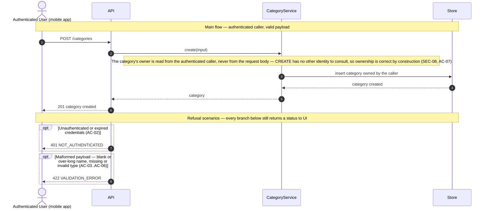
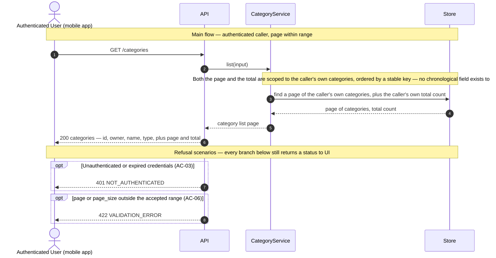
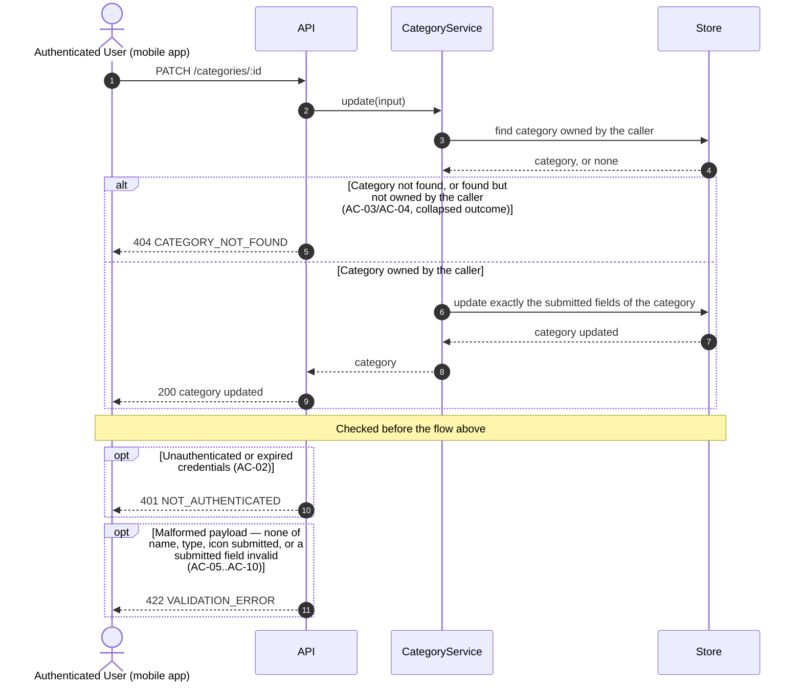
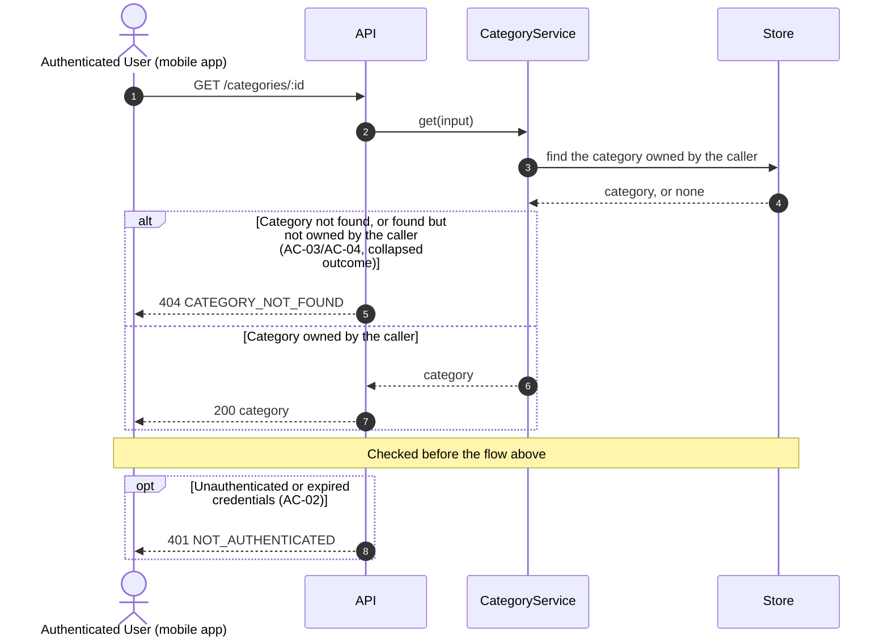

# Technical Plan: Category Management (CM)

> **Feature:** SRS §6 Feature-04 · SDS §5.4 (CM)
> **Spec:** [spec.md](spec.md)
> **Stories in this file:** CM-US-01 *(implemented, verified — 219 passed, 99% coverage)* · CM-US-02 *(implemented, verified — 391 passed)* · CM-US-04 *(implemented, verified — 526 total passing)* · CM-US-03 *(implemented, verified — 611 total passing)*

---

## CM-US-01: Create a Category

### Gaps & Decisions (Resolved)

Code and architecture decisions settled during design. Spec-level findings were folded back into `spec.md` before this step closed.

| ID | Area | Decision | Status |
|----|------|----------|--------|
| G1 | Reference docs | **SDS §2.2 / §4.3.3 `icon` contradiction, aligned at the document.** §2.2's Category domain object lists `(id, user_id, name, type, icon)`; §4.3.3's `CATEGORIES` ERD block listed only `id, user_id, name, type` — no `icon`. §5.4.4's CM-US-04 goal ("Modify category name, type, or icon") is a third, independent SDS passage that already assumes `icon` is real, which tips the disagreement: the ERD is the more likely slip, the same class of gap WM-US-01's `plan.md` A5 found in `wallets.created_at`. Unlike A5's treatment, this is a genuine *internal* SDS contradiction (both sides are the same document, not SDS vs. reality), so `CLAUDE.md`'s "aligning is routine" applies directly — `SDS.md` §4.3.3 was corrected to add a nullable `string icon` to the `CATEGORIES` block, logged in §1.6 as v1.4.0. This is a document fix only: it does not obligate CM-US-01 to build the column — see A4. | ✅ Resolved |
| A1 | Domain | **`name` is bounded at 100 characters.** No SRS or SDS source states a length rule for category name. WM-US-01's own `name` field (also a short free-text label with no stated bound) settled on 100 characters (`plan.md` A-equivalent DTO block); reusing that exact number keeps one convention for "a short free-text label" in this codebase rather than inventing an unrelated bound with no textual support either way. `CategoryCreate.name: str = Field(min_length=1, max_length=100)`. | ✅ Resolved |
| A2 | Domain | **`type` is a closed enum, `CategoryType` — unlike Wallet's free-text `type` (WM-US-01 A1).** SRS FR-04 names a real, closed vocabulary: "classified as either `INCOME` or `EXPENSE`" — two named literals, not an open set of illustrative examples the way Wallet's `type` was. Modelled exactly like `UserStatus`/`UserRole` (`backend/app/models/user.py`): `class CategoryType(enum.StrEnum): INCOME = "INCOME"; EXPENSE = "EXPENSE"`, column `Enum(CategoryType, native_enum=False, length=10)` (constitution NC-05). `CategoryCreate.type: CategoryType` — Pydantic validates against the enum's exact literal members, so no case-folding or trimming happens anywhere in the chain (spec AC-06, EC-01, EC-06), matching this codebase's reject-don't-normalise precedent for every other closed-vocabulary or shape-validated field. | ✅ Resolved |
| A3 | Domain | **No uniqueness constraint on `categories.name`**, not even scoped to one User. No AC, EC, or BR requires it (spec EC-03), so no unique index and no service-layer duplicate check are added — directly following WM-US-01's own `plan.md` A6 for `wallets.name`. | ✅ Resolved |
| A4 | Domain / ERD | **`icon` is not created or populated by this story**, even though G1 aligned the *document* to say it belongs on Category. CM-US-01's own AC set (SRS Gherkin, FR-04, SDS §5.4.1's goal) never mentions `icon` — inventing create-time support for a field no AC here asks for would be extending the story past what it was specified to do (`CLAUDE.md` "extending is not aligning"). The `categories` table this story's migration creates therefore carries exactly `id`, `user_id`, `name`, `type` — no `icon` column yet. Adding it is CM-US-04's own decision to make, since CM-US-04 (`SDS §5.4.4`) is the story whose goal actually names icon-editing. This mirrors WM-US-01 A5's shape (flag a gap, defer the column to the story that needs it) with one difference: there, the *source document* was left with the gap still open; here, G1 closes the document-level gap now, while the *column* still waits for CM-US-04. | ✅ Resolved *(flagged, not closed — see spec.md Assumptions)* |
| A5 | Domain | **No `is_system` flag or nullable owner — the "system vs. user-defined category" concept is deferred entirely, not decided here.** CM-US-02's own goal (SDS §5.4.2, out of scope for this story) mentions "system and user-defined transaction categories," which could imply a category with no owning User. Nothing in CM-US-01's own AC set requires that distinction: every category *this* story creates is made by an authenticated User, for themselves. `categories.user_id` is therefore `NOT NULL`, FK to `users.id`, exactly like `wallets.user_id`. If CM-US-02 (List Categories) needs to surface shared or ownerless categories, raising and designing that is CM-US-02's own decision — not something CM-US-01 may pre-empt by guessing at a flag or a nullable column no AC here justifies. | ✅ Resolved |
| A6 | Security | **A client-supplied `user_id` (or `icon`, or any other unrecognised key) in the request body is structurally impossible to honour, not merely rejected.** `CategoryCreate` declares exactly two fields, `name` and `type` — no `user_id`, no `icon`. An extra key in the submitted JSON is silently ignored by Pydantic's default `BaseModel` behaviour (no `model_config = {"extra": "forbid"}`, matching every existing schema in this codebase, none of which sets it) — ownership is enforced by the DTO's shape (constitution SEC-08, spec AC-07, BR-01), and `icon`'s absence from the DTO is what makes spec EC-05/FR-09 true by construction rather than by a check that could be forgotten. Directly mirrors WM-US-01 A7. | ✅ Resolved |
| A7 | Security | **No role restriction.** `CurrentUserDep` — not `AdminDep` — guards this route. SRS §6 US-04-01 names the actor "Authenticated User" with no role qualifier, and SDS §5.4.1 tags the story "(USER)", meaning any authenticated account, not an ADMIN-only action. Directly mirrors WM-US-01 A8. | ✅ Resolved |
| A8 | Architecture | **No audit event.** Constitution LA-04 enumerates exactly three audited event families — invitations sent, activations completed, logins — and category creation is not among them. No AC or FR in `spec.md` asks for one either. Directly mirrors WM-US-01 A9. | ✅ Resolved |

---

### Architecture

**Package layout** (additions only — every foundation module below already exists and is reused unchanged; `WalletModel`'s sibling files are the closest precedent throughout).

```text
backend/app/
├── models/
│   └── category.py                   # NEW  CategoryType, CategoryModel (SDS §2.1, §2.2, §4.3.3)
├── schemas/
│   └── category.py                   # NEW  CategoryCreate, CategoryRead
├── repositories/
│   └── category_repo.py              # NEW  add_category()
├── services/
│   └── category_service.py           # NEW  create_category()
└── api/v1/
    ├── categories.py                 # NEW  POST /categories
    └── router.py                     # update: mount categories.router

backend/migrations/versions/
└── <rev>_create_categories.py        # NEW  categories table (DOD-02), down_revision = 022fc9649eb5 (current head)

backend/tests/
└── integration/test_cm_us_01_create_category.py   # NEW  written at the Implement step from test_cases.md
```

No change to `core/deps.py` — `CurrentUserDep` (`get_current_user`) already resolves any authenticated `ACTIVE` User of either role and is reused exactly as-is (A7).

**Domain objects**

| Entity | Table | Key Fields | Notes |
|--------|-------|------------|-------|
| `CategoryModel` | `categories` | `id` PK, `user_id` FK→`users.id` (indexed), `name`, `type` | No `icon` this story (A4). `id` is `String(36)` UUID text, matching `UserModel`/`WalletModel` (constitution ENV-03). `user_id` carries an index — every future query on this table filters by owner (constitution SEC-08, PF-02), the same forward-looking index WM-US-01 added for `wallets.user_id`. |
| `CategoryType` | — | `INCOME`, `EXPENSE` | New `enum.StrEnum` (A2) — the first Category-adjacent field with a real closed vocabulary in this codebase's second story to define one (after `UserStatus`/`UserRole`). |

**DTOs** (`app/schemas/category.py`)

```python
class CategoryCreate(BaseModel):
    # Trimmed and required non-empty after trimming (spec AC-03, EC-02);
    # bounded at the column width (spec AC-04; plan.md A1).
    name: str = Field(min_length=1, max_length=100)

    # Closed enum, no case-folding, no trimming (plan.md A2;
    # spec AC-05, AC-06, EC-01, EC-06).
    type: CategoryType

class CategoryRead(BaseModel):
    id: str
    user_id: str
    name: str
    type: CategoryType
```

`name`'s trim is a `field_validator`, the same opt-in-per-field technique `WalletCreate.name` uses — no model-wide `str_strip_whitespace`. A trimmed-to-empty name still fails `min_length=1` inside the same validator (spec AC-03). `CategoryCreate` declares no `user_id` and no `icon` field at all (A6) — an extra key of either name in the submitted JSON is silently ignored by Pydantic's default behaviour, never read.

**Business rules enforced in service layer**

| Rule | Source | Enforcement |
|------|--------|--------------|
| Authenticated User of any role may create a category | AC-01, FR-01, A7 | `POST /api/v1/categories` accepting `CategoryCreate`, guarded by `CurrentUserDep` — not `AdminDep` |
| Unauthenticated caller denied before the payload is evaluated | AC-02, FR-02 | `CurrentUserDep` resolves before FastAPI validates the body — identical ordering to WM-US-01 |
| Name required, trimmed, bounded | AC-03, AC-04, EC-02, FR-03, A1 | `CategoryCreate` field validator: strip, reject empty, `max_length=100` |
| Type required, exactly `INCOME`/`EXPENSE`, no folding or trimming | AC-05, AC-06, EC-01, EC-06, FR-04, A2 | `type: CategoryType` — Pydantic's enum validation rejects any value that is not one of the two exact literal members, a `422` before the service runs |
| Owner is always the caller, never client input | AC-07, FR-05, A6, constitution SEC-08 | `category_service.create_category(db, owner=current_user, ...)` reads `owner.id`; `CategoryCreate` has no `user_id` field to read from instead |
| Response exposes exactly four fields, no `icon` | AC-08, FR-06, A4, constitution PF-03 | `CategoryRead` — no ORM graph, no extra field |
| Extra `icon` (or other unrecognised) key ignored | EC-05, FR-09, A6 | `CategoryCreate` has no such field to bind to; nothing reads it |
| Every validation failure reported together | EC-04, FR-07, constitution VL-02 | Reuses the existing `RequestValidationError` handler in `main.py` — unchanged, no new wiring |
| No uniqueness constraint on name | EC-03, FR-08, A3 | No unique index on `categories.name`; no service-layer duplicate check |
| No audit event | A8 | `category_service.create_category()` calls no `audit.record()` |

**Sequence diagram — Create a Category**

Drawn to `constitution.md` DG-01…DG-07: four lanes only, no SQL, no parameter lists, every request into `API` answered back to `UI` with a status code.



Only one workflow is drawn (DG-07) — no recovery path or background step exists for category creation, the same shape as WM-US-01's diagram.

**Error flows**

| Scenario | HTTP | Error Code |
|----------|------|------------|
| No or invalid bearer credentials (AC-02) | 401 | `NOT_AUTHENTICATED` |
| Blank or over-long name, missing or invalid type (AC-03..AC-06) | 422 | `VALIDATION_ERROR` |
| Unexpected server error | 500 | `INTERNAL_ERROR` |

All in the flat envelope `{"error_code", "message", "details"}` (SDS §6.6, constitution API-02) — reused unchanged from `main.py`. No `403` (A7: no role restriction) and no `409` (A3: no uniqueness to conflict on).

**Constitution notes**

| Rule | Status | Note |
|------|--------|------|
| AR-01 Service owns business rules | Required | `category_service.create_category()` is the only place that decides the owner and assembles the persisted row |
| AR-02 Thin router | Required | Router binds the payload, resolves `CurrentUserDep`, calls the service, commits, formats the response — no branching on business state |
| AR-03 Repository isolation | Required | `category_repo.add_category()` persists only; every validation rule already ran in the Pydantic layer or the service before it is called |
| AR-04 DTO ↔ model mapping outside routers/repos | Required | No field-name mapping is needed this story (`name`/`type` are identical on DTO and column), but the service, not the router, is still the boundary that would carry it |
| AR-05 No framework objects in services | Required | `create_category()` takes plain values (`owner: UserModel`, `name`, `category_type`); no `Request`/`Response` |
| AR-06 One transaction per request | Required | Service flushes; the router commits once |
| AR-08 Module layout | Required | `backend/app/{models,schemas,repositories,services,api}` — no new top-level package |
| API-01 Versioned plural path | Required | `POST /api/v1/categories` |
| API-02 Flat error envelope | Required | Reused from `main.py`, unchanged |
| API-03 Status codes | Required | `201` create · `401` · `422` validation |
| API-04 Prefixed error codes | N/A | This story introduces no new error code — `NOT_AUTHENTICATED` and `VALIDATION_ERROR` already exist |
| API-05 No generic status endpoint | Required | `/categories` is a plain resource-creation `POST`, not a status-transition endpoint |
| API-06 Pagination | N/A | Single-resource creation; no list in this story |
| API-07 Explicit response_model | Required | `response_model=CategoryRead`, `status_code=201` |
| API-08 Public endpoint list | Required | This route is **protected** — not added to the public list |
| NC-01 Module naming | Required | `category_repo.py`, `category_service.py` — singular, matching `wallet_repo.py`/`wallet_service.py` |
| NC-02 Naming | Required | `CategoryModel`; `CategoryCreate` / `CategoryRead` (SDS §2.1); table `categories` |
| NC-04 Column naming | Required | snake_case; `user_id` FK |
| NC-05 Enum serialisation | Required | `type` is `CategoryType`, an `Enum(..., native_enum=False, length=10)` column serialising as `"INCOME"`/`"EXPENSE"` — unlike Wallet's `type`/`currency` (A2), this is the first Category-story field this codebase gives a real enum column since `UserStatus`/`UserRole` |
| NC-06 Concise service methods | Required | `CategoryService.create`, matching `WalletService.create` |
| VL-01 Pydantic is the source of truth | Required | Every bound (length, enum membership) lives on `CategoryCreate` |
| VL-02 Errors grouped | Required | Reused `RequestValidationError` handler (EC-04) |
| VL-07 Decimal money | N/A | Category carries no monetary field |
| SEC-06 JWT parameters | N/A | Consumed via `CurrentUserDep`, not defined here |
| SEC-07 Authz proven by test | Required (partial) | `401` gets a dedicated test; there is no `403` case to test (A7) |
| SEC-08 Ownership filter | Required | The one row this story ever writes is scoped to the caller by construction (A6) — the read-side half of SEC-08 has no query to filter yet and becomes real only with CM-US-02 |
| SEC-09 Secrets from .env | N/A | No secret is introduced by this story |
| SEC-10 No enumeration | N/A | No existence check against another User's data occurs here |
| SEC-11 Rate limiting | N/A | Scoped by its own text to the invitation and activation endpoints |
| LA-01 No secrets in logs | N/A | No credential or token is handled by this story |
| LA-02 / LA-04 Audit | N/A (by decision) | Category creation is not one of LA-04's three named audited events, and no AC/FR asks for a fourth (A8) |
| PF-01 300 ms p95 | Required | No I/O off the request path is needed — a single insert |
| PF-02 Indexed lookups | Required | `categories.user_id` indexed now, ahead of CM-US-02's need for it |
| PF-03 DTO projection | Required | `CategoryRead` — four fields, no ORM graph |
| TST-01/02 AC→TC coverage | Required | Every AC and EC mapped in `test_cases.md` before any test code |
| DOD-02 Migration | Required | One Alembic revision creating `categories`, `down_revision = 022fc9649eb5` (current head) |
| DOD-03 Coverage > 80% | Required | Measured at the Implement step |

**Element IDs**

| Element | ID | Status | File |
|---------|----|--------|------|
| — | — | **N/A (mobile deferred)** | No category-creation screen exists this round. `mobile/`'s fixture-driven prototype covers only UM-US-01's invite screen (`CLAUDE.md` §5); a category-creation screen is not part of Round 1's mobile scope and no SRS UXR names one. |

**Open tasks**

| ID | Task | File | Status |
|----|------|------|--------|
| T-01 | `CategoryType` enum + `CategoryModel` (`id`, `user_id` FK indexed, `name`, `type` — no `icon`, A4) | `backend/app/models/category.py` | Open |
| T-02 | Alembic revision creating `categories` with its FK and index, `down_revision = 022fc9649eb5` | `backend/migrations/versions/` | Open |
| T-03 | Schemas `CategoryCreate`, `CategoryRead` | `backend/app/schemas/category.py` | Open |
| T-04 | `category_repo.add_category(db, *, user_id, name, category_type)` | `backend/app/repositories/category_repo.py` | Open |
| T-05 | `category_service.create_category(db, *, owner, name, category_type)` | `backend/app/services/category_service.py` | Open |
| T-06 | `POST /api/v1/categories` router; mount `categories.router` in `api/v1/router.py` | `backend/app/api/v1/categories.py`, `backend/app/api/v1/router.py` | Open |
| T-07 | Integration tests written from `test_cases.md` | `backend/tests/integration/test_cm_us_01_create_category.py` | Open |

---

## CM-US-02: List Categories

> **IDs in this section are local to CM-US-02** (`A*`/`T-NN`), matching `spec.md`'s convention. Only
> `TC-NN` in `test_cases.md` continues across this epic file — this story continues from `TC-18`.
> **`QF-NN` also continues here**, from `QF-05` (CM-US-01 used `QF-01`…`QF-04`) — matching the
> continuing convention `specs/003-wallet-management/test_cases.md` (WM-US-02) and
> `specs/006-transaction-management/test_cases.md` (TM-US-02) both already adopted and reasoned
> through in detail, over `specs/001-user-onboarding/test_cases.md`'s per-story reset. This is the
> first point in this epic file where the choice actually has to be made explicit — CM-US-01 was the
> file's first story, so nothing distinguished "reset" from "continue" for it — and it is decided the
> same way the majority, more-recently-established precedent in this codebase already decided it.

### Gaps & Decisions (Resolved)

| ID | Area | Decision | Status |
|----|------|----------|--------|
| A1 | Domain / ERD | **Ordering with no `created_at`: order by the primary key `id` ascending (`ORDER BY id ASC`), no schema change.** `backend/app/models/category.py` carries no `created_at` column, and SDS §4.3.3's `CATEGORIES` ERD (as aligned by CM-US-01 G1 to add `icon`) still lists only `id`, `user_id`, `name`, `type`, `icon` — no timestamp. This is the identical gap WM-US-01 A5 found for `wallets` and WM-US-02 A1 designed around; the same reasoning transfers directly — adding a column the ERD does not list is a domain-model change reserved for the user's own decision (`CLAUDE.md` §1), and no AC in either reference document asks for chronological order, only *a* list. Ordering by `id` gives a total, stable, gap-free, duplicate-free order across pages at zero schema cost, at the accepted cost of carrying no chronological meaning (full rationale: `spec.md` Assumptions; risk of a false impression of meaningful order: `test_cases.md` QF-06). | ✅ Resolved |
| A2 | API | **New envelope `CategoryListRead { items, total, page, page_size }`**, mirroring `WalletListRead` (WM-US-02 A2) and `TransactionListRead` (TM-US-02 A8) exactly. `CategoryRead` itself is reused unchanged as the per-item shape (four fields — `id`, `user_id`, `name`, `type`; no `icon`, CM-US-01 A4) — SDS §2.1's traceability row already names it as Category's read DTO. | ✅ Resolved |
| A3 | Security / Architecture | **Pagination and ownership filtering combined, single-table `WHERE`.** Both the bounded page query and the total-count query in `category_repo.list_owned()` carry the identical `WHERE user_id = :owner_id` predicate — copying WM-US-02 A3's own single-table shape exactly (this story has no join to a second table the way TM-US-02 A2 does). Scoping only one of the two queries would either leak a system-wide count next to a caller-scoped list, or scope the count but not the items — both wrong in different ways (`test_cases.md` QF-05). | ✅ Resolved |
| A4 | Architecture | **The router issues no `db.commit()`.** Pure read, nothing to commit — mirrors `GET /wallets` (WM-US-02 A4) and `GET /transactions` (TM-US-02 A9). | ✅ Resolved |
| A5 | Logging | **No new audit event for a list view.** Constitution LA-04 names exactly three audited event families (invitations sent, activations completed, logins); category creation itself was already excluded by CM-US-01 A8, and reading a list is further still from anything LA-04 enumerates. No AC or FR here asks for one. | ✅ Resolved |
| A6 | Security | **No role restriction — `CurrentUserDep` guards the route, not `AdminDep`.** SDS §5.4.2 tags this story "(USER)", identical to CM-US-01's own "(USER)" tag: any authenticated account, scoped to what it owns. An ADMIN caller who also owns categories sees, through this route, only their own (spec EC-04, BR-01; `test_cases.md` QF-07); nothing elevates an ADMIN's visibility here. | ✅ Resolved |
| A7 | Domain / Scope | **No "system category" concept is built.** SDS §5.4.2's goal text — "system **and** user-defined transaction categories" — is the only source anywhere that implies a category with no owning User. CM-US-01 A5 explicitly deferred this exact question to this story rather than guessing. It is resolved here, not deferred again: SRS §1.5 states plainly that categories "belong to the User who created them, not to a shared list," SDS §2.1/§2.2/§2.3's own domain model draws exactly one relationship for Category (`User "1" -- "*" Category : defines`, no second ownerless class), and the schema CM-US-01 built has `categories.user_id NOT NULL` with no `is_system` column and no seed migration anywhere under `backend/migrations/versions/` creating an ownerless row. `CLAUDE.md`'s precedence rule gives SRS the win over SDS, and here SRS is explicit while SDS is one under-supported phrase contradicted by its own document's domain model — the same class of internal-SDS gap CM-US-01 G1 fixed for `icon`, except by phrase rather than by missing ERD column, and reaching into SRS too. Inventing nullable ownership or an `is_system` flag now, on the strength of one phrase with no seed data or ERD support anywhere, would be exactly the domain-model extension `CLAUDE.md` §1 reserves for a stop-and-ask decision. **Recommended, not performed in this dispatch:** a future SDS alignment pass reword §5.4.2's goal to drop "system and" — parallel to how v1.2.0 already removed the never-implemented `UserActivate`/`ActivateUser` name from §6.2.1 — left undone here because this dispatch's file scope is limited to `specs/004-category-management/`. | ✅ Resolved |
| A8 | Domain / API | **No `type` filter.** SDS §5.4.2's goal sentence names no filter dimension, unlike TM-US-02's own SDS §5.6.2 goal ("Query and filter logged transactions by wallet, category, or date range"), which is precisely why that story built three filters unprompted by SRS. No equivalent sentence exists for this story. Declining mirrors WM-US-02's own declination to filter by wallet `type`/`currency`/`balance` when nothing asked for it. | ✅ Resolved |

---

### Architecture

**Package layout** (additions/updates only — CM-US-01's foundation is reused as-is unless noted;
**no new Alembic migration this story** — see note below).

```text
backend/app/
├── schemas/
│   └── category.py                   # update: add CategoryListRead (A2)
├── repositories/
│   └── category_repo.py              # update: add list_owned(db, *, user_id, page, page_size)
└── services/
    └── category_service.py           # update: add list_categories()

backend/app/api/v1/
└── categories.py                     # update: add GET /categories (list)

backend/tests/
└── integration/test_cm_us_02_list_categories.py   # NEW  written at the Implement step from test_cases.md
```

No change to `core/deps.py` — `CurrentUserDep` is reused exactly as CM-US-01 already established
(A6). **No new Alembic revision**: this story adds no column and needs no new index —
`categories.user_id` already carries one (CM-US-01 T-01/T-02, `ix_categories_user_id`), and ordering
by the primary key `id` needs nothing beyond what every table already has (constitution PF-02 — a
primary key is indexed by construction on both SQLite and PostgreSQL). The current migration head
(`2187429f50ce`) is unaffected.

**Domain objects**

| Entity | Table | Fields touched | Notes |
|--------|-------|-----------------|-------|
| `CategoryModel` | `categories` | none (read-only) | This story only reads. No new column — ordering uses the existing `id` primary key (A1), not a new `created_at`. No `is_system`/nullable-owner column either (A7). |
| `CategoryRead` (DTO) | — | `id`, `user_id`, `name`, `type` | Reused unchanged from CM-US-01 — the same four fields; no list-specific per-item variant (A2). |
| `CategoryListRead` (DTO) | — | `items: CategoryRead[]`, `total`, `page`, `page_size` | New envelope (A2), mirrors `WalletListRead`/`TransactionListRead` — not in SDS's registry. |

**DTOs** (`app/schemas/category.py`, addition)

```python
class CategoryListRead(BaseModel):
    """New envelope (A2) — mirrors WalletListRead (WM-US-02 plan.md A2) and
    TransactionListRead (TM-US-02 plan.md A8). CategoryRead's own four
    fields are reused unchanged as the per-item shape (CM-US-01, this
    story's A2) — no icon, no other entity's data folded in.
    """

    items: list[CategoryRead]
    total: int
    page: int
    page_size: int
```

**Business rules enforced in service layer**

| Rule | Source | Enforcement |
|------|--------|--------------|
| Any authenticated User of any role may list their own categories | AC-01, FR-01, A6 | `GET /api/v1/categories` guarded by `CurrentUserDep` — not `AdminDep`, mirrors CM-US-01's own route guard |
| Unauthenticated caller denied before any query parameter is evaluated | AC-03, FR-03 | `CurrentUserDep` resolves before FastAPI validates `page`/`page_size` — identical ordering to `GET /wallets` (WM-US-02 TC-27) |
| Every category query scoped to the caller — items and total alike | AC-07, FR-07, FR-10, A3, constitution SEC-08 | `category_repo.list_owned()` — both queries carry `WHERE user_id = :owner_id` |
| Bounded, paginated results | AC-04, AC-05, AC-06, API-06, PF-04 | Router declares `Query(page, ge=1)` / `Query(page_size, ge=1, le=100)` — out-of-range is `422`, not clamped |
| Stable, deterministic order | AC-08, EC-03, BR-03, A1 | `ORDER BY id ASC` in `category_repo.list_owned()` — the one column guaranteed unique and present without a schema change |
| Accurate, caller-scoped total | AC-01, AC-02, AC-04, AC-05, EC-01, A3, BR-04 | `category_repo.list_owned()` computes the count under the identical `user_id` predicate as the page query |
| Projection reused unchanged, no filter, no system-category | AC-09, FR-02, FR-09, FR-10, PF-03, A7, A8 | `CategoryRead` — the same four fields CM-US-01 defined; no `type` query parameter declared on the route; no query capable of returning an ownerless row |
| Pure read, no commit | A4 | Router issues no `db.commit()` — mirrors `GET /wallets` |

**Repository** (`app/repositories/category_repo.py`, addition)

```python
def list_owned(
    db: Session, *, user_id: str, page: int, page_size: int
) -> tuple[Sequence[CategoryModel], int]:
    """A page of categories owned by `user_id`, plus that owner's own total
    count (spec AC-01, AC-04, AC-05, AC-07; plan.md A1, A3).

    Both queries carry the identical `user_id` predicate (constitution
    SEC-08) — the total is the caller's own category count, never the
    system-wide row count (test_cases.md QF-05). Ordered by `id`, the one
    column guaranteed to exist and be unique without a schema change (A1);
    this order carries no chronological meaning. Mirrors
    `wallet_repo.list_owned()` exactly (WM-US-02) — the same single-table
    shape, no join.
    """
    total = (
        db.scalar(
            select(func.count()).select_from(CategoryModel).where(CategoryModel.user_id == user_id)
        )
        or 0
    )
    items = db.scalars(
        select(CategoryModel)
        .where(CategoryModel.user_id == user_id)
        .order_by(CategoryModel.id.asc())
        .offset((page - 1) * page_size)
        .limit(page_size)
    ).all()
    return items, total
```

**Service** (`app/services/category_service.py`, addition)

```python
def list_categories(
    db: Session, *, owner: UserModel, page: int, page_size: int
) -> CategoryListRead:
    """Assemble a page of the caller's own categories into the
    `CategoryListRead` envelope (A2, A3).

    Unlike `user_service.list_users`, this calls no `clock.ensure_aware()` —
    `CategoryRead` carries no datetime field to normalise (mirrors
    `wallet_service.list_wallets`, WM-US-02).
    """
    items, total = category_repo.list_owned(db, user_id=owner.id, page=page, page_size=page_size)
    return CategoryListRead(
        items=[
            CategoryRead(
                id=c.id,
                user_id=c.user_id,
                name=c.name,
                type=c.type,
            )
            for c in items
        ],
        total=total,
        page=page,
        page_size=page_size,
    )
```

**Router** (`app/api/v1/categories.py`, addition)

```python
@router.get(
    "",
    response_model=CategoryListRead,
    status_code=status.HTTP_200_OK,
    summary="List the caller's categories",
    description=(
        "Returns every category owned by the authenticated caller, paginated, "
        "with an accurate total scoped to that caller."
    ),
    responses={
        401: {"description": "NOT_AUTHENTICATED"},
        422: {"description": "VALIDATION_ERROR"},
    },
)
def list_categories(
    db: DbDep,
    current_user: CurrentUserDep,
    page: int = Query(1, ge=1),
    page_size: int = Query(25, ge=1, le=100),
) -> CategoryListRead:
    """Pure read — no `db.commit()` (A4)."""
    return category_service.list_categories(db, owner=current_user, page=page, page_size=page_size)
```

**Sequence diagram — List Categories**

Drawn to `constitution.md` DG-01…DG-07: four lanes only, no SQL, no parameter lists, every request
into `API` answered back to `UI` with a status code.



Only one workflow is drawn (DG-07) — there is no recovery path or background step, the same shape
CM-US-01's own diagram already established for a story with no prior state to reconcile against.

**Error flows**

| Scenario | HTTP | Error Code |
|----------|------|------------|
| No or invalid bearer credentials (AC-03) | 401 | `NOT_AUTHENTICATED` |
| `page` or `page_size` not a positive integer, or `page_size` > 100 (AC-06) | 422 | `VALIDATION_ERROR` |
| Unexpected server error | 500 | `INTERNAL_ERROR` |

No new error class this story — all three codes already exist in `core/errors.py`, reused as-is. All
in the flat envelope `{"error_code", "message", "details"}` (SDS §6.6, constitution API-02). No `403`
(A6: no role restriction) and no `409` (a read has nothing to conflict on).

**Constitution notes**

| Rule | Status | Note |
|------|--------|------|
| AR-01 Service owns business rules | Required | `category_service.list_categories()` assembles the DTO; the repository does not decide *what* to enforce |
| AR-02 Thin router | Required | Router binds `page`/`page_size`, resolves `CurrentUserDep`, delegates, formats the response — no branching on business state |
| AR-03 Repository isolation | Required | `category_repo.list_owned()` is a query only — filtering, ordering, and limiting, no business rule |
| AR-04 DTO ↔ model mapping outside routers/repos | Required | `CategoryModel` → `CategoryRead` mapping happens in `category_service.list_categories()`, not the router or `category_repo.list_owned()` |
| AR-05 No framework objects in services | Required | `list_categories()` takes plain `owner: UserModel`, `page`, `page_size`; no `Request`/`Response` |
| AR-06 One transaction per request | N/A | Pure read, nothing to commit (A4) |
| AR-07 router → service → repository | Required | Router never calls `category_repo` directly |
| AR-08 Module layout | Required | No new top-level package; additions only to existing modules |
| API-01 Versioned plural path | Required | `GET /api/v1/categories` |
| API-02 Flat error envelope | Required | Reused from `main.py`, unchanged |
| API-03 Status codes | Required | `200` read · `401` · `422` validation |
| API-04 Prefixed error codes | N/A | No new error code — `NOT_AUTHENTICATED` and `VALIDATION_ERROR` already catalogued |
| API-05 No generic status endpoint | Required | `GET /categories` is a plain resource-listing route, not a status-transition endpoint |
| API-06 Pagination | Required | `page`/`page_size`, default 25, max 100, total count in `CategoryListRead` — this story's central constitution citation |
| API-07 Explicit response_model | Required | `response_model=CategoryListRead`, `status_code=200` |
| API-08 Public endpoint list | Required | This route is **protected** — not added to the public list |
| NC-01 Module naming | Required | No new module; additions to `category_repo.py`/`category_service.py`/`categories.py` |
| NC-02 Naming | Required | `CategoryListRead` (SDS §2.1 names `CategoryRead`; the envelope is new, A2) |
| NC-04 Column naming | N/A | No column change this story |
| NC-05 Enum serialisation | Required | Inherited unchanged from CM-US-01 — `type` continues to serialise as the exact literal `"INCOME"`/`"EXPENSE"`; this story adds no new enum |
| NC-06 Concise service methods | Required | `category_service.list_categories`, matching this codebase's own established style (`wallet_service.list_wallets`, `user_service.list_users`) |
| VL-01 Pydantic is the source of truth | Required | `Query(ge=1, le=100)` constraints are the validation, not a service-layer clamp |
| VL-02 Errors grouped | Required | Reused `RequestValidationError` handler |
| SEC-07 Authz proven by test | Required (partial) | `401` gets a dedicated test; there is no `403` case in this story (A6 — no role restriction) |
| SEC-08 Ownership filter | Required | Both the page query and the total-count query carry the `user_id` predicate (A3) |
| SEC-10 No enumeration | N/A | This endpoint takes no email or identifying parameter to probe |
| SEC-11 Rate limiting | N/A | Scoped by its own text to the invitation and activation endpoints |
| LA-01 No secrets in logs | N/A | No credential or token is handled by this story |
| LA-02 / LA-04 Audit | N/A (by decision) | Listing is not one of LA-04's three named audited events (A5) |
| PF-01 300 ms p95 | Required | No slow I/O in this path; a two-query read, both indexed |
| PF-02 Indexed lookups | Required | `categories.user_id` already indexed (CM-US-01); `id` (the sort key) is the primary key, indexed by construction — no new migration |
| PF-03 DTO projection | Required | `CategoryRead` — four fields, no ORM graph |
| PF-04 Bounded lists | Required | Enforced by API-06's cap — this story's other central citation |
| TST-01/02 AC→TC coverage | Required | Every AC and EC mapped in `test_cases.md` before any test code |
| TST-05 Boundaries | Required | EC-02 covers the exact `page_size=100` boundary; AC-06 covers zero/negative |
| DOD-02 Migration | N/A | No column or index change this story (see Architecture note) |
| DOD-03 Coverage > 80% | Required | Measured at the Implement step |

**Element IDs**

| Element | ID | Status | File |
|---------|----|--------|------|
| — | — | **N/A (mobile deferred)** | No category-list screen exists this round, the same treatment CM-US-01 gave category creation — `mobile/`'s fixture-driven prototype covers only UM-US-01's invite screen (`CLAUDE.md` §5). |

**Open tasks**

| ID | Task | File | Status |
|----|------|------|--------|
| T-01 | `CategoryListRead` envelope (A2) | `backend/app/schemas/category.py` | Open |
| T-02 | `category_repo.list_owned(db, *, user_id, page, page_size)` — ownership-scoped page + total (A1, A3) | `backend/app/repositories/category_repo.py` | Open |
| T-03 | `category_service.list_categories(db, *, owner, page, page_size) -> CategoryListRead` (A2, A3) | `backend/app/services/category_service.py` | Open |
| T-04 | `GET /api/v1/categories` router — `Query(page, ge=1)` / `Query(page_size, ge=1, le=100)`, guarded by `CurrentUserDep`, no `db.commit()` (A4, A6) | `backend/app/api/v1/categories.py` | Open |
| T-05 | Integration tests written from `test_cases.md` | `backend/tests/integration/test_cm_us_02_list_categories.py` | Open |

---

## CM-US-04: Update a Category

> **IDs in this section are local to CM-US-04** (`A*`/`T-NN`), continuing the demonstrated convention:
> every second-or-later story in this file restarts `A*`/`T-NN` locally (CM-US-02 already did this,
> restarting from `A1`/`T-01`), while `test_cases.md`'s `TC-NN` and `QF-NN` run continuously across the
> epic file. `test_cases.md`'s `TC-NN` below continues from `TC-35` and `QF-NN` from `QF-09` — confirmed
> by direct count of that file's own current end (`TC-34`, `QF-08`), not from the number this dispatch
> was originally briefed with (see that file's own header note).

### Gaps & Decisions (Resolved)

| ID | Area | Decision | Status |
|----|------|----------|--------|
| A1 | Domain / API | **`name`, `type`, and `icon` are each independently optional on `CategoryUpdate`; at least one is required.** SDS §5.4.4's own goal text — "Modify category name, type, **or** icon" — names three concrete fields disjunctively, unlike BM-US-04's own single-field `BudgetUpdate` (A6 there), where "required" and "optional" were the same question. A cross-field `model_validator` rejects a submission naming none of the three — the same technique TM-US-02 A7 already used for its own `date_from`/`date_to` ordering check, reused here for *how* to express a cross-field rule, not for what it says. Full reasoning: `spec.md` Assumptions. | ✅ Resolved |
| A2 | API | **`PATCH /api/v1/categories/{category_id}`** — a verb-free path on the resource's own id, not a generic status endpoint and not a dedicated per-field action route. Category has no status/lifecycle field of any kind (unlike Budget, which already has a real computed status BM-US-04 A2 had to reason around) — `name`/`type`/`icon` are ordinary business fields, so the "is this secretly a state machine" question does not even arise. `PATCH`, not `PUT`, because the request is a genuine partial update of up to three of five fields. Mirrors BM-US-04 A2. | ✅ Resolved |
| A3 | Architecture | **Reuse `category_repo.get_owned_by_id(db, *, category_id, user_id)` unchanged for this story's own ownership-scoped lookup — no new repository *read* function.** Confirmed directly from the file: it already exists, built for BM-US-01's own creation-time category-ownership check. Unlike Budget's own equivalent (BM-US-04 A3, which had to generalise a *wallet-join* lookup because Budget carries no owner column of its own), Category already carries its own `user_id` directly, so this function is already the exact single-table shape this story needs — nothing to generalise, nothing to add. | ✅ Resolved |
| A4 | Architecture | **New `category_repo.update_category(db, *, category, name, category_type, icon)`.** Takes the already-fetched, already-ownership-verified `CategoryModel` instance from A3 and sets only the attributes the caller actually submitted (each parameter `None` means "leave unchanged," consistent with A1/A12) — never touches `user_id`. Flushed, not committed (AR-06) — the router owns the transaction boundary, the same shape every other write function in this codebase follows. | ✅ Resolved |
| A5 | Domain / ERD | **New Alembic migration adding a nullable `icon` column, `String(50)`, no default, `down_revision` = the current head `f3a9c1d4e8b2`.** This is CM-US-01 A4's own deferred decision landing here, exactly as CM-US-01 A4 itself said it would: "Adding it is CM-US-04's own decision to make, since CM-US-04 ... is the story whose goal actually names icon-editing." Nullable because every category CM-US-01/02 already created has no value for it, and no AC requires a default other than absent. Length 50: see A11. | ✅ Resolved |
| A6 | API | **`CategoryRead` is extended to a fifth field, `icon` — reused across create, list, *and* update, not a separate "detail" DTO.** A separate DTO (e.g. `CategoryDetailRead`, used only by this endpoint) was considered and rejected: it would mean a caller who successfully sets an icon through this endpoint, then immediately calls `GET /api/v1/categories` (CM-US-02), would see the icon vanish again — a worse, inconsistent design nothing justifies, when SDS's own aligned domain object (§2.2, §4.3.3) already describes `icon` as one Category attribute among the other four, not a write-only or update-only one. **Consequence, flagged, not hidden:** CM-US-01's `TC-14` and CM-US-02's `TC-19` — both already `PASS`, both already implemented — assert the response carries "exactly" four keys with no `icon`. Extending `CategoryRead` makes that literal assertion false going forward. Their own `TC-NN` text in `test_cases.md` is **not** rewritten here (`CLAUDE.md` §1.1 rule 4) — it remains an accurate record of what CM-US-01/CM-US-02 themselves guaranteed, which CM-US-01 A4 itself already flagged as provisional ("the column is CM-US-04's own decision to add"). The pytest code implementing those two TCs will need a one-line update, at the Implement step for *this* story, to expect the added key (value `None` unless set) — recorded here as `T-07`, not performed in this artifacts-only dispatch. `CategoryListRead` itself needs no change at all: it wraps `CategoryRead` unchanged, so the new field flows through automatically. | ✅ Resolved |
| A7 | Security / API | **New error class `CategoryNotFoundError` (404, `CATEGORY_NOT_FOUND`).** `core/errors.py` checked directly first, the same question BM-US-04 A7 worked through for Budget: neither `BudgetCategoryNotFoundError` nor `TransactionCategoryNotFoundError` fits — both are about a category *referenced* by a Budget or a Transaction failing to resolve at *that* story's own creation time, not about the category *being updated* resolving against the caller here. `CategoryNotFoundError` is constitution VL-06's "404 if absent" branch, applied to a category's own id for the first time — the identical move BM-US-04 A7 made for Budget one epic earlier. | ✅ Resolved |
| A8 | Security | **No role restriction — `CurrentUserDep` guards the route, not `AdminDep`.** SDS §5.4.4 tags this story "(USER)", identical to every other Category Management story's own tag. Mirrors CM-US-01 A7, CM-US-02 A6, BM-US-04 A9. | ✅ Resolved |
| A9 | Logging | **No new audit event.** Constitution LA-04 names exactly three audited event families; category creation (CM-US-01 A8) and listing (CM-US-02 A5) were already excluded, and updating fields is no closer to any of the three. No AC or FR here asks for one. | ✅ Resolved |
| A10 | Architecture | **The router issues exactly one `db.commit()`, after the service call succeeds** — identical to every other write endpoint in this codebase (AR-06). `category_service.update_category()` itself only flushes (via A4's `update_category()`), never commits. | ✅ Resolved |
| A11 | Domain | **`icon` is bounded at 50 characters, trimmed, required non-blank when submitted, and carries no format constraint beyond that** — no URL shape, no enum of known icon names. No SRS/SDS source states a length or format rule (the same situation CM-US-01 A1 faced for `name`, resolved the same way: reuse a close precedent rather than invent an unrelated number). 50, not `name`'s own 100, because an icon is expected to be a short identifier or slug (`test_cases.md` TC-13's own fixture, `"shopping-cart"`, is representative), not a label-length piece of text. Declining to constrain the format further mirrors CM-US-02 A8's own restraint about an unrequested `type` filter. | ✅ Resolved |
| A12 | Domain / API | **Submitting `icon` as `null` and omitting it are indistinguishable — both leave the current value unchanged; there is no "clear my icon" operation in this story's contract.** Supporting a true clear-to-absent operation would require distinguishing "the key was sent with value null" from "the key was not sent at all" (Pydantic's `model_fields_set`/`exclude_unset`), a sentinel distinction nothing in SRS or SDS asks for. Declining it mirrors BM-US-04 A1's own "fewest invented rules" discipline. If a future story needs it, that is a gap to raise then. | ✅ Resolved |
| A13 | Domain | **A category's `type` is freely editable with no retroactive effect — reasoned against the real code, not assumed.** `transaction_service.create_transaction()` compares a category's `type` to a submitted Transaction's `type` **once, at that Transaction's own creation time** (TM-US-01 BR-03) and never again; `TransactionModel`/`TransactionRead` carry their own independently-stored `type`, never re-derived from the category afterward. `transaction_repo.get_expense_totals_by_wallet_category()` — the function BM-US-02's budget spend-aggregation calls — filters on `TransactionModel.type == TransactionType.EXPENSE` (the **transaction's own stored type**) grouped by `(wallet_id, category_id)`; it never joins `CategoryModel` and never reads a category's `type` at all. No restriction is therefore placed on changing `type` after a Transaction or Budget already references the category — there is no invariant anywhere in this codebase past creation time for such a restriction to protect. Full reasoning: `spec.md` Assumptions; demonstrated: `test_cases.md` TC-60/TC-61/TC-62. | ✅ Resolved |
| A14 | Scope | **CM-US-03 (View a Category) is not a dependency of this story.** `category_repo.get_owned_by_id()` is a repository-level function with no dependency on a public single-resource `GET` endpoint existing (A3); the category id a caller acts on is already available to them from CM-US-01's create response or CM-US-02's list response. | ✅ Resolved |

---

### Architecture

**Package layout** (additions/updates only — CM-US-01/02's foundation is reused as-is unless noted; the
first schema change to `categories` since its own creation).

```text
backend/app/
├── models/
│   └── category.py                   # update: add `icon` column (A5)
├── schemas/
│   └── category.py                   # update: CategoryRead gains `icon` (A6); NEW CategoryUpdate (A1, A11, A12)
├── repositories/
│   └── category_repo.py              # update: add update_category() (A4); get_owned_by_id() reused unchanged (A3)
├── services/
│   └── category_service.py           # update: add update_category() (A1, A3, A4, A6); create_category()/list_categories() map the new `icon` field (A6)
├── core/
│   └── errors.py                     # update: add CategoryNotFoundError (A7)
└── api/v1/
    └── categories.py                 # update: add PATCH /categories/{category_id} (A2, A8, A10)

backend/migrations/versions/
└── <rev>_add_icon_to_categories.py   # NEW nullable icon column, down_revision = f3a9c1d4e8b2 (current head, A5)

backend/tests/
└── integration/test_cm_us_04_update_category.py   # NEW written at the Implement step from test_cases.md
    (plus a one-line update to test_cm_us_01_create_category.py's TC-14 test and
     test_cm_us_02_list_categories.py's TC-19 test, to expect the new `icon` key — A6, T-07)
```

No change to `core/deps.py` — `CurrentUserDep` is reused exactly as CM-US-01/02 already established
(A8).

**Domain objects**

| Entity | Table | Fields touched | Notes |
|--------|-------|-----------------|-------|
| `CategoryModel` | `categories` | `name`, `type`, `icon` (write); `icon` column added (A5) | The first story to write to an existing category row. `user_id` is read (for the ownership check) but never written (A3, spec BR-05). |
| `CategoryUpdate` (DTO) | — | `name`, `type`, `icon` | New request DTO (A1) — all three optional; a `model_validator` rejects a submission with all three `None` (A1). |
| `CategoryRead` (DTO) | — | *(extended)* | Gains a fifth field, `icon: str \| None` (A6) — reused unchanged by create and list as well as this story's own response. |

**DTO changes** (`app/schemas/category.py`)

```python
class CategoryUpdate(BaseModel):
    """Request DTO for PATCH /categories/{category_id} (CM-US-04). All three
    fields are independently optional (plan.md A1) -- None means "leave this
    field unchanged," including for icon (A12): there is no way to submit a
    null that clears an existing icon, only a new non-blank string that
    replaces it. At least one field must be given a non-None value (A1) or
    the request is refused -- the first multi-field optional update contract
    in this codebase.
    """

    name: str | None = Field(default=None, min_length=1, max_length=100)
    type: CategoryType | None = None
    # Bounded at 50, not name's 100 -- an icon is a short identifier/slug,
    # not a label (plan.md A11). No format constraint beyond length and
    # non-blankness (A11).
    icon: str | None = Field(default=None, min_length=1, max_length=50)

    @field_validator("name")
    @classmethod
    def validate_name(cls, v: str | None) -> str | None:
        """Only runs when a value was actually submitted -- Pydantic skips a
        field validator for a field left at its None default. Same
        trim-then-reject-blank technique as CategoryCreate.validate_name.
        """
        if v is None:
            return v
        trimmed = v.strip()
        if not trimmed:
            raise ValueError("Category name cannot be empty or whitespace only")
        return trimmed

    @field_validator("icon")
    @classmethod
    def validate_icon(cls, v: str | None) -> str | None:
        """Same technique as validate_name, applied to icon (plan.md A11)."""
        if v is None:
            return v
        trimmed = v.strip()
        if not trimmed:
            raise ValueError("Category icon cannot be empty or whitespace only")
        return trimmed

    @model_validator(mode="after")
    def validate_at_least_one_field(self) -> "CategoryUpdate":
        """spec AC-05, FR-04 (plan.md A1) -- the one cross-field rule
        Pydantic cannot express on a single field, the same class of rule
        TM-US-02 A7 already needed for date_from/date_to ordering.
        """
        if self.name is None and self.type is None and self.icon is None:
            raise ValueError("At least one of name, type, or icon must be provided.")
        return self


class CategoryRead(BaseModel):
    """SDS §2.2 (as aligned). Now five fields (plan.md A6) -- icon added for
    the first time; None until a category has one set via this story's own
    PATCH.
    """

    id: str
    user_id: str
    name: str
    type: CategoryType
    icon: str | None
```

**Repository additions** (`app/repositories/category_repo.py`)

```python
def update_category(
    db: Session,
    *,
    category: CategoryModel,
    name: str | None,
    category_type: CategoryType | None,
    icon: str | None,
) -> CategoryModel:
    """spec AC-01, FR-05..FR-08, BR-02, BR-05 (plan.md A1, A4). Mutates only
    the attributes actually submitted on an already-fetched,
    already-ownership-verified row -- user_id is never touched. Flushed, not
    committed (AR-06) -- the router owns the transaction boundary.
    """
    if name is not None:
        category.name = name
    if category_type is not None:
        category.type = category_type
    if icon is not None:
        category.icon = icon
    db.add(category)
    db.flush()
    return category
```

`get_owned_by_id()` is reused unchanged (A3) — no addition needed.

**Service** (`app/services/category_service.py`, addition)

```python
def update_category(
    db: Session,
    *,
    owner: UserModel,
    category_id: str,
    name: str | None,
    category_type: CategoryType | None,
    icon: str | None,
) -> CategoryRead:
    """spec AC-01, FR-03 (plan.md A3, A4, A6). Looks up the category scoped
    to the caller, then updates exactly the submitted fields -- no further
    precondition check follows ownership (no uniqueness, no referenced-data
    check: nothing this story's contract touches is referenced by anything
    else in a way that requires one, A13).
    """
    category = category_repo.get_owned_by_id(db, category_id=category_id, user_id=owner.id)
    if category is None:
        raise CategoryNotFoundError()

    category = category_repo.update_category(
        db, category=category, name=name, category_type=category_type, icon=icon
    )
    return CategoryRead(
        id=category.id,
        user_id=category.user_id,
        name=category.name,
        type=category.type,
        icon=category.icon,
    )
```

`create_category()` and `list_categories()` (both existing, CM-US-01/02) each need one added line
mapping `icon=category.icon` / `icon=c.icon` into the `CategoryRead(...)` they already construct (A6,
T-07) — not shown again here in full; the only change is that one field per call site.

**Router** (`app/api/v1/categories.py`, addition)

```python
@router.patch(
    "/{category_id}",
    response_model=CategoryRead,
    status_code=status.HTTP_200_OK,
    summary="Update a category",
    description=(
        "Updates one or more of the name, type, and icon of one of the "
        "authenticated caller's own categories, identified by its own id. "
        "Any field not submitted is left unchanged; the category's owner "
        "can never be changed."
    ),
    responses={
        401: {"description": "NOT_AUTHENTICATED"},
        404: {"description": "CATEGORY_NOT_FOUND"},
        422: {"description": "VALIDATION_ERROR"},
    },
)
def update_category(
    category_id: str,
    payload: CategoryUpdate,
    db: DbDep,
    current_user: CurrentUserDep,
) -> CategoryRead:
    result = category_service.update_category(
        db,
        owner=current_user,
        category_id=category_id,
        name=payload.name,
        category_type=payload.type,
        icon=payload.icon,
    )
    db.commit()
    return result
```

**New error** (`app/core/errors.py`, appended under a new `# --- CM-US-04: Update a Category` section)

```python
class CategoryNotFoundError(AppError):
    """spec AC-03 / AC-04 / FR-03. Identical for "no such category" and "not
    this caller's category" (constitution VL-06's `404 if absent` branch) --
    the first time this codebase looks a category up by its own id rather
    than validating a *referenced* category from Budget or Transaction
    (plan.md A7)."""
    status_code = 404
    error_code = "CATEGORY_NOT_FOUND"
    default_message = "The referenced category was not found."
```

**Business rules enforced in service layer**

| Rule | Source | Enforcement |
|------|--------|--------------|
| Authenticated User of any role may update their own category's fields | AC-01, FR-01, A8 | `PATCH /api/v1/categories/{category_id}` guarded by `CurrentUserDep` — not `AdminDep` |
| Unauthenticated caller denied before anything else is evaluated | AC-02, FR-02 | `CurrentUserDep` resolves before the body is validated |
| `category_id` must resolve to the caller's own category; not-found and not-owned collapsed | AC-03, AC-04, EC-08, EC-11, FR-03, A3 | `category_repo.get_owned_by_id()` returns `None` for both cases by construction; service raises `CategoryNotFoundError` |
| At least one of name/type/icon required | AC-05, FR-04, A1 | `CategoryUpdate`'s `model_validator` |
| `name`, when submitted: non-blank, trimmed, ≤100 chars | AC-06, AC-07, EC-02, FR-05 | `CategoryUpdate.name`'s `Field`/validator, reusing CM-US-01's own bound |
| `type`, when submitted: exactly INCOME/EXPENSE, no folding/trimming | AC-08, EC-01, EC-09, FR-06 | `type: CategoryType \| None` — Pydantic's enum validation, reusing CM-US-01's own rule |
| `icon`, when submitted: non-blank, trimmed, ≤50 chars | AC-09, AC-10, EC-07, EC-12, FR-07, A11 | `CategoryUpdate.icon`'s `Field`/validator |
| Owner and unsubmitted fields never change | AC-11, EC-05, FR-08, BR-05 | `category_repo.update_category()` only sets a column whose argument is not `None`; no `user_id` parameter exists to set it with |
| Response exposes exactly five fields | AC-12, FR-09, constitution PF-03 | `CategoryRead` — no ORM graph, no extra field (A6) |
| Every validation failure reported together | EC-04, FR-10, constitution VL-02 | Reuses the existing `RequestValidationError` handler — unchanged |
| No uniqueness constraint on name | EC-03, FR-11 | No unique index; no service-layer duplicate check (reuses CM-US-01 A3) |
| `type` changes carry no retroactive effect | EC-10, FR-12, BR-04, A13 | `update_category()` performs no Transaction/Budget lookup or revalidation of any kind |
| No audit event | A9 | `category_service.update_category()` calls no `audit.record()` |

**Sequence diagram — Update a Category**

Drawn to `constitution.md` DG-01…DG-07: four lanes only, no SQL, no parameter lists, every request into
`API` answered back to `UI` with a status code, one workflow.



Only one workflow is drawn (DG-07). The nested `alt`/`else` blocks are the one flow's own branches — not
a second flow — mirroring BM-US-04's own diagram shape.

**Error flows**

| Scenario | HTTP | Error Code |
|----------|------|------------|
| No or invalid bearer credentials (AC-02) | 401 | `NOT_AUTHENTICATED` |
| None of name/type/icon submitted, or a submitted field invalid (AC-05..AC-10) | 422 | `VALIDATION_ERROR` |
| Category not found, or found but not owned by the caller (AC-03, AC-04) | 404 | `CATEGORY_NOT_FOUND` |
| Unexpected server error | 500 | `INTERNAL_ERROR` |

All in the flat envelope `{"error_code", "message", "details"}` (SDS §6.6, constitution API-02). No `403`
(A8: no role restriction) and no `409` of any kind — nothing this story's own contract touches carries a
uniqueness constraint (BR-03) or a referenced-entity precondition beyond the category's own existence/
ownership (A13).

**Constitution notes**

| Rule | Status | Note |
|------|--------|------|
| AR-01 Service owns business rules | Required | `category_service.update_category()` is the only place that decides what a failed lookup means, and which fields actually change |
| AR-02 Thin router | Required | Router binds the path param and payload, resolves `CurrentUserDep`, calls the service, commits, formats the response — no branching on business state |
| AR-03 Repository isolation | Required | `category_repo.get_owned_by_id()`/`update_category()` are queries and persistence only (A3, A4) |
| AR-04 DTO ↔ model mapping outside routers/repos | Required | `CategoryModel` → `CategoryRead` mapping happens in `category_service.update_category()`, the same place `create_category()`/`list_categories()` already do it |
| AR-05 No framework objects in services | Required | `update_category()` takes plain values (`owner`, `category_id`, `name`, `category_type`, `icon`); no `Request`/`Response` |
| AR-06 One transaction per request | Required | Service flushes at most once (after the ownership lookup succeeds); the router commits once (A10) |
| AR-07 Router → service → repository | Required | The router never calls `category_repo` directly |
| AR-08 Module layout | Required | No new top-level package; additions only to existing modules |
| API-01 Versioned plural path | Required | `PATCH /api/v1/categories/{category_id}` |
| API-02 Flat error envelope | Required | Reused from `main.py`, unchanged |
| API-03 Status codes | Required | `200` update (not `201`) · `401` · `404` · `422` |
| API-04 Prefixed error codes | Required | `CATEGORY_NOT_FOUND` — catalogued above |
| API-05 No generic status endpoint | Required (reasoned) | See A2 — Category has no status/lifecycle field of any kind for this endpoint to collapse into a setter for |
| API-06 Pagination | N/A | Single-resource update; no list in this story |
| API-07 Explicit response_model | Required | `response_model=CategoryRead`, `status_code=200` |
| API-08 Public endpoint list | Required | This route is **protected** — not added to the public list |
| NC-01 Module naming | Required | No new module; additions to `category_repo.py`/`category_service.py`/`categories.py`/`errors.py` |
| NC-02 Naming | Required | `CategoryUpdate` new (SDS §2.1 has no registry entry for it, the same gap BM-US-01 A1 already found for `BudgetCreate`/`BudgetRead`); `CategoryRead` extended, not replaced |
| NC-03 No verbs except state transitions | Required | `/categories/{category_id}` — no verb in the path (A2) |
| NC-04 Column naming | Required | `icon` snake_case, nullable, no new FK (A5) |
| NC-05 Enum serialisation | N/A | No new enum; `type` continues to serialise as `"INCOME"`/`"EXPENSE"` unchanged when submitted |
| NC-06 Concise service methods | Required | `category_service.update_category`, matching `create_category`/`list_categories`'s own naming |
| VL-01 Pydantic is the source of truth | Required | `CategoryUpdate`'s `Field` bounds and `model_validator` are the validation |
| VL-02 Errors grouped | Required | Reused `RequestValidationError` handler (EC-04) |
| VL-05 Two-level uniqueness | N/A | No uniqueness constraint exists on `categories.name` to enforce (BR-03) |
| VL-06 Referenced entities verified before use | Required (404 only) | `404` if the category is absent/not owned (A3) — the only branch this story uses; no "wrong state" / `409` branch applies, because Category carries no status for a category to be in the wrong state of |
| VL-07 Decimal money | N/A | Category carries no monetary field |
| SEC-06 JWT parameters | N/A | Consumed via `CurrentUserDep`, not defined here |
| SEC-07 Authz proven by test | Required (partial) | `401` gets a dedicated test; there is no `403` case to test (A8) |
| SEC-08 Ownership filter | Required | `get_owned_by_id()` filters by `user_id` directly — Category's own column, no join needed (A3) |
| SEC-09 Secrets from .env | N/A | No secret introduced by this story |
| SEC-10 No enumeration | N/A (reasoning reused) | VL-06's absent-vs-present collapse (A3) means a non-owner learns nothing from a `404`, the same discipline BM-US-04 A3 already established |
| SEC-11 Rate limiting | N/A | Scoped by its own text to the invitation and activation endpoints |
| LA-01 No secrets in logs | N/A | No credential or token handled by this story |
| LA-02 / LA-04 Audit | N/A (by decision) | Updating a category is not one of LA-04's three named audited events, and no AC/FR asks for one (A9) |
| PF-01 300 ms p95 | Required | One indexed lookup (`categories.id` primary key, `user_id` already indexed) plus one update, no slow I/O off the request path |
| PF-02 Indexed lookups | Required | `categories.id` is the primary key; `categories.user_id` already indexed (CM-US-01) |
| PF-03 DTO projection | Required | `CategoryRead` — five fields, no ORM graph (A6) |
| PF-04 Bounded lists | N/A | No list endpoint in this story |
| TST-01/02 AC→TC coverage | Required | Every AC and EC mapped in `test_cases.md` before any test code |
| DOD-02 Migration | Required | One Alembic revision adding `icon`, `down_revision = f3a9c1d4e8b2` (current head) — the first schema change to `categories` since its own creation (A5) |
| DOD-03 Coverage > 80% | Required | Measured at the Implement step |

**Element IDs**

| Element | ID | Status | File |
|---------|----|--------|------|
| — | — | **N/A (mobile deferred)** | No category-update screen exists this round — the same treatment CM-US-01/02 each gave their own endpoints. `mobile/`'s fixture-driven prototype covers only UM-US-01's invite screen (`CLAUDE.md` §5). |

**Open tasks**

| ID | Task | File | Status |
|----|------|------|--------|
| T-01 | Alembic revision adding nullable `icon` column (`String(50)`), `down_revision = f3a9c1d4e8b2` (A5) | `backend/migrations/versions/` | Open |
| T-02 | `CategoryModel.icon: Mapped[str \| None]` field addition (A5) | `backend/app/models/category.py` | Open |
| T-03 | `CategoryRead` gains `icon`; new `CategoryUpdate` DTO (A1, A6, A11, A12) | `backend/app/schemas/category.py` | Open |
| T-04 | `category_repo.update_category(db, *, category, name, category_type, icon)` (A4); `get_owned_by_id()` reused unchanged (A3) | `backend/app/repositories/category_repo.py` | Open |
| T-05 | Add `CategoryNotFoundError` (A7) | `backend/app/core/errors.py` | Open |
| T-06 | `category_service.update_category(db, *, owner, category_id, name, category_type, icon)` — ownership lookup, then partial update (A1, A3, A4) | `backend/app/services/category_service.py` | Open |
| T-07 | Update `create_category()`/`list_categories()` to map `icon` into `CategoryRead`; update `test_cm_us_01_create_category.py`'s `TC-14` test and `test_cm_us_02_list_categories.py`'s `TC-19` test to expect the added `icon` key (A6) | `backend/app/services/category_service.py`, `backend/tests/integration/test_cm_us_01_create_category.py`, `backend/tests/integration/test_cm_us_02_list_categories.py` | Open |
| T-08 | `PATCH /api/v1/categories/{category_id}` router; no new mount (router already exists) | `backend/app/api/v1/categories.py` | Open |
| T-09 | Integration tests written from `test_cases.md` | `backend/tests/integration/test_cm_us_04_update_category.py` | Open |

---

## CM-US-03: View a Category

> **IDs in this section are local to CM-US-03** (`A*`/`T-NN`), continuing the demonstrated convention:
> every second-or-later story in this file restarts `A*`/`T-NN` locally, while `test_cases.md`'s
> `TC-NN`/`QF-NN` run continuously across the epic file. `test_cases.md`'s `TC-NN` below continues
> from `TC-64` and `QF-NN` from `QF-14` — confirmed by direct count against that file's own current
> end (`TC-63`, `QF-13`, both CM-US-04's own last entries) before writing anything here, per
> `spec.md`'s own identical confirmation note for this story.

### Gaps & Decisions (Resolved)

| ID | Area | Decision | Status |
|----|------|----------|--------|
| A1 | API | **`GET /api/v1/categories/{category_id}` — a plain resource-read on the collection's own id, not a new verb or a nested path.** Matches API-01 (versioned, plural resource noun) and NC-03 (no verb except an explicit state-transition, not applicable here — an ordinary read). Declared on the same router (`categories.py`) as the existing `POST /categories`, `GET /categories` (list), and `PATCH /categories/{category_id}`, with no path collision: a bare `/categories`, a `/categories/{category_id}` `GET`, and a `/categories/{category_id}` `PATCH` are distinguished by method and by path shape — this router's third distinct path/method combination, the identical reasoning WM-US-03 A1/TM-US-03 A2 each already used for their own router gaining a second or third path shape. | ✅ Resolved |
| A2 | API / Domain | **The response reuses `CategoryRead` unchanged — no new DTO, no enrichment.** Mirrors WM-US-03 A2/TM-US-03 A3 exactly. Unlike WM-US-03, which had to weigh and reject embedding Transaction "history" data against a genuinely competing reading of its own SDS goal, this story's own SDS §5.4.3 goal ("View details and category metadata") names nothing beyond Category's own five already-established fields, and Category has no sibling entity (no Transaction-shaped "owns many" relationship) for an enrichment temptation to even arise from. Full reasoning: `spec.md` Assumptions & Dependencies. | ✅ Resolved |
| A3 | Architecture | **No new repository function at all — `category_repo.get_owned_by_id(db, *, category_id, user_id)` is reused unchanged.** It already exists (built by CM-US-01 for BM-US-01's own referenced-category check, already reused unchanged by CM-US-04 for its own ownership-scoped lookup) and already collapses "no such category" and "exists, owned by someone else" to the identical `None` by construction (constitution SEC-08) — exactly the lookup this story's own "fetch the category being viewed" need requires. This is the second Category Management story needing no new repository function of any kind (after CM-US-04 itself reused it for update), and the first needing no new repository function **and** no new migration. | ✅ Resolved |
| A4 | Security | **No role restriction — `CurrentUserDep` guards the route, not `AdminDep`.** SDS §5.4.3 tags this story "(USER)", identical to every other Category Management story's own tag. An ADMIN caller who does not own the requested category is refused exactly as any other caller would be (spec EC-03) — nothing elevates an ADMIN's visibility here, the same scoping CM-US-02 A6/CM-US-04 A8/WM-US-03 A4/TM-US-03 A5 each already established for their own single-resource or ownership-scoped operations. | ✅ Resolved |
| A5 | Logging | **No new audit event.** Constitution LA-04 names exactly three audited event families; viewing one category is no closer to any of them than creating one (CM-US-01 A8), listing them (CM-US-02 A5), or updating one (CM-US-04 A9) already were. No AC or FR here asks for one. | ✅ Resolved |
| A6 | Architecture | **The router issues no `db.commit()`.** Pure read, nothing to commit — mirrors `GET /categories` (CM-US-02 A4), `GET /wallets/{wallet_id}` (WM-US-03 A6), and `GET /transactions/{transaction_id}` (TM-US-03 A7). | ✅ Resolved |
| A7 | Architecture | **No new Alembic migration, and no new error class.** This story adds no column, no index, and no table — the second Category Management story with none (after CM-US-02's own no-migration story). It also needs no new error: `CategoryNotFoundError` already exists, built by CM-US-04 for exactly "the category being acted on directly was not found or not owned," and is reused unchanged — the identical position WM-US-03 A7 recorded for its own reuse of `WalletNotFoundError` (built one story earlier, by WM-US-04, in that same epic). | ✅ Resolved |

---

### Architecture

**Package layout** (additions only — no new top-level module, no migration, no new DTO, no new
repository function, and no new error class; the second Category Management story needing none of the
four, after CM-US-02 itself needed only a new DTO envelope and nothing else).

```text
backend/app/
├── services/
│   └── category_service.py        # update: add get_category() (A2, A3)
└── api/v1/
    └── categories.py               # update: add GET /categories/{category_id} (A1, A4)

backend/tests/
└── integration/test_cm_us_03_view_category.py   # NEW  written at the Implement step from test_cases.md
```

No change to `models/category.py` (no schema change), `schemas/category.py` (`CategoryRead` reused
unchanged, A2), `repositories/category_repo.py` (`get_owned_by_id()` reused unchanged, A3),
`core/errors.py` (`CategoryNotFoundError` reused unchanged, A7), `core/deps.py` (`CurrentUserDep`
reused exactly as CM-US-01/02/04 already established, A4), and `api/v1/router.py` (`categories.router`
is already mounted, CM-US-01).

**Domain objects**

| Entity | Table | Fields touched | Notes |
|--------|-------|-----------------|-------|
| `CategoryModel` | `categories` | none (read-only) | This story only reads, by `id` (primary key, indexed by construction) scoped by `user_id` (already indexed, CM-US-01). No new column, no new index — the second Category Management story needing neither (after CM-US-02). |
| `CategoryRead` (DTO) | — | *(reused, unchanged)* | CM-US-04's own five-field shape, reused for this single-item read too (A2) — the third story to return it unchanged, after CM-US-01's create and CM-US-02's list items, and the second to return it with `icon` already present (after CM-US-04's own update response). |

**Service** (`app/services/category_service.py`, addition)

```python
def get_category(db: Session, *, owner: UserModel, category_id: str) -> CategoryRead:
    """spec AC-01, FR-03 (plan.md A2, A3). Looks up the category scoped to
    the caller; no further precondition follows ownership -- a view changes
    nothing, the same shape wallet_service.get_wallet() (WM-US-03) and
    transaction_service.get_transaction() (TM-US-03) already established for
    their own single-resource reads, and the same ownership-scoped lookup
    category_service.update_category() (CM-US-04) already uses before
    mutating.
    """
    category = category_repo.get_owned_by_id(db, category_id=category_id, user_id=owner.id)
    if category is None:
        raise CategoryNotFoundError()

    return CategoryRead(
        id=category.id,
        user_id=category.user_id,
        name=category.name,
        type=category.type,
        icon=category.icon,
    )
```

**Router** (`app/api/v1/categories.py`, addition)

```python
@router.get(
    "/{category_id}",
    response_model=CategoryRead,
    status_code=status.HTTP_200_OK,
    summary="View a category",
    description=(
        "Returns the full detail -- identifier, owner, name, type, and icon "
        "-- of one of the authenticated caller's own categories, identified "
        "by its own id."
    ),
    responses={
        401: {"description": "NOT_AUTHENTICATED"},
        404: {"description": "CATEGORY_NOT_FOUND"},
    },
)
def get_category(
    category_id: str,
    db: DbDep,
    current_user: CurrentUserDep,
) -> CategoryRead:
    """Pure read -- no db.commit() (plan.md A6)."""
    return category_service.get_category(db, owner=current_user, category_id=category_id)
```

No new error class (`app/core/errors.py` unchanged) — `CategoryNotFoundError` (CM-US-04) is reused
exactly as `wallet_service.get_wallet()` (WM-US-03) reuses `WalletNotFoundError` within its own story,
the identical "already built one story earlier, in this same epic" position (A7).

**Business rules enforced in service layer**

| Rule | Source | Enforcement |
|------|--------|--------------|
| Authenticated User of any role may view their own category | AC-01, FR-01, A4 | `GET /api/v1/categories/{category_id}` guarded by `CurrentUserDep` — not `AdminDep` |
| Unauthenticated caller denied before anything else is evaluated | AC-02, FR-02 | `CurrentUserDep` resolves before the path parameter is used |
| `category_id` must resolve to a category owned by the caller; not-found and not-owned collapsed | AC-03, AC-04, EC-01, EC-02, FR-03, A3 | `category_repo.get_owned_by_id()` returns `None` for both cases by construction; service raises `CategoryNotFoundError` |
| No role elevation — ADMIN sees only their own | EC-03, FR-04 | Same `get_owned_by_id()` call, same `user_id` scope, regardless of `current_user.role` |
| Response exposes exactly five fields, no other User's data | AC-05, FR-05, constitution PF-03 | `CategoryRead` — no ORM graph, no extra field |
| A category with no icon ever set still views successfully | EC-04 | `CategoryRead.icon: str \| None` — `None` serialises as `null`, not an error |
| No audit event | A5 | `category_service.get_category()` calls no `audit.record()` |

**Sequence diagram — View a Category**

Drawn to `constitution.md` DG-01…DG-07: four lanes only, no SQL, no parameter lists, every request
into `API` answered back to `UI` with a status code, one workflow.



Only one workflow is drawn (DG-07). The `alt`/`else` block is the one flow's own branching, not a
second flow — mirrors WM-US-03's own diagram shape exactly.

**Error flows**

| Scenario | HTTP | Error Code |
|----------|------|------------|
| No or invalid bearer credentials (AC-02) | 401 | `NOT_AUTHENTICATED` |
| Category not found, or found but not owned by the caller (AC-03, AC-04) | 404 | `CATEGORY_NOT_FOUND` |
| Unexpected server error | 500 | `INTERNAL_ERROR` |

All in the flat envelope `{"error_code", "message", "details"}` (SDS §6.6, constitution API-02). No
`403` (A4: no role restriction), no `422` (the only input is a path parameter with no shape
constraint), and no `409` (a read has nothing to conflict on, mirrors CM-US-02/WM-US-03/TM-US-03).

**Constitution notes**

| Rule | Status | Note |
|------|--------|------|
| AR-01 Service owns business rules | Required | `category_service.get_category()` is the only place that decides what a failed lookup means |
| AR-02 Thin router | Required | Router binds the path parameter, resolves `CurrentUserDep`, calls the service, formats the response — no branching on business state |
| AR-03 Repository isolation | Required | `category_repo.get_owned_by_id()` is a query only |
| AR-04 DTO ↔ model mapping outside routers/repos | Required | Mapping to `CategoryRead` happens in the service |
| AR-05 No framework objects in services | Required | `get_category()` takes plain values (`owner: UserModel`, `category_id`); no `Request`/`Response` |
| AR-06 One transaction per request | N/A | Pure read, nothing to commit (A6) |
| AR-07 router → service → repository | Required | Router never calls `category_repo` directly |
| AR-08 Module layout | Required | No new top-level package; additions only |
| API-01 Versioned plural path | Required | `GET /api/v1/categories/{category_id}` |
| API-02 Flat error envelope | Required | Reused from `main.py`, unchanged |
| API-03 Status codes | Required | `200` read · `401` · `404` |
| API-04 Prefixed error codes | Required | `CATEGORY_NOT_FOUND` — already catalogued by CM-US-04, reused |
| API-05 No generic status endpoint | Required | A plain resource-read, not a state-transition |
| API-06 Pagination | N/A | Single-resource read; no list in this story |
| API-07 Explicit response_model | Required | `response_model=CategoryRead`, `status_code=200` |
| API-08 Public endpoint list | Required | This route is **protected** — not added to the public list |
| NC-01 Module naming | Required | No new module; additions to `category_service.py`/`categories.py` only |
| NC-02 Naming | Required | `CategoryRead` reused unchanged (SDS §2.1); no new DTO (A2) |
| NC-03 API paths | Required | `/categories/{category_id}` — no verb |
| NC-04 Column naming | N/A | No column change this story |
| NC-05 Enum serialisation | N/A | No new enum; `type` continues to serialise as `"INCOME"`/`"EXPENSE"` unchanged |
| NC-06 Concise service methods | Required | `category_service.get_category`, matching `create_category`/`list_categories`/`update_category`'s own naming |
| VL-01 Pydantic is the source of truth | N/A | No request body or query parameter this story validates — the only input is a path parameter with no shape constraint |
| VL-06 Referenced entities verified before use | Required | `category_id` resolved through an ownership-scoped lookup before any response is built (absent → 404) |
| SEC-07 Authz proven by test | Required (partial) | `401` gets a dedicated test; there is no `403` case to test (A4: no role restriction) |
| SEC-08 Ownership filter | Required | The viewed category itself, not merely a *referenced* row, is filtered by `user_id` (A3) |
| SEC-10 No enumeration | N/A (reasoning reused) | An authenticated caller who does not own a real category id learns nothing about who does, because the identical `404` covers both cases (A3) |
| LA-02 / LA-04 Audit | N/A (by decision) | Viewing a category is not one of LA-04's three named audited events (A5) |
| PF-01 300 ms p95 | Required | One indexed lookup, no I/O off the request path |
| PF-02 Indexed lookups | Required | The lookup is by `categories.id` (primary key) filtered by `categories.user_id` (indexed, CM-US-01) — no new index needed |
| PF-03 DTO projection | Required | `CategoryRead` — five fields, no ORM graph (A2) |
| PF-04 Bounded lists | N/A | Not a list endpoint |
| TST-01/02 AC→TC coverage | Required | Every AC and EC mapped in `test_cases.md` before any test code |
| DOD-02 Migration | N/A | No schema change — the second Category Management story with none (mirrors CM-US-02) |
| DOD-03 Coverage > 80% | Required | Measured at the Implement step |

**Element IDs**

| Element | ID | Status | File |
|---------|----|--------|------|
| — | — | **N/A (mobile deferred)** | No category-detail screen exists this round — the same treatment CM-US-01/02/04 each gave their own endpoints. `mobile/`'s fixture-driven prototype covers only UM-US-01's invite screen (`CLAUDE.md` §5). |

**Open tasks**

| ID | Task | File | Status |
|----|------|------|--------|
| T-01 | `category_service.get_category(db, *, owner, category_id) -> CategoryRead` — ownership lookup via existing `get_owned_by_id()` (A2, A3) | `backend/app/services/category_service.py` | Open |
| T-02 | `GET /api/v1/categories/{category_id}` route (A1, A4, A6) | `backend/app/api/v1/categories.py` | Open |
| T-03 | Integration tests written from `test_cases.md` | `backend/tests/integration/test_cm_us_03_view_category.py` | Open |

**Verification note (constitution `CLAUDE.md` §3, mermaid diagram check).** The sequence diagram above
was extracted and run through `mermaid.parse()` (`mermaid@11` + `jsdom`) before this gate was claimed —
see the gate message for the pasted output. By eye/grep: four lanes only (`UI`, `API`, `Svc`, `Store`),
no `Repo`/`DB` lane, no `SELECT`/`INSERT`/`UPDATE … WHERE`/`JOIN`/`rowcount`/table-and-column syntax
anywhere in the block, and every `UI→API` request (one: `GET /categories/:id`) is answered back to
`UI` in both branches it can take (`404` and `200`), plus the `401` branch checked before the flow —
no unanswered request in any branch (DG-05). One workflow only (DG-07). No `;` or `#` in any label
(DG-06).

---
