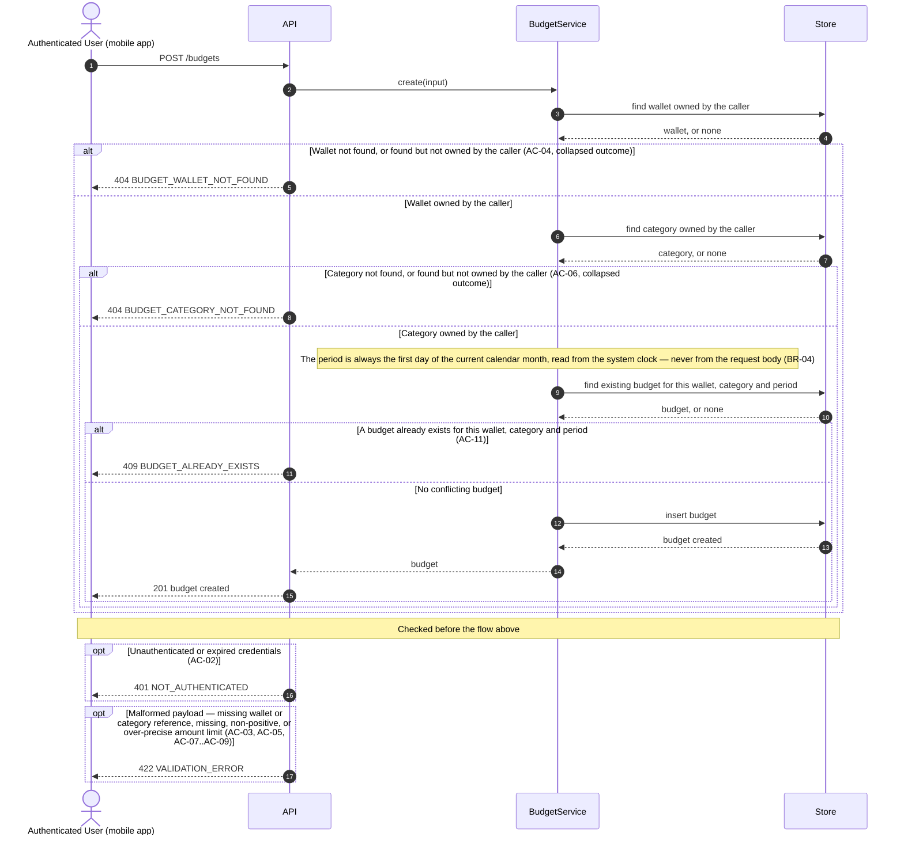
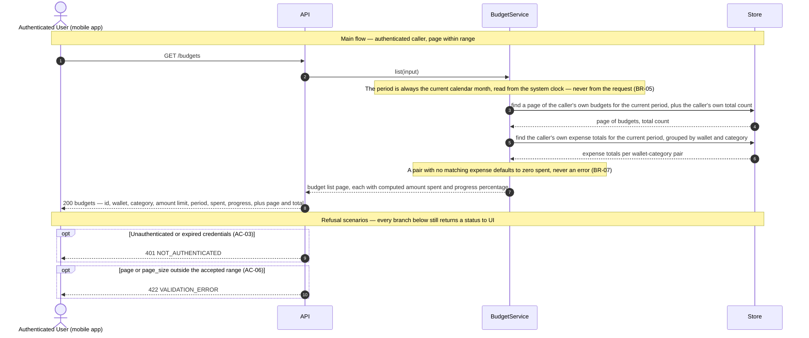
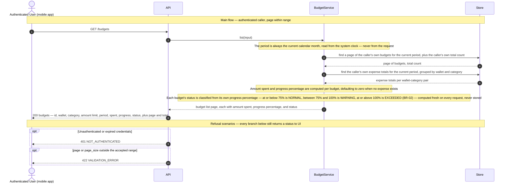
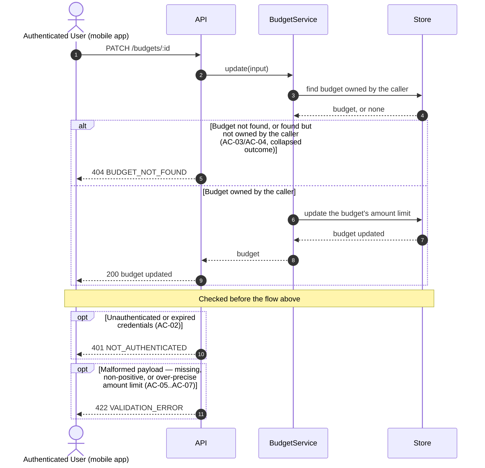
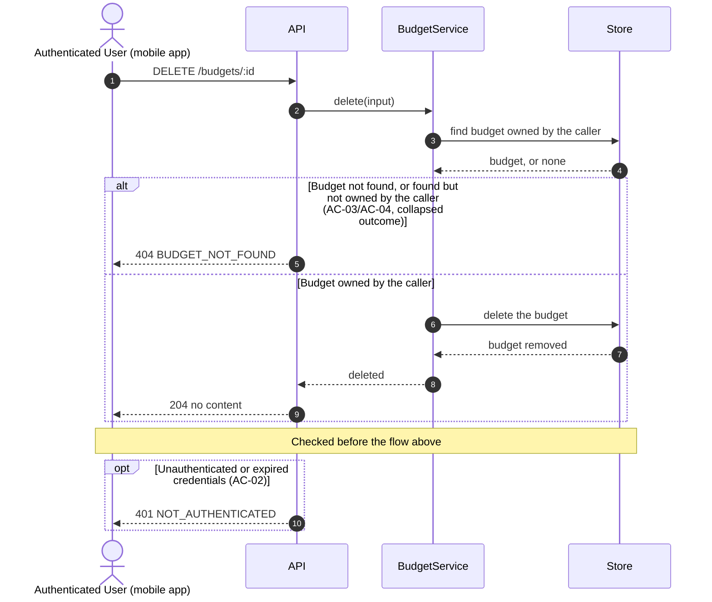

# Technical Plan: Budget Management (BM)

> **Feature:** SRS §6 Feature-05 · SDS §5.5 (BM)
> **Spec:** [spec.md](spec.md)
> **Stories in this file:** BM-US-01 *(implemented, verified — 245 passed, 99% coverage)* · BM-US-02 *(implemented, verified — 420 total passing)* · BM-US-03 *(implemented, verified — 431 total passing)* · BM-US-04 *(implemented, verified — 526 total passing)* · BM-US-05 *(implemented, verified — 526 total passing)*

---

## BM-US-01: Create a Budget

### Gaps & Decisions (Resolved)

Code and architecture decisions settled during design. Spec-level findings were folded back into `spec.md` before this step closed.

| ID | Area | Decision | Status |
|----|------|----------|--------|
| A1 | Domain | **`BudgetCreate` requires both `wallet_id` and `category_id`**, even though the SRS Gherkin scenario names only a category. The Gherkin is read as an abbreviated illustrative example, not a complete field list (the same treatment WM-US-01's `plan.md` A1 gave its own Gherkin's `type` examples) — SRS §1.5 itself draws both `Wallet scoped_to Budget` and `Category applies_to Budget` as required relationships, and SDS §2.2 (domain object), §2.3 (class diagram), and §4.3.3 (ERD) unanimously list `wallet_id` and `category_id` as required columns with no nullability hint anywhere. There is no genuine cross-document conflict here — the fuller sources all agree, and only the shorthand Gherkin omits a field, exactly as it omits an explicit period. Not escalated as `[NEEDS RULING]` because nothing actually disagrees. | ✅ Resolved |
| A2 | Domain | **`BudgetCreate` has no `period` field at all; `period` is computed server-side as the first day of the current calendar month**, read from `app.core.clock.utcnow()` (never `datetime.now()` — CLAUDE.md §4). No source shows a person choosing a period: the SRS Gherkin has the User enter only a category and a limit before clicking Save, and SDS §5.5.1's goal describes "a monthly period" as a property the budget carries, not an input field. Accepting an explicit `period` would require inventing validation rules no source states — how far into the past or future a period may be, what happens to a non-first-of-month value, whether multiple formats are accepted — while defaulting to "the current month" requires inventing nothing. This is the same "decide, document, keep moving" discipline WM-US-01/CM-US-01 used for their own undictated fields, applied here to prefer the interpretation that invents the fewest additional rules. `BudgetCreate` therefore declares no `period` field; any `period`-shaped key a caller submits anyway is silently ignored by Pydantic's default `BaseModel` behaviour, the same "structurally impossible to honour" pattern as WM-US-01 A7 and CM-US-01 A6 (spec EC-04). | ✅ Resolved |
| A3 | Domain | **A duplicate budget for the same `wallet_id` + `category_id` + `period` is refused — a deliberate departure from WM-US-01 A6 / CM-US-01 A3's "no uniqueness constraint" precedent for wallet and category names.** Reasoned independently rather than pattern-matched: a duplicate wallet or category *name* is cosmetic — two wallets named "Savings" are simply two different accounts with no functional ambiguity. Two budgets covering the same wallet, category, and month are different in kind: FR-05's own text ("track spending against **this** limit" and threshold percentages at 75%/100%) presupposes exactly one limit governs a given wallet+category+period, and BM-US-03 (out of scope here, but already named by the SDS §2.4.3 state machine this story's data feeds) has no well-defined "spending / limit" ratio to compute if two limits exist for the same period. This mirrors why `users.email` (UM-US-01 VL-05), unlike a wallet name, carries a uniqueness constraint — because a collision would break a real downstream lookup, not merely look confusing. Enforced at both levels constitution VL-05 requires: a service-layer check returning `409 BUDGET_ALREADY_EXISTS`, and a database unique index (`uq_budgets_wallet_category_period`) as the backstop. | ✅ Resolved |
| A4 | Domain / Money | **`amount_limit` must be strictly greater than zero — a departure from WM-US-01 A4's "no sign constraint" precedent for `wallets.balance`.** A wallet balance is a *state* that can legitimately go negative (a credit-type wallet already in debt); a budget's `amount_limit` is a *cap* a person deliberately sets, and the SRS's own and only example is positive (`200.00`). FR-05's threshold language ("75%, 100%") is meaningless against a zero or negative limit — there is no sensible "75% of a zero cap." `BudgetCreate.amount_limit` therefore adds `gt=0` alongside the `Decimal(15,2)` bound WM-US-01 A3 already established and this story reuses unchanged. | ✅ Resolved |
| A5 | Domain | **`wallet_id` and `category_id` are plain non-empty strings with no UUID-shape validation** (`Field(min_length=1)`), not a regex-constrained or native UUID type. This codebase's own `id` columns are `String(36)` free text (constitution ENV-03), and no existing DTO in this codebase validates an incoming foreign-key-shaped string against a UUID pattern. A malformed reference (`"not-a-real-id"`) and a well-formed but non-existent one both fail the same ownership-scoped lookup (A6) and so already produce the identical `404` outcome without any extra rule — adding shape validation would only create a *second*, `422`-flavoured error class for what is functionally the same caller mistake ("this does not name a wallet/category you own"), which nothing in the requirements asks for. Recorded as spec EC-07. | ✅ Resolved |
| A6 | Architecture | **Layering split for the two ownership checks, per constitution AR-01/AR-03.** The *query* — "does a wallet with this id, owned by this user, exist" — is data access with no business decision in it, so it lives in the repository layer as a new `get_owned_by_id()` function added to the existing `wallet_repo.py` and `category_repo.py` (not a new module — these two files already exist from WM-US-01/CM-US-01 and simply gain a second function each, the same way `user_repo.py` accumulated functions across UM-US-01/02/03). The *decision* — "a `None` result means refuse the whole request, and with which error" — is a business rule, so it lives in the new `budget_service.py` (AR-01), which calls the repository function and raises `BudgetWalletNotFoundError`/`BudgetCategoryNotFoundError` on `None`. The duplicate-budget check follows the identical split: the existence query is a new `budget_repo.get_by_wallet_category_period()`, the refusal decision is `budget_service`'s. | ✅ Resolved |
| A7 | Security | **`BudgetCreate` declares no field a client could use to name a budget's "owner"**, because there is no owner column to spoof in the first place — SDS §4.3.3's `BUDGETS` ERD has no `user_id` at all, unlike `wallets`/`categories`. Ownership is proven entirely by the two ownership-scoped lookups in A6: a `wallet_id`/`category_id` the caller does not own is refused before a `BudgetModel` row is even considered, so there is no separate "assign the owner" step analogous to WM-US-01 A7 / CM-US-01 A6 for this story to get wrong. | ✅ Resolved |
| A8 | Domain / State | **The SDS §2.4.3 Budget Monitoring State machine (`DRAFT → NORMAL → WARNING → EXCEEDED → ARCHIVED`) is not implemented by this story, and `budgets` gets no `status` column.** The §4.3.3 ERD lists exactly `id`, `wallet_id`, `category_id`, `amount_limit`, `period` for `BUDGETS` — no status field — and no AC in this story's own set asks for one. The Gherkin's "creates an **active** budget" is read as describing the fact that the row now exists and will be monitored going forward, not a value this story stores; deriving and persisting real progress against that state machine needs spending data this story never reads, which is BM-US-03's job. Flagged here rather than silently building toward it, the same "flag a gap, defer the column to the story that needs it" shape as WM-US-01 A5 and CM-US-01 A4. | ✅ Resolved *(flagged, not closed — see spec.md Assumptions)* |
| A9 | Security | **No role restriction.** `CurrentUserDep` — not `AdminDep` — guards this route. SRS §6 US-05-01 names the actor "Authenticated User" with no role qualifier, and SDS §5.5.1 tags the story "(USER)". Directly mirrors WM-US-01 A8 / CM-US-01 A7. | ✅ Resolved |
| A10 | Architecture | **No audit event.** Constitution LA-04 enumerates exactly three audited event families — invitations sent, activations completed, logins — and budget creation is not among them. No AC or FR in `spec.md` asks for one either. Directly mirrors WM-US-01 A9 / CM-US-01 A8. | ✅ Resolved |
| A11 | Domain / ERD | **No `created_at` column on `budgets`.** SDS §4.3.3's ERD lists `budgets` with exactly the five columns named in A8 — no timestamp, the same gap WM-US-01 A5 found in `wallets`. Not added here for the same reason: a column the ERD does not list is a domain-model change outside this story's authority to make unilaterally. | ✅ Resolved *(flagged, not closed — see spec.md Assumptions)* |

---

### Architecture

**Package layout** (additions only; `WalletModel`/`CategoryModel`'s sibling files are the closest precedent throughout — this is the first story to *modify* two existing repository modules rather than only adding new ones).

```text
backend/app/
├── models/
│   └── budget.py                     # NEW  BudgetModel (SDS §2.1, §2.2, §4.3.3)
├── schemas/
│   └── budget.py                     # NEW  BudgetCreate, BudgetRead
├── repositories/
│   ├── wallet_repo.py                # MODIFIED  add get_owned_by_id()
│   ├── category_repo.py              # MODIFIED  add get_owned_by_id()
│   └── budget_repo.py                # NEW  add_budget(), get_by_wallet_category_period()
├── services/
│   └── budget_service.py             # NEW  create_budget()
├── core/
│   └── errors.py                     # MODIFIED  add BudgetWalletNotFoundError, BudgetCategoryNotFoundError, BudgetAlreadyExistsError
└── api/v1/
    ├── budgets.py                    # NEW  POST /budgets
    └── router.py                     # MODIFIED  mount budgets.router

backend/migrations/versions/
└── <rev>_create_budgets.py           # NEW  budgets table, down_revision = 81bfb85427ed (current head)

backend/tests/
└── integration/test_bm_us_01_create_budget.py   # NEW  written at the Implement step from test_cases.md
```

No change to `core/deps.py` — `CurrentUserDep` (`get_current_user`) already resolves any authenticated `ACTIVE` User of either role and is reused exactly as-is (A9).

**Domain objects**

| Entity | Table | Key Fields | Notes |
|--------|-------|------------|-------|
| `BudgetModel` | `budgets` | `id` PK, `wallet_id` FK→`wallets.id` (indexed), `category_id` FK→`categories.id` (indexed), `amount_limit`, `period` | No `user_id` (A7), no `status` (A8), no `created_at` (A11) — exactly the five ERD columns. Both FKs carry an index: every query this story or a future one runs against `budgets` filters by one or both (constitution PF-02), and the ownership lookups in A6 are themselves indexed lookups on `wallets.id`/`categories.id`, already primary-keyed. |
| — | — | `uq_budgets_wallet_category_period` | Composite unique constraint on `(wallet_id, category_id, period)` — the database backstop half of VL-05's two-level uniqueness (A3). |

**Model** (`app/models/budget.py`)

```python
class BudgetModel(Base):
    __tablename__ = "budgets"

    id: Mapped[str] = mapped_column(String(36), primary_key=True, default=new_uuid)

    # spec BR-01: ownership is entirely transitive through this FK — no
    # user_id column exists on this table at all (A7).
    wallet_id: Mapped[str] = mapped_column(
        String(36), ForeignKey("wallets.id"), nullable=False, index=True
    )
    category_id: Mapped[str] = mapped_column(
        String(36), ForeignKey("categories.id"), nullable=False, index=True
    )

    # spec BR-03, constitution VL-07: Decimal(15,2), strictly positive (A4).
    amount_limit: Mapped[Decimal] = mapped_column(Numeric(15, 2), nullable=False)

    # spec BR-04: always the 1st of the current month at creation (A2).
    period: Mapped[date] = mapped_column(Date, nullable=False)

    __table_args__ = (
        # spec BR-05, plan.md A3: at most one budget per wallet+category+period.
        UniqueConstraint(
            "wallet_id", "category_id", "period", name="uq_budgets_wallet_category_period"
        ),
    )

    def __repr__(self) -> str:  # pragma: no cover - debugging aid
        return f"<BudgetModel id={self.id} wallet_id={self.wallet_id} category_id={self.category_id}>"
```

**DTOs** (`app/schemas/budget.py`)

```python
class BudgetCreate(BaseModel):
    """No `period` field (A2, spec EC-04) — a submitted one is silently
    ignored, the same "structurally impossible to honour" pattern as
    WalletCreate/CategoryCreate's absent `user_id` field. No UUID-shape
    validation on the two references (A5) — an unresolvable value of any
    shape is refused identically by the ownership-scoped lookup (A6).
    """

    wallet_id: str = Field(min_length=1)
    category_id: str = Field(min_length=1)

    # Decimal(15,2), reject-don't-round (WM-US-01 A3 precedent, reused
    # unchanged) plus a strict positivity bound this story adds (A4).
    amount_limit: Decimal = Field(max_digits=15, decimal_places=2, gt=0)


class BudgetRead(BaseModel):
    """SDS §2.2. Exactly five fields (spec AC-12, FR-11, constitution
    PF-03) — no owner field of any kind (A7), no status (A8).
    """

    id: str
    wallet_id: str
    category_id: str
    amount_limit: Decimal
    period: date
```

**Repository additions**

```python
# wallet_repo.py — new function alongside the existing add_wallet()
def get_owned_by_id(db: Session, *, wallet_id: str, user_id: str) -> WalletModel | None:
    """spec FR-04, BR-01/BR-02, constitution SEC-08. Scoped by user_id in
    the query itself, so "does not exist" and "belongs to someone else"
    return the identical None — collapsed by construction, not by a
    check that could be forgotten (A6).
    """

# category_repo.py — new function alongside the existing add_category()
def get_owned_by_id(db: Session, *, category_id: str, user_id: str) -> CategoryModel | None:
    """spec FR-06, BR-01/BR-02, constitution SEC-08. Same shape as
    wallet_repo.get_owned_by_id().
    """
```

```python
# budget_repo.py — new module
def get_by_wallet_category_period(
    db: Session, *, wallet_id: str, category_id: str, period: date
) -> BudgetModel | None:
    """spec FR-10, BR-05, plan.md A3. The existence half of the
    two-level uniqueness check (constitution VL-05) — the refusal
    decision is the service's, not this query's (A6)."""

def add_budget(
    db: Session, *, wallet_id: str, category_id: str, amount_limit: Decimal, period: date
) -> BudgetModel:
    """spec AC-01, FR-09..FR-11, BR-01. Flushed, not committed (AR-06) —
    the router owns the transaction boundary."""
```

**Service** (`app/services/budget_service.py`)

```python
def create_budget(
    db: Session, *, owner: UserModel, wallet_id: str, category_id: str, amount_limit: Decimal
) -> BudgetRead:
    """spec AC-01, FR-13, BR-02. Fixed check order — wallet ownership,
    then category ownership, then the duplicate-budget check — so a
    request that fails more than one reports only the first (A6).
    """
    wallet = wallet_repo.get_owned_by_id(db, wallet_id=wallet_id, user_id=owner.id)
    if wallet is None:
        raise BudgetWalletNotFoundError()

    category = category_repo.get_owned_by_id(db, category_id=category_id, user_id=owner.id)
    if category is None:
        raise BudgetCategoryNotFoundError()

    # spec BR-04, plan.md A2: never from the request payload.
    period = clock.utcnow().date().replace(day=1)

    existing = budget_repo.get_by_wallet_category_period(
        db, wallet_id=wallet_id, category_id=category_id, period=period
    )
    if existing is not None:
        raise BudgetAlreadyExistsError()

    budget = budget_repo.add_budget(
        db, wallet_id=wallet_id, category_id=category_id, amount_limit=amount_limit, period=period
    )
    return BudgetRead(
        id=budget.id,
        wallet_id=budget.wallet_id,
        category_id=budget.category_id,
        amount_limit=budget.amount_limit,
        period=budget.period,
    )
```

**New errors** (`app/core/errors.py`, appended under a new `# --- BM-US-01: Create a Budget` section)

```python
class BudgetWalletNotFoundError(AppError):
    """spec AC-04 / FR-04. Identical for "no such wallet" and "not this
    caller's wallet" (constitution VL-06's `404 if absent` branch)."""
    status_code = 404
    error_code = "BUDGET_WALLET_NOT_FOUND"
    default_message = "The referenced wallet was not found."


class BudgetCategoryNotFoundError(AppError):
    """spec AC-06 / FR-06. Same collapsed shape as BudgetWalletNotFoundError."""
    status_code = 404
    error_code = "BUDGET_CATEGORY_NOT_FOUND"
    default_message = "The referenced category was not found."


class BudgetAlreadyExistsError(AppError):
    """spec AC-11 / FR-10 / BR-05, constitution VL-05."""
    status_code = 409
    error_code = "BUDGET_ALREADY_EXISTS"
    default_message = "A budget already exists for this wallet, category, and period."
```

**Business rules enforced in service layer**

| Rule | Source | Enforcement |
|------|--------|--------------|
| Authenticated User of any role may create a budget | AC-01, FR-01, A9 | `POST /api/v1/budgets` accepting `BudgetCreate`, guarded by `CurrentUserDep` — not `AdminDep` |
| Unauthenticated caller denied before the payload is evaluated | AC-02, FR-02 | `CurrentUserDep` resolves before FastAPI validates the body — identical ordering to WM-US-01/CM-US-01 |
| `wallet_id` required, non-empty | AC-03, FR-03 | `Field(min_length=1)` |
| `wallet_id` must resolve to the caller's own wallet; not-found and not-owned collapsed | AC-04, EC-05, EC-07, FR-04, A1, A5, A6 | `wallet_repo.get_owned_by_id()` returns `None` for both cases by construction; service raises `BudgetWalletNotFoundError` |
| `category_id` required, non-empty | AC-05, FR-05 | `Field(min_length=1)` |
| `category_id` must resolve to the caller's own category; not-found and not-owned collapsed | AC-06, EC-06, EC-07, FR-06, A1, A5, A6 | `category_repo.get_owned_by_id()` returns `None` for both cases by construction; service raises `BudgetCategoryNotFoundError` |
| `amount_limit` required, `Decimal(15,2)`, reject not round | AC-07, AC-09, EC-02, FR-07, constitution VL-07 | `Field(max_digits=15, decimal_places=2)` |
| `amount_limit` strictly positive | AC-08, EC-01, FR-08, A4 | `Field(..., gt=0)` |
| `period` always the 1st of the current month; client input ignored | AC-10, EC-04, FR-09, A2 | `BudgetCreate` declares no `period` field; service computes `clock.utcnow().date().replace(day=1)` |
| Duplicate `wallet_id`+`category_id`+`period` refused | AC-11, EC-08, EC-09, EC-10, FR-10, A3 | `budget_repo.get_by_wallet_category_period()`; service raises `BudgetAlreadyExistsError` if found |
| Fixed check order — wallet, then category, then uniqueness | FR-13, BR-02, A6 | `create_budget()`'s straight-line sequence; each check returns/raises before the next runs |
| Response exposes exactly five fields | AC-12, FR-11, constitution PF-03 | `BudgetRead` — no ORM graph, no extra field |
| Every validation failure reported together | EC-03, FR-12, constitution VL-02 | Reuses the existing `RequestValidationError` handler in `main.py` — unchanged, no new wiring |
| No audit event | A10 | `budget_service.create_budget()` calls no `audit.record()` |

**Sequence diagram — Create a Budget**

Drawn to `constitution.md` DG-01…DG-07: four lanes only, no SQL, no parameter lists, every request into `API` answered back to `UI` with a status code, one workflow.



Only one workflow is drawn (DG-07). The nested `alt`/`else` blocks are the one flow's own branches — not a second flow — mirroring how WM-US-01/CM-US-01 folded their refusal `opt`s into a single diagram.

**Error flows**

| Scenario | HTTP | Error Code |
|----------|------|------------|
| No or invalid bearer credentials (AC-02) | 401 | `NOT_AUTHENTICATED` |
| Missing wallet reference, missing category reference, missing/non-positive/over-precise amount limit (AC-03, AC-05, AC-07..AC-09) | 422 | `VALIDATION_ERROR` |
| Wallet not found, or found but not owned by the caller (AC-04) | 404 | `BUDGET_WALLET_NOT_FOUND` |
| Category not found, or found but not owned by the caller (AC-06) | 404 | `BUDGET_CATEGORY_NOT_FOUND` |
| A budget already exists for this wallet, category, and period (AC-11) | 409 | `BUDGET_ALREADY_EXISTS` |
| Unexpected server error | 500 | `INTERNAL_ERROR` |

All in the flat envelope `{"error_code", "message", "details"}` (SDS §6.6, constitution API-02) — reused unchanged from `main.py`. No `403` (A9: no role restriction).

**Constitution notes**

| Rule | Status | Note |
|------|--------|------|
| AR-01 Service owns business rules | Required | `budget_service.create_budget()` is the only place that decides what a failed lookup means and assembles the persisted row |
| AR-02 Thin router | Required | Router binds the payload, resolves `CurrentUserDep`, calls the service, commits, formats the response — no branching on business state |
| AR-03 Repository isolation | Required | `wallet_repo.get_owned_by_id()`, `category_repo.get_owned_by_id()`, and `budget_repo`'s two functions are queries and persistence only (A6) |
| AR-04 DTO ↔ model mapping outside routers/repos | Required | No field-name mapping needed (`wallet_id`/`category_id`/`amount_limit`/`period` are identical on DTO and column), but the service remains the boundary that would carry it |
| AR-05 No framework objects in services | Required | `create_budget()` takes plain values (`owner: UserModel`, `wallet_id`, `category_id`, `amount_limit`); no `Request`/`Response` |
| AR-06 One transaction per request | Required | Service flushes at most once (after all three checks pass); the router commits once |
| AR-07 Router → service → repository | Required | The router never calls `wallet_repo`/`category_repo`/`budget_repo` directly |
| AR-08 Module layout | Required | `backend/app/{models,schemas,repositories,services,api}` — no new top-level package; two existing repository files gain a function each (A6) |
| API-01 Versioned plural path | Required | `POST /api/v1/budgets` |
| API-02 Flat error envelope | Required | Reused from `main.py`, unchanged |
| API-03 Status codes | Required | `201` create · `401` · `404` (×2 codes) · `409` · `422` |
| API-04 Prefixed error codes | Required | `BUDGET_WALLET_NOT_FOUND`, `BUDGET_CATEGORY_NOT_FOUND`, `BUDGET_ALREADY_EXISTS` — all catalogued above |
| API-05 No generic status endpoint | Required | `/budgets` is a plain resource-creation `POST` |
| API-06 Pagination | N/A | Single-resource creation; no list in this story |
| API-07 Explicit response_model | Required | `response_model=BudgetRead`, `status_code=201` |
| API-08 Public endpoint list | Required | This route is **protected** — not added to the public list |
| NC-01 Module naming | Required | `budget_repo.py`, `budget_service.py` — singular, matching `wallet_repo.py`/`category_repo.py` |
| NC-02 Naming | Required | `BudgetModel`; `BudgetCreate` / `BudgetRead` (SDS §2.1); table `budgets` |
| NC-04 Column naming | Required | snake_case; `wallet_id`/`category_id` FKs. No `created_at` this story (A11) |
| NC-05 Enum serialisation | N/A | Budget introduces no enum column |
| NC-06 Concise service methods | Required | `BudgetService.create`, matching `WalletService.create`/`CategoryService.create` |
| VL-01 Pydantic is the source of truth | Required | Every payload-shape bound (presence, decimal shape, positivity) lives on `BudgetCreate` |
| VL-02 Errors grouped | Required | Reused `RequestValidationError` handler (EC-03) |
| VL-05 Two-level uniqueness | Required | Service check (`BudgetAlreadyExistsError`, 409) plus DB unique index `uq_budgets_wallet_category_period` (A3) — first story in this codebase to need this rule |
| VL-06 Referenced entities verified before use | Required | Both `wallet_id` and `category_id` resolved through an ownership-scoped lookup before a `BudgetModel` is built; absent → 404 (A6). No "wrong state" branch applies — neither Wallet nor Category has a status field to be in the wrong state of |
| VL-07 Decimal money | Required | `Decimal`, `max_digits=15, decimal_places=2` on the DTO (WM-US-01 A3 precedent) plus `gt=0` this story adds (A4); `Numeric(15, 2)` on the column |
| SEC-06 JWT parameters | N/A | Consumed via `CurrentUserDep`, not defined here |
| SEC-07 Authz proven by test | Required (partial) | `401` gets a dedicated test; there is no `403` case to test (A9) |
| SEC-08 Ownership filter | Required | Extended one hop past its usual shape (spec BR-01): the *referenced* rows, not the row being written, are what get filtered by `user_id` — the read-side half of SEC-08 this story's two `get_owned_by_id()` queries implement directly |
| SEC-09 Secrets from .env | N/A | No secret is introduced by this story |
| SEC-10 No enumeration | N/A (reasoning reused) | SEC-10 itself is about disclosing whether an *account* exists to an unauthenticated caller — not literally this story's situation, since the caller here is already authenticated and a wallet/category id is not a login credential. Its non-enumeration *discipline* is still applied, via VL-06's absent-vs-present collapse (A6): an authenticated caller who does not own a real wallet/category id learns nothing about who does, because the identical `404` covers both "never existed" and "exists, but not yours" |
| SEC-11 Rate limiting | N/A | Scoped by its own text to the invitation and activation endpoints |
| LA-01 No secrets in logs | N/A | No credential or token is handled by this story |
| LA-02 / LA-04 Audit | N/A (by decision) | Budget creation is not one of LA-04's three named audited events, and no AC/FR asks for a fourth (A10) |
| PF-01 300 ms p95 | Required | Three indexed lookups plus one insert, no I/O off the request path |
| PF-02 Indexed lookups | Required | `budgets.wallet_id`/`budgets.category_id` indexed now; the ownership lookups query `wallets`/`categories` by primary key, already indexed |
| PF-03 DTO projection | Required | `BudgetRead` — five fields, no ORM graph |
| PF-04 Bounded lists | N/A | No list endpoint in this story |
| TST-01/02 AC→TC coverage | Required | Every AC and EC mapped in `test_cases.md` before any test code |
| DOD-02 Migration | Required | One Alembic revision creating `budgets`, `down_revision = 81bfb85427ed` (current head) |
| DOD-03 Coverage > 80% | Required | Measured at the Implement step |

**Element IDs**

| Element | ID | Status | File |
|---------|----|--------|------|
| — | — | **N/A (mobile deferred)** | No budget-creation screen exists this round. `mobile/`'s fixture-driven prototype covers only UM-US-01's invite screen (`CLAUDE.md` §5); a budget-creation screen is not part of Round 1's mobile scope and no SRS UXR names one for creation (UXR-02 concerns *displaying* budget health, which belongs to BM-US-03). |

**Open tasks**

| ID | Task | File | Status |
|----|------|------|--------|
| T-01 | `BudgetModel` (`id`, `wallet_id` FK indexed, `category_id` FK indexed, `amount_limit`, `period` — no `user_id`/`status`/`created_at`, A7/A8/A11) plus `uq_budgets_wallet_category_period` | `backend/app/models/budget.py` | Open |
| T-02 | Alembic revision creating `budgets` with its two FKs, two indexes, and the composite unique constraint, `down_revision = 81bfb85427ed` | `backend/migrations/versions/` | Open |
| T-03 | Schemas `BudgetCreate`, `BudgetRead` | `backend/app/schemas/budget.py` | Open |
| T-04 | Add `wallet_repo.get_owned_by_id(db, *, wallet_id, user_id)` | `backend/app/repositories/wallet_repo.py` | Open |
| T-05 | Add `category_repo.get_owned_by_id(db, *, category_id, user_id)` | `backend/app/repositories/category_repo.py` | Open |
| T-06 | `budget_repo.get_by_wallet_category_period(...)`, `budget_repo.add_budget(...)` | `backend/app/repositories/budget_repo.py` | Open |
| T-07 | `budget_service.create_budget(db, *, owner, wallet_id, category_id, amount_limit)` — fixed check order (FR-13) | `backend/app/services/budget_service.py` | Open |
| T-08 | Add `BudgetWalletNotFoundError`, `BudgetCategoryNotFoundError`, `BudgetAlreadyExistsError` | `backend/app/core/errors.py` | Open |
| T-09 | `POST /api/v1/budgets` router; mount `budgets.router` in `api/v1/router.py` | `backend/app/api/v1/budgets.py`, `backend/app/api/v1/router.py` | Open |
| T-10 | Integration tests written from `test_cases.md` | `backend/tests/integration/test_bm_us_01_create_budget.py` | Open |

---

## BM-US-02: List Budgets

> **IDs in this section are local to BM-US-02** (`A*`/`T-NN`), matching `spec.md`'s convention and
> `specs/003-wallet-management/plan.md` (WM-US-02) / `specs/004-category-management/plan.md`
> (CM-US-02)'s own precedent — both restart `A*`/`T-NN` per story while `test_cases.md`'s `TC-NN`/`QF-NN`
> continue across the whole epic file. **Deviation from this dispatch's own brief, flagged here rather
> than silently followed:** the brief instructed continuing plan.md's ids from `A12`/`T-11`. Every
> existing second-or-later story in this codebase's plan.md files (WM-US-02, CM-US-02, and — by the same
> convention — TM-US-02) instead restarts at `A1`/`T-01` locally, each with a header note identical in
> shape to this one, precisely because `CLAUDE.md`'s own instruction to "open BM-US-01/WM-US-02/CM-US-02/
> TM-US-02's own sections and match it" is unambiguous once those files are actually opened (done above).
> Followed here as the demonstrated, three-times-repeated repository convention over the literal
> numbers in the dispatch brief, which appear to have been computed against `spec.md`'s AC/EC/FR/BR
> series (which *is* meant to look continuous story-to-story in numbering coincidence, not by rule) rather
> than against the actual, already-established plan.md convention. `test_cases.md`'s `TC-NN` below does
> continue from `TC-26` as instructed, since that one matches the real convention exactly.

### Gaps & Decisions (Resolved)

| ID | Area | Decision | Status |
|----|------|----------|--------|
| A1 | Domain / ERD | **Ordering with no `created_at`: order by the primary key `id` ascending (`ORDER BY id ASC`), no schema change.** Identical reasoning to WM-US-02 A1/CM-US-02 A1 — `backend/app/models/budget.py` carries no `created_at` (BM-US-01 A11), and no AC in this story asks for chronological order, only *a* list. | ✅ Resolved |
| A2 | API | **New per-item DTO `BudgetProgressRead` (seven fields) and new envelope `BudgetListRead { items, total, page, page_size }`, mirroring `WalletListRead`/`CategoryListRead`/`TransactionListRead`.** `BudgetRead` (BM-US-01) is **not** reused for the per-item shape, unlike CM-US-02/WM-US-02's reuse of their own single-resource `Read` DTOs unchanged. Reuse is deliberately declined here: BM-US-01 AC-12/FR-11 fix `BudgetRead` at exactly five fields for the *creation* response, and that story's own test suite (`test_cases.md` TC-24) asserts the response has **exactly** those five keys. Extending `BudgetRead` itself with `amount_spent`/`progress_percentage` would risk `POST /budgets` silently growing two fields no BM-US-01 AC asks for the moment the two schemas were merged — so a distinct `BudgetProgressRead` is safer than reuse-with-extra-fields, and its four base fields are still identical to `BudgetRead`'s own four non-`id` fields, so nothing is invented twice. | ✅ Resolved |
| A3 | Security / Architecture | **Ownership scoped by a single `JOIN` on `wallets`, not a second join to `categories`.** `budget_repo.list_owned()` filters on `WalletModel.user_id == user_id` through a join on `budgets.wallet_id`, the same single-join shape `transaction_repo.list_owned()` already established for `transactions` (TM-US-02 A2) — even though `budgets`, like `transactions`, references two owned entities (`wallet_id` and `category_id`). This is safe, not merely convenient: BM-US-01 FR-13/BR-02 validates `wallet_id` **and** `category_id` independently against the *same* caller at creation time, in a fixed order, before a `BudgetModel` row is ever written — there is no code path in this codebase that can produce a stored budget whose `wallet_id` and `category_id` belong to two different Users. A second join to `categories` would therefore filter on a predicate that is already guaranteed true by every row's own provenance, adding a table to the query plan for no additional correctness. Both the bounded page query and the total-count query in `list_owned()` carry the identical join and predicate (mirrors WM-US-02 A3/CM-US-02 A3's "combined pagination and ownership filtering, single predicate" shape) — scoping only one of the two would leak a system-wide count next to a caller-scoped list (`test_cases.md` QF-07). | ✅ Resolved |
| A4 | Domain / Architecture | **New `transaction_repo.get_expense_totals_by_wallet_category()`, grouped by `(wallet_id, category_id)`, filtered to `type == EXPENSE` and the current-month bounds.** Mirrors `transaction_repo.get_summary_totals()`'s own shape (FR-US-01) exactly, grouped by a different key: that function groups by `type` for one owner's whole-period totals; this one groups by `(wallet_id, category_id)` to align each sum with the one budget it belongs to. Carries the identical `GROUP BY` omits-empty-groups trap `get_summary_totals()`'s own docstring already documents and `test_cases.md` QF-09 tests for: a `(wallet_id, category_id)` pair with no qualifying `EXPENSE` row in the period produces no dictionary entry at all, so `budget_service.list_budgets()` must default a missing key to `Decimal("0.00")`, never treat a missing key as an error or as "no such budget." | ✅ Resolved |
| A5 | Domain | **"Active" = the budget's `period` equals the current calendar month, computed from `clock.utcnow()`, never client input.** `budget_repo.list_owned()` takes a `period: date` argument the service computes once, the same one-liner BM-US-01 A2 already established (`clock.utcnow().date().replace(day=1)`), and filters `budgets.period == period` — an equality check, not a range, since every stored `period` value is already normalised to the first of its month at creation time (BM-US-01 BR-04). Full rationale in `spec.md` Assumptions. | ✅ Resolved |
| A6 | Architecture / Data | **New Alembic migration adding an index on `budgets.period` — the first migration this listing-shaped story needs, unlike CM-US-02/WM-US-02, which added none.** Those two stories' own `list_owned()` filters only on `user_id` (already indexed at creation time) and orders by the primary key. This story's `list_owned()` additionally filters on `budgets.period` in a `WHERE` clause for the first time anywhere in this codebase — the existing `uq_budgets_wallet_category_period` unique index has `period` only as its *third* column, which does not efficiently serve a query that supplies `wallet_id` only through a join and supplies no `category_id` predicate at all. Constitution PF-02 ("columns used in `WHERE` ... carry an index") is read literally here rather than relied on to be already covered by a differently-shaped composite index. | ✅ Resolved |
| A7 | Domain / Scope | **Computing `progress_percentage` and `amount_spent` is this story's own job, not BM-US-03's — narrowing BM-US-01's own "Out of scope" note.** Full reasoning in `spec.md` Assumptions: SDS §5.5.2's goal for *this* story names "current progress percentages" directly, distinct from the SDS §2.4.3 state machine's `WARNING`/`EXCEEDED` classification and FR-05's threshold-alert language, both of which remain BM-US-03's. Not an extension of either reference document — it is reading BM-US-02's own SDS line for what it actually says. | ✅ Resolved |
| A8 | Security | **No role restriction — `CurrentUserDep` guards the route, not `AdminDep`.** SDS §5.5.2 tags this story "(USER)", identical to BM-US-01's own "(USER)" tag. An ADMIN caller who also owns budgets sees, through this route, only their own (spec EC-04, BR-01; `test_cases.md` QF-07/QF-08); nothing elevates an ADMIN's visibility here. Mirrors BM-US-01 A9, CM-US-02 A6, WM-US-02 A6. | ✅ Resolved |
| A9 | Logging | **No new audit event for a list view.** Constitution LA-04 names exactly three audited event families; budget creation itself was already excluded by BM-US-01 A10, and reading a list is further still from anything LA-04 enumerates. No AC or FR here asks for one. Mirrors CM-US-02 A5/WM-US-02 A5. | ✅ Resolved |
| A10 | Architecture | **The router issues no `db.commit()`.** Pure read, nothing to commit — mirrors `GET /wallets`, `GET /categories`, and `GET /transactions`. | ✅ Resolved |
| A11 | Architecture | **`budget_service.py` gets its own private `_month_bounds()` helper, duplicating `report_service._month_bounds()`'s six-line shape rather than importing it.** `report_service._month_bounds()` is name-mangled private (a leading underscore) to its own module by this codebase's own convention (no other service imports another service's underscore-prefixed helper anywhere in this codebase); reaching across that boundary would blur which service owns the "what does *current month* mean" decision for its own AR-01 business logic. The duplication is six lines with no independent logic of its own to drift, and this story's own `[NEEDS RULING]`-free judgement call is that respecting module ownership costs less than the duplication risks. | ✅ Resolved |
| A12 | Domain / Money | **`progress_percentage` is a `Decimal`, quantized to two decimal places with `ROUND_HALF_UP`, computed as `(amount_spent / amount_limit * 100)` — not a `float`, though constitution VL-07 does not itself govern a ratio.** `amount_limit` is guaranteed strictly positive by BM-US-01 BR-03, so no division-by-zero guard is needed. `Decimal` is chosen anyway, over `float`, because every other numeric value this codebase serialises already goes through `Decimal` for float-free, deterministic test assertions (constitution TST-06) — introducing the one `float` field in this response would reintroduce exactly the non-determinism VL-07 exists to rule out for money, even though a percentage is not itself money. No cap at 100 (spec BR-08) — FR-05's own "alerts when thresholds are reached" presupposes the ratio can exceed 100%. | ✅ Resolved |
| A13 | Architecture / Data | **`BudgetModel.period`'s own `mapped_column` declaration gains `index=True` at Implement time, alongside the hand-written migration this story's package layout already lists — a deviation from that layout's literal file list (which named only `migrations/versions/<rev>_index_budgets_period.py`, not `models/budget.py`).** Leaving the ORM model's column declaration out of sync with a hand-written index migration risks a future `alembic revision --autogenerate` proposing to drop the index it doesn't know about — the exact pre-existing gap `e33a7c97dab4`'s own docstring already flags for `ix_users_created_at`, not a trap this story should add a second instance of while it is already touching the table. `models/budget.py`'s own docstring is updated alongside (A6's "no schema change" note still holds for the ERD's column list — only an index is added, no column). | ✅ Resolved |

---

### Architecture

**Package layout** (additions only — no new top-level module; the same "additions to existing files"
shape CM-US-02/WM-US-02 both used for their own list story).

```text
backend/app/
├── schemas/
│   └── budget.py                     # update: add BudgetProgressRead, BudgetListRead (A2)
├── repositories/
│   ├── budget_repo.py                # update: add list_owned() (A1, A3, A5)
│   └── transaction_repo.py           # update: add get_expense_totals_by_wallet_category() (A4)
└── services/
    └── budget_service.py             # update: add list_budgets(), _month_bounds() (A2, A4, A5, A7, A11, A12)

backend/app/api/v1/
└── budgets.py                        # update: add GET /budgets (list) (A8, A10)

backend/migrations/versions/
└── <rev>_index_budgets_period.py     # NEW  index on budgets.period, down_revision = 2187429f50ce (current head) (A6)

backend/tests/
└── integration/test_bm_us_02_list_budgets.py   # NEW  written at the Implement step from test_cases.md
```

No change to `core/deps.py` — `CurrentUserDep` is reused exactly as BM-US-01 already established (A8).

**Domain objects**

| Entity | Table | Fields touched | Notes |
|--------|-------|-----------------|-------|
| `BudgetModel` | `budgets` | none (read-only) | This story only reads. Still no `user_id`/`status`/`created_at` (BM-US-01 A7/A8/A11). The new index on `period` (A6) is the only schema change this story makes. |
| `TransactionModel` | `transactions` | none (read-only) | Read for the first time by a Budget Management story — the sole source of every "amount spent" figure (A4). |
| `BudgetProgressRead` (DTO) | — | `id`, `wallet_id`, `category_id`, `amount_limit`, `period`, `amount_spent`, `progress_percentage` | New per-item shape (A2) — not `BudgetRead`, which BM-US-01 AC-12/FR-11 fix at exactly five fields for the creation response. |
| `BudgetListRead` (DTO) | — | `items: BudgetProgressRead[]`, `total`, `page`, `page_size` | New envelope (A2), mirrors `WalletListRead`/`CategoryListRead`/`TransactionListRead` — not in SDS's registry. |

**DTOs** (`app/schemas/budget.py`, addition)

```python
class BudgetProgressRead(BaseModel):
    """Per-item shape for the list endpoint (BM-US-02 AC-13, FR-13; SDS
    §5.5.2 "current progress percentages"). Distinct from `BudgetRead` (A2)
    — its own five fields are unchanged, this DTO simply repeats the same
    four non-id fields and adds the two computed ones.
    """

    id: str
    wallet_id: str
    category_id: str
    amount_limit: Decimal
    period: date

    # Computed at read time (A4, A12) — never stored on BudgetModel.
    amount_spent: Decimal
    progress_percentage: Decimal


class BudgetListRead(BaseModel):
    """New envelope (A2) — mirrors WalletListRead (WM-US-02), CategoryListRead
    (CM-US-02), TransactionListRead (TM-US-02).
    """

    items: list[BudgetProgressRead]
    total: int
    page: int
    page_size: int
```

**Business rules enforced in service layer**

| Rule | Source | Enforcement |
|------|--------|--------------|
| Any authenticated User of any role may list their own active budgets | AC-01, FR-01, A8 | `GET /api/v1/budgets` guarded by `CurrentUserDep` — not `AdminDep` |
| Unauthenticated caller denied before any query parameter is evaluated | AC-03, FR-02 | `CurrentUserDep` resolves before FastAPI validates `page`/`page_size` |
| Every budget query scoped to the caller — items and total alike | AC-07, FR-06, FR-07, A3, constitution SEC-08 | `budget_repo.list_owned()` — both queries join `wallets` and carry `WHERE wallets.user_id = :owner_id` |
| Bounded, paginated results | AC-04, AC-05, AC-06, API-06, PF-04 | Router declares `Query(page, ge=1)` / `Query(page_size, ge=1, le=100)` — out-of-range is `422`, not clamped |
| Stable, deterministic order | AC-08, EC-03, BR-03, A1 | `ORDER BY id ASC` in `budget_repo.list_owned()` |
| Restricted to the current calendar month | AC-09, EC-06, FR-09, BR-05, A5 | `budget_repo.list_owned()` filters `budgets.period == period`, `period` computed once in the service from `clock.utcnow()` |
| Amount spent scoped per budget's own wallet+category, EXPENSE only, current month only | AC-10, EC-05, EC-08, EC-09, FR-10, BR-06, A4 | `transaction_repo.get_expense_totals_by_wallet_category()` — `GROUP BY wallet_id, category_id`, `WHERE type == EXPENSE AND timestamp in [period_start, period_end)` |
| A budget with no matching expense defaults to zero, never omitted or erroring | AC-11, FR-11, BR-07, A4 | `budget_service.list_budgets()` looks up `spending.get((wallet_id, category_id), Decimal("0.00"))` |
| Progress percentage, uncapped | AC-12, FR-12, BR-08, A12 | `(amount_spent / amount_limit * 100).quantize(Decimal("0.01"), rounding=ROUND_HALF_UP)` |
| Response exposes exactly seven per-item fields, four envelope fields | AC-13, FR-13, constitution PF-03 | `BudgetProgressRead` / `BudgetListRead` — no ORM graph, no extra field |
| Pure read, no commit | A10 | Router issues no `db.commit()` |

**Repository additions**

```python
# budget_repo.py — new function alongside the existing get_by_wallet_category_period()/add_budget()
def list_owned(
    db: Session, *, user_id: str, period: date, page: int, page_size: int
) -> tuple[Sequence[BudgetModel], int]:
    """A page of the caller's own budgets whose `period` equals the current
    calendar month, plus that owner's own total count (spec AC-01, AC-04,
    AC-05, AC-07, AC-09; plan.md A1, A3, A5).

    Ownership is transitive through a join to `wallets` (A3) — there is no
    `budgets.user_id` column, the same shape `transaction_repo.list_owned()`
    already established for `transactions`. A single join on `wallets` is
    sufficient: BM-US-01 FR-13/BR-02 validates `wallet_id` and `category_id`
    independently against the same caller at creation, so every stored row's
    `category_id` is already guaranteed to belong to whoever owns its
    `wallet_id` (A3). Ordered by `id`, the one column guaranteed to exist and
    be unique without a schema change (A1).
    """
    conditions = [WalletModel.user_id == user_id, BudgetModel.period == period]

    joined = select(BudgetModel).join(WalletModel, BudgetModel.wallet_id == WalletModel.id)

    total = (
        db.scalar(
            select(func.count())
            .select_from(BudgetModel)
            .join(WalletModel, BudgetModel.wallet_id == WalletModel.id)
            .where(*conditions)
        )
        or 0
    )
    items = db.scalars(
        joined.where(*conditions)
        .order_by(BudgetModel.id.asc())
        .offset((page - 1) * page_size)
        .limit(page_size)
    ).all()
    return items, total
```

```python
# transaction_repo.py — new function alongside the existing get_summary_totals()
def get_expense_totals_by_wallet_category(
    db: Session, *, user_id: str, period_start: datetime, period_end: datetime
) -> dict[tuple[str, str], Decimal]:
    """Sum the caller's own EXPENSE transactions in [period_start,
    period_end), grouped by (wallet_id, category_id) — one entry per pair
    actually present (spec BM-US-02 AC-10, BR-06; plan.md A4).

    A (wallet_id, category_id) pair with no qualifying EXPENSE transaction in
    the period produces no row at all -- GROUP BY omits empty groups, the
    same trap get_summary_totals()'s own docstring documents -- so the caller
    (budget_service.list_budgets) must default a missing key to
    Decimal("0.00"); a missing key is never an error.
    """
    conditions = [
        WalletModel.user_id == user_id,
        TransactionModel.type == TransactionType.EXPENSE,
        TransactionModel.timestamp >= period_start,
        TransactionModel.timestamp < period_end,
    ]
    rows = db.execute(
        select(TransactionModel.wallet_id, TransactionModel.category_id, func.sum(TransactionModel.amount))
        .join(WalletModel, TransactionModel.wallet_id == WalletModel.id)
        .where(*conditions)
        .group_by(TransactionModel.wallet_id, TransactionModel.category_id)
    ).all()
    return {(row[0], row[1]): row[2] for row in rows}
```

**Service** (`app/services/budget_service.py`, addition)

```python
def _month_bounds(today: date) -> tuple[datetime, datetime]:
    """The current calendar month as a half-open UTC interval [start, end)
    (plan.md A5, A11) -- local to this module, deliberately not imported
    from report_service (A11). `today` is always clock.utcnow().date().
    """
    start_date = today.replace(day=1)
    if start_date.month == 12:
        end_date = start_date.replace(year=start_date.year + 1, month=1)
    else:
        end_date = start_date.replace(month=start_date.month + 1)
    return (
        datetime.combine(start_date, time.min, tzinfo=UTC),
        datetime.combine(end_date, time.min, tzinfo=UTC),
    )


def list_budgets(
    db: Session, *, owner: UserModel, page: int, page_size: int
) -> BudgetListRead:
    """Assemble a page of the caller's own active budgets, each with its
    computed spending progress (A2, A4, A5, A7, A12).
    """
    today = clock.utcnow().date()
    period = today.replace(day=1)
    period_start, period_end = _month_bounds(today)

    items, total = budget_repo.list_owned(
        db, user_id=owner.id, period=period, page=page, page_size=page_size
    )
    spending = transaction_repo.get_expense_totals_by_wallet_category(
        db, user_id=owner.id, period_start=period_start, period_end=period_end
    )

    results = [
        BudgetProgressRead(
            id=budget.id,
            wallet_id=budget.wallet_id,
            category_id=budget.category_id,
            amount_limit=budget.amount_limit,
            period=budget.period,
            amount_spent=(spent := spending.get((budget.wallet_id, budget.category_id), Decimal("0.00"))),
            progress_percentage=(spent / budget.amount_limit * 100).quantize(
                Decimal("0.01"), rounding=ROUND_HALF_UP
            ),
        )
        for budget in items
    ]
    return BudgetListRead(items=results, total=total, page=page, page_size=page_size)
```

**Router** (`app/api/v1/budgets.py`, addition)

```python
@router.get(
    "",
    response_model=BudgetListRead,
    status_code=status.HTTP_200_OK,
    summary="List the caller's active budgets",
    description=(
        "Returns every budget owned by the authenticated caller whose period "
        "is the current calendar month, paginated, each carrying its current "
        "amount spent and progress percentage."
    ),
    responses={
        401: {"description": "NOT_AUTHENTICATED"},
        422: {"description": "VALIDATION_ERROR"},
    },
)
def list_budgets(
    db: DbDep,
    current_user: CurrentUserDep,
    page: int = Query(1, ge=1),
    page_size: int = Query(25, ge=1, le=100),
) -> BudgetListRead:
    """Pure read — no `db.commit()` (A10)."""
    return budget_service.list_budgets(db, owner=current_user, page=page, page_size=page_size)
```

**Sequence diagram — List Budgets**

Drawn to `constitution.md` DG-01…DG-07: four lanes only, no SQL, no parameter lists, every request
into `API` answered back to `UI` with a status code, one workflow.



Only one workflow is drawn (DG-07) — the two `Svc→Store` calls are the one flow's own sequential steps,
not a second flow, mirroring how the report and category/wallet list diagrams each fold a multi-query
read into a single picture.

**Error flows**

| Scenario | HTTP | Error Code |
|----------|------|------------|
| No or invalid bearer credentials (AC-03) | 401 | `NOT_AUTHENTICATED` |
| `page` or `page_size` not a positive integer, or `page_size` > 100 (AC-06) | 422 | `VALIDATION_ERROR` |
| Unexpected server error | 500 | `INTERNAL_ERROR` |

No new error class this story — both codes already exist in `core/errors.py`, reused as-is. All in the
flat envelope `{"error_code", "message", "details"}` (SDS §6.6, constitution API-02). No `403` (A8: no
role restriction) and no `404`/`409` (a read has nothing to find-by-id or conflict on).

**Constitution notes**

| Rule | Status | Note |
|------|--------|------|
| AR-01 Service owns business rules | Required | `budget_service.list_budgets()` computes the period, combines the two repository calls, and decides how to default a missing spend to zero |
| AR-02 Thin router | Required | Router binds `page`/`page_size`, resolves `CurrentUserDep`, delegates, formats the response — no branching on business state |
| AR-03 Repository isolation | Required | `budget_repo.list_owned()` and the new `transaction_repo.get_expense_totals_by_wallet_category()` are queries only |
| AR-04 DTO ↔ model mapping outside routers/repos | Required | `BudgetModel` → `BudgetProgressRead` mapping and the spend/percentage computation both happen in `budget_service.list_budgets()` |
| AR-05 No framework objects in services | Required | `list_budgets()` takes plain `owner: UserModel`, `page`, `page_size`; no `Request`/`Response` |
| AR-06 One transaction per request | N/A | Pure read, nothing to commit (A10) |
| AR-07 Router → service → repository | Required | Router never calls `budget_repo`/`transaction_repo` directly |
| AR-08 Module layout | Required | No new top-level package; additions only to existing modules |
| API-01 Versioned plural path | Required | `GET /api/v1/budgets` |
| API-02 Flat error envelope | Required | Reused from `main.py`, unchanged |
| API-03 Status codes | Required | `200` read · `401` · `422` validation |
| API-04 Prefixed error codes | N/A | No new error code — both already catalogued |
| API-05 No generic status endpoint | Required | `GET /budgets` is a plain resource-listing route |
| API-06 Pagination | Required | `page`/`page_size`, default 25, max 100, total in `BudgetListRead` |
| API-07 Explicit response_model | Required | `response_model=BudgetListRead`, `status_code=200` |
| API-08 Public endpoint list | Required | This route is **protected** — not added to the public list |
| NC-01 Module naming | Required | No new module; additions to `budget_repo.py`/`transaction_repo.py`/`budget_service.py`/`budgets.py` |
| NC-02 Naming | Required | `BudgetProgressRead`, `BudgetListRead` — new, not in SDS §2.1's registry (A2) |
| NC-04 Column naming | N/A | No column renamed; `period` is newly indexed (A6), not renamed |
| NC-05 Enum serialisation | N/A | No new enum this story |
| NC-06 Concise service methods | Required | `budget_service.list_budgets`, matching `category_service.list_categories`/`wallet_service.list_wallets` |
| VL-01 Pydantic is the source of truth | Required | `Query(ge=1, le=100)` constraints are the validation, not a service-layer clamp |
| VL-02 Errors grouped | Required | Reused `RequestValidationError` handler |
| VL-07 Decimal money | N/A | `progress_percentage` is a ratio, not money — VL-07 does not require it. `Decimal`, quantized to two places, is used anyway for deterministic, float-free serialisation (A12); `amount_spent` itself *is* money and stays `Decimal(15,2)` under VL-07 as always |
| SEC-07 Authz proven by test | Required (partial) | `401` gets a dedicated test; there is no `403` case in this story (A8 — no role restriction) |
| SEC-08 Ownership filter | Required | Both the page query and the total-count query carry the `wallets.user_id` predicate via the join (A3); the spend aggregate carries the identical predicate (A4) |
| SEC-10 No enumeration | N/A | This endpoint takes no email or identifying parameter to probe |
| SEC-11 Rate limiting | N/A | Scoped by its own text to the invitation and activation endpoints |
| LA-01 No secrets in logs | N/A | No credential or token is handled by this story |
| LA-02 / LA-04 Audit | N/A (by decision) | Listing is not one of LA-04's three named audited events (A9) |
| PF-01 300 ms p95 | Required | Two indexed lookups plus an in-Python combination, no slow I/O |
| PF-02 Indexed lookups | Required | `budgets.period` newly indexed (A6); `budgets.wallet_id`, `transactions.wallet_id`/`timestamp` already indexed (BM-US-01, TM-US-02) |
| PF-03 DTO projection | Required | `BudgetProgressRead` — seven fields, no ORM graph |
| PF-04 Bounded lists | Required | Enforced by API-06's cap |
| TST-01/02 AC→TC coverage | Required | Every AC and EC mapped in `test_cases.md` before any test code |
| TST-05 Boundaries | Required | EC-02 covers the exact `page_size=100` boundary; EC-08 covers the month-boundary instant |
| DOD-02 Migration | Required | One Alembic revision adding an index on `budgets.period`, `down_revision = 2187429f50ce` (current head) — the first migration this listing-shaped story needs, unlike CM-US-02/WM-US-02 (A6) |
| DOD-03 Coverage > 80% | Required | Measured at the Implement step |

**Element IDs**

| Element | ID | Status | File |
|---------|----|--------|------|
| — | — | **N/A (mobile deferred)** | No budget-list screen exists this round, the same treatment BM-US-01 gave budget creation — `mobile/`'s fixture-driven prototype covers only UM-US-01's invite screen (`CLAUDE.md` §5). |

**Open tasks**

| ID | Task | File | Status |
|----|------|------|--------|
| T-01 | `BudgetProgressRead` (seven fields), `BudgetListRead` envelope (A2) | `backend/app/schemas/budget.py` | Open |
| T-02 | Alembic revision adding an index on `budgets.period`, `down_revision = 2187429f50ce` (A6) | `backend/migrations/versions/` | Open |
| T-03 | `budget_repo.list_owned(db, *, user_id, period, page, page_size)` — join on `wallets`, filter on `period` (A1, A3, A5) | `backend/app/repositories/budget_repo.py` | Open |
| T-04 | `transaction_repo.get_expense_totals_by_wallet_category(db, *, user_id, period_start, period_end)` (A4) | `backend/app/repositories/transaction_repo.py` | Open |
| T-05 | `budget_service.list_budgets(db, *, owner, page, page_size) -> BudgetListRead`, plus local `_month_bounds()` helper (A2, A4, A5, A7, A11, A12) | `backend/app/services/budget_service.py` | Open |
| T-06 | `GET /api/v1/budgets` router — `Query(page, ge=1)` / `Query(page_size, ge=1, le=100)`, guarded by `CurrentUserDep`, no `db.commit()` (A8, A10) | `backend/app/api/v1/budgets.py` | Open |
| T-07 | Integration tests written from `test_cases.md` | `backend/tests/integration/test_bm_us_02_list_budgets.py` | Open |

---

## BM-US-03: View Budget Status & Alerts

> **IDs in this section are local to BM-US-03** (`A*`/`T-NN`), continuing the demonstrated convention:
> BM-US-02's own plan.md header note above already confirmed `A*`/`T-NN` restart per story while only
> `test_cases.md`'s `TC-NN`/`QF-NN` run continuously across the epic file. `test_cases.md`'s `TC-NN`
> below continues from `TC-52` and `QF-NN` from `QF-13`, matching BM-US-02's own `TC-27`/`QF-07` start.

### Gaps & Decisions (Resolved)

| ID | Area | Decision | Status |
|----|------|----------|--------|
| A1 | Domain / State | **Only `NORMAL`, `WARNING`, and `EXCEEDED` are reachable through `GET /api/v1/budgets`; `DRAFT` and `ARCHIVED` are not implemented and can never be returned.** `DRAFT` has no code path to persist or read — every budget is created whole, by one atomic `POST /budgets` call (BM-US-01), and the instant it is readable at all BM-US-02 already computes a real `progress_percentage` for it (defaulting to zero), which this story's own classification maps to `NORMAL` — there is no "half-created" budget this system can produce. `ARCHIVED` is excluded one layer upstream: BM-US-02's own `list_owned()` already filters to `period == current month` (BM-US-02 A5/BR-05), so a budget whose period has ended never reaches this story's classification step at all. Full reasoning in `spec.md` Assumptions. Not escalated as `[NEEDS RULING]` — nothing in SRS/SDS disagrees; the state machine itself is silent on which states are reachable through which endpoint, and reading two of its five states as unreachable here is reasoning about this system's own actual data model, not a disagreement with the reference documents. | ✅ Resolved |
| A2 | Architecture / Data | **Status is computed at read time inside `budget_service.list_budgets()` and is never persisted — no new column, no migration.** Narrows BM-US-01 A8 ("deriving and persisting real progress against that state machine is BM-US-03's job") by resolving the "persisting" half in the negative: nothing in this story's own AC set asks for a stored value, and AC-06 (status must reflect data "computed fresh ... at the moment of the request") is actually easier to satisfy by never storing it at all — a cached value would need its own invalidation logic the moment a Transaction changes, which this story has no AC asking it to build. `budgets` keeps exactly its five original ERD columns (BM-US-01 A7/A8/A11); the only persisted change this story's own package layout lists is zero — see *Architecture* below. | ✅ Resolved |
| A3 | API | **Status is added as an eighth field directly on the existing `BudgetProgressRead`/`GET /api/v1/budgets` response — no new endpoint, no new DTO.** Distinguished from BM-US-02 A2's own decision *not* to reuse BM-US-01's `BudgetRead`: that decision was about two different endpoints (`POST /budgets` vs. `GET /budgets`), where extending the creation response would have silently grown a field no creation AC asks for. Here, the *same* endpoint BM-US-02 built specifically to carry "current progress percentages" (SDS §5.5.2's own goal) is simply completing the interpretation of that same percentage — an intended, additive evolution of one resource's own response shape, not a reach into an unrelated one. A caller reading only BM-US-02's seven original fields is unaffected. | ✅ Resolved |
| A4 | Testing / Cross-doc | **This additive field conflicts with BM-US-02's own `test_cases.md` TC-28 and its underlying pytest function, which assert the response carries exactly seven fields "and in particular no `status`."** That assertion was correct and faithfully tested as of BM-US-02 — this story is exactly what makes it stop being true. `CLAUDE.md` §1.1 forbids rewriting an existing `TC-NN`'s text, so TC-28's prose in `test_cases.md` stays as written, a historical record of BM-US-02's own tested contract at the time. The resolution: this story's own `test_cases.md` section adds `TC-60`, asserting the now-current eight-field contract (including `status`) as the shape future readers should trust going forward; and `T-04` below opens an Implement-step task to update only the **pytest function body** behind TC-28 (`test_response_item_exposes_exactly_seven_fields_wrapped_in_paginated_envelope`, in `backend/tests/integration/test_bm_us_02_list_budgets.py`) to assert eight fields and the presence of `status` — the automation file is its own, separately-tracked artifact (`CLAUDE.md` §1.1 rule 0's "known gap"), not `test_cases.md`'s protected prose, so updating it keeps the suite honest without rewriting a TC. Not silently papered over: recorded here and flagged in the gate report. | ✅ Resolved |
| A5 | Domain / Scope | **"Alerts" means returning classification data for a client to render, not a persisted notification or delivery mechanism.** SDS §5.5.3's goal ("display visual warning indicators") and SRS UXR-02 ("dashboard widgets ... convey financial health ... without reading raw data tables") both describe UI rendering — color tokens and visual hierarchy a client applies to a `status` value — not a backend-persisted alert record or delivery channel. Feature-08 Notification Management (NM-US-01) is a separate, unbuilt feature explicitly out of this round (`CLAUDE.md` §5); building toward it here would be extending, not aligning, the reference documents. This story's responsibility ends at the `status` field. | ✅ Resolved |
| A6 | Domain | **Boundary semantics taken verbatim from SDS §2.4.3, not re-derived:** `progress_percentage <= 75.00` → `NORMAL`; `75.00 < progress_percentage < 100.00` → `WARNING`; `progress_percentage >= 100.00` → `EXCEEDED`. Implemented as a straight-line comparison chain, evaluated in that order, against the `Decimal` `progress_percentage` BM-US-02 A12 already quantizes to two decimal places — so the two boundary values are always compared as exact `Decimal("75.00")`/`Decimal("100.00")`, never a floating-point approximation. | ✅ Resolved |
| A7 | Security | **No role restriction — `CurrentUserDep` guards the route, not `AdminDep`.** This story adds no new route; the existing `GET /api/v1/budgets` route already carries this guard (BM-US-01 A9, BM-US-02 A8), and nothing about status classification changes who may call the endpoint. | ✅ Resolved |
| A8 | Logging | **No new audit event.** Constitution LA-04 names exactly three audited event families; neither budget creation (BM-US-01 A10) nor listing (BM-US-02 A9) qualified, and classifying an already-returned value qualifies even less. Directly enforces spec AC-08/FR-08/BR-04. | ✅ Resolved |
| A9 | Domain / Type | **`status` is typed as `Literal["NORMAL", "WARNING", "EXCEEDED"]` on `BudgetProgressRead`, not a general enum that also lists `DRAFT`/`ARCHIVED`.** This makes spec FR-06/BR-03's unreachability claim structural rather than only a prose promise: if a future change to the classification helper ever produced a fourth value by mistake, Pydantic's own response validation would raise before the result could leave the service, rather than silently serializing an undocumented string. | ✅ Resolved |
| A10 | Testing / Scope | **`test_cases.md` TC-62 reads "that transaction is then deleted," but no `DELETE /api/v1/transactions` endpoint exists this round — confirmed directly against the live OpenAPI route list, which has only `post`/`get` on `/api/v1/transactions`. TM-US-05 (Delete a Transaction) is a separate, unbuilt story and explicitly out of this round's scope (`CLAUDE.md` §5).** TC-62's own underlying claim — "status is computed fresh every request, never cached" (spec AC-06/FR-05) — is still true and still worth proving regardless of which mechanism changes the underlying data, so the Implement-step test (`backend/tests/integration/test_bm_us_03_budget_status.py`) exercises it by deleting the `TransactionModel` row directly through the test's own `db: Session` fixture (`db.delete(transaction_model); db.commit()`) rather than calling a delete endpoint — the same established idiom `test_bm_us_02_list_budgets.py`'s own helpers already use for state no public endpoint can produce. This is **not** licence to build `DELETE /api/v1/transactions` here; that remains TM-US-05's own scope. | ✅ Resolved |
| A11 | Testing | **BM-US-02's own TC-27 test (`test_authenticated_user_lists_every_active_budget_they_own_with_computed_progress`) asserts an exact field-set per item, the same way TC-28's test did — but TC-27's own `test_cases.md` prose only lists the fields a budget "carries," without TC-28's "exactly," so the exact-match assertion was stricter than TC-27 itself ever claimed.** Discovered at the Implement step: once `status` became a real eighth field (A3), TC-27's test broke alongside TC-28's, even though only TC-28's test was named in T-04/QF-15. Resolved the same way as T-04: `test_cases.md`'s TC-27 prose is untouched (`CLAUDE.md` §1.1), and only the pytest function body changes — from an exact `set(...) ==` comparison to a `.issubset(...)` containment check, which stays faithful to what TC-27 actually asserts ("carrying" these fields) without claiming exclusivity TC-27 never promised. The exclusivity check remains solely TC-28's (now eight fields) and TC-60's job. | ✅ Resolved |

---

### Architecture

**Package layout** (additions only — no new top-level module, no migration; the smallest package-layout
footprint of any Budget Management story so far, because A2 rules out any persisted change).

```text
backend/app/
├── schemas/
│   └── budget.py                     # update: add `status` field to BudgetProgressRead (A3, A9)
└── services/
    └── budget_service.py             # update: add `_classify_status()`, call it from list_budgets() (A1, A2, A6)

backend/tests/
├── integration/test_bm_us_03_budget_status.py   # NEW  written at the Implement step from test_cases.md
└── integration/test_bm_us_02_list_budgets.py    # update: TC-28's pytest function body only (A4, T-04) —
                                                   # test_cases.md's own TC-28 prose is untouched
```

No change to `models/budget.py`, no new Alembic revision, no change to `api/v1/budgets.py`'s route
signature, no change to `core/deps.py` — `CurrentUserDep` is reused exactly as BM-US-01/BM-US-02 already
established (A7).

**Domain objects**

| Entity | Table | Fields touched | Notes |
|--------|-------|-----------------|-------|
| `BudgetModel` | `budgets` | none | Still exactly the five ERD columns (BM-US-01 A7/A8/A11) — no `status` column is ever added (A2). |
| `BudgetProgressRead` (DTO) | — | **adds** `status: Literal["NORMAL", "WARNING", "EXCEEDED"]` | Eighth field, additive (A3, A9). The seven fields BM-US-02 already documents are unchanged. |

**DTO change** (`app/schemas/budget.py`, addition to the existing `BudgetProgressRead`)

```python
class BudgetProgressRead(BaseModel):
    """Per-item shape for the list endpoint. BM-US-03 adds `status` as an
    eighth, purely additive field (plan.md A3) — the seven fields BM-US-02
    already documents are unchanged.
    """

    id: str
    wallet_id: str
    category_id: str
    amount_limit: Decimal
    period: date
    amount_spent: Decimal
    progress_percentage: Decimal

    # BM-US-03: classified at read time from progress_percentage, never
    # stored on BudgetModel (A1, A2). Only the three reachable states are
    # valid values — Pydantic itself rejects anything else (A9).
    status: Literal["NORMAL", "WARNING", "EXCEEDED"]
```

**Business rules enforced in service layer**

| Rule | Source | Enforcement |
|------|--------|--------------|
| `progress_percentage <= 75.00` classifies `NORMAL`, including exactly `0.00` and exactly `75.00` | AC-01, AC-04, EC-01, FR-02, A6 | `_classify_status()`'s first comparison |
| `75.00 < progress_percentage < 100.00` classifies `WARNING` | AC-02, EC-03, EC-04, FR-03, A6 | `_classify_status()`'s second branch |
| `progress_percentage >= 100.00` classifies `EXCEEDED`, including exactly `100.00` | AC-03, EC-02, FR-04, A6 | `_classify_status()`'s final branch |
| Status computed fresh every request, never persisted or cached | AC-06, EC-05, FR-05, A2 | No column, no cache — `list_budgets()` calls `_classify_status()` inline on each request's own freshly-computed `progress_percentage` |
| `status` never `DRAFT`/`ARCHIVED` | AC-07, EC-06, FR-06, A1, A9 | Structurally — `_classify_status()`'s return type and `BudgetProgressRead.status`'s `Literal` admit no other value |
| Response carries status as an eighth field, the existing seven unchanged | AC-05, FR-07, A3 | `BudgetProgressRead` addition only |
| No alert/notification/audit record created | AC-08, FR-08, BR-04, A5, A8 | `list_budgets()` calls no `audit.record()`, no notification service — none exists in this codebase to call |

**Service addition** (`app/services/budget_service.py`)

```python
from typing import Literal

def _classify_status(progress_percentage: Decimal) -> Literal["NORMAL", "WARNING", "EXCEEDED"]:
    """SDS §2.4.3, read literally (plan.md A1, A6): `<= 75%` is NORMAL
    (inclusive upper bound), the open interval `(75%, 100%)` is WARNING, and
    `>= 100%` is EXCEEDED (inclusive lower bound). `DRAFT`/`ARCHIVED` are
    never produced here — neither is reachable through this endpoint (A1),
    and the return type admits no other value (A9).
    """
    if progress_percentage <= Decimal("75.00"):
        return "NORMAL"
    if progress_percentage < Decimal("100.00"):
        return "WARNING"
    return "EXCEEDED"
```

`list_budgets()`'s existing comprehension gains one line — `status=_classify_status(progress_percentage)`
— computed from the same `progress_percentage` value already assembled per item; no new repository call,
no new query.

**Router**

No change. `GET /api/v1/budgets` already exists (BM-US-02); its `response_model=BudgetListRead` picks up
the new field automatically once `BudgetProgressRead` gains it.

**Sequence diagram — View Budget Status & Alerts**

Drawn to `constitution.md` DG-01…DG-07: four lanes only, no SQL, no parameter lists, every request into
`API` answered back to `UI` with a status code, one workflow. This story adds no new request/response
pair — it is the same `GET /budgets` flow BM-US-02 already drew, with the classification step made
explicit.



Only one workflow is drawn (DG-07) — the classification `Note` is an elaboration of the one flow's own
assembly step, not a second flow, mirroring how BM-US-02's own diagram folded its multi-query read into
a single picture.

**Error flows**

| Scenario | HTTP | Error Code |
|----------|------|------------|
| No or invalid bearer credentials | 401 | `NOT_AUTHENTICATED` |
| `page` or `page_size` not a positive integer, or `page_size` > 100 | 422 | `VALIDATION_ERROR` |
| Unexpected server error | 500 | `INTERNAL_ERROR` |

No new error class, no new scenario — this story introduces no new failure mode; both codes already exist
in `core/errors.py`, reused as-is, identical to BM-US-02's own table. All in the flat envelope
`{"error_code", "message", "details"}` (SDS §6.6, constitution API-02). No `403` (A7) and no `404`/`409`
(a read has nothing to find-by-id or conflict on).

**Constitution notes**

| Rule | Status | Note |
|------|--------|------|
| AR-01 Service owns business rules | Required | `_classify_status()` is the only place that decides what a progress percentage means; it is pure, no I/O |
| AR-02 Thin router | N/A | No router change — the existing router is untouched |
| AR-03 Repository isolation | N/A | No new repository call; status is computed from data `list_budgets()` already holds |
| AR-04 DTO ↔ model mapping outside routers/repos | Required | `status` is assembled in `budget_service.list_budgets()`'s existing comprehension, same place the other six computed/mapped fields already live |
| AR-05 No framework objects in services | Required | `_classify_status()` takes a plain `Decimal`; no `Request`/`Response` |
| AR-06 One transaction per request | N/A | Pure read, nothing to commit (unchanged from BM-US-02 A10) |
| AR-07 Router → service → repository | N/A | No new repository call this story makes |
| AR-08 Module layout | Required | No new top-level package; one field added to an existing schema, one private function added to an existing service |
| API-01 Versioned plural path | N/A | No new route |
| API-02 Flat error envelope | Required | Unchanged — no new error this story introduces |
| API-03 Status codes | N/A | No new status code — `200`/`401`/`422` unchanged from BM-US-02 |
| API-04 Prefixed error codes | N/A | No new error code |
| API-05 No generic status endpoint | N/A | No new endpoint at all |
| API-06 Pagination | N/A | Unchanged from BM-US-02 |
| API-07 Explicit response_model | Required | `response_model=BudgetListRead` unchanged; the model's own field list grows, which FastAPI/Pydantic reflects in the generated OpenAPI schema automatically |
| API-08 Public endpoint list | N/A | This route is already protected (BM-US-01/02); unaffected |
| NC-01 Module naming | N/A | No new module |
| NC-02 Naming | Required | `BudgetProgressRead` keeps its name; no new DTO (A3) |
| NC-04 Column naming | N/A | No column added (A2) |
| NC-05 Enum serialisation | Required | `status` serialises as the literal `UPPER_SNAKE_CASE` string (`"NORMAL"`/`"WARNING"`/`"EXCEEDED"`); no human-readable label is returned — that is a client concern per NC-05's own text |
| NC-06 Concise service methods | Required | `_classify_status`, a private helper scoped to `budget_service` — not `classify_budget_status_for_list_endpoint` |
| VL-01 Pydantic is the source of truth | Required | The `Literal` type itself is the validation that only three values are ever accepted out of the service |
| VL-02 Errors grouped | N/A | No new validation scenario — `_classify_status()` cannot fail; it is a total function over `Decimal` |
| VL-07 Decimal money | N/A | `status` is a string classification, not money or a ratio; `progress_percentage`/`amount_spent` keep their existing `Decimal` typing from BM-US-02 A12, unchanged |
| SEC-07 Authz proven by test | N/A (unchanged) | No new route; BM-US-02's own `401` test already covers this route |
| SEC-08 Ownership filter | N/A (unchanged) | No new query; BM-US-02's own join-based scoping is untouched |
| SEC-10 No enumeration | N/A | This endpoint takes no email or identifying parameter to probe (unchanged from BM-US-02) |
| SEC-11 Rate limiting | N/A | Scoped by its own text to the invitation and activation endpoints |
| LA-01 No secrets in logs | N/A | No credential or token is handled by this story |
| LA-02 / LA-04 Audit | N/A (by decision) | Classifying an already-returned value is not one of LA-04's three named audited events (A8) |
| PF-01 300 ms p95 | Required | `_classify_status()` is an in-memory comparison chain with no I/O — negligible cost added to BM-US-02's existing two indexed lookups |
| PF-02 Indexed lookups | N/A | No new query |
| PF-03 DTO projection | Required | `BudgetProgressRead` — eight fields, still no ORM graph |
| PF-04 Bounded lists | N/A | Unchanged from BM-US-02 |
| TST-01/02 AC→TC coverage | Required | Every AC and EC mapped in `test_cases.md` before any test code |
| TST-05 Boundaries | Required | `EC-01`/`EC-02` cover the exact `75.00%`/`100.00%` boundaries; `EC-03`/`EC-04` cover the adjacent non-boundary values |
| DOD-02 Migration | N/A | No model change — no Alembic revision this story (A2) |
| DOD-03 Coverage > 80% | Required | Measured at the Implement step |

**Element IDs**

| Element | ID | Status | File |
|---------|----|--------|------|
| — | — | **N/A (mobile deferred)** | No budget-status screen exists this round — the same treatment BM-US-01/BM-US-02 gave their own endpoints. SRS UXR-02's color-token guidance names a future dashboard widget, not a screen any story this round builds (`CLAUDE.md` §5). |

**Open tasks**

| ID | Task | File | Status |
|----|------|------|--------|
| T-01 | `_classify_status(progress_percentage) -> Literal["NORMAL", "WARNING", "EXCEEDED"]` (A1, A6, A9) | `backend/app/services/budget_service.py` | Open |
| T-02 | Add `status` field to `BudgetProgressRead`, wire `list_budgets()`'s comprehension to call `_classify_status()` (A2, A3) | `backend/app/schemas/budget.py`, `backend/app/services/budget_service.py` | Open |
| T-03 | Integration tests written from `test_cases.md` | `backend/tests/integration/test_bm_us_03_budget_status.py` | Open |
| T-04 | Update the **pytest function body** of BM-US-02's `test_response_item_exposes_exactly_seven_fields_wrapped_in_paginated_envelope` (TC-28) to assert eight fields and the presence of `status` — `test_cases.md`'s own TC-28 prose stays unchanged per `CLAUDE.md` §1.1; only the automation file changes (A4) | `backend/tests/integration/test_bm_us_02_list_budgets.py` | Open |

---

## BM-US-04: Update a Budget

> **IDs in this section are local to BM-US-04** (`A*`/`T-NN`), continuing the demonstrated convention:
> every second-or-later story in this file restarts `A*`/`T-NN` locally, while `test_cases.md`'s `TC-NN`
> and `QF-NN` run continuously across the epic file. `test_cases.md`'s `TC-NN` below continues from
> `TC-64` and `QF-NN` from `QF-16`, matching BM-US-03's own `TC-52`/`QF-13` start.

### Gaps & Decisions (Resolved)

| ID | Area | Decision | Status |
|----|------|----------|--------|
| A1 | Domain / Scope | **Only `amount_limit` is updatable; `wallet_id`, `category_id`, and `period` have no corresponding field on the request DTO at all.** SDS §5.5.4's own goal text says "Adjust spending **caps**" — the plural of "cap," i.e. `amount_limit` — not "re-target a budget." Accepting a new `wallet_id`/`category_id`/`period` would reopen BM-US-01 BR-05's uniqueness constraint in a materially harder form: the *new* combination would need re-validating against every other budget the caller owns, with no source describing what happens on a collision (refuse, or silently merge two budgets' histories), plus re-validating ownership of any newly-submitted wallet/category reference exactly as creation already does. None of that is asked for by any source, and the single-field reading leaves BR-05 structurally inapplicable here, since the triple it keys on never changes under this contract. Same "fewest invented rules" discipline as BM-US-01 A2. Full reasoning in `spec.md` Assumptions. | ✅ Resolved |
| A2 | API | **`PATCH /api/v1/budgets/{budget_id}` — a verb-free path on the resource's own id, not a `/budgets/{id}/amount-limit`-style action endpoint, and not a generic `PATCH /budgets/{id}` accepting a `status` field.** Constitution API-05 forbids collapsing a **business state transition** into a generic setter (its own example: `/users/activate`, not `PATCH /users/{id}` with a status field) — the concern is specifically about a named lifecycle move (an entity crossing between enumerated states, each with its own side effects and preconditions a generic setter can't enforce distinctly). `amount_limit` is not a state or status field: it carries no enum of named states and no transition rules, and `Budget` already *has* a real status field — BM-US-03's computed `NORMAL`/`WARNING`/`EXCEEDED` — which this story never touches and cannot set. Updating `amount_limit` is an ordinary scalar business-field edit, structurally identical to editing a wallet's name or balance, which is exactly the shape constitution NC-03 reserves `PATCH`/`PUT` on a resource's own id for ("no verbs except for explicit state transitions permitted by API-05" — implying the *default*, verb-free path is for everything else). Since this story's own contract exposes exactly one field, it is also not "generic" in API-05's sense — there is only one operation this endpoint can ever perform. `PATCH` (not `PUT`) because the request is a partial update of one field on a five-field resource, matching HTTP's own semantics for the verb and constitution API-03's "`200` read/update" mapping. | ✅ Resolved |
| A3 | Architecture | **New `budget_repo.get_owned_by_id(db, *, budget_id, user_id)` — the first "fetch one budget by its own id, scoped to the caller" lookup in this codebase.** Generalises BM-US-01's `wallet_repo.get_owned_by_id()`/`category_repo.get_owned_by_id()` shape — built there for a *referenced* row at creation time — to the budget being acted on directly. Reuses BM-US-02 A3's single-join-on-`wallets` ownership scoping unchanged: every stored budget's `category_id` is already guaranteed to belong to the same owner as its `wallet_id`, by construction, at creation time (BM-US-01 FR-13/BR-02), so one join suffices here too, with no second join to `categories` needed. Scoped by `user_id` in the query itself, so "no such budget" and "exists, owned by someone else" collapse to the identical `None` by construction (constitution SEC-08). | ✅ Resolved |
| A4 | Architecture | **New `budget_repo.update_amount_limit(db, *, budget, amount_limit)` — the first write-after-creation function in this codebase's Budget Management epic.** Takes the already-fetched, already-ownership-verified `BudgetModel` instance from A3 and mutates only its `amount_limit` attribute — never `wallet_id`/`category_id`/`period` (spec BR-03). Flushed, not committed (AR-06) — the router owns the transaction boundary, the same shape every other write function in this codebase already follows. | ✅ Resolved |
| A5 | API | **The success response reuses `BudgetRead` unchanged (five fields) — not `BudgetProgressRead`, and not a new DTO.** `BudgetProgressRead` (BM-US-02/03) carries `amount_spent`/`progress_percentage`/`status`, three fields this write-only operation never computes and has no reason to serve — those remain the *list* endpoint's own job. `BudgetRead` is exactly the shape BM-US-01 already established for "what a write to a budget returns," and this update's response is structurally identical in kind to that one: the budget's own five stored/computed-at-write-time fields, nothing derived from Transaction data. Symmetry with BM-US-01, not a new invention. | ✅ Resolved |
| A6 | API / Domain | **New request DTO `BudgetUpdate` with exactly one field, `amount_limit`, validated by the identical `Decimal(15,2)`, `gt=0` rule `BudgetCreate.amount_limit` already carries (BM-US-01 A4).** Reused unchanged, not redefined — the same cap a caller sets at creation time is the same cap they adjust here, and inventing a second, looser or stricter rule for the identical business concept would contradict BM-US-01 BR-03 for no reason any source gives. The field is required, not optional: because it is the DTO's *only* field, a "partial" update of zero fields is simply not a request this endpoint does anything with — an absent `amount_limit` is a validation failure (spec AC-05), not a no-op 200. | ✅ Resolved |
| A7 | Security / API | **One new error class: `BudgetNotFoundError` (404, `BUDGET_NOT_FOUND`).** Neither existing budget error fits: `BudgetWalletNotFoundError`/`BudgetCategoryNotFoundError` (BM-US-01) are about a *referenced* wallet/category failing to resolve, not about the budget-being-updated itself; `BudgetAlreadyExistsError` is BM-US-01's own uniqueness conflict, which A1 already established cannot be triggered by this story (see A8). `BudgetNotFoundError` is constitution VL-06's "404 if absent" branch, applied to the budget's own id for the first time. This story produces no `409` of any kind (see A8) — an earlier design draft's own period-based conflict class was removed after the project owner's review. | ✅ Resolved |
| A8 | Domain | **No `409` is reachable through this endpoint at all.** BM-US-01 BR-05's uniqueness conflict (`BudgetAlreadyExistsError`) is structurally unreachable here: BR-05 scopes uniqueness to the triple `(wallet_id, category_id, period)` — A1 fixes all three as immutable under this contract, so no update performed through `PATCH /budgets/{id}` can ever produce a *new* triple to collide with an existing budget. An earlier design draft also refused updates to a budget whose period was not the current calendar month, with its own `409 BUDGET_NOT_ACTIVE` conflict — the project owner rejected that restriction at the design-gate review (budgets are not time-boxed anywhere else in this system; see `spec.md` Assumptions & Dependencies), and that error class has been removed. Both conflicts are therefore out of this story's error catalog: the only responses this endpoint can ever produce are `200`, `401`, `404`, and `422`. | ✅ Resolved |
| A9 | Security | **No role restriction — `CurrentUserDep` guards the route, not `AdminDep`.** SDS §5.5.4 tags this story "(USER)", identical to every other Budget Management story's own tag. Mirrors BM-US-01 A9, BM-US-02 A8, BM-US-03 A7. | ✅ Resolved |
| A10 | Logging | **No new audit event.** Constitution LA-04 names exactly three audited event families; neither budget creation (BM-US-01 A10), listing (BM-US-02 A9), nor status classification (BM-US-03 A8) qualified, and updating a cap value is no closer to any of the three than those were. No AC or FR here asks for one. | ✅ Resolved |
| A11 | Architecture | **No new Alembic migration.** `amount_limit` already exists as a column on `budgets` (BM-US-01 T-01) — this story changes a value in an existing column, not the schema. `DOD-02` is therefore N/A, the first write-shaped Budget Management story with no migration of its own. | ✅ Resolved |
| A12 | Architecture | **The router issues exactly one `db.commit()`, after the service call succeeds** — identical to BM-US-01's `create_budget` router (AR-06). `budget_service.update_budget()` itself only flushes (via A4's `update_amount_limit()`), never commits. | ✅ Resolved |

---

### Architecture

**Package layout** (additions only — no new top-level module, no migration; the first story in this
epic to add a route with a path parameter and the first to modify an existing row).

```text
backend/app/
├── schemas/
│   └── budget.py                     # update: add BudgetUpdate (A5, A6)
├── repositories/
│   └── budget_repo.py                # update: add get_owned_by_id(), update_amount_limit() (A3, A4)
├── services/
│   └── budget_service.py             # update: add update_budget() (A1, A5)
├── core/
│   └── errors.py                     # update: add BudgetNotFoundError (A7)
└── api/v1/
    └── budgets.py                    # update: add PATCH /budgets/{budget_id} (A2, A9)

backend/tests/
└── integration/test_bm_us_04_update_budget.py   # NEW  written at the Implement step from test_cases.md
```

No change to `models/budget.py` (A11), no new Alembic revision, no change to `core/deps.py` —
`CurrentUserDep` is reused exactly as BM-US-01/02/03 already established (A9).

**Domain objects**

| Entity | Table | Fields touched | Notes |
|--------|-------|-----------------|-------|
| `BudgetModel` | `budgets` | `amount_limit` (write) | The only column this story ever writes. `wallet_id`/`category_id`/`period` are read (for the ownership check) but never written (A1, spec BR-03). No schema change (A11). |
| `BudgetUpdate` (DTO) | — | `amount_limit` | New request DTO (A6) — one required field, identical validation to `BudgetCreate.amount_limit`. |
| `BudgetRead` (DTO) | — | *(reused, unchanged)* | BM-US-01's own five-field response shape, reused for this write's response too (A5). |

**DTO addition** (`app/schemas/budget.py`)

```python
class BudgetUpdate(BaseModel):
    """Request DTO for PATCH /budgets/{budget_id} (BM-US-04). The budget's
    only mutable field (plan.md A1) -- wallet_id/category_id/period are
    immutable post-creation (spec BR-03) and have no corresponding field
    here, so a caller cannot even name them meaningfully; any such key
    submitted anyway is silently ignored by Pydantic's default BaseModel
    behaviour (spec EC-06).

    Validation identical to BudgetCreate.amount_limit (BM-US-01 A4), reused
    unchanged -- Decimal(15,2), reject-don't-round, strictly positive (A6).
    """

    amount_limit: Decimal = Field(max_digits=15, decimal_places=2, gt=0)
```

**Repository additions** (`app/repositories/budget_repo.py`)

```python
def get_owned_by_id(db: Session, *, budget_id: str, user_id: str) -> BudgetModel | None:
    """spec FR-03, BR-02, constitution SEC-08 (plan.md A3). The first "fetch
    one budget by its own id, scoped to the caller" lookup in this
    codebase -- generalises BM-US-01's wallet_repo/category_repo
    get_owned_by_id() shape (built there for a *referenced* row) to the
    budget being acted on directly. Reuses BM-US-02 A3's single-join-on-
    wallets ownership scoping unchanged: every stored budget's category_id
    already belongs to the same owner as its wallet_id by construction
    (BM-US-01 FR-13/BR-02), so one join suffices. "No such budget" and
    "exists, owned by someone else" collapse to the identical None by
    construction, not a check that could be forgotten.
    """
    return db.scalar(
        select(BudgetModel)
        .join(WalletModel, BudgetModel.wallet_id == WalletModel.id)
        .where(BudgetModel.id == budget_id, WalletModel.user_id == user_id)
    )


def update_amount_limit(db: Session, *, budget: BudgetModel, amount_limit: Decimal) -> BudgetModel:
    """spec AC-01, FR-04, FR-06, BR-01, BR-03 (plan.md A4). Mutates only
    amount_limit on an already-fetched, already-ownership-verified row --
    wallet_id, category_id, and period are never touched. Flushed, not
    committed (AR-06) -- the router owns the transaction boundary.
    """
    budget.amount_limit = amount_limit
    db.add(budget)
    db.flush()
    return budget
```

**Service** (`app/services/budget_service.py`, addition)

```python
def update_budget(
    db: Session, *, owner: UserModel, budget_id: str, amount_limit: Decimal
) -> BudgetRead:
    """spec AC-01, FR-03 (plan.md A1, A3, A4, A5). Looks up the budget
    scoped to the caller, then updates its amount limit directly -- no
    further precondition check follows ownership. An earlier design draft
    also required the budget's period to equal the current calendar month;
    that restriction was removed after the project owner's design-gate
    review (spec.md Assumptions & Dependencies) -- budgets are not
    time-boxed anywhere else in this system.
    """
    budget = budget_repo.get_owned_by_id(db, budget_id=budget_id, user_id=owner.id)
    if budget is None:
        raise BudgetNotFoundError()

    budget = budget_repo.update_amount_limit(db, budget=budget, amount_limit=amount_limit)
    return BudgetRead(
        id=budget.id,
        wallet_id=budget.wallet_id,
        category_id=budget.category_id,
        amount_limit=budget.amount_limit,
        period=budget.period,
    )
```

**Router** (`app/api/v1/budgets.py`, addition)

```python
@router.patch(
    "/{budget_id}",
    response_model=BudgetRead,
    status_code=status.HTTP_200_OK,
    summary="Update a budget's amount limit",
    description=(
        "Updates the amount limit of one of the authenticated caller's own "
        "budgets, identified by its own id. Only the amount limit may be "
        "changed -- the budget's wallet, category, and period are "
        "immutable."
    ),
    responses={
        401: {"description": "NOT_AUTHENTICATED"},
        404: {"description": "BUDGET_NOT_FOUND"},
        422: {"description": "VALIDATION_ERROR"},
    },
)
def update_budget(
    budget_id: str,
    payload: BudgetUpdate,
    db: DbDep,
    current_user: CurrentUserDep,
) -> BudgetRead:
    result = budget_service.update_budget(
        db, owner=current_user, budget_id=budget_id, amount_limit=payload.amount_limit
    )
    db.commit()
    return result
```

**New errors** (`app/core/errors.py`, appended under a new `# --- BM-US-04: Update a Budget` section)

```python
class BudgetNotFoundError(AppError):
    """spec AC-03 / AC-04 / FR-03. Identical for "no such budget" and "not
    this caller's budget" (constitution VL-06's `404 if absent` branch) --
    the first time this codebase looks a budget up by its own id rather
    than validating a *referenced* wallet/category."""
    status_code = 404
    error_code = "BUDGET_NOT_FOUND"
    default_message = "The referenced budget was not found."
```

**Business rules enforced in service layer**

| Rule | Source | Enforcement |
|------|--------|--------------|
| Authenticated User of any role may update their own budget's amount limit | AC-01, FR-01, A9 | `PATCH /api/v1/budgets/{budget_id}` guarded by `CurrentUserDep` — not `AdminDep` |
| Unauthenticated caller denied before anything else is evaluated | AC-02, FR-02 | `CurrentUserDep` resolves before the body is validated |
| `budget_id` must resolve to the caller's own budget; not-found and not-owned collapsed | AC-03, AC-04, EC-03, EC-07, FR-03, A3 | `budget_repo.get_owned_by_id()` returns `None` for both cases by construction; service raises `BudgetNotFoundError` |
| `amount_limit` required, `Decimal(15,2)`, reject not round, strictly positive | AC-05..AC-07, EC-01, EC-02, FR-04, FR-05, A6 | `BudgetUpdate.amount_limit`'s `Field` bounds, identical to `BudgetCreate`'s |
| `wallet_id`/`category_id`/`period` never change; any submitted value ignored | AC-08, EC-06, FR-06, A1 | `BudgetUpdate` declares no such field; `update_amount_limit()` touches only `amount_limit` |
| Response exposes exactly five fields | AC-09, FR-07, constitution PF-03 | `BudgetRead` — no ORM graph, no extra field (A5) |
| No audit event | A10 | `budget_service.update_budget()` calls no `audit.record()` |

**Sequence diagram — Update a Budget**

Drawn to `constitution.md` DG-01…DG-07: four lanes only, no SQL, no parameter lists, every request into
`API` answered back to `UI` with a status code, one workflow.



Only one workflow is drawn (DG-07). The nested `alt`/`else` blocks are the one flow's own branches — not
a second flow — mirroring how every prior Budget Management diagram folded its own refusal paths into a
single picture.

**Error flows**

| Scenario | HTTP | Error Code |
|----------|------|------------|
| No or invalid bearer credentials (AC-02) | 401 | `NOT_AUTHENTICATED` |
| Missing, non-positive, or over-precise amount limit (AC-05..AC-07) | 422 | `VALIDATION_ERROR` |
| Budget not found, or found but not owned by the caller (AC-03, AC-04) | 404 | `BUDGET_NOT_FOUND` |
| Unexpected server error | 500 | `INTERNAL_ERROR` |

All in the flat envelope `{"error_code", "message", "details"}` (SDS §6.6, constitution API-02). No
`403` (A9: no role restriction), and no `409` of any kind (A8) — this endpoint produces only `200`,
`401`, `404`, `422`, or `500`. BM-US-01's own `BUDGET_ALREADY_EXISTS` conflict is **not** in this
table — it is structurally unreachable through this endpoint (A8).

**Constitution notes**

| Rule | Status | Note |
|------|--------|------|
| AR-01 Service owns business rules | Required | `budget_service.update_budget()` is the only place that decides what a failed lookup means |
| AR-02 Thin router | Required | Router binds the path param and payload, resolves `CurrentUserDep`, calls the service, commits, formats the response — no branching on business state |
| AR-03 Repository isolation | Required | `budget_repo.get_owned_by_id()`/`update_amount_limit()` are queries and persistence only (A3, A4) |
| AR-04 DTO ↔ model mapping outside routers/repos | Required | `BudgetModel` → `BudgetRead` mapping happens in `budget_service.update_budget()`, the same place BM-US-01's `create_budget()` already does it |
| AR-05 No framework objects in services | Required | `update_budget()` takes plain values (`owner`, `budget_id`, `amount_limit`); no `Request`/`Response` |
| AR-06 One transaction per request | Required | Service flushes at most once (after the ownership lookup succeeds); the router commits once (A12) |
| AR-07 Router → service → repository | Required | The router never calls `budget_repo` directly |
| AR-08 Module layout | Required | No new top-level package; additions only to existing modules |
| API-01 Versioned plural path | Required | `PATCH /api/v1/budgets/{budget_id}` |
| API-02 Flat error envelope | Required | Reused from `main.py`, unchanged |
| API-03 Status codes | Required | `200` update (not `201`) · `401` · `404` · `422` |
| API-04 Prefixed error codes | Required | `BUDGET_NOT_FOUND` — catalogued above |
| API-05 No generic status endpoint | Required (reasoned) | See A2 — `amount_limit` is a concrete business field, not a state-machine status; `Budget`'s real status field (BM-US-03) is untouched and unsettable by this endpoint; a single-field `PATCH` on the resource's own id is the default shape constitution NC-03 reserves verb-named endpoints *from* |
| API-06 Pagination | N/A | Single-resource update; no list in this story |
| API-07 Explicit response_model | Required | `response_model=BudgetRead`, `status_code=200` |
| API-08 Public endpoint list | Required | This route is **protected** — not added to the public list |
| NC-01 Module naming | Required | No new module; additions to `budget_repo.py`/`budget_service.py`/`budgets.py`/`errors.py` |
| NC-02 Naming | Required | `BudgetUpdate` new (SDS §2.1 has no registry entry for it, the same gap BM-US-01 A1 already found for `BudgetCreate`/`BudgetRead`); `BudgetRead` reused unchanged |
| NC-03 No verbs except state transitions | Required | `/budgets/{budget_id}` — no verb in the path (A2) |
| NC-04 Column naming | N/A | No column renamed; no column added (A11) |
| NC-05 Enum serialisation | N/A | No enum touched by this story |
| NC-06 Concise service methods | Required | `budget_service.update_budget`, matching `create_budget`/`list_budgets`'s own naming |
| VL-01 Pydantic is the source of truth | Required | `BudgetUpdate.amount_limit`'s `Field` bounds are the validation |
| VL-02 Errors grouped | Required | Reused `RequestValidationError` handler — moot in practice with only one field, but the mechanism is the same unchanged one |
| VL-05 Two-level uniqueness | N/A | No new uniqueness constraint; BM-US-01's own constraint is structurally unreachable here (A8) |
| VL-06 Referenced entities verified before use | Required (404 only) | `404` if the budget is absent/not owned (A3) — the only branch this story uses. No "wrong state" / `409` branch applies — an earlier design draft's period-based conflict was removed after the project owner's review (A8) |
| VL-07 Decimal money | Required | `Decimal`, `max_digits=15, decimal_places=2, gt=0` — reused unchanged from `BudgetCreate` (A6) |
| SEC-06 JWT parameters | N/A | Consumed via `CurrentUserDep`, not defined here |
| SEC-07 Authz proven by test | Required (partial) | `401` gets a dedicated test; there is no `403` case to test (A9) |
| SEC-08 Ownership filter | Required | `get_owned_by_id()` filters by `user_id` via the join to `wallets`, the same shape BM-US-02 A3 established |
| SEC-09 Secrets from .env | N/A | No secret introduced by this story |
| SEC-10 No enumeration | N/A (reasoning reused) | Same discipline as BM-US-01's own note — VL-06's absent-vs-present collapse (A3) means a non-owner learns nothing from a `404` |
| SEC-11 Rate limiting | N/A | Scoped by its own text to the invitation and activation endpoints |
| LA-01 No secrets in logs | N/A | No credential or token handled by this story |
| LA-02 / LA-04 Audit | N/A (by decision) | Updating an amount limit is not one of LA-04's three named audited events, and no AC/FR asks for one (A10) |
| PF-01 300 ms p95 | Required | One indexed lookup (join on `wallets.user_id`, already indexed by WM-US-02) plus one update, no slow I/O off the request path |
| PF-02 Indexed lookups | Required | `budgets.id` is the primary key; `wallets.user_id` is already indexed (WM-US-02); `budgets.wallet_id` already indexed (BM-US-01) |
| PF-03 DTO projection | Required | `BudgetRead` — five fields, no ORM graph (A5) |
| PF-04 Bounded lists | N/A | No list endpoint in this story |
| TST-01/02 AC→TC coverage | Required | Every AC and EC mapped in `test_cases.md` before any test code |
| DOD-02 Migration | N/A | `amount_limit` already exists as a column (A11) — no schema change, no Alembic revision |
| DOD-03 Coverage > 80% | Required | Measured at the Implement step |

**Element IDs**

| Element | ID | Status | File |
|---------|----|--------|------|
| — | — | **N/A (mobile deferred)** | No budget-update screen exists this round — the same treatment BM-US-01/02/03 each gave their own endpoints. `mobile/`'s fixture-driven prototype covers only UM-US-01's invite screen (`CLAUDE.md` §5). |

**Open tasks**

| ID | Task | File | Status |
|----|------|------|--------|
| T-01 | `BudgetUpdate` schema — one required field, `amount_limit` (A5, A6) | `backend/app/schemas/budget.py` | Done |
| T-02 | `budget_repo.get_owned_by_id(db, *, budget_id, user_id)` — single join on `wallets` (A3) | `backend/app/repositories/budget_repo.py` | Done |
| T-03 | `budget_repo.update_amount_limit(db, *, budget, amount_limit)` (A4) | `backend/app/repositories/budget_repo.py` | Done |
| T-04 | Add `BudgetNotFoundError` (A7) | `backend/app/core/errors.py` | Done |
| T-05 | `budget_service.update_budget(db, *, owner, budget_id, amount_limit)` — ownership lookup, then update; no active-period branch (FR-03) | `backend/app/services/budget_service.py` | Done |
| T-06 | `PATCH /api/v1/budgets/{budget_id}` router; no new mount (router already exists) | `backend/app/api/v1/budgets.py` | Done |
| T-07 | Integration tests written from `test_cases.md` | `backend/tests/integration/test_bm_us_04_update_budget.py` | Done |

---

## BM-US-05: Delete a Budget

> **IDs in this section are local to BM-US-05** (`A*`/`T-NN`), continuing the demonstrated convention:
> every second-or-later story in this file restarts `A*`/`T-NN` locally, while `test_cases.md`'s `TC-NN`
> and `QF-NN` run continuously across the epic file. `test_cases.md`'s `TC-NN` below continues from
> `TC-85` and `QF-NN` from `QF-20`, matching BM-US-04's own `TC-64`/`QF-16` start.

### Gaps & Decisions (Resolved)

| ID | Area | Decision | Status |
|----|------|----------|--------|
| A1 | Domain / Scope | **No restriction is imposed on which budgets may be deleted based on their period — the identical reading BM-US-04 already settled for its own update operation, carried forward rather than re-opened.** SDS §5.5.5's own goal text uses the word "active" ("Remove an **active** budget tracker"), the same word BM-US-04's own SDS §5.5.4 goal used before its design-gate review settled it in the negative: budgets are never deleted or otherwise time-boxed anywhere else in this system, and nothing gives a reason a caller could edit an old budget's cap (BM-US-04) but be unable to delete that same old row. This story applies that same settled reading a second time to the same word in the same SDS section — not a fresh disagreement, so not escalated as `[NEEDS RULING]`. Full reasoning in `spec.md` Assumptions. | ✅ Resolved |
| A2 | Domain / Data | **Hard delete — an actual row removal from `budgets`, no `is_deleted`/soft-delete/archival column.** Confirmed directly against every model file in `backend/app/models/`: no table in this schema uses a soft-delete pattern (`users.status` carries `DEACTIVATED` as a distinct, pre-existing lifecycle state, not a deletion mechanism — the only precedent anywhere close, and it is not a soft-delete column). Consistent with every other model this codebase has built; adding a soft-delete column on `budgets` alone would be a brand-new pattern with no requirement driving it, and SDS §5.5.5's own goal text ("**Remove** an active budget tracker") reads as literal removal. | ✅ Resolved |
| A3 | Architecture | **No cascade handling of any kind — confirmed directly against every model file that no table carries a foreign key to `budgets.id`.** A budget has no children of its own, so this story's delete is self-contained: one row removed from `budgets`, nothing else touched, by construction rather than by any cascade rule this story would otherwise have to design. | ✅ Resolved |
| A4 | API | **`DELETE /api/v1/budgets/{budget_id}` — a verb-free path on the resource's own id**, the identical shape BM-US-04 A2 already established for `PATCH /budgets/{budget_id}`. Constitution NC-03 reserves verb-named paths for explicit state transitions (API-05); deleting a resource by its own id is the default HTTP verb/path pairing for exactly this operation, not a state transition needing its own named route. | ✅ Resolved |
| A5 | API | **Success response is `204 No Content`, with no response body — not `200` with a minimal body.** Constitution API-03 lists no status code for a delete at all (`200`/`201`/`400`/`401`/`403`/`404`/`409`/`422`, no `204`) — this is the first story in this codebase, in any epic, to need one, since no `DELETE` endpoint has existed before this story. Decided in favor of `204` over `200` for four reasons: (1) `204 No Content` is the standard HTTP/REST pairing for a delete that leaves nothing further to say — the resource is gone, and the status code itself communicates that without a body; (2) a `200` response would need a body, and the only candidates are either the just-deleted budget's own last-known fields (describing a row that, by A2's own hard-delete decision, no longer exists — actively misleading) or a new, single-purpose acknowledgement DTO (e.g. `{"deleted": true}`) invented solely to satisfy a status-code choice, serving no AC this story's own `spec.md` asks for; (3) no AC in this story's spec requires any response content — AC-01 asks only that the removal happen and be observable through a later list/lookup, never that the response itself carry data; (4) `204`'s own HTTP semantics ("successful, nothing further to communicate") is the literal, exact description of this operation's outcome. **Aside, not a blocking disagreement:** this is the first time constitution API-03's status-code catalog has needed extending in this codebase — `204` does not contradict anything API-03 already enumerates, it simply fills a gap the catalog never had occasion to cover before any `DELETE` endpoint existed. Worth a one-line note here rather than silently assumed; the user may wish to fold "`204` for a delete, no body" into `constitution.md`'s own API-03 text the next time it is edited, alongside whichever other epics' own future Delete stories land. | ✅ Resolved |
| A6 | Architecture | **New `budget_repo.delete_budget(db, *, budget)` — the first write-after-creation function in this codebase's Budget Management epic to remove a row rather than insert or mutate one.** Takes the already-fetched, already-ownership-verified `BudgetModel` instance from BM-US-04's own `get_owned_by_id()` (reused unchanged — no new repository *read* function needed, only a new *write* one) and calls `db.delete(budget)`. Flushed, not committed (AR-06) — the router owns the transaction boundary, the same shape every other write function in this codebase already follows. | ✅ Resolved |
| A7 | Security / API | **No new error class — this story reuses `BudgetNotFoundError` (404, `BUDGET_NOT_FOUND`) unchanged from BM-US-04.** BM-US-04 already established this exact error for "no such budget, or a budget that exists but is not this caller's" — the identical collapsed semantics this story's own AC-03/AC-04 need, against the identical resource (a budget looked up by its own id). Inventing a second, differently-named not-found error for the identical concept (a budget id that fails to resolve to a row this caller owns) would duplicate `BUDGET_NOT_FOUND`'s own catalogued meaning (constitution API-04) for no reason any source gives — this dispatch's own brief is explicit that the same not-found error should be reused, not re-invented, for this concept. | ✅ Resolved |
| A8 | Domain | **A second deletion request against an already-deleted budget is `404 BUDGET_NOT_FOUND` — the same outcome as a reference that never existed — not a distinct "already deleted" error or a `204` no-op success.** Once removed (A2's hard delete), the row genuinely no longer exists; `get_owned_by_id()` finds nothing, structurally identical to a budget that was never created, the same "absent vs. not-owned, collapsed by construction" idiom BM-US-01/04 already use, extended one further step to "absent because it once existed and was removed." No source asks for a distinguishable idempotent-success response, and inventing one would require the service to remember that a row once existed after A2 already decided nothing should be left to remember it by. | ✅ Resolved |
| A9 | Security | **No role restriction — `CurrentUserDep` guards the route, not `AdminDep`.** SDS §5.5.5 tags this story "(USER)", identical to every other Budget Management story's own tag. Mirrors BM-US-01 A9, BM-US-02 A8, BM-US-03 A7, BM-US-04 A9. | ✅ Resolved |
| A10 | Logging | **No new audit event.** Constitution LA-04 names exactly three audited event families; none of creation (BM-US-01 A10), listing (BM-US-02 A9), status classification (BM-US-03 A8), or update (BM-US-04 A10) qualified, and deleting a budget is no closer to any of the three than those were. No AC or FR here asks for one. | ✅ Resolved |
| A11 | Architecture | **No new Alembic migration.** This story performs a DML row removal against the existing `budgets` table — no column is added, removed, or renamed, and no new index is needed (the ownership-scoped lookup reuses BM-US-04's own indexed join on `wallets.user_id`, unchanged). The first write-shaped Budget Management story besides BM-US-04 with no migration of its own. | ✅ Resolved |
| A12 | Architecture | **The router issues exactly one `db.commit()`, after the service call succeeds** — identical to BM-US-01/04's own routers (AR-06). `budget_service.delete_budget()` itself only flushes (via A6's `delete_budget()` repository function), never commits. | ✅ Resolved |

---

### Architecture

**Package layout** (additions only — no new top-level module, no migration, no new DTO; the first story
in this epic whose success response carries no body at all).

```text
backend/app/
├── repositories/
│   └── budget_repo.py                # update: add delete_budget() (A6)
├── services/
│   └── budget_service.py             # update: add delete_budget() (A1, A6, A7, A8)
└── api/v1/
    └── budgets.py                    # update: add DELETE /budgets/{budget_id} (A4, A5, A9)

backend/tests/
└── integration/test_bm_us_05_delete_budget.py   # NEW  written at the Implement step from test_cases.md
```

No change to `models/budget.py` (A2, A3, A11), no new Alembic revision, no change to `schemas/budget.py`
(A5's "no body" decision means no new request or response DTO), no change to `core/errors.py` (A7
reuses `BudgetNotFoundError` unchanged), no change to `core/deps.py` — `CurrentUserDep` is reused exactly
as every prior Budget Management story already established (A9).

**Domain objects**

| Entity | Table | Fields touched | Notes |
|--------|-------|-----------------|-------|
| `BudgetModel` | `budgets` | *(row removed)* | The only operation this story performs against `budgets` — no column is written; the row itself ceases to exist (A2). No schema change (A11). |

**Repository addition** (`app/repositories/budget_repo.py`)

```python
def delete_budget(db: Session, *, budget: BudgetModel) -> None:
    """spec AC-01, FR-04 (plan.md A2, A6). Hard-deletes an already-fetched,
    already-ownership-verified row -- no soft-delete column exists on this
    table or any other in this codebase (A2). Flushed, not committed
    (AR-06) -- the router owns the transaction boundary.
    """
    db.delete(budget)
    db.flush()
```

No new repository *read* function — `get_owned_by_id()` (BM-US-04 A3) is reused unchanged for the
ownership-scoped lookup this story also needs.

**Service** (`app/services/budget_service.py`, addition)

```python
def delete_budget(db: Session, *, owner: UserModel, budget_id: str) -> None:
    """spec AC-01, FR-03 (plan.md A1, A6, A7, A8). Looks up the budget
    scoped to the caller -- reusing budget_repo.get_owned_by_id() unchanged
    from BM-US-04 -- then deletes it. No precondition beyond ownership: no
    active-period restriction (A1), the same settled reading BM-US-04
    already carries for its own update operation. A second delete of the
    same id finds nothing (A8) and raises the identical BudgetNotFoundError
    a delete against a never-existed id would raise. No audit call (A10).
    """
    budget = budget_repo.get_owned_by_id(db, budget_id=budget_id, user_id=owner.id)
    if budget is None:
        raise BudgetNotFoundError()

    budget_repo.delete_budget(db, budget=budget)
```

**Router** (`app/api/v1/budgets.py`, addition)

```python
@router.delete(
    "/{budget_id}",
    status_code=status.HTTP_204_NO_CONTENT,
    response_model=None,
    summary="Delete a budget",
    description=(
        "Permanently deletes one of the authenticated caller's own "
        "budgets, identified by its own id. The budget's wallet, category, "
        "and every transaction recorded against either of them are left "
        "unaffected."
    ),
    responses={
        401: {"description": "NOT_AUTHENTICATED"},
        404: {"description": "BUDGET_NOT_FOUND"},
    },
)
def delete_budget(
    budget_id: str,
    db: DbDep,
    current_user: CurrentUserDep,
) -> None:
    """BM-US-05 (plan.md A4, A5, A9, A12). One commit, after the service
    call succeeds -- the service only flushes (AR-06). No body is
    returned -- response_model=None alongside 204 (A5).
    """
    budget_service.delete_budget(db, owner=current_user, budget_id=budget_id)
    db.commit()
```

**New errors**

None. This story reuses `BudgetNotFoundError` (404, `BUDGET_NOT_FOUND`) unchanged from BM-US-04 (A7).

**Business rules enforced in service layer**

| Rule | Source | Enforcement |
|------|--------|--------------|
| Authenticated User of any role may delete their own budget | AC-01, FR-01, A9 | `DELETE /api/v1/budgets/{budget_id}` guarded by `CurrentUserDep` — not `AdminDep` |
| Unauthenticated caller denied before anything else is evaluated | AC-02, FR-02 | `CurrentUserDep` resolves before the path is handled |
| `budget_id` must resolve to the caller's own budget; not-found and not-owned collapsed | AC-03, AC-04, EC-01, EC-02, FR-03, A7 | `budget_repo.get_owned_by_id()` (reused from BM-US-04) returns `None` for both cases by construction; service raises `BudgetNotFoundError` |
| Deletion permanently removes the budget's own row; no other entity is touched | AC-05, FR-04, A2, A3 | `budget_repo.delete_budget()` — `db.delete(budget)`; no cascade exists to configure (A3) |
| No restriction based on period | AC-06, FR-05, A1 | `delete_budget()`'s service function performs no period check at all |
| A repeated deletion is refused identically to a never-existed reference | AC-07, FR-06, A8 | The second call's `get_owned_by_id()` finds nothing — the same `BudgetNotFoundError` path as a first-ever unknown id |
| No audit event | A10 | `budget_service.delete_budget()` calls no `audit.record()` |

**Sequence diagram — Delete a Budget**

Drawn to `constitution.md` DG-01…DG-07: four lanes only, no SQL, no parameter lists, every request into
`API` answered back to `UI` with a status code, one workflow.



Only one workflow is drawn (DG-07). The `alt`/`else` block is the one flow's own branching — not a
second flow — mirroring how every prior Budget Management diagram folded its own refusal paths into a
single picture. No `opt` for payload validation this story — the request carries no body at all, so
there is no malformed-payload branch to draw (unlike BM-US-01/BM-US-04, whose `PATCH`/`POST` bodies each
needed one).

**Error flows**

| Scenario | HTTP | Error Code |
|----------|------|------------|
| No or invalid bearer credentials (AC-02) | 401 | `NOT_AUTHENTICATED` |
| Budget not found, or found but not owned by the caller (AC-03, AC-04) | 404 | `BUDGET_NOT_FOUND` |
| Unexpected server error | 500 | `INTERNAL_ERROR` |

All in the flat envelope `{"error_code", "message", "details"}` (SDS §6.6, constitution API-02) for
every *failure* response — the success response itself carries no body at all (A5). No `403` (A9: no
role restriction), no `409` of any kind (deletion has no uniqueness or state conflict to guard against),
and no `422` (there is no request payload for this endpoint to validate at all — the only input is the
path parameter, which either resolves to an owned budget or does not).

**Constitution notes**

| Rule | Status | Note |
|------|--------|------|
| AR-01 Service owns business rules | Required | `budget_service.delete_budget()` is the only place that decides what a failed lookup means |
| AR-02 Thin router | Required | Router binds the path param, resolves `CurrentUserDep`, calls the service, commits, returns no body — no branching on business state |
| AR-03 Repository isolation | Required | `budget_repo.get_owned_by_id()` (reused) and the new `delete_budget()` are queries and persistence only (A6) |
| AR-04 DTO ↔ model mapping outside routers/repos | N/A | No DTO exists for this endpoint's response at all (A5) — nothing to map |
| AR-05 No framework objects in services | Required | `delete_budget()` takes plain values (`owner`, `budget_id`); no `Request`/`Response` |
| AR-06 One transaction per request | Required | Service flushes at most once (after the ownership lookup succeeds); the router commits once (A12) |
| AR-07 Router → service → repository | Required | The router never calls `budget_repo` directly |
| AR-08 Module layout | Required | No new top-level package; additions only to existing modules |
| API-01 Versioned plural path | Required | `DELETE /api/v1/budgets/{budget_id}` |
| API-02 Flat error envelope | Required | Reused from `main.py`, unchanged — governs the failure responses; the success response has no body to envelope (A5) |
| API-03 Status codes | Required (extended) | `204` delete (not in API-03's literal list — the first story to need it, A5) · `401` · `404` |
| API-04 Prefixed error codes | Required | `BUDGET_NOT_FOUND` — reused, not duplicated (A7) |
| API-05 No generic status endpoint | Required | `DELETE /budgets/{budget_id}` is a plain resource-deletion route, not a state-machine setter |
| API-06 Pagination | N/A | Single-resource deletion; no list in this story |
| API-07 Explicit response_model | Required | `response_model=None`, `status_code=204` — declared explicitly so the generated OpenAPI schema correctly shows no response body (A5) |
| API-08 Public endpoint list | Required | This route is **protected** — not added to the public list |
| NC-01 Module naming | Required | No new module; additions to `budget_repo.py`/`budget_service.py`/`budgets.py` |
| NC-02 Naming | N/A | No new DTO (A5) |
| NC-03 No verbs except state transitions | Required | `/budgets/{budget_id}` — no verb in the path (A4) |
| NC-04 Column naming | N/A | No column added, removed, or renamed (A2, A11) |
| NC-05 Enum serialisation | N/A | No enum touched by this story |
| NC-06 Concise service methods | Required | `budget_service.delete_budget`, matching `create_budget`/`list_budgets`/`update_budget`'s own naming |
| VL-01 Pydantic is the source of truth | N/A | No request body for this endpoint at all |
| VL-02 Errors grouped | N/A | No validation scenario this story can produce — there is no payload to validate |
| VL-05 Two-level uniqueness | N/A | No uniqueness constraint touched by a deletion |
| VL-06 Referenced entities verified before use | Required (404 only) | `404` if the budget is absent/not owned (reused from BM-US-04 A3). No "wrong state" / `409` branch applies — no active-period restriction (A1), the same carried-forward reading as BM-US-04 |
| VL-07 Decimal money | N/A | No monetary value is read or written by this story |
| SEC-06 JWT parameters | N/A | Consumed via `CurrentUserDep`, not defined here |
| SEC-07 Authz proven by test | Required (partial) | `401` gets a dedicated test; there is no `403` case to test (A9) |
| SEC-08 Ownership filter | Required | `get_owned_by_id()` filters by `user_id` via the join to `wallets`, reused unchanged from BM-US-04 |
| SEC-09 Secrets from .env | N/A | No secret introduced by this story |
| SEC-10 No enumeration | N/A (reasoning reused) | Same discipline as BM-US-01/04's own note — VL-06's absent-vs-present collapse (A7) means a non-owner learns nothing from a `404` |
| SEC-11 Rate limiting | N/A | Scoped by its own text to the invitation and activation endpoints |
| LA-01 No secrets in logs | N/A | No credential or token handled by this story |
| LA-02 / LA-04 Audit | N/A (by decision) | Deleting a budget is not one of LA-04's three named audited events, and no AC/FR asks for one (A10) |
| PF-01 300 ms p95 | Required | One indexed lookup (join on `wallets.user_id`, already indexed) plus one row delete, no slow I/O off the request path |
| PF-02 Indexed lookups | Required | `budgets.id` is the primary key; `wallets.user_id` already indexed (WM-US-02); `budgets.wallet_id` already indexed (BM-US-01) |
| PF-03 DTO projection | N/A | No response body to project at all — the first endpoint in this codebase with none (A5) |
| PF-04 Bounded lists | N/A | No list endpoint in this story |
| TST-01/02 AC→TC coverage | Required | Every AC and EC mapped in `test_cases.md` before any test code |
| DOD-02 Migration | N/A | No schema change — a DML row removal against the existing table, no Alembic revision (A11) |
| DOD-03 Coverage > 80% | Required | Measured at the Implement step |

**Element IDs**

| Element | ID | Status | File |
|---------|----|--------|------|
| — | — | **N/A (mobile deferred)** | No budget-delete screen exists this round — the same treatment every prior Budget Management story gave its own endpoint. `mobile/`'s fixture-driven prototype covers only UM-US-01's invite screen (`CLAUDE.md` §5). |

**Open tasks**

| ID | Task | File | Status |
|----|------|------|--------|
| T-01 | `budget_repo.delete_budget(db, *, budget)` (A2, A6) | `backend/app/repositories/budget_repo.py` | Open |
| T-02 | `budget_service.delete_budget(db, *, owner, budget_id)` — ownership lookup reused from BM-US-04, then delete; no active-period branch (A1, A7, A8) | `backend/app/services/budget_service.py` | Open |
| T-03 | `DELETE /api/v1/budgets/{budget_id}` router — `204`, `response_model=None` (A4, A5, A9) | `backend/app/api/v1/budgets.py` | Open |
| T-04 | Integration tests written from `test_cases.md` | `backend/tests/integration/test_bm_us_05_delete_budget.py` | Open |
