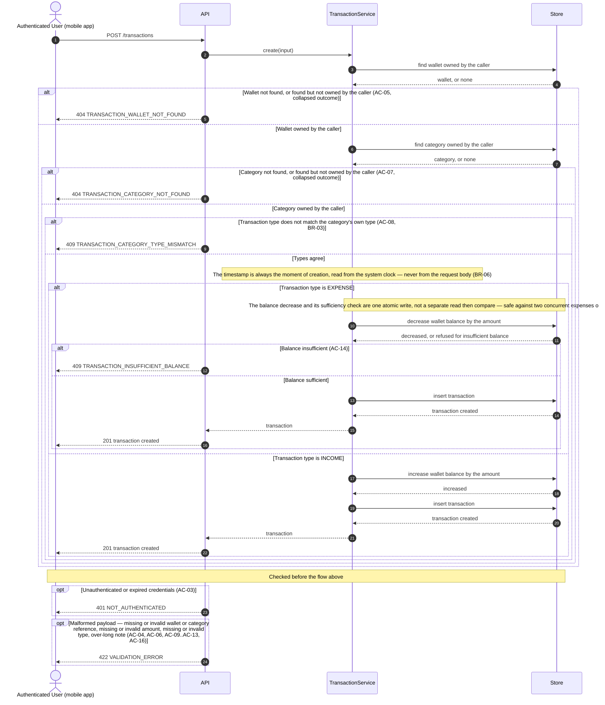
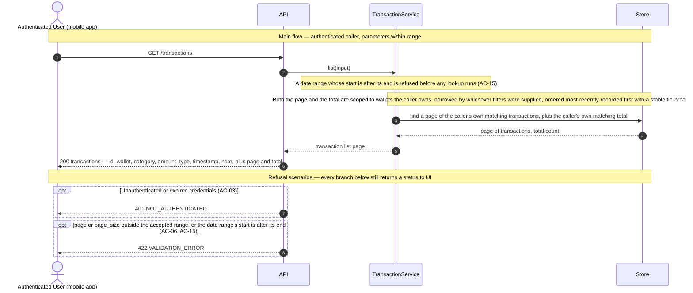
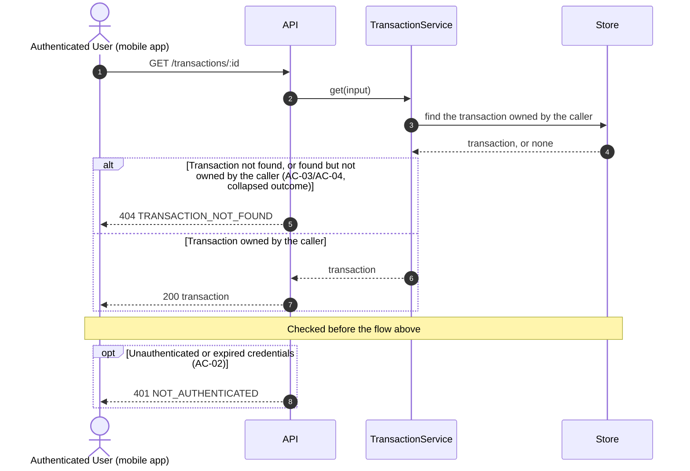
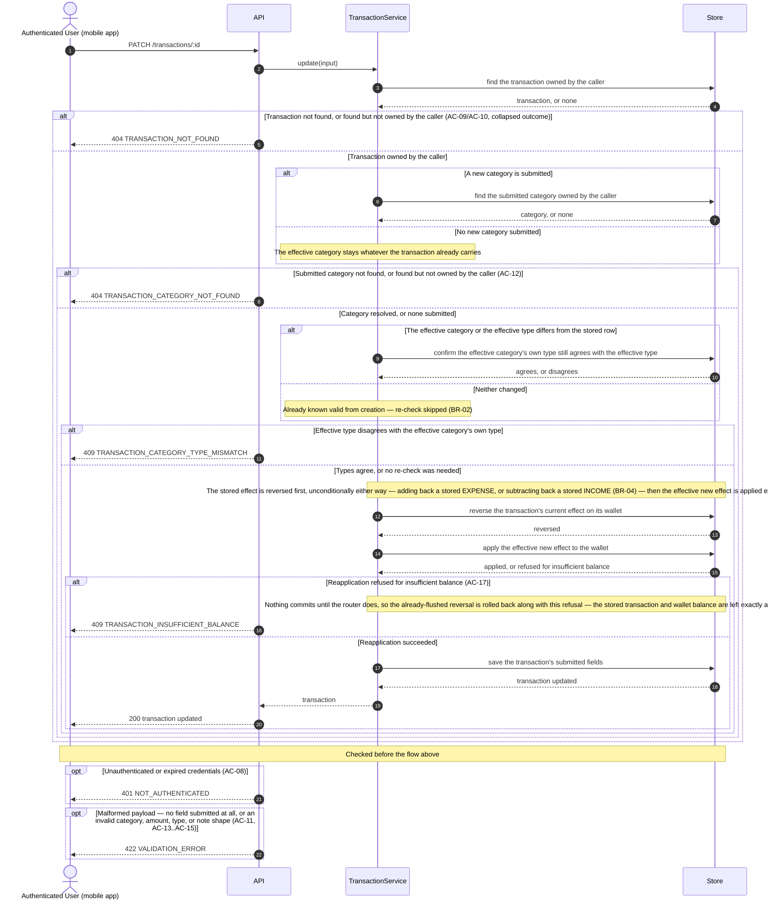
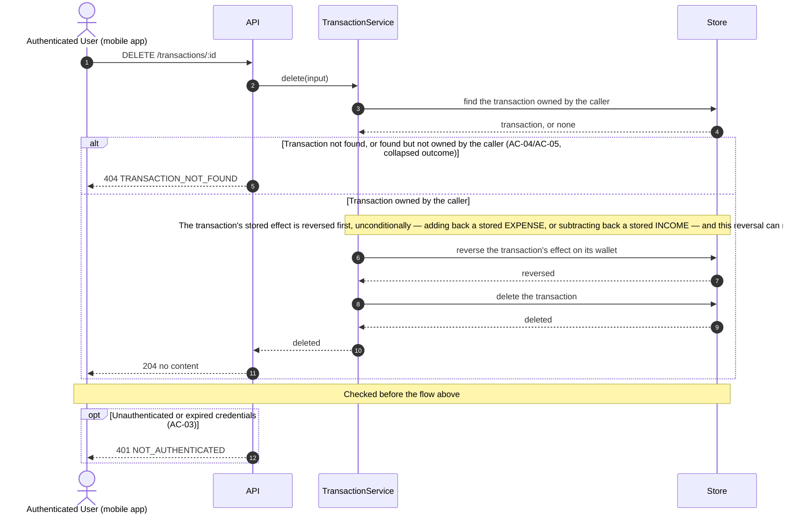

# Technical Plan: Transaction Management (TM)

> **Feature:** SRS §6 Feature-06 · SDS §5.6 (TM)
> **Spec:** [spec.md](spec.md)
> **Stories in this file:** TM-US-01 *(implemented, verified — 36/36 TC PASS)* · TM-US-02 *(implemented, verified — 36/36 TC PASS)* · TM-US-03 *(implemented, verified — 10/10 TC PASS)* · TM-US-04 *(implemented, verified — 30/30 TC PASS)* · TM-US-05 *(implemented, verified — 14/14 TC PASS)*

---

## TM-US-01: Create a Transaction

### Gaps & Decisions (Resolved)

Code and architecture decisions settled during design. Spec-level findings were folded back into `spec.md` before this step closed.

| ID | Area | Decision | Status |
|----|------|----------|--------|
| A1 | Domain | **`TransactionCreate.type` accepts both `INCOME` and `EXPENSE`; the SRS Gherkin's illustrating only an EXPENSE scenario is not evidence that INCOME is out of scope.** FR-06's own first sentence is unqualified: "allow Users to log income **and** expense Transactions." The Gherkin Background sets up a wallet at 1000.00 and both of its own scenarios spend against it — one successfully, one rejected — because the *interesting* behaviour this story needs to specify precisely is the insufficient-balance rule, which only an EXPENSE can trigger; an INCOME scenario would have nothing distinctive to illustrate beyond "the balance goes up," so its absence from the Gherkin reads as economy of example, not a narrowed contract. This is the same treatment WM-US-01 A1 and BM-US-01 A1 each gave their own under-illustrated Gherkins. Not escalated as `[NEEDS RULING]`: FR-06 and the Gherkin do not disagree here — the Gherkin simply shows less than FR-06 already states. | ✅ Resolved |
| A2 | Domain | **The insufficient-balance rule applies to `EXPENSE` transactions only, and applies uniformly to every wallet regardless of how its current balance was reached — including a wallet WM-US-01 (EC-02) already permits to start negative.** Two sub-questions, both reasoned rather than assumed. *Scope to EXPENSE only:* the SRS Gherkin's rejected scenario is exclusively an EXPENSE ("Reject expense exceeding available balance (MVP Rule)"); no scenario anywhere shows an INCOME transaction being refused for any balance-related reason, and semantically an INCOME transaction only ever *adds* to a balance — there is no "current balance" value an addition could conflict with the way a subtraction can. Inventing an INCOME-side check would mean guarding against a condition that cannot arise from the operation itself, which no source asks for. *Uniform across every wallet, no type-based carve-out:* the SRS states the rule flatly, tagged "(MVP Rule)" with no qualifying clause naming a wallet type, currency, or history; WM-US-01 EC-02 already establishes that a wallet may legitimately start at a negative balance ("a wallet of type `CREDIT` ... legitimately begins already in debt"), which could suggest a credit-style wallet ought to be exempt from a balance floor — but nothing in FR-06, the Gherkin, or SDS §5.6.1 draws that distinction, and inventing an exemption by wallet `type` would mean inventing both a new closed vocabulary of "wallets exempt from this rule" *and* the criterion for membership in it, neither of which any source states. The flat reading is also the one that invents nothing: "the amount must not exceed the current balance" applies identically whether that balance is 1000.00 or −50.00. Recorded rather than silently assumed, because a reader could otherwise wonder whether the omission was deliberate. | ✅ Resolved |
| A3 | Domain | **A transaction's `type` must equal its referenced category's own `type`; a mismatch is refused with `409 TRANSACTION_CATEGORY_TYPE_MISMATCH`.** Nothing in SRS or SDS states this as an explicit rule in so many words — the Gherkin's own example already happens to agree (`"EXPENSE"` against `"Groceries"`, which SRS FR-04's own example list names as an expense-flavoured category alongside `"Rent"`, `"Salary"`, `"Utilities"`), so the Gherkin alone cannot prove the rule is *enforced* rather than merely *followed by example*. Reasoned instead from what the two entities are *for*: FR-04 defines a Category's `type` specifically so that Categories are "classified as either `INCOME` or `EXPENSE`" — that classification has no purpose at all unless something downstream reads and relies on it, and the only "downstream" FR-06 names is exactly this story, logging Transactions "against a designated Wallet and Category." FR-07 (Financial Reporting, out of scope but informative as context) aggregates "income and expense transactions" into summaries and "top category spending rankings" — arithmetic that silently breaks the moment one `EXPENSE` transaction is filed under an `INCOME`-typed category like "Salary," because the aggregation has no independent signal to fall back on once a transaction's own `type` and its category's `type` disagree. This is the same class of judgment WM-US-01/CM-US-01/BM-US-01 each made for their own undictated fields (CLAUDE.md's "decide, document, keep moving") — but reasoned toward *enforcing* a constraint rather than away from inventing one, specifically because leaving it unenforced would let one story's data silently corrupt a downstream feature's arithmetic rather than merely leave a field's shape looser than it could be. Enforced in the service layer (AR-01) after both ownership lookups succeed, comparing the two enums' underlying string values — never in the repository (no business rule there, AR-03) and never as a DTO-level Pydantic constraint (it depends on a row loaded from the database, which a DTO cannot see). Not escalated as `[NEEDS RULING]`: this is a real, answerable question about what FR-04 and FR-06 already imply together, not a case where two sources actually disagree. | ✅ Resolved |
| A4 | Architecture | **Fixed four-step check order: wallet ownership, then category ownership, then category-type consistency, then (EXPENSE only) balance sufficiency.** Extends BM-US-01 FR-13/BR-02's own two-step order (wallet, then category) by two more steps, reasoned the same way: each step can only run once the step before it has produced the data it needs. Category-type consistency needs a *resolved* category row (BR-03 compares the submitted `type` against `category.type`), so it cannot run before category ownership succeeds — there is no coherent way to ask "does the type match" about a category that was never found. Balance sufficiency needs to know the transaction is EXPENSE and needs a resolved wallet, and — by design (A9) — the check *is* the same database statement as the balance mutation itself, so it is necessarily the last step: nothing after it could still cause the request to fail once it has run. The two orderings this design makes genuinely *testable* by a single multi-failure request are wallet-before-category (`spec EC-14`, identical in shape to BM-US-01's own `EC-11`) and type-before-balance (`spec EC-11`: a category that is both wrongly typed and would separately fail the balance check reports only the type mismatch). The middle pairing — a category-ownership failure competing with a type mismatch — is not merely hard to construct, it is **structurally impossible**: a type mismatch cannot exist as a competing failure unless the category was already found, so the two conditions can never simultaneously hold. Recorded here rather than treated as an accidental testing gap, mirroring exactly how BM-US-01's own `test_cases.md` coverage matrix recorded its analogous category-versus-uniqueness gap. | ✅ Resolved |
| A5 | Domain | **`TransactionCreate` has no `timestamp` field at all; `timestamp` is computed server-side as `app.core.clock.utcnow()` at the moment the service runs**, read through the same clock seam every other TTL- and period-sensitive decision in this codebase already uses (constitution TST-06), never `datetime.now()` (CLAUDE.md §4). Directly mirrors BM-US-01 A2's treatment of `period`: no source shows a person choosing a timestamp anywhere in the SRS Gherkin's two scenarios — the User selects type, amount, category, and wallet, then clicks "Save Transaction," with no date or time control in the flow — and SDS §6.2.1's `TransactionCreate` registry entry itself lists exactly five fields (`wallet_id`, `category_id`, `amount`, `type`, `note`), with no sixth `timestamp` key. Accepting one anyway would mean inventing validation rules no source states (how far into the past or future a value may be, what timezone it is interpreted in, what happens to a value that collides with another transaction). `TransactionCreate` therefore declares no `timestamp` field; any `timestamp`-shaped key a caller submits anyway is silently ignored by Pydantic's default `BaseModel` behaviour, the same "structurally impossible to honour" pattern as `BudgetCreate`'s absent `period` (spec EC-04). | ✅ Resolved |
| A6 | Domain | **`note` is optional (`str \| None`, default `None`) and bounded at 500 characters — a materially larger bound than the 100-character convention WM-US-01/CM-US-01 established for `name` — and its column type is `Text`, not `String(n)`.** Two separate decisions, both grounded in what's actually declared. *Optional:* neither of the SRS Gherkin's two scenarios has the User enter a note at all ("selects transaction type," "enters amount," "selects category," "selects wallet," "clicks Save Transaction" — no note step in either scenario), and SDS §6.2.1's registry lists `note` as a plain `"string"` with nothing distinguishing it from the four fields this story's own AC-04/AC-06/AC-09/AC-12 already require. *500 characters, not 100:* SDS §4.3.3's `TRANSACTIONS` ERD types the column `text note`, not `string note` the way `wallets.name`/`categories.name` are each typed `string` in their own ERD blocks — a deliberate signal distinguishing a short label from free-form text, so this story does not reuse the 100-character label bound. 500 is still a real bound, not "no bound at all": VL-01 makes Pydantic the source of truth for request validation regardless of the column's own (here, unbounded) width, and an unbounded client-controlled string is a minor risk this codebase has not needed to accept anywhere else yet. No source names an exact figure, so 500 is this story's own reasoned choice, recorded rather than assumed. No trimming or blank-to-`null` normalisation is added either — nothing requires a note to be meaningful the way a `name` must identify something, so a blank note is left exactly as submitted rather than invented behaviour no AC asks for. | ✅ Resolved |
| A7 | Domain / Architecture | **`TransactionType` is declared as its own enum in `models/transaction.py`, with the identical two literal values as `CategoryType` (`INCOME`, `EXPENSE`), rather than importing and reusing `CategoryType` directly on `TransactionModel.type`.** Every enum this codebase has modelled so far belongs to, and lives beside, the one model whose column it types — `UserStatus`/`UserRole` in `user.py`, `InvitationStatus` in `invitation.py`, `CategoryType` in `category.py` — and no existing column reuses another model's enum class. A Transaction's `type` and a Category's `type` are two different attributes of two different entities that happen to share a vocabulary (BR-03 requires them to *agree in value*, not to *be the same field*), the same relationship `wallet_id`/`category_id` (a plain `str` FK, not a shared Python type) already have to the rows they reference. Cross-model type reuse would also create an import from `models/transaction.py` into `models/category.py` this codebase has no precedent for. BR-03's comparison is done by value (`category.type.value == type.value`), which needs no shared class — both are `StrEnum`s with identical literals. | ✅ Resolved |
| A8 | Domain | **`wallet_id` and `category_id` are plain non-empty strings with no UUID-shape validation** (`Field(min_length=1)`), directly reusing BM-US-01 A5's reasoning unchanged: this codebase's own `id` columns are `String(36)` free text (constitution ENV-03), a malformed reference and a well-formed-but-nonexistent one both fail the same ownership-scoped lookup and so already produce the identical `404` without any extra rule, and adding shape validation would only create a second, `422`-flavoured error class for the same caller mistake. Recorded as spec EC-07. | ✅ Resolved |
| A9 | Architecture / Concurrency | **The insufficient-balance check and the balance mutation are one atomic database statement — a conditional `UPDATE ... WHERE balance >= amount`, executed in the repository — not a read-the-balance-then-compare-in-Python-then-write sequence.** This is the first UPDATE `wallet_repo.py` has ever needed (its only two functions until now, `get_owned_by_id()` and `add_wallet()`, are a pure read and a pure insert) — but the *technique* itself is not new to this codebase: `invitation_repo.mark_accepted()` (UM-US-02) already uses a conditional `UPDATE ... WHERE status == PENDING` as an atomic mutex against two simultaneous activation attempts on the same invitation. What genuinely is new here is applying that same technique to a **numeric, arithmetic** column (`balance = balance ± amount`) rather than a status-enum transition, and doing so for money specifically — SRS NFR-05's own text ("Balance updates must execute inside ACID-compliant database transaction blocks") names exactly this operation. Two designs were weighed: **(a)** the service reads the wallet's current `balance` (already in hand from the ownership lookup), compares it to `amount` in Python, and only then calls a plain unconditional UPDATE if sufficient; or **(b)** the repository issues a single conditional UPDATE whose WHERE clause *is* the sufficiency check, and the service reads only the statement's rowcount. Design (a) has a real TOCTOU race: two simultaneous EXPENSE requests against the same wallet can each read the same pre-decrement balance, each independently conclude "sufficient" in Python, and each issue its own UPDATE — overwriting rather than compounding against each other, or both succeeding and leaving the balance permanently wrong, exactly the class of bug BR-05's "never below zero" guarantee exists to prevent. Design (b) closes that race by construction: the WHERE clause and the decrement happen as one statement the database evaluates against whatever row version is current at execution time, so a second concurrent UPDATE against the same row necessarily waits for the first's row lock and then re-evaluates its own WHERE clause against the *already-decremented* balance — the same reasoning `mark_accepted()` already relies on, returning a rowcount rather than a boolean the caller computed itself. `wallet_repo.decrement_balance()` is therefore design (b): `UPDATE wallets SET balance = balance - :amount WHERE id = :wallet_id AND balance >= :amount`, returning the affected row count; `rowcount == 0` is exactly the signal `TransactionInsufficientBalanceError` is raised from — there is no separate Python-level comparison to get out of sync with the database's own. `increment_balance()` (INCOME) has no sufficiency condition at all (BR-05), so it is a plain unconditional UPDATE. **Known testability limit, carried over rather than newly discovered:** UM-US-01/UM-US-02's own `test_cases.md` QF-02 already recorded that this codebase's test database (SQLite, `StaticPool`, single-threaded test execution — constitution ENV-03) serialises writers, so a literal "two requests race, only one wins" integration test cannot be constructed here; it would prove serialisation, not conflict-handling. This story's own `test_cases.md` QF-04 records the same limit and defers true concurrent verification to a PostgreSQL run, exactly as UM-US-01/02 already did — the single-request boundary (amount exactly equal to balance, spec `EC-08`) and refusal (spec `AC-14`) cases are what this suite can and does prove deterministically. | ✅ Resolved |
| A10 | Architecture | **The balance mutation and the transaction insert are two different tables written inside one request; atomicity comes from the transaction boundary, not from any explicit `BEGIN`/`COMMIT` this story writes.** `transaction_service.create_transaction()` calls `wallet_repo.decrement_balance()`/`increment_balance()` and then `transaction_repo.add_transaction()`; both repository calls `db.flush()` (send their SQL to the database within the session's already-open transaction) but neither calls `db.commit()` (constitution AR-06 — services never commit). The router's single `db.commit()`, issued only after `transaction_service.create_transaction()` returns successfully, is the one and only commit point for the whole request. Two failure paths both leave nothing persisted: **(1)** if `decrement_balance()`'s conditional UPDATE affects zero rows, the service raises `TransactionInsufficientBalanceError` *before* `transaction_repo.add_transaction()` is ever called, so no transaction row is even built; **(2)** if anything else raises after a flush has already sent SQL to the database, `app.db.session.get_db()`'s `except Exception: db.rollback()` catches it before the request handler's `db.commit()` is ever reached, discarding every flushed-but-uncommitted change in the session. AR-06 has real precedent for multi-row atomicity — UM-US-01 A1 already writes a `users` row and an `invitations` row inside one transaction ("neither may exist without the other"), and UM-US-02 atomically transitions both a user's `status` and an invitation's `status` together. What is new here is the shape of the failure this atomicity guards against: UM-US-01/02's paired writes are either two unconditional inserts, or two status-enum transitions gated by the same conditional-UPDATE-as-mutex technique A9 reuses — never a case where one write's *numeric outcome* (how much a balance actually decreased) determines whether the other write is even attempted. Here, a debited wallet with no matching transaction row (or vice versa) would not just be an inconsistent status — it would be money silently gained or lost, which is exactly what SRS FR-06's "atomically" and NFR-05's "ACID-compliant" language are about. | ✅ Resolved |
| A11 | Security | **`TransactionCreate` declares no field a client could use to name a transaction's "owner"**, because there is no owner column to spoof — SDS §4.3.3's `TRANSACTIONS` ERD has no `user_id` at all, the same shape as `BUDGETS` (BM-US-01 A7). Ownership is proven entirely by the two ownership-scoped lookups (A4's wallet/category checks): a `wallet_id`/`category_id` the caller does not own is refused before a `TransactionModel` row is even considered. | ✅ Resolved |
| A12 | Security | **No role restriction.** `CurrentUserDep` — not `AdminDep` — guards this route. SRS §6 US-06-01 names the actor "the User" with no role qualifier, and SDS §5.6.1 tags the story "(USER)". Directly mirrors WM-US-01 A8 / BM-US-01 A9. | ✅ Resolved |
| A13 | Architecture | **No audit event.** Constitution LA-04 enumerates exactly three audited event families — invitations sent, activations completed, logins — and transaction creation is not among them. No AC or FR in `spec.md` asks for one either. Directly mirrors WM-US-01 A9 / BM-US-01 A10. | ✅ Resolved |
| A14 | Domain / API | **`TransactionRead` carries exactly the Transaction's own seven fields (`id`, `wallet_id`, `category_id`, `amount`, `type`, `timestamp`, `note`) — no embedded wallet, no echoed new balance, and no `message` field.** The SRS Gherkin narrates the wallet's new balance ("the balance for 'Main Checking' decreases to 950.00") as an observable outcome of the scenario, and it is one — verified directly against the `wallets` row (spec AC-01/AC-02, *Assumptions*) — but it is the *Wallet's* field changing, not a new fact about the *Transaction*. Every existing Create-story response in this codebase (`WalletRead`, `CategoryRead`, `BudgetRead`) is scoped strictly to its own entity's own columns, with no other entity's data folded in — `BudgetRead` does not echo the wallet's balance either, even though a Budget is just as tightly coupled to a Wallet as a Transaction is. Matching that precedent keeps PF-03's "DTO projection, never an entity graph" true here too. No `message` field either (unlike `InvitationRead`): every other Create endpoint communicates success through its `201` status alone, and the SRS Gherkin's "shows message 'Transaction created successfully'" is UI-layer feedback — no screen exists yet for this story to build (*Element IDs*, mobile deferred). | ✅ Resolved |
| A15 | Domain | **No uniqueness constraint on a Transaction, in any respect.** No AC, EC, or BR requires it — unlike Budget's own deliberate per-period uniqueness (BM-US-01 A3/BR-05), which exists because two overlapping budget limits leave "the" limit undefined. Two transactions can legitimately be identical in every field (same wallet, category, amount, and type) and still both be real, independent events — two identical coffee purchases on the same day are not a data-integrity problem the way two competing spending caps would be. Recorded as spec EC-12, mirroring WM-US-01 A6's own "no uniqueness constraint" reasoning for wallet names, reasoned independently rather than pattern-matched (the same discipline BM-US-01 A3 itself used when it broke from that very precedent for Budget). | ✅ Resolved |

---

### Architecture

**Package layout** (additions only; `budget.py`'s siblings across every layer are the closest precedent — this is the first story to add a genuine `UPDATE` to `wallet_repo.py` specifically, which until now held only `get_owned_by_id()` (a read) and `add_wallet()` (an insert)).

```text
backend/app/
├── models/
│   └── transaction.py                # NEW  TransactionModel, TransactionType (SDS §2.1, §2.2, §4.3.3)
├── schemas/
│   └── transaction.py                # NEW  TransactionCreate, TransactionRead
├── repositories/
│   ├── wallet_repo.py                # MODIFIED  add decrement_balance(), increment_balance()
│   └── transaction_repo.py           # NEW  add_transaction()
├── services/
│   └── transaction_service.py        # NEW  create_transaction()
├── core/
│   └── errors.py                     # MODIFIED  add TransactionWalletNotFoundError, TransactionCategoryNotFoundError, TransactionCategoryTypeMismatchError, TransactionInsufficientBalanceError
└── api/v1/
    ├── transactions.py               # NEW  POST /transactions
    └── router.py                     # MODIFIED  mount transactions.router

backend/migrations/versions/
└── <rev>_create_transactions.py      # NEW  transactions table, down_revision = 003e5ae90a36 (current head)

backend/tests/
└── integration/test_tm_us_01_create_transaction.py   # NEW  written at the Implement step from test_cases.md
```

`category_repo.py` is **not** modified — `get_owned_by_id()` already exists there from BM-US-01 and is reused completely unchanged; this story only extends `wallet_repo.py`, and only because a *mutation*, not another read, is new territory for it. No change to `core/deps.py` — `CurrentUserDep` (`get_current_user`) already resolves any authenticated `ACTIVE` User of either role and is reused exactly as-is (A12).

**Domain objects**

| Entity | Table | Key Fields | Notes |
|--------|-------|------------|-------|
| `TransactionModel` | `transactions` | `id` PK, `wallet_id` FK→`wallets.id` (indexed), `category_id` FK→`categories.id` (indexed), `amount`, `type`, `timestamp`, `note` | No `user_id` (A11) — exactly the seven ERD columns. Both FKs carry an index, mirroring BM-US-01's own reasoning for `budgets`: every query this story or a future one runs against `transactions` filters by one or both (constitution PF-02). `timestamp` carries **no** index this story — TM-US-02 (list/filter, out of scope) is the story with an actual query to justify one; indexing it now would be speculative in a way `wallet_id`/`category_id` are not (those already have an established ownership-filtering precedent, SEC-08). |
| — | — | *(no new unique constraint)* | No uniqueness rule applies to a Transaction (A15) — the first money-bearing story in this codebase where VL-05 does not apply. |

**Model** (`app/models/transaction.py`)

```python
class TransactionType(enum.StrEnum):
    """SRS FR-06, SDS §6.2.1 TransactionCreate example. Same two literal
    values as CategoryType (spec BR-03 requires them to agree) — declared as
    its own enum rather than importing CategoryType, matching this
    codebase's one-enum-per-owning-model convention (A7)."""

    INCOME = "INCOME"
    EXPENSE = "EXPENSE"


class TransactionModel(Base):
    __tablename__ = "transactions"

    id: Mapped[str] = mapped_column(String(36), primary_key=True, default=new_uuid)

    # spec BR-01: ownership is entirely transitive through these two FKs — no
    # user_id column exists on this table at all, the same shape BM-US-01
    # established for budgets (A11).
    wallet_id: Mapped[str] = mapped_column(
        String(36), ForeignKey("wallets.id"), nullable=False, index=True
    )
    category_id: Mapped[str] = mapped_column(
        String(36), ForeignKey("categories.id"), nullable=False, index=True
    )

    # spec BR-04, constitution VL-07: Decimal(15,2), strictly positive — a
    # magnitude; direction is carried by `type`, not by the sign of `amount`.
    amount: Mapped[Decimal] = mapped_column(Numeric(15, 2), nullable=False)

    # spec BR-03, FR-10: closed enum, must agree with the referenced
    # category's own type (A3, A7).
    type: Mapped[TransactionType] = mapped_column(
        Enum(TransactionType, native_enum=False, length=10), nullable=False
    )

    # spec BR-06: always the moment of creation, from app.core.clock.utcnow()
    # — never client input (A5).
    timestamp: Mapped[datetime] = mapped_column(DateTime(timezone=True), nullable=False)

    # spec FR-15, A6: optional free text, bounded at the DTO layer only — the
    # column itself is unbounded, matching SDS §4.3.3's `text note` typing.
    note: Mapped[str | None] = mapped_column(Text, nullable=True)

    def __repr__(self) -> str:  # pragma: no cover - debugging aid
        return (
            f"<TransactionModel id={self.id} wallet_id={self.wallet_id} "
            f"category_id={self.category_id} type={self.type}>"
        )
```

**DTOs** (`app/schemas/transaction.py`)

```python
class TransactionCreate(BaseModel):
    """plan.md DTO block. No `timestamp` field at all (A5, spec AC-15) — the
    system always sets it to the moment of creation; a submitted
    timestamp-shaped value is silently ignored, the same "structurally
    impossible to honour" pattern as BudgetCreate's absent `period` field.
    No UUID-shape validation on the two references (A8) — an unresolvable
    value of any shape is refused identically by the ownership-scoped
    lookup.
    """

    wallet_id: str = Field(min_length=1)
    category_id: str = Field(min_length=1)

    # Decimal(15,2), reject-don't-round (WM-US-01 A3 precedent) plus a
    # strict positivity bound — amount is a magnitude, type carries
    # direction (spec BR-04).
    amount: Decimal = Field(max_digits=15, decimal_places=2, gt=0)

    # Closed enum — Pydantic's own enum-membership validation rejects
    # anything that is not exactly "INCOME" or "EXPENSE" (spec AC-13).
    type: TransactionType

    # Optional free text (A6, spec AC-17); bounded at 500 chars (A6).
    note: str | None = Field(default=None, max_length=500)


class TransactionRead(BaseModel):
    """SDS §2.2. Exactly seven fields (spec AC-18, FR-16, constitution
    PF-03) — no owner field of any kind (A11), no echoed wallet balance, no
    message (A14).
    """

    id: str
    wallet_id: str
    category_id: str
    amount: Decimal
    type: TransactionType
    timestamp: datetime
    note: str | None
```

**Repository additions**

```python
# wallet_repo.py — two new functions alongside the existing get_owned_by_id()/add_wallet()
def decrement_balance(db: Session, *, wallet_id: str, amount: Decimal) -> int:
    """spec FR-11, BR-05, plan.md A9. Conditional UPDATE — the sufficiency
    check *is* the WHERE clause, not a prior read-then-compare in Python.
    Returns the affected row count: 1 if the balance was sufficient and the
    decrement applied, 0 if not (the service raises
    TransactionInsufficientBalanceError on 0). Mirrors
    invitation_repo.mark_accepted()'s conditional-UPDATE-as-atomic-mutex
    technique (UM-US-02 EC-05). Flushed, not committed (AR-06)."""


def increment_balance(db: Session, *, wallet_id: str, amount: Decimal) -> None:
    """spec FR-12, BR-05, plan.md A9. Unconditional UPDATE — an INCOME
    transaction has no sufficiency condition to check. Flushed, not
    committed (AR-06)."""
```

```python
# transaction_repo.py — new module
def add_transaction(
    db: Session,
    *,
    wallet_id: str,
    category_id: str,
    amount: Decimal,
    type: TransactionType,
    timestamp: datetime,
    note: str | None,
) -> TransactionModel:
    """spec AC-01, AC-02, FR-16, BR-01. Flushed, not committed (AR-06) — the
    router owns the transaction boundary; this call and wallet_repo's
    balance mutation are flushed within the same request so both changes
    reach the database inside one commit (FR-13, BR-07, A10)."""
```

**Service** (`app/services/transaction_service.py`)

```python
def create_transaction(
    db: Session,
    *,
    owner: UserModel,
    wallet_id: str,
    category_id: str,
    amount: Decimal,
    type: TransactionType,
    note: str | None,
) -> TransactionRead:
    """spec AC-01, AC-02, FR-18, BR-02. Fixed check order — wallet
    ownership, then category ownership, then category-type consistency,
    then (EXPENSE only) balance sufficiency — so a request that fails more
    than one reports only the first (A4).
    """
    wallet = wallet_repo.get_owned_by_id(db, wallet_id=wallet_id, user_id=owner.id)
    if wallet is None:
        raise TransactionWalletNotFoundError()

    category = category_repo.get_owned_by_id(db, category_id=category_id, user_id=owner.id)
    if category is None:
        raise TransactionCategoryNotFoundError()

    # spec BR-03, A3, A7: compared by value — TransactionType and
    # CategoryType are deliberately separate enum classes with matching literals.
    if category.type.value != type.value:
        raise TransactionCategoryTypeMismatchError()

    # spec BR-05, A2, A9: the sufficiency check is the conditional UPDATE
    # itself for EXPENSE; INCOME never checks (A2).
    if type is TransactionType.EXPENSE:
        affected = wallet_repo.decrement_balance(db, wallet_id=wallet_id, amount=amount)
        if affected == 0:
            raise TransactionInsufficientBalanceError()
    else:
        wallet_repo.increment_balance(db, wallet_id=wallet_id, amount=amount)

    # spec BR-06, A5: never from the request payload.
    timestamp = clock.utcnow()

    transaction = transaction_repo.add_transaction(
        db,
        wallet_id=wallet_id,
        category_id=category_id,
        amount=amount,
        type=type,
        timestamp=timestamp,
        note=note,
    )
    return TransactionRead(
        id=transaction.id,
        wallet_id=transaction.wallet_id,
        category_id=transaction.category_id,
        amount=transaction.amount,
        type=transaction.type,
        timestamp=transaction.timestamp,
        note=transaction.note,
    )
```

**Router** (`app/api/v1/transactions.py`) — thin, mirrors `budgets.py` exactly:

```python
router = APIRouter(prefix="/transactions", tags=["transactions"])


@router.post(
    "",
    response_model=TransactionRead,
    status_code=status.HTTP_201_CREATED,
    responses={
        401: {"description": "NOT_AUTHENTICATED"},
        404: {"description": "TRANSACTION_WALLET_NOT_FOUND / TRANSACTION_CATEGORY_NOT_FOUND"},
        409: {"description": "TRANSACTION_CATEGORY_TYPE_MISMATCH / TRANSACTION_INSUFFICIENT_BALANCE"},
        422: {"description": "VALIDATION_ERROR"},
    },
)
def create_transaction(payload: TransactionCreate, db: DbDep, current_user: CurrentUserDep) -> TransactionRead:
    result = transaction_service.create_transaction(
        db,
        owner=current_user,
        wallet_id=payload.wallet_id,
        category_id=payload.category_id,
        amount=payload.amount,
        type=payload.type,
        note=payload.note,
    )
    db.commit()
    return result
```

**New errors** (`app/core/errors.py`, appended under a new `# --- TM-US-01: Create a Transaction` section)

```python
class TransactionWalletNotFoundError(AppError):
    """spec AC-05 / FR-04. Identical for "no such wallet" and "not this
    caller's wallet" (constitution VL-06's `404 if absent` branch)."""
    status_code = 404
    error_code = "TRANSACTION_WALLET_NOT_FOUND"
    default_message = "The referenced wallet was not found."


class TransactionCategoryNotFoundError(AppError):
    """spec AC-07 / FR-06. Same collapsed shape as TransactionWalletNotFoundError."""
    status_code = 404
    error_code = "TRANSACTION_CATEGORY_NOT_FOUND"
    default_message = "The referenced category was not found."


class TransactionCategoryTypeMismatchError(AppError):
    """spec AC-08 / FR-07 / BR-03. Constitution VL-06's "409 if present but
    in the wrong state" branch — the first story in this codebase to
    exercise it: the category exists and is owned by the caller, but its
    own type disagrees with the submitted transaction type."""
    status_code = 409
    error_code = "TRANSACTION_CATEGORY_TYPE_MISMATCH"
    default_message = "The transaction type does not match the referenced category's type."


class TransactionInsufficientBalanceError(AppError):
    """spec AC-14 / FR-11 / BR-05. The SRS's own "(MVP Rule)" scenario and
    its own literal message."""
    status_code = 409
    error_code = "TRANSACTION_INSUFFICIENT_BALANCE"
    default_message = "Insufficient balance."
```

**Business rules enforced in service layer**

| Rule | Source | Enforcement |
|------|--------|--------------|
| Authenticated User of any role may create a transaction | AC-01, AC-02, FR-01, A12 | `POST /api/v1/transactions` accepting `TransactionCreate`, guarded by `CurrentUserDep` — not `AdminDep` |
| Unauthenticated caller denied before the payload is evaluated | AC-03, FR-02 | `CurrentUserDep` resolves before FastAPI validates the body — identical ordering to every existing protected route |
| `wallet_id` required, non-empty | AC-04, FR-03 | `Field(min_length=1)` |
| `wallet_id` must resolve to the caller's own wallet; not-found and not-owned collapsed | AC-05, EC-05, EC-07, FR-04, A8 | `wallet_repo.get_owned_by_id()` returns `None` for both cases by construction (reused unchanged from BM-US-01 A6); service raises `TransactionWalletNotFoundError` |
| `category_id` required, non-empty | AC-06, FR-05 | `Field(min_length=1)` |
| `category_id` must resolve to the caller's own category; not-found and not-owned collapsed | AC-07, EC-06, EC-07, FR-06, A8 | `category_repo.get_owned_by_id()` returns `None` for both cases by construction (reused unchanged from BM-US-01 A6); service raises `TransactionCategoryNotFoundError` |
| Transaction `type` must equal the category's own `type` | AC-08, FR-07, A3, A7 | Service compares `category.type.value != type.value`; raises `TransactionCategoryTypeMismatchError` |
| `amount` required, `Decimal(15,2)`, reject not round | AC-09, AC-11, EC-02, FR-08, constitution VL-07 | `Field(max_digits=15, decimal_places=2)` |
| `amount` strictly positive | AC-10, EC-01, FR-09 | `Field(..., gt=0)` |
| `type` required, closed to INCOME/EXPENSE | AC-12, AC-13, FR-10 | `type: TransactionType` — Pydantic's own enum-membership validation |
| EXPENSE refused when amount exceeds current balance; balance unchanged on refusal | AC-14, EC-08, EC-10, FR-11, A2, A9 | `wallet_repo.decrement_balance()`'s conditional UPDATE; `rowcount == 0` → `TransactionInsufficientBalanceError`, nothing flushed for the transaction row |
| INCOME never balance-checked | AC-02, EC-09, FR-12, A2 | `wallet_repo.increment_balance()` — unconditional |
| `timestamp` always the moment of creation; client input ignored | AC-15, EC-04, FR-14, A5 | `TransactionCreate` declares no `timestamp` field; service computes `clock.utcnow()` |
| `note` optional, bounded at 500 chars | AC-16, AC-17, EC-13, FR-15, A6 | `Field(default=None, max_length=500)` |
| Response exposes exactly seven fields | AC-18, FR-16, constitution PF-03 | `TransactionRead` — no ORM graph, no extra field |
| Every validation failure reported together | EC-03, FR-17, constitution VL-02 | Reuses the existing `RequestValidationError` handler in `main.py` — unchanged, no new wiring |
| Fixed check order — wallet, category, type, then balance | FR-18, BR-02, A4 | `create_transaction()`'s straight-line sequence; each check returns/raises before the next runs |
| No uniqueness constraint | EC-12, FR-19, A15 | No unique index on `transactions`; no service-layer duplicate check |
| Transaction insert and balance update are one atomic unit | FR-13, BR-07, A10 | Both repository calls flush only; the router's single `db.commit()` is the only commit point |
| No audit event | A13 | `transaction_service.create_transaction()` calls no `audit.record()` |

**Sequence diagram — Create a Transaction**

Drawn to `constitution.md` DG-01…DG-07: four lanes only, no SQL, no parameter lists, every request into `API` answered back to `UI` with a status code, one workflow.



Only one workflow is drawn (DG-07). The nested `alt`/`else` blocks are the one flow's own branches — not a second flow — mirroring how WM-US-01/CM-US-01/BM-US-01 folded their refusal `opt`s into a single diagram. Verified with `check.mjs` (`mermaid.parse()`) — see *Verification note* below.

**Error flows**

| Scenario | HTTP | Error Code |
|----------|------|------------|
| No or invalid bearer credentials (AC-03) | 401 | `NOT_AUTHENTICATED` |
| Missing/invalid wallet or category reference shape, missing/invalid amount, missing/invalid type, over-long note (AC-04, AC-06, AC-09..AC-13, AC-16) | 422 | `VALIDATION_ERROR` |
| Wallet not found, or found but not owned by the caller (AC-05) | 404 | `TRANSACTION_WALLET_NOT_FOUND` |
| Category not found, or found but not owned by the caller (AC-07) | 404 | `TRANSACTION_CATEGORY_NOT_FOUND` |
| Transaction type disagrees with the category's own type (AC-08) | 409 | `TRANSACTION_CATEGORY_TYPE_MISMATCH` |
| EXPENSE amount exceeds the wallet's current balance (AC-14) | 409 | `TRANSACTION_INSUFFICIENT_BALANCE` |
| Unexpected server error | 500 | `INTERNAL_ERROR` |

All in the flat envelope `{"error_code", "message", "details"}` (SDS §6.6, constitution API-02) — reused unchanged from `main.py`. No `403` (A12: no role restriction).

**Constitution notes**

| Rule | Status | Note |
|------|--------|------|
| AR-01 Service owns business rules | Required | `transaction_service.create_transaction()` is the only place that decides what a failed lookup, a type mismatch, or an insufficient balance means, and assembles the persisted row |
| AR-02 Thin router | Required | Router binds the payload, resolves `CurrentUserDep`, calls the service, commits once, formats the response — no branching on business state |
| AR-03 Repository isolation | Required | `wallet_repo`'s two new balance functions and `transaction_repo.add_transaction()` are queries/persistence only — the sufficiency *decision* (raise on rowcount 0) is the service's, not the repository's |
| AR-04 DTO ↔ model mapping outside routers/repos | Required | No field-name mapping needed (every DTO field matches its column 1:1), but the service remains the boundary that would carry it |
| AR-05 No framework objects in services | Required | `create_transaction()` takes plain values (`owner: UserModel`, `wallet_id`, `category_id`, `amount`, `type`, `note`); no `Request`/`Response` |
| AR-06 One transaction per request | Required — same guarantee UM-US-01/02 already rely on, applied to a numeric balance for the first time (A10) | The balance mutation and the transaction insert are two different tables; both are flushed inside the service and neither is committed there — the router's single `db.commit()` is what makes them atomic. If the conditional UPDATE affects zero rows, the service raises before the transaction row is even built; if anything else raises between the two flushes, `get_db()`'s exception handler rolls back the whole session |
| AR-07 Router → service → repository | Required | The router never calls `wallet_repo`/`category_repo`/`transaction_repo` directly |
| AR-08 Module layout | Required | `backend/app/{models,schemas,repositories,services,api}` — no new top-level package; `wallet_repo.py` gains two functions, matching how BM-US-01 grew `wallet_repo.py`/`category_repo.py` by one function each |
| API-01 Versioned plural path | Required | `POST /api/v1/transactions` |
| API-02 Flat error envelope | Required | Reused from `main.py`, unchanged |
| API-03 Status codes | Required | `201` create · `401` · `404` (×2 codes) · `409` (×2 codes) · `422` |
| API-04 Prefixed error codes | Required | `TRANSACTION_WALLET_NOT_FOUND`, `TRANSACTION_CATEGORY_NOT_FOUND`, `TRANSACTION_CATEGORY_TYPE_MISMATCH`, `TRANSACTION_INSUFFICIENT_BALANCE` — all catalogued above |
| API-05 No generic status endpoint | Required | `/transactions` is a plain resource-creation `POST` |
| API-06 Pagination | N/A | Single-resource creation; no list in this story |
| API-07 Explicit response_model | Required | `response_model=TransactionRead`, `status_code=201` |
| API-08 Public endpoint list | Required | This route is **protected** — not added to the public list |
| NC-01 Module naming | Required | `transaction_repo.py`, `transaction_service.py` — singular, matching `budget_repo.py`/`budget_service.py` |
| NC-02 Naming | Required | `TransactionModel`; `TransactionCreate` / `TransactionRead` (SDS §2.1, §6.2.1); table `transactions` |
| NC-04 Column naming | Required | snake_case; `wallet_id`/`category_id` FKs |
| NC-05 Enum serialisation | Required | `TransactionType` literals `"INCOME"`/`"EXPENSE"` serialise unchanged, matching `CategoryType`'s precedent |
| NC-06 Concise service methods | Required | `TransactionService.create`, matching `BudgetService.create`/`WalletService.create` |
| VL-01 Pydantic is the source of truth | Required | Every payload-shape bound (presence, decimal shape, positivity, enum membership, note length) lives on `TransactionCreate` |
| VL-02 Errors grouped | Required | Reused `RequestValidationError` handler (EC-03) |
| VL-05 Two-level uniqueness | N/A | No uniqueness rule applies to a Transaction (A15) — the first money-bearing story in this codebase where VL-05 does not apply |
| VL-06 Referenced entities verified before use | Required | `wallet_id`/`category_id` resolved through ownership-scoped lookups before a `TransactionModel` is built (absent → 404); a category present but wrongly typed is VL-06's "409 if present but in the wrong state" branch — the first story to exercise that branch (BM-US-01 had none) |
| VL-07 Decimal money | Required | `Decimal`, `max_digits=15, decimal_places=2` on the DTO (WM-US-01 A3 precedent) plus `gt=0` (mirrors BM-US-01 A4); `Numeric(15, 2)` on the column |
| SEC-06 JWT parameters | N/A | Consumed via `CurrentUserDep`, not defined here |
| SEC-07 Authz proven by test | Required (partial) | `401` gets a dedicated test; there is no `403` case to test (A12: no role restriction) |
| SEC-08 Ownership filter | Required | Extended one hop past its usual shape (spec BR-01), the same way BM-US-01 first did it: the *referenced* wallet and category, not a row this story owns directly, are filtered by `user_id` |
| SEC-09 Secrets from .env | N/A | No secret is introduced by this story |
| SEC-10 No enumeration | N/A (reasoning reused) | Same reasoning as BM-US-01: an authenticated caller who does not own a real wallet/category id learns nothing about who does, because the identical `404` covers both cases (A8) |
| SEC-11 Rate limiting | N/A | Scoped by its own text to the invitation and activation endpoints |
| LA-01 No secrets in logs | N/A | No credential or token is handled by this story |
| LA-02 / LA-04 Audit | N/A (by decision) | Transaction creation is not one of LA-04's three named audited events, and no AC/FR asks for a fourth (A13) |
| PF-01 300 ms p95 | Required | Two ownership lookups, one conditional/unconditional balance UPDATE, one insert — no I/O off the request path |
| PF-02 Indexed lookups | Required | `transactions.wallet_id`/`transactions.category_id` indexed now; the ownership lookups query `wallets`/`categories` by primary key, already indexed |
| PF-03 DTO projection | Required | `TransactionRead` — seven fields, no ORM graph, no embedded Wallet/Category object (A14) |
| PF-04 Bounded lists | N/A | No list endpoint in this story |
| TST-01/02 AC→TC coverage | Required | Every AC and EC mapped in `test_cases.md` before any test code |
| TST-06 Deterministic time | Required | Every timestamp-sensitive test case monkeypatches `app.core.clock.utcnow` — no reliance on wall-clock time |
| DOD-02 Migration | Required | One Alembic revision creating `transactions`, `down_revision = 003e5ae90a36` (current head) |
| DOD-03 Coverage > 80% | Required | Measured at the Implement step |

**Element IDs**

| Element | ID | Status | File |
|---------|----|--------|------|
| — | — | **N/A (mobile deferred)** | No transaction-creation screen exists this round. `mobile/`'s fixture-driven prototype covers only UM-US-01's invite screen (`CLAUDE.md` §5); a transaction-creation screen is not part of Round 1's mobile scope. SRS UXR-01 names low-friction transaction entry as a future UI concern, but no UXR describes a creation *screen* this round is building against. |

**Open tasks**

| ID | Task | File | Status |
|----|------|------|--------|
| T-01 | `TransactionModel` (`id`, `wallet_id` FK indexed, `category_id` FK indexed, `amount`, `type`, `timestamp`, `note` — no `user_id`, A11) plus `TransactionType` enum | `backend/app/models/transaction.py` | Open |
| T-02 | Alembic revision creating `transactions` with its two FKs and two indexes, `down_revision = 003e5ae90a36` | `backend/migrations/versions/` | Open |
| T-03 | Schemas `TransactionCreate`, `TransactionRead` | `backend/app/schemas/transaction.py` | Open |
| T-04 | Add `wallet_repo.decrement_balance(db, *, wallet_id, amount)` (conditional UPDATE, A9) and `wallet_repo.increment_balance(db, *, wallet_id, amount)` (unconditional) | `backend/app/repositories/wallet_repo.py` | Open |
| T-05 | `transaction_repo.add_transaction(...)` | `backend/app/repositories/transaction_repo.py` | Open |
| T-06 | `transaction_service.create_transaction(db, *, owner, wallet_id, category_id, amount, type, note)` — fixed check order (FR-18, A4) | `backend/app/services/transaction_service.py` | Open |
| T-07 | Add `TransactionWalletNotFoundError`, `TransactionCategoryNotFoundError`, `TransactionCategoryTypeMismatchError`, `TransactionInsufficientBalanceError` | `backend/app/core/errors.py` | Open |
| T-08 | `POST /api/v1/transactions` router; mount `transactions.router` in `api/v1/router.py` | `backend/app/api/v1/transactions.py`, `backend/app/api/v1/router.py` | Open |
| T-09 | Integration tests written from `test_cases.md` | `backend/tests/integration/test_tm_us_01_create_transaction.py` | Open |

**Verification note (constitution `CLAUDE.md` §3, mermaid diagram check).** The sequence diagram above was extracted and run through `mermaid.parse()` (`mermaid@11` + `jsdom`, scratch install per `CLAUDE.md` §3) before this gate was claimed. It parses cleanly. By eye/grep: no `Repo`/`DB` lane (four lanes only — `UI`, `API`, `Svc`, `Store`), no `SELECT`/`INSERT`/`UPDATE … WHERE`/`rowcount`/table-and-column syntax in any arrow label (the conditional-UPDATE mechanism is described in prose in a `Note`, per DG-04's own allowance, not spelled out as SQL), and every `UI→API` request (there is exactly one: `POST /transactions`) is answered by exactly one of the eight terminal branches, each carrying an HTTP status back to `UI`.

---

## TM-US-02: List Transactions

> **IDs in this section are local to TM-US-02** (`A*`/`T-NN`), matching `spec.md`'s convention. Only
> `TC-NN` in `test_cases.md` continues across this epic file — this story continues from `TC-37`.
> **`QF-NN` also continues here**, from `QF-09` (TM-US-01 used `QF-01`…`QF-08`) — see
> `test_cases.md`'s own header note for the full reasoning. This is the first decision point in this
> epic file where the convention actually has to be chosen (TM-US-01 was the epic's first story, so
> nothing distinguished "reset" from "continue" for it); it is decided here by matching
> `artifact-templates/`'s own worked example (`PM-US-02`'s Quality Findings continue from `QF-08`,
> confirmed by inspecting `test-case-templates.md` directly rather than only taking WM-US-02's word
> for it) and `specs/003-wallet-management/test_cases.md`'s own precedent and reasoning — the more
> recently-established, more thoroughly-reasoned convention of this codebase's two competing ones.

### Gaps & Decisions (Resolved)

| ID | Area | Decision | Status |
|----|------|----------|--------|
| A1 | Domain / API | **All three filter dimensions SDS §5.6.2 names — wallet, category, and date range — are built now, as independent, combinable, optional query parameters on this same `GET /transactions` endpoint.** SDS §5.6.2's own goal sentence for *this* story (not a future one) is explicit: "Query and filter logged transactions by wallet, category, or date range." This is a materially different situation from WM-US-02, whose own SDS goal ("Display all wallets owned by the logged-in user") named no filter at all — WM-US-02 correctly declared filtering out of scope because nothing asked for it. Here the opposite condition holds, and there is no separate, later-numbered "Filter Transactions" story in SDS §5.6 (unlike TM-US-03/04/05, each its own distinct, separately-numbered operation) for this language to be deferred to. Building fewer than all three would be declining scope SDS already assigns to *this* story number, with no source disagreement to justify the narrowing — not scope creep, but its mirror-image failure. Not escalated as `[NEEDS RULING]`: SRS and SDS do not disagree here: SRS says nothing (bare header), and SDS's own text is unambiguous once read as this-story-scoped rather than deferred. | ✅ Resolved |
| A2 | Security / Architecture | **A single `JOIN` from `transactions` to `wallets` is both necessary and sufficient to enforce ownership on every query this endpoint issues — no second join to `categories` is needed.** `TransactionModel` carries no `user_id` (TM-US-01 A11); ownership is entirely transitive through `wallet_id` → `wallets.user_id`. Both the bounded page-of-items query and the total-count query carry the identical join-plus-predicate (`transactions.wallet_id = wallets.id AND wallets.user_id = :caller_id`) — the same both-queries discipline WM-US-02 A3 established for a single-table filter, now extended to a join, because scoping only one of the two queries would leak a system-wide (or wrong-wallet) count next to a caller-scoped list, or vice versa (`test_cases.md` QF-10). A **category** filter needs no analogous join to `categories` to stay safe: TM-US-01 BR-01 already guarantees, at the moment a transaction is created, that its `category_id` belongs to the same User who owns its `wallet_id` — there is no code path today that can produce a `transactions` row whose wallet and category belong to different Users. Consequently, filtering `transactions.category_id = :filter` **on top of** the wallet-ownership join can never surface a transaction through a foreign category id — the wallet-ownership predicate alone already excludes it, regardless of which category is named. This is a standing dependency on TM-US-01's own invariant, not a new one this story introduces; if a future story ever allows reassigning a wallet's or a category's owner, this reasoning must be revisited (recorded so it is not silently relied on forever). Not escalated as `[NEEDS RULING]`: this is a real, answerable question about what TM-US-01's own BR-01 already guarantees, not a case where sources disagree. | ✅ Resolved |
| A3 | Domain | **A `wallet_id` or `category_id` filter value that does not resolve to a row the caller owns — whether absent altogether, malformed, or belonging to a different User — produces an empty result (`200`, `items: []`, `total: 0`), never a `404` and never any other distinguishing signal.** Three readings were available: (a) mirror TM-US-01's create-time behaviour and return `404`; (b) return `200` with an empty result; (c) validate the filter shape and `422` on anything malformed. Rejected (a): TM-US-01's `404` exists for a reference the caller is *acting on* (creating a row against it) — VL-06's "404 if absent" branch is about an entity the request depends on existing, not a search predicate that may legitimately match nothing. Returning `404` here would also require a *second*, purely diagnostic ownership-scoped lookup query whose only job is deciding whether to 404 — the exact kind of redundant, independently-maintained query this design otherwise avoids (A2), and it would reintroduce the drift risk QF-05-style findings exist to catch, this time between "the lookup that decides the error" and "the filter that shapes the result." Rejected (c): TM-US-01 A8 already establishes this codebase's convention that a reference field carries no shape validation — a malformed value simply fails to match, which a filter parameter should do too, for the same reason. Accepted (b): a filter matching zero of the caller's own rows is exactly WM-US-02 EC-01's own "page beyond the last page" philosophy — a legitimate, non-error empty outcome — extended from a pagination parameter to a content filter. It also has a security benefit A2 would otherwise have to argue for separately: a caller cannot learn whether a `wallet_id`/`category_id` belongs to a real, different User, because "belongs to someone else" and "does not exist at all" are, by construction, the identical response (constitution SEC-10). | ✅ Resolved |
| A4 | Domain | **Order by `timestamp` descending (most recently recorded first), tie-broken by `id` ascending.** Unlike `WalletModel` (no `created_at`, forcing WM-US-02 A1 to fall back to the primary key with no chronological meaning at all), `TransactionModel.timestamp` is a real, meaningful instant TM-US-01 BR-06 already guarantees is always the moment of creation. "View list of transactions" for a ledger has an obvious, conventional reading — most recent first — and it is the same direction UM-US-03 already chose for `users.created_at`, the only other story in this codebase with a genuine creation timestamp to order by. A tie-break is still needed: two transactions can share an identical `timestamp` (the system clock's resolution is finite, and TM-US-01 TC-35 already proves two transactions can be created back-to-back), and `timestamp` alone is not unique the way `WalletModel.id` was for WM-US-02, so `id` (always unique) is appended as the second sort key — chosen or, ascending, for the same "otherwise arbitrary, pick one and be consistent" reasoning WM-US-02 A1 used for its own single sort key. | ✅ Resolved |
| A5 | Architecture / Performance | **One new composite index, `ix_transactions_wallet_id_timestamp` on (`wallet_id`, `timestamp`), replacing the existing plain `ix_transactions_wallet_id`; `ix_transactions_category_id` is left unchanged.** TM-US-01's own `plan.md` named this story as the one with "an actual query to justify" indexing `timestamp` (constitution PF-02: "Columns used in `WHERE`, `JOIN`, or `ORDER BY` carry an index"). Three shapes were weighed. **Plain index on `timestamp` alone:** would serve a fully cross-wallet, unfiltered, globally-time-ordered scan, but every query this endpoint issues is *already* scoped by the wallet-ownership join (A2) to a small set of the caller's own wallets — a plain global `timestamp` index would not let the database seek directly to "this caller's rows in order," and for a caller who owns a small fraction of a large system-wide `transactions` table, a deep page (`OFFSET`) could force scanning far more rows than necessary before collecting enough owned ones. **Composite (`category_id`, `timestamp`):** symmetric to the chosen design but for the weaker dimension — SDS names wallet, category, and date range as co-equal filters, but this codebase's own ownership design (A2) already makes `wallet_id` the column present in *every* query this endpoint issues (via the join), never optional, whereas `category_id` is only ever an optional narrowing filter; indexing the dimension that is always present pays off on every request, not only filtered ones. **Composite (`wallet_id`, `timestamp`), chosen:** the leading column exactly matches what the ownership join already keys on, so this composite is a strict superset of what the plain `ix_transactions_wallet_id` index already provided — no existing query pattern regresses — and appending `timestamp` means the database can retrieve each of the caller's owned wallets' transactions **already in the required sort order**, needing only a cheap merge across the caller's own (typically few) wallets rather than an unindexed sort of the whole caller-owned result, and it directly serves the wallet-filtered case (A1) as a pure index range scan with no extra sort step at all. `category_id` keeps its existing plain index (equality filter only; no compound-ordering case is forced on it the way the ownership join forces one onto `wallet_id`). A new Alembic migration is required — `backend/` is out of this dispatch's scope, so it is recorded as open task T-02 for the Implement dispatch, not created here. | ✅ Resolved |
| A6 | Domain | **A date-range boundary is interpreted as UTC when the submitted value carries no explicit time zone offset**, reusing `app.core.clock.ensure_aware()`'s existing "naive means UTC" convention (`CLAUDE.md` §4: "SQLite returns naive datetimes — pass them through `clock.ensure_aware()` before comparing") rather than inventing a new rule. Every stored `timestamp` value is already UTC by construction (TM-US-01 BR-06, A5: always `clock.utcnow()`), so treating a naive filter boundary as UTC keeps the filter's meaning consistent with what is actually stored, on both SQLite (dev) and PostgreSQL (target) per constitution ENV-03. Both bounds are inclusive (`timestamp >= date_from` and `timestamp <= date_to`) — the plainest reading of "transactions between these two dates," and the one that makes EC-07 (`date_from == date_to`) a real, satisfiable, non-empty range rather than a degenerate one. | ✅ Resolved |
| A7 | Architecture | **The `date_from > date_to` cross-field check is a plain conditional in `transaction_service.list_transactions()`, raising the existing generic `app.core.errors.ValidationError` (`422 VALIDATION_ERROR`) — no new error class, and no query-parameters Pydantic model.** Two placements were weighed. A `Depends`-bound Pydantic model wrapping all the query parameters would let a `model_validator` express the cross-field rule declaratively (closer to VL-01's spirit), but this codebase's existing `401`-before-`422` ordering for query parameters (proven by WM-US-02 TC-27 and UM-US-03 TC-61) rests on `CurrentUserDep` being declared, and therefore resolved, before any plain `Query()` parameter in the router's own signature — a behaviour this design does not risk disturbing by introducing a new kind of dependency into that same signature, for a cross-field rule that is not otherwise expressible as a single field's `Query(...)` constraint anyway. The service-layer check keeps every router in this endpoint's family declared identically (`db`, then `current_user`, then plain `Query()` parameters), and reuses `ValidationError` — already defined in `core/errors.py`, already `422`, already the flat envelope — building its `details` in the same `{"fields": [{"location", "message", "type"}]}` shape `main.py`'s own `RequestValidationError` handler already produces, so a client cannot tell a Pydantic-caught shape error from this one. No `TRANSACTION_`-prefixed code is minted, because this is not a domain conflict the way `TRANSACTION_INSUFFICIENT_BALANCE` is — it is a relationship between two already-valid inputs, squarely `VALIDATION_ERROR`'s own territory. | ✅ Resolved |
| A8 | Domain / API | **New envelope `TransactionListRead { items, total, page, page_size }`, mirroring `WalletListRead` (WM-US-02 A2) and `UserListRead` (UM-US-03 A6) exactly. `TransactionRead` is reused unchanged as the per-item shape — no embedded wallet or category name.** Considered and rejected: enriching each item with its wallet's/category's own `name` so a client would not need separate lookups to render a human-readable row. Rejected because it would break an unbroken precedent — every existing list in this codebase (`WalletListRead`, `UserListRead`) reuses its single-item `Read` DTO **unchanged**, and TM-US-01 A14 already ruled, for this exact entity, that "no other entity's data folded in" is the correct shape (constitution PF-03) — and because no source document asks for it: SDS §5.6.2's own goal sentence is about filtering, not about response enrichment, and no UXR names a transaction-list screen this round (mobile is fixture-driven and out of scope, `CLAUDE.md` §5). If a real screen later needs display names, that is a new, explicit design question for whichever story builds it — not a default this story should reach for. | ✅ Resolved |
| A9 | Architecture | **The router issues no `db.commit()`.** Pure read, nothing to commit — mirrors `GET /wallets` (WM-US-02 A4) and `GET /users`. | ✅ Resolved |
| A10 | Logging | **No new audit event for a list view.** Constitution LA-04 names exactly three audited event families (invitations sent, activations completed, logins); listing is further still from any of them, the same reasoning WM-US-02 A5 and TM-US-01 A13 already gave their own list/create operations. No AC or FR here asks for one. | ✅ Resolved |
| A11 | Security | **No role restriction — `CurrentUserDep` guards the route, not `AdminDep`.** SDS §5.6.2 tags this story "(USER)", identical to TM-US-01's own "(USER)" tag: any authenticated account, scoped to what it owns — not an ADMIN-wide view the way UM-US-03 is. An ADMIN caller who also owns wallets and transactions sees, through this route, only their own (spec EC-04, BR-01; `test_cases.md` QF derived from WM-US-02 QF-07's own precedent); nothing elevates an ADMIN's visibility here. | ✅ Resolved |

---

### Architecture

**Package layout** (additions/updates only — TM-US-01's foundation is reused as-is unless noted).

```text
backend/app/
├── schemas/
│   └── transaction.py                # update: add TransactionListRead (A8)
├── repositories/
│   └── transaction_repo.py           # update: add list_owned(db, *, user_id, page, page_size, wallet_id, category_id, date_from, date_to)
└── services/
    └── transaction_service.py        # update: add list_transactions()

backend/app/api/v1/
└── transactions.py                   # update: add GET /transactions (list)

backend/app/core/
└── errors.py                         # no new class — A7 reuses the existing generic ValidationError

backend/migrations/versions/
└── <rev>_index_transactions_wallet_id_timestamp.py   # NEW  composite index (A5), down_revision = e33a7c97dab4 (current head)

backend/tests/
└── integration/test_tm_us_02_list_transactions.py   # NEW  written at the Implement step from test_cases.md
```

No change to `core/deps.py` — `CurrentUserDep` is reused exactly as TM-US-01 already established (A11).
`category_repo.py` is **not** modified — this story issues no query against `categories` at all (A2).

**Domain objects**

| Entity | Table | Fields touched | Notes |
|--------|-------|-----------------|-------|
| `TransactionModel` | `transactions` | none (read-only) | This story only reads. No new column. `timestamp` gains an index for the first time, as a composite with `wallet_id` (A5) — the exact gap TM-US-01's own `plan.md` flagged by name for this story to resolve. |
| `WalletModel` | `wallets` | none (read-only, join only) | Joined, never selected from directly — only `wallets.user_id` participates in the query, to prove ownership (A2). `wallets.user_id` already carries an index (WM-US-01), and `wallets.id` (the join key on the other side) is the primary key, indexed by construction. |
| `TransactionRead` (DTO) | — | `id`, `wallet_id`, `category_id`, `amount`, `type`, `timestamp`, `note` | Reused unchanged from TM-US-01 — the same seven fields; no list-specific per-item variant (A8). |
| `TransactionListRead` (DTO) | — | `items: TransactionRead[]`, `total`, `page`, `page_size` | New envelope (A8), mirrors `WalletListRead`/`UserListRead` — not in SDS's registry (§6.2.1 names only `TransactionCreate`). |

**DTOs** (`app/schemas/transaction.py`, addition)

```python
class TransactionListRead(BaseModel):
    """New envelope (A8) — mirrors WalletListRead (WM-US-02 plan.md A2) and
    UserListRead (UM-US-03 plan.md A6). TransactionRead's own seven fields
    are reused unchanged as the per-item shape (TM-US-01 A14, this story's
    A8) — no embedded wallet or category name.
    """

    items: list[TransactionRead]
    total: int
    page: int
    page_size: int
```

**Business rules enforced in service layer**

| Rule | Source | Enforcement |
|------|--------|--------------|
| Any authenticated User of any role may list transactions belonging to wallets they own | AC-01, FR-01, A11 | `GET /api/v1/transactions` guarded by `CurrentUserDep` — not `AdminDep`, mirrors TM-US-01's own route guard |
| Unauthenticated caller denied before any query parameter is evaluated | AC-03, FR-03 | `CurrentUserDep` resolves before FastAPI validates any `Query()` parameter — identical ordering to `GET /wallets` (WM-US-02 TC-27) |
| Every transaction query scoped to the caller via a join to `wallets` — items and total alike | AC-07, FR-07, FR-15, A2, constitution SEC-08 | `transaction_repo.list_owned()` — both queries `JOIN wallets` on `transactions.wallet_id = wallets.id` and filter `wallets.user_id = :owner_id`, built from one shared predicate list so the two queries cannot drift apart |
| Bounded, paginated results | AC-04, AC-05, AC-06, API-06, PF-04 | Router declares `Query(page, ge=1)` / `Query(page_size, ge=1, le=100)` — out-of-range is `422`, not clamped, matching WM-US-02/UM-US-03's precedent |
| Most-recent-first order, deterministic tie-break | AC-08, EC-08, BR-03, A4 | `ORDER BY timestamp DESC, id ASC` in `transaction_repo.list_owned()` |
| Accurate, caller-and-filter-scoped total | AC-01, AC-02, AC-04, AC-05, AC-10, AC-12, AC-14, EC-01, A2, BR-04 | `transaction_repo.list_owned()` computes the count under the identical join-plus-predicate list as the page query |
| Projection reused unchanged | AC-09, FR-02, PF-03 | `TransactionRead` — the same seven fields TM-US-01 defined, no new or missing field |
| Optional wallet filter, empty-not-error on miss | AC-10, AC-11, EC-09, FR-09, A3 | `wallet_id: str \| None = Query(None)` appended to the shared predicate list only when supplied; no shape validation (mirrors TM-US-01 A8) |
| Optional category filter, empty-not-error on miss | AC-12, AC-13, EC-10, FR-10, A2, A3 | `category_id: str \| None = Query(None)` — same treatment; no join to `categories` needed (A2) |
| Optional date-range filter, inclusive bounds, UTC-naive normalisation | AC-14, EC-05, EC-06, EC-07, FR-11, FR-13, A6 | `date_from`/`date_to`: `datetime \| None = Query(None)`; each passed through `clock.ensure_aware()` before use |
| Reject an inverted date range | AC-15, FR-12, BR-06, A7 | `transaction_service.list_transactions()` raises `ValidationError` when both bounds are given and `date_from > date_to` |
| Filters combine with AND semantics | AC-16, FR-14, BR-07 | Every supplied filter appends to the same predicate list — the query is satisfied only when all are true at once |
| Pure read, no commit | A9 | Router issues no `db.commit()` — mirrors `GET /wallets` |

**Repository** (`app/repositories/transaction_repo.py`, addition)

```python
def list_owned(
    db: Session,
    *,
    user_id: str,
    page: int,
    page_size: int,
    wallet_id: str | None = None,
    category_id: str | None = None,
    date_from: datetime | None = None,
    date_to: datetime | None = None,
) -> tuple[Sequence[TransactionModel], int]:
    """A page of transactions belonging to a wallet owned by `user_id`, plus
    that owner's own matching total count (spec AC-01, AC-04, AC-05, AC-07,
    AC-10, AC-12, AC-14; plan.md A2, A3, A4).

    Ownership is transitive through a join to `wallets` (A2) — there is no
    `transactions.user_id` column to filter on directly. Every optional
    filter appends to one shared condition list, and **both** the count
    query and the page query are built from that same list object (not two
    independently-retyped predicates), which is what makes the two queries
    structurally unable to drift apart the way `test_cases.md` QF-10 warns
    against. Ordered by `timestamp` descending, `id` ascending as a
    deterministic tie-break (A4) — the composite index `A5` adds is keyed to
    serve exactly this ordering once `wallet_id` is also the join column.
    """
    conditions = [WalletModel.user_id == user_id]
    if wallet_id is not None:
        conditions.append(TransactionModel.wallet_id == wallet_id)
    if category_id is not None:
        conditions.append(TransactionModel.category_id == category_id)
    if date_from is not None:
        conditions.append(TransactionModel.timestamp >= date_from)
    if date_to is not None:
        conditions.append(TransactionModel.timestamp <= date_to)

    joined = select(TransactionModel).join(
        WalletModel, TransactionModel.wallet_id == WalletModel.id
    )

    total = (
        db.scalar(
            select(func.count())
            .select_from(TransactionModel)
            .join(WalletModel, TransactionModel.wallet_id == WalletModel.id)
            .where(*conditions)
        )
        or 0
    )
    items = db.scalars(
        joined.where(*conditions)
        .order_by(TransactionModel.timestamp.desc(), TransactionModel.id.asc())
        .offset((page - 1) * page_size)
        .limit(page_size)
    ).all()
    return items, total
```

**Service** (`app/services/transaction_service.py`, addition)

```python
def list_transactions(
    db: Session,
    *,
    owner: UserModel,
    page: int,
    page_size: int,
    wallet_id: str | None,
    category_id: str | None,
    date_from: datetime | None,
    date_to: datetime | None,
) -> TransactionListRead:
    """Assemble a page of the caller's own matching transactions into the
    TransactionListRead envelope (A8), after resolving each date bound to an
    aware UTC instant (A6) and rejecting an inverted range (A7).
    """
    if date_from is not None:
        date_from = clock.ensure_aware(date_from)
    if date_to is not None:
        date_to = clock.ensure_aware(date_to)

    if date_from is not None and date_to is not None and date_from > date_to:
        raise ValidationError(
            details={
                "fields": [
                    {
                        "location": ["query", "date_to"],
                        "message": "date_to must not be earlier than date_from.",
                        "type": "value_error",
                    }
                ]
            }
        )

    items, total = transaction_repo.list_owned(
        db,
        user_id=owner.id,
        page=page,
        page_size=page_size,
        wallet_id=wallet_id,
        category_id=category_id,
        date_from=date_from,
        date_to=date_to,
    )
    return TransactionListRead(
        items=[
            TransactionRead(
                id=t.id,
                wallet_id=t.wallet_id,
                category_id=t.category_id,
                amount=t.amount,
                type=t.type,
                timestamp=clock.ensure_aware(t.timestamp),
                note=t.note,
            )
            for t in items
        ],
        total=total,
        page=page,
        page_size=page_size,
    )
```

**Router** (`app/api/v1/transactions.py`, addition)

```python
@router.get(
    "",
    response_model=TransactionListRead,
    status_code=status.HTTP_200_OK,
    summary="List the caller's transactions",
    description=(
        "Returns every transaction belonging to a wallet owned by the "
        "authenticated caller, optionally narrowed by wallet, category, or "
        "date range, paginated, with an accurate total scoped to the caller "
        "and to every filter supplied."
    ),
    responses={
        401: {"description": "NOT_AUTHENTICATED"},
        422: {"description": "VALIDATION_ERROR"},
    },
)
def list_transactions(
    db: DbDep,
    current_user: CurrentUserDep,
    page: int = Query(1, ge=1),
    page_size: int = Query(25, ge=1, le=100),
    wallet_id: str | None = Query(None),
    category_id: str | None = Query(None),
    date_from: datetime | None = Query(None),
    date_to: datetime | None = Query(None),
) -> TransactionListRead:
    """Pure read — no `db.commit()` (A9)."""
    return transaction_service.list_transactions(
        db,
        owner=current_user,
        page=page,
        page_size=page_size,
        wallet_id=wallet_id,
        category_id=category_id,
        date_from=date_from,
        date_to=date_to,
    )
```

**Migration** (`backend/migrations/versions/<rev>_index_transactions_wallet_id_timestamp.py`, sketch — created at the Implement step, T-02)

```python
"""index transactions (wallet_id, timestamp)

TM-US-02 T-02 (plan.md A5, constitution PF-02). Every query this story
issues joins through `wallet_id` (A2) and orders by `timestamp` (A4); the
existing plain `ix_transactions_wallet_id` (TM-US-01) is a strict subset of
what this composite already provides, so it is dropped rather than kept
alongside the new one. `ix_transactions_category_id` is untouched — see A5
for why `category_id` does not get its own `timestamp` composite.

Revision ID: <rev>
Revises: e33a7c97dab4
"""

def upgrade() -> None:
    with op.batch_alter_table("transactions", schema=None) as batch_op:
        batch_op.drop_index(batch_op.f("ix_transactions_wallet_id"))
        batch_op.create_index(
            batch_op.f("ix_transactions_wallet_id_timestamp"),
            ["wallet_id", "timestamp"],
            unique=False,
        )


def downgrade() -> None:
    with op.batch_alter_table("transactions", schema=None) as batch_op:
        batch_op.drop_index(batch_op.f("ix_transactions_wallet_id_timestamp"))
        batch_op.create_index(batch_op.f("ix_transactions_wallet_id"), ["wallet_id"], unique=False)
```

**Sequence diagram — List Transactions**

Drawn to `constitution.md` DG-01…DG-07: four lanes only, no SQL, no parameter lists, every request
into `API` answered back to `UI` with a status code.



Only one workflow is drawn (DG-07), the same shape TM-US-01/WM-US-02's own diagrams already
established for a story with no recovery path or background step. Verified with `check.mjs`
(`mermaid.parse()`) — see *Verification note* below.

**Error flows**

| Scenario | HTTP | Error Code |
|----------|------|------------|
| No or invalid bearer credentials (AC-03) | 401 | `NOT_AUTHENTICATED` |
| `page`/`page_size` not a positive integer or over the cap, or date range start after end (AC-06, AC-15) | 422 | `VALIDATION_ERROR` |
| Unexpected server error | 500 | `INTERNAL_ERROR` |

No new error class this story — both codes already exist in `core/errors.py`, reused as-is (A7). All
in the flat envelope `{"error_code", "message", "details"}` (SDS §6.6, constitution API-02). No `403`
(A11: no role restriction), no `404` (a filter that matches nothing is an empty result, not a missing
resource — A3), and no `409` (a read has nothing to conflict on).

**Constitution notes**

| Rule | Status | Note |
|------|--------|------|
| AR-01 Service owns business rules | Required | `transaction_service.list_transactions()` normalises the date bounds, decides the inverted-range refusal, and assembles the DTO; the repository does not decide *what* to enforce |
| AR-02 Thin router | Required | Router binds `page`/`page_size`/four filter parameters, resolves `CurrentUserDep`, delegates, formats the response — no branching on business state |
| AR-03 Repository isolation | Required | `transaction_repo.list_owned()` is a query only — join, filtering, ordering, limiting, no business rule |
| AR-04 DTO ↔ model mapping outside routers/repos | Required | `TransactionModel` → `TransactionRead` mapping happens in `transaction_service.list_transactions()`, not the router or the repository |
| AR-05 No framework objects in services | Required | `list_transactions()` takes plain `owner: UserModel`, `page`, `page_size`, four filter values; no `Request`/`Response` |
| AR-06 One transaction per request | N/A | Pure read, nothing to commit (A9) |
| AR-07 router → service → repository | Required | Router never calls `transaction_repo`/`wallet_repo` directly |
| AR-08 Module layout | Required | No new top-level package; additions only to existing modules |
| API-01 Versioned plural path | Required | `GET /api/v1/transactions` |
| API-02 Flat error envelope | Required | Reused from `main.py`, unchanged |
| API-03 Status codes | Required | `200` read · `401` · `422` validation |
| API-04 Prefixed error codes | N/A | No new error code — `NOT_AUTHENTICATED` and the generic `VALIDATION_ERROR` are already catalogued |
| API-05 No generic status endpoint | Required | `GET /transactions` is a plain resource-listing route, not a status-transition endpoint |
| API-06 Pagination | Required | `page`/`page_size`, default 25, max 100, total count in `TransactionListRead` |
| API-07 Explicit response_model | Required | `response_model=TransactionListRead`, `status_code=200` |
| API-08 Public endpoint list | Required | This route is **protected** — not added to the public list |
| NC-01 Module naming | Required | No new module; additions to `transaction_repo.py`/`transaction_service.py`/`transactions.py` |
| NC-02 Naming | Required | `TransactionListRead` (SDS §2.1 names `TransactionRead`; the envelope is new, A8) |
| NC-04 Column naming | N/A | No column change this story — the new index adds no column |
| NC-06 Concise service methods | Required | `transaction_service.list_transactions`, matching this codebase's own established style (`wallet_service.list_wallets`, `user_service.list_users`) |
| VL-01 Pydantic is the source of truth | Required | `Query(ge=1, le=100)` constraints are the validation for pagination; the one rule Pydantic cannot express alone (the cross-field date range) is reasoned through explicitly in A7 rather than silently left to chance |
| VL-02 Errors grouped | Required | Reused `RequestValidationError` handler for per-field errors; the hand-raised `ValidationError` (A7) uses the identical `details.fields` shape |
| VL-06 Referenced entities verified before use | N/A | A `wallet_id`/`category_id` filter is a search predicate a caller supplies to narrow a read, not a referenced entity the request is acting on the way a create payload's foreign key is — so VL-06's `404`-if-absent branch is deliberately not extended to it; an unresolvable filter value is an empty result instead (A3) |
| SEC-07 Authz proven by test | Required (partial) | `401` gets a dedicated test; there is no `403` case in this story (A11 — no role restriction) |
| SEC-08 Ownership filter | Required | First **join-based** ownership filter in this codebase (A2) — both the page query and the total-count query carry the identical join-plus-predicate |
| SEC-10 No enumeration | N/A (reasoning reused) | SEC-10's own text is scoped to account existence; the identical protection is reused by analogy for a wallet/category filter (same treatment TM-US-01 gave this citation) — a real row owned by someone else is indistinguishable from one naming nothing at all (A3) |
| SEC-11 Rate limiting | N/A | Scoped by its own text to the invitation and activation endpoints |
| LA-01 No secrets in logs | N/A | No credential or token is handled by this story |
| LA-02 / LA-04 Audit | N/A (by decision) | Listing is not one of LA-04's three named audited events (A10) |
| PF-01 300 ms p95 | Required | No slow I/O in this path; a two-query read, both indexed via the join key and the new composite |
| PF-02 Indexed lookups | Required | New composite `ix_transactions_wallet_id_timestamp` (A5) serves the join, the wallet filter, and the order; `ix_transactions_category_id` (TM-US-01) serves the category filter; `wallets.user_id` (WM-US-01) and `wallets.id` (primary key) serve the join's other side |
| PF-03 DTO projection | Required | `TransactionRead` — seven fields, no ORM graph, no embedded Wallet/Category object (A8) |
| PF-04 Bounded lists | Required | Enforced by API-06's cap |
| TST-01/02 AC→TC coverage | Required | Every AC and EC mapped in `test_cases.md` before any test code |
| TST-05 Boundaries | Required | EC-02 covers `page_size=100`; EC-07 covers `date_from == date_to`; AC-06 covers zero/negative page values |
| TST-06 Deterministic time | Required | `TC-50`/`TC-51`/`TC-67` each monkeypatch `app.core.clock.utcnow` to explicit instants — no reliance on wall-clock time or on creation-call ordering (QF-09) |
| DOD-02 Migration | Required | One Alembic revision replacing `ix_transactions_wallet_id` with the composite (A5); `down_revision = e33a7c97dab4` (current head) |
| DOD-03 Coverage > 80% | Required | Measured at the Implement step |

**Element IDs**

| Element | ID | Status | File |
|---------|----|--------|------|
| — | — | **N/A (mobile deferred)** | No transaction-list screen exists this round — `mobile/`'s fixture-driven prototype covers only UM-US-01's invite screen (`CLAUDE.md` §5); no SRS UXR names a transaction-list screen either. |

**Open tasks**

| ID | Task | File | Status |
|----|------|------|--------|
| T-01 | `TransactionListRead` envelope (A8) | `backend/app/schemas/transaction.py` | Open |
| T-02 | Alembic revision: drop `ix_transactions_wallet_id`, add composite `ix_transactions_wallet_id_timestamp` on (`wallet_id`, `timestamp`) (A5), `down_revision = e33a7c97dab4` | `backend/migrations/versions/` | Open |
| T-03 | `transaction_repo.list_owned(db, *, user_id, page, page_size, wallet_id, category_id, date_from, date_to)` — join-based ownership scope, shared predicate list for both queries (A2, A3) | `backend/app/repositories/transaction_repo.py` | Open |
| T-04 | `transaction_service.list_transactions(db, *, owner, page, page_size, wallet_id, category_id, date_from, date_to) -> TransactionListRead` — UTC normalisation, inverted-range rejection (A6, A7, A8) | `backend/app/services/transaction_service.py` | Open |
| T-05 | `GET /api/v1/transactions` router — `Query()` for `page`/`page_size`/`wallet_id`/`category_id`/`date_from`/`date_to`, guarded by `CurrentUserDep`, no `db.commit()` (A9, A11) | `backend/app/api/v1/transactions.py` | Open |
| T-06 | Integration tests written from `test_cases.md` | `backend/tests/integration/test_tm_us_02_list_transactions.py` | Open |

**Verification note (constitution `CLAUDE.md` §3, mermaid diagram check).** The sequence diagram
above was extracted and run through `mermaid.parse()` (`mermaid@11` + `jsdom`, scratch install
already present in this session's scratchpad per `CLAUDE.md` §3) before this gate was claimed. It
parses cleanly. By eye/grep: four lanes only (`UI`, `API`, `Svc`, `Store`), no `Repo`/`DB` lane, no
`SELECT`/`INSERT`/`UPDATE … WHERE`/`JOIN`/`rowcount`/table-and-column syntax in any arrow label (the
join-based ownership scope is described in prose in a `Note`, per DG-04's own allowance), no `;` or
`#` in any label (DG-06), and the one `UI→API` request (`GET /transactions`) is answered by exactly
one of the three terminal branches, each carrying an HTTP status back to `UI` (DG-05). One workflow
only (DG-07).

---

## TM-US-03: View a Transaction

> **IDs in this section are local to TM-US-03** (`A*`/`T-NN`), matching `spec.md`'s convention. Only
> `TC-NN` in `test_cases.md` continues across this epic file — this story continues from `TC-73`.

### Gaps & Decisions (Resolved)

| ID | Area | Decision | Status |
|----|------|----------|--------|
| A1 | Architecture | **`transaction_repo.get_owned_by_id()` needs exactly one join, to `wallets` — no second join to `categories`.** This generalises this same module's own `list_owned()` ownership scoping (TM-US-02 A2) from "a page of the caller's own matching transactions" to "one transaction, fetched by its own id, scoped to the caller" — the identical widening BM-US-04 A3 applied to `budget_repo.list_owned()`'s own single-join design (BM-US-02 A3) when it built `budget_repo.get_owned_by_id()`. `TransactionModel` carries no `user_id` (TM-US-01 A11); ownership is entirely transitive through `wallet_id` → `wallets.user_id`. The join-suffices argument rests on an invariant fixed at creation time, not discovered at read time: TM-US-01 FR-04/FR-06/BR-01 independently validate both `wallet_id` and `category_id` against the same caller before a `TransactionModel` row is ever built, so every stored transaction's `category_id` is already guaranteed to belong to the same owner as its `wallet_id` — there is no code path today that can produce a row whose wallet and category belong to different Users. This is the identical invariant TM-US-02 A2 already relied on for the list case; this decision restates it for the single-row case rather than re-deriving it, because fetching one row instead of many changes nothing about what the invariant guarantees. Stated on its own terms, not by citing Budget's reasoning as if it transferred automatically: `budget_repo.get_owned_by_id()`'s own docstring grounds the identical join-suffices argument in *Budget's* own creation-time invariant (BM-US-01 FR-13/BR-02 — two references independently validated at creation). Checked directly against this story's own precedent rather than assumed: the two stories are not different in *kind* here — Transaction's FR-04/FR-06/BR-01 is the same shape of guarantee, not a weaker or absent one, so a premise that Transaction has "no analogous structure to lean on" does not hold up on inspection; it has the identical structure, under its own rule numbers, already exercised once for exactly this purpose by TM-US-02 A2. The one genuine difference between the two tables is narrower than the join argument itself: Transaction carries no uniqueness constraint at all (TM-US-01 A15 — "the first money-bearing story in this codebase where VL-05 does not apply"), where Budget's own uniqueness key additionally spans `period` (BM-US-01 BR-05) — so this story's version of the invariant has one fewer dimension to state than Budget's, not a missing one. "No such transaction" and "exists, owned by someone else" collapse to the identical `None` by construction, not a check that could be forgotten (constitution SEC-08) — the same collapse `wallet_repo`/`category_repo`/`budget_repo`'s own `get_owned_by_id()` functions already establish for their own tables. A malformed `transaction_id` (spec EC-01) collapses into the same `None` for the same reason TM-US-01 A8 already gave for `wallet_id`/`category_id`: this codebase's `id` columns are free-text `String(36)` (constitution ENV-03), so a malformed value simply matches no row rather than needing a distinct validation error. | ✅ Resolved |
| A2 | API | **`GET /api/v1/transactions/{transaction_id}` — a plain resource-read on the collection's own id, not a new verb or a nested path.** Matches API-01 (versioned, plural resource noun) and NC-03 (no verb except an explicit state-transition, not applicable here — this is an ordinary read). Declared on the same router (`transactions.py`) as the existing `POST /transactions` and `GET /transactions` (list), with no path collision: a bare `/transactions` and a `/transactions/{transaction_id}` are different path shapes to FastAPI/Starlette's router, so declaration order between the list route and this one does not matter here — worth recording since this is the first time this router gains a path parameter. | ✅ Resolved |
| A3 | API / Domain | **The response reuses `TransactionRead` unchanged — no new DTO.** TM-US-01 A14 and TM-US-02 A8 already settled, for this exact entity, that a transaction response carries exactly its own seven fields with no other entity's data folded in; this story's own "detail view" framing does not change that, despite "detail" inviting more fields than "list" might — `spec.md`'s own Out-of-scope section says so explicitly. No wallet name, no category name, no `message` field (TM-US-01 A14's own reasoning for omitting one applies again unchanged: this is not a creation, the `200` status alone communicates success). | ✅ Resolved |
| A4 | Security / API | **One new error class: `TransactionNotFoundError` (404, `TRANSACTION_NOT_FOUND`).** None of the four existing `Transaction`-prefixed errors fit: `TransactionWalletNotFoundError`/`TransactionCategoryNotFoundError` (TM-US-01) are about a *referenced* wallet or category failing to resolve at creation time, not about the transaction being viewed itself; `TransactionCategoryTypeMismatchError`/`TransactionInsufficientBalanceError` are creation-time conflicts this story cannot reach (there is nothing to mismatch or to afford when merely reading a row). `TransactionNotFoundError` is constitution VL-06's "404 if absent" branch, applied to the transaction's own id for the first time — the same distinction BM-US-04 A7 drew between `BudgetNotFoundError` and `BudgetWalletNotFoundError`/`BudgetCategoryNotFoundError`. | ✅ Resolved |
| A5 | Security | **No role restriction — `CurrentUserDep` guards the route, not `AdminDep`.** SDS §5.6.3 tags this story "(USER)", identical to TM-US-01/02's own tag. Mirrors TM-US-01 A12, TM-US-02 A11. An ADMIN caller who does not own the requested transaction is refused exactly as any other caller would be (spec EC-03) — nothing elevates an ADMIN's visibility here, the same scoping TM-US-02 A11 already established for the list endpoint. | ✅ Resolved |
| A6 | Logging | **No new audit event.** Constitution LA-04 names exactly three audited event families (invitations sent, activations completed, logins); viewing one transaction is no closer to any of them than creating one (TM-US-01 A13) or listing them (TM-US-02 A10) already were. No AC or FR here asks for one. | ✅ Resolved |
| A7 | Architecture | **The router issues no `db.commit()`.** Pure read, nothing to commit — mirrors `GET /wallets` (WM-US-02 A4) and `GET /transactions` (TM-US-02 A9). | ✅ Resolved |
| A8 | Architecture | **No new Alembic migration.** This story adds no column, no index, and no table — the first Transaction Management story needing neither (TM-US-01/02 each added one). `DOD-02` is therefore N/A, the same position BM-US-04 A11 recorded for its own first non-schema-changing story in the Budget epic. | ✅ Resolved |

---

### Architecture

**Package layout** (additions only — no new top-level module, no migration; the first Transaction
Management story to add a route with a path parameter and the first to need neither a new column nor
a new index).

```text
backend/app/
├── repositories/
│   └── transaction_repo.py           # update: add get_owned_by_id() (A1)
├── services/
│   └── transaction_service.py        # update: add get_transaction() (A1)
├── core/
│   └── errors.py                     # update: add TransactionNotFoundError (A4)
└── api/v1/
    └── transactions.py               # update: add GET /transactions/{transaction_id} (A2, A5)

backend/tests/
└── integration/test_tm_us_03_view_transaction.py   # NEW  written at the Implement step from test_cases.md
```

No change to `models/transaction.py` or `schemas/transaction.py` (`TransactionRead` reused unchanged,
A3), `wallet_repo.py` (its own `get_owned_by_id()` is not called here — this story's ownership proof
is the join inside `transaction_repo.get_owned_by_id()` itself, not a separate wallet lookup),
`category_repo.py` (this story issues no query against `categories` at all, the same position TM-US-02
A2 already took), `core/deps.py` (`CurrentUserDep` reused exactly as TM-US-01/02 already established,
A5), and `api/v1/router.py` (`transactions.router` is already mounted, TM-US-01). No new Alembic
revision (A8).

**Domain objects**

| Entity | Table | Fields touched | Notes |
|--------|-------|-----------------|-------|
| `TransactionModel` | `transactions` | none (read-only) | This story only reads, by `id` (primary key, indexed by construction) joined through `wallet_id` (already indexed, TM-US-01). No new column, no new index — the first Transaction Management story needing neither. |
| `WalletModel` | `wallets` | none (read-only, join only) | Joined, never selected from directly — only `wallets.user_id` participates, to prove ownership (A1). Already indexed (WM-US-01). |
| `TransactionRead` (DTO) | — | *(reused, unchanged)* | TM-US-01's own seven-field shape, reused for this single-item read too (A3). |

**Repository addition** (`app/repositories/transaction_repo.py`)

```python
def get_owned_by_id(db: Session, *, transaction_id: str, user_id: str) -> TransactionModel | None:
    """spec FR-03, BR-01, constitution SEC-08 (plan.md A1). The first "fetch
    one transaction by its own id, scoped to the caller" lookup in this
    codebase. Generalises this same module's own list_owned() single-join-
    on-wallets ownership scoping (TM-US-02 A2) from a page of matching rows
    to exactly one. Every stored transaction's category_id already belongs
    to the same owner as its wallet_id by construction (TM-US-01 FR-04/
    FR-06/BR-01), so one join suffices here too, with no second join to
    categories needed. Scoped by user_id in the query itself, so "no such
    transaction" and "exists, owned by someone else" collapse to the
    identical None by construction, not a check that could be forgotten.
    """
    return db.scalar(
        select(TransactionModel)
        .join(WalletModel, TransactionModel.wallet_id == WalletModel.id)
        .where(TransactionModel.id == transaction_id, WalletModel.user_id == user_id)
    )
```

**Service** (`app/services/transaction_service.py`, addition)

```python
def get_transaction(db: Session, *, owner: UserModel, transaction_id: str) -> TransactionRead:
    """spec AC-01, FR-03 (plan.md A1). Looks up the transaction scoped to
    the caller; no further precondition follows ownership -- unlike
    create_transaction()'s multi-step check order (TM-US-01 A4), there is
    nothing else about a transaction's own state to check once it is
    confirmed to belong to the caller, because a view changes nothing.
    """
    transaction = transaction_repo.get_owned_by_id(
        db, transaction_id=transaction_id, user_id=owner.id
    )
    if transaction is None:
        raise TransactionNotFoundError()

    return TransactionRead(
        id=transaction.id,
        wallet_id=transaction.wallet_id,
        category_id=transaction.category_id,
        amount=transaction.amount,
        type=transaction.type,
        timestamp=clock.ensure_aware(transaction.timestamp),
        note=transaction.note,
    )
```

**Router** (`app/api/v1/transactions.py`, addition)

```python
@router.get(
    "/{transaction_id}",
    response_model=TransactionRead,
    status_code=status.HTTP_200_OK,
    summary="View a transaction",
    description=(
        "Returns the full detail of one of the authenticated caller's own "
        "transactions, identified by its own id."
    ),
    responses={
        401: {"description": "NOT_AUTHENTICATED"},
        404: {"description": "TRANSACTION_NOT_FOUND"},
    },
)
def get_transaction(
    transaction_id: str,
    db: DbDep,
    current_user: CurrentUserDep,
) -> TransactionRead:
    """Pure read -- no db.commit() (plan.md A7)."""
    return transaction_service.get_transaction(
        db, owner=current_user, transaction_id=transaction_id
    )
```

**New error** (`app/core/errors.py`, appended under a new `# --- TM-US-03: View a Transaction` section)

```python
class TransactionNotFoundError(AppError):
    """spec AC-03 / AC-04 / FR-03. Identical for "no such transaction" and
    "not this caller's transaction" (constitution VL-06's `404 if absent`
    branch) -- the first time this codebase looks a transaction up by its
    own id rather than validating a *referenced* wallet/category. Distinct
    from TransactionWalletNotFoundError/TransactionCategoryNotFoundError
    (TM-US-01), which are about a *referenced* wallet or category failing
    to resolve, not about the transaction being viewed itself -- the same
    distinction BM-US-04 A7 drew for Budget.
    """
    status_code = 404
    error_code = "TRANSACTION_NOT_FOUND"
    default_message = "The referenced transaction was not found."
```

**Business rules enforced in service layer**

| Rule | Source | Enforcement |
|------|--------|--------------|
| Authenticated User of any role may view their own transaction | AC-01, FR-01, A5 | `GET /api/v1/transactions/{transaction_id}` guarded by `CurrentUserDep` — not `AdminDep` |
| Unauthenticated caller denied before anything else is evaluated | AC-02, FR-02 | `CurrentUserDep` resolves before the path parameter is used |
| `transaction_id` must resolve to a transaction owned by the caller; not-found and not-owned collapsed | AC-03, AC-04, EC-01, EC-02, FR-03, A1 | `transaction_repo.get_owned_by_id()` returns `None` for both cases by construction; service raises `TransactionNotFoundError` |
| No role elevation — ADMIN sees only their own | EC-03, FR-04 | Same `get_owned_by_id()` call, same `user_id` scope, regardless of `current_user.role` |
| Response exposes exactly seven fields, unchanged | AC-05, FR-05, constitution PF-03 | `TransactionRead` — no ORM graph, no extra field, no embedded Wallet/Category (A3) |
| No audit event | A6 | `transaction_service.get_transaction()` calls no `audit.record()` |

**Sequence diagram — View a Transaction**

Drawn to `constitution.md` DG-01…DG-07: four lanes only, no SQL, no parameter lists, every request
into `API` answered back to `UI` with a status code, one workflow.



Only one workflow is drawn (DG-07). Verified with `check.mjs` (`mermaid.parse()`) — see *Verification
note* below.

**Error flows**

| Scenario | HTTP | Error Code |
|----------|------|------------|
| No or invalid bearer credentials (AC-02) | 401 | `NOT_AUTHENTICATED` |
| Transaction not found, or found but not owned by the caller (AC-03, AC-04) | 404 | `TRANSACTION_NOT_FOUND` |
| Unexpected server error | 500 | `INTERNAL_ERROR` |

All in the flat envelope `{"error_code", "message", "details"}` (SDS §6.6, constitution API-02). No
`403` (A5: no role restriction), no `422` (the only input is a path parameter with no shape
constraint, A1), and no `409` (a read has nothing to conflict on, mirrors TM-US-02).

**Constitution notes**

| Rule | Status | Note |
|------|--------|------|
| AR-01 Service owns business rules | Required | `transaction_service.get_transaction()` is the only place that decides what a failed lookup means |
| AR-02 Thin router | Required | Router binds the path parameter, resolves `CurrentUserDep`, calls the service, formats the response — no branching on business state |
| AR-03 Repository isolation | Required | `transaction_repo.get_owned_by_id()` is a query only |
| AR-04 DTO ↔ model mapping outside routers/repos | Required | Mapping to `TransactionRead` happens in the service |
| AR-05 No framework objects in services | Required | `get_transaction()` takes plain values (`owner: UserModel`, `transaction_id`); no `Request`/`Response` |
| AR-06 One transaction per request | N/A | Pure read, nothing to commit (A7) |
| AR-07 router → service → repository | Required | Router never calls `transaction_repo` directly |
| AR-08 Module layout | Required | No new top-level package; additions only |
| API-01 Versioned plural path | Required | `GET /api/v1/transactions/{transaction_id}` |
| API-02 Flat error envelope | Required | Reused from `main.py`, unchanged |
| API-03 Status codes | Required | `200` read · `401` · `404` |
| API-04 Prefixed error codes | Required | `TRANSACTION_NOT_FOUND` — catalogued above |
| API-05 No generic status endpoint | Required | A plain resource-read, not a state-transition |
| API-06 Pagination | N/A | Single-resource read; no list in this story |
| API-07 Explicit response_model | Required | `response_model=TransactionRead`, `status_code=200` |
| API-08 Public endpoint list | Required | This route is **protected** — not added to the public list |
| NC-01 Module naming | Required | No new module; additions to `transaction_repo.py`/`transaction_service.py`/`transactions.py` |
| NC-02 Naming | Required | `TransactionRead` reused unchanged (SDS §2.1); no new DTO |
| NC-03 API paths | Required | `/transactions/{transaction_id}` — no verb |
| NC-04 Column naming | N/A | No column change this story |
| NC-06 Concise service methods | Required | `transaction_service.get_transaction`, matching `budget_service.update_budget`'s own concision within its module |
| VL-01 Pydantic is the source of truth | N/A | No request body or query parameter this story validates — the only input is a path parameter with no shape constraint (A1) |
| VL-06 Referenced entities verified before use | Required | `transaction_id` resolved through an ownership-scoped lookup before any response is built (absent → 404) |
| SEC-07 Authz proven by test | Required (partial) | `401` gets a dedicated test; there is no `403` case to test (A5: no role restriction) |
| SEC-08 Ownership filter | Required | The viewed transaction itself, not merely a *referenced* row, is filtered by `user_id` through the wallet join (A1) — the same extension TM-US-02 first made for a list, now made for a single row |
| SEC-10 No enumeration | N/A (reasoning reused) | An authenticated caller who does not own a real transaction id learns nothing about who does, because the identical `404` covers both cases (A1) |
| LA-02 / LA-04 Audit | N/A (by decision) | Viewing a transaction is not one of LA-04's three named audited events (A6) |
| PF-01 300 ms p95 | Required | One indexed lookup, no I/O off the request path |
| PF-02 Indexed lookups | Required | The lookup is by `transactions.id` (primary key) joined to `wallets.id` (primary key) filtered by `wallets.user_id` (indexed, WM-US-01) — every column already indexed, no new index needed |
| PF-03 DTO projection | Required | `TransactionRead` — seven fields, no ORM graph, no embedded Wallet/Category (A3) |
| PF-04 Bounded lists | N/A | Not a list endpoint |
| TST-01/02 AC→TC coverage | Required | Every AC and EC mapped in `test_cases.md` before any test code |
| DOD-02 Migration | N/A | No schema change — the first Transaction Management story with none (mirrors BM-US-04 A11) |
| DOD-03 Coverage > 80% | Required | Measured at the Implement step |

**Element IDs**

| Element | ID | Status | File |
|---------|----|--------|------|
| — | — | **N/A (mobile deferred)** | No transaction-detail screen exists — confirmed directly in `mobile/app/(tabs)/transactions/index.tsx`'s own source comments, which name TM-US-03 by number as a screen that prototype deliberately does not build ("TM-US-03/04 (a transaction-detail screen) are out of scope"). No SRS UXR names one either. |

**Open tasks**

| ID | Task | File | Status |
|----|------|------|--------|
| T-01 | `transaction_repo.get_owned_by_id(db, *, transaction_id, user_id)` — single join on `wallets` (A1) | `backend/app/repositories/transaction_repo.py` | Open |
| T-02 | `transaction_service.get_transaction(db, *, owner, transaction_id) -> TransactionRead` (A1) | `backend/app/services/transaction_service.py` | Open |
| T-03 | Add `TransactionNotFoundError` | `backend/app/core/errors.py` | Open |
| T-04 | `GET /api/v1/transactions/{transaction_id}` route (A2, A5, A7) | `backend/app/api/v1/transactions.py` | Open |
| T-05 | Integration tests written from `test_cases.md` | `backend/tests/integration/test_tm_us_03_view_transaction.py` | Open |

**Verification note (constitution `CLAUDE.md` §3, mermaid diagram check).** The sequence diagram
above was extracted and run through `mermaid.parse()` (`mermaid@11` + `jsdom`, scratch install
already present in this session's scratchpad per `CLAUDE.md` §3) before this gate was claimed:

```
=== specs/006-transaction-management/plan.md — 3 mermaid block(s) found ===
  OK   block starting at line 366
  OK   block starting at line 820
  OK   block starting at line 1104

3/3 mermaid blocks parsed cleanly.
```

The block at line 1104 is this story's own diagram; it parses cleanly. By eye/grep: four lanes only
(`UI`, `API`, `Svc`, `Store`), no `Repo`/`DB` lane, no `SELECT`/`INSERT`/`UPDATE … WHERE`/`JOIN`/
`rowcount`/table-and-column syntax in any arrow label, no `;` or `#` in any label (DG-06), and the
one `UI→API` request (`GET /transactions/:id`) is answered by exactly one of the two terminal
branches, each carrying an HTTP status back to `UI` (DG-05). One workflow only (DG-07).

---

## TM-US-04: Update a Transaction

> **IDs in this section are local to TM-US-04** (`A*`/`T-NN`), matching `spec.md`'s convention. Only
> `TC-NN` in `test_cases.md` continues across this epic file — this story continues from `TC-83`.
> `QF-NN` also continues, from `QF-16` (TM-US-03 used `QF-13`…`QF-15`) — confirmed by direct count of
> `test_cases.md`'s own last entries before this dispatch.

### Gaps & Decisions (Resolved)

| ID | Area | Decision | Status |
|----|------|----------|--------|
| A1 | Domain / Scope | **`wallet_id` is immutable; `category_id`, `amount`, `type`, and `note` are the four independently optional editable fields.** `wallet_id`'s exclusion mirrors BM-US-04 A1's "fewest invented rules" reasoning for a budget's wallet/category/period, narrowed here to exactly one of a transaction's two references: moving a transaction between wallets is a two-wallet balance recalculation with its own ownership and currency questions no source asks for, where `category_id` carries no such complication and is kept editable. The remaining four fields are all built, independently optional, as CM-US-04 first established for this codebase's only other *multi*-field optional-update contract (`name`/`type`/`icon`) — unlike BM-US-04's own single-field contract, nothing in SDS §5.6.4's bare "edit transaction details" goal singles out one of `amount`/`type`/`category_id`/`note` over the others. Full reasoning: `spec.md` Assumptions & Dependencies. | ✅ Resolved |
| A2 | API | **`PATCH /api/v1/transactions/{transaction_id}`** — a verb-free path on the resource's own id, identical reasoning to BM-US-04 A2: this is an ordinary scalar/reference business-field edit, not a named lifecycle transition (API-05 does not apply), so NC-03's default verb-free path governs. `PATCH`, not `PUT`, because the request is a genuine partial update of up to four of seven fields, matching constitution API-03's "`200` read/update" mapping. Declared on the already-mounted `transactions.py` router, alongside the existing `POST /transactions`, `GET /transactions`, and `GET /transactions/{transaction_id}` — a fourth path shape (`PATCH` + the same `{transaction_id}` pattern `GET` already uses) that FastAPI/Starlette's router distinguishes by method, not by declaration order. | ✅ Resolved |
| A3 | Domain / Architecture | **The recalculation always reverses the transaction's current stored effect on its wallet, then applies its new effective effect — uniformly, for every successful update, regardless of which of the four fields were actually submitted.** Chosen over special-casing "skip the wallet mutation entirely when neither `amount` nor `type` was submitted," for the same "fewest invented rules" reason this codebase's other Update stories already applied to *scope* (BM-US-04 A1), now applied to *logic*: one algorithm that behaves correctly whether 1, 2, 3, or 4 fields changed is simpler to state and verify than a combinatorial special-case tree (amount-only, type-only, both, neither, each crossed with the category question), and is structurally incapable of a bug a hand-rolled branch could introduce by forgetting one combination. **Proven safe, not merely asserted,** for the sub-case that looks riskiest — a category-only or note-only update, where `amount` and `type` are both left unchanged (`spec.md` EC-09): once a stored `EXPENSE` has ever been successfully created against a wallet, that wallet's balance is guaranteed by `wallet_repo.decrement_balance()`'s own conditional sufficiency check (TM-US-01 A9) never to have gone negative from that point on; reversing that same `EXPENSE` (adding its amount back, unconditionally, A5) therefore always produces an intermediate balance at least equal to that same amount, so reapplying the *identical*, unchanged amount as an `EXPENSE` can never fail the sufficiency check, regardless of what unrelated activity has happened on the wallet since. Reversing then reapplying an unchanged `INCOME` needs no sufficiency check at all (TM-US-01 BR-05). The only two ways the reapplication step can genuinely fail are therefore a *larger* submitted amount or a *type flip* from `INCOME` to `EXPENSE` (spec AC-04) — both real, correctly-refusable business situations, never an artifact of running the uniform algorithm on an edit that did not need it. Verified concretely by `test_cases.md` TC-108/QF-19 (a wallet driven to exactly zero balance by unrelated activity, then a note-only edit on an older transaction, which still succeeds). | ✅ Resolved |
| A4 | Domain | **Type-category re-validation runs only when the effective category or the effective type actually differs from the transaction's own stored row** (spec FR-07, BR-02). The pairing was already checked once, at creation (TM-US-01 FR-07/BR-03), and nothing about leaving both fields unsubmitted — or resubmitting their existing values unchanged — can have invalidated that prior check; re-running it against identical inputs would prove nothing new. This is the one place this story's design deliberately *skips* a check TM-US-01's own fixed order always ran, and it is recorded as its own functional requirement (FR-07) rather than left implicit, specifically because a skipped check is exactly the kind of thing a later refactor could accidentally reinstate everywhere (wasteful, not incorrect) or accidentally remove everywhere (a real correctness regression) without a test ever having named the skip as deliberate. `test_cases.md` QF-17 records why no black-box test can directly *observe* the skip happening (as opposed to "always re-validating and it happening to pass") — every stored transaction's pairing is already guaranteed valid at creation time, so there is no constructible stored row with an invalid pairing to re-check against in the first place. | ✅ Resolved |
| A5 | Architecture | **New `wallet_repo.decrement_balance_unconditional(db, *, wallet_id, amount) -> None`** — the third balance-mutation primitive this codebase has needed, alongside TM-US-01's own `decrement_balance()` (conditional) and `increment_balance()` (unconditional). Used only to reverse a previously applied `INCOME` transaction's effect (BR-04): a reversal must never be refused, because it undoes a real effect already counted as having happened, not a new spend — the identical reasoning the Create-story's own `increment_balance()` already applies to a *forward* `INCOME`, now needed for a *backward* one. `decrement_balance()` (TM-US-01 A9) is unsuitable for this because its sufficiency check — `WHERE balance >= amount` — is deliberately conditional, which is exactly the wrong behaviour for undoing a credit the wallet already legitimately holds. Reversing a previously applied `EXPENSE`, by contrast, needs **no new function at all**: adding its amount back is exactly `increment_balance()`, reused completely unchanged — the task brief's own "reuse `wallet_repo.increment_balance()`/`decrement_balance()` directly, don't duplicate them" is honoured for three of this story's four balance-mutation call sites (both reapplication branches, and the EXPENSE-reversal branch); only the fourth (INCOME-reversal) needs this one new, narrowly-scoped sibling. | ✅ Resolved |
| A6 | Architecture | **A failed reapplication is safe because of `app.db.session.get_db()`'s own exception handling, confirmed directly rather than merely asserted.** `get_db()` wraps the whole request in `try: yield db / except Exception: db.rollback() / finally: db.close()`. The reversal (A5/`increment_balance()`) and the attempted reapplication (`decrement_balance()`) are both flushed, never committed, inside `transaction_service.update_transaction()` — the router's own single `db.commit()`, reached only after the service call returns successfully, is the one and only commit point for the whole request (AR-06, mirroring TM-US-01 A10's own two-write atomicity, now extended to three writes: two balance mutations plus one row update). When `decrement_balance()`'s conditional UPDATE affects zero rows, the service raises `TransactionInsufficientBalanceError` **before** `transaction_repo.update_transaction()` is ever called, so the transaction's own row is never touched; the exception then propagates up through the router (whose `db.commit()` line is never reached) to `get_db()`'s `except Exception: db.rollback()`, which discards the already-flushed reversal along with everything else in the session. The net effect a client (or a direct row read) observes is therefore nothing changed at all — not the reversal alone, not a half-updated row — exactly spec FR-13/EC-06's guarantee. | ✅ Resolved |
| A7 | Architecture | **New `transaction_repo.update_transaction(db, *, transaction, category_id, amount, type, note) -> TransactionModel`** — mutates only the field(s) actually submitted (non-`None`) on an already-fetched, already-ownership-verified, already-reversed-and-reapplied row; `wallet_id` and `id` are never touched. Identical "if X is not None: row.X = X" shape to `wallet_repo.update_wallet()` (WM-US-04)/`category_repo.update_category()` (CM-US-04) — the third repository in this codebase to follow this exact convention. Flushed, not committed (AR-06). | ✅ Resolved |
| A8 | API / Domain | **New request DTO `TransactionUpdate`, four independently optional fields, validated identically to `TransactionCreate`'s own bounds.** `category_id: str \| None` (non-empty when given), `amount: Decimal \| None` (`max_digits=15, decimal_places=2, gt=0`, reused unchanged from TM-US-01), `type: TransactionType \| None`, `note: str \| None` (`max_length=500`) — no `wallet_id` field at all (A1). A `model_validator(mode="after")` requires at least one of the four to be non-`None`, the identical cross-field rule CM-US-04 first needed for this codebase's only other multi-field optional-update DTO, raising the existing generic validation path (no new error class). `None` means "leave this field's stored value unchanged," whether the key was omitted or submitted explicitly as `null` — the same convention `WalletUpdate`/`CategoryUpdate` already established — **except** that `note`, unlike `name`/`icon`, has never carried a non-blank requirement (TM-US-01 A6), so a caller who wants to genuinely blank out an existing note can do so by submitting an empty string, a real, distinct value from both "omitted" and "null" under this convention; no new rule is invented to support this, it falls out of `note` never requiring non-blankness in the first place. | ✅ Resolved |
| A9 | API | **The success response reuses `TransactionRead` unchanged** — the same seven fields every other Transaction Management story already returns (TM-US-01 A14, TM-US-02 A8, TM-US-03 A3). No new DTO; this write's response is structurally identical in kind to every other story's own. | ✅ Resolved |
| A10 | Security | **No role restriction — `CurrentUserDep` guards the route, not `AdminDep`.** SDS §5.6.4 tags this story "(USER)", identical to every other Transaction Management story's own tag. Mirrors TM-US-01 A12, TM-US-02 A11, TM-US-03 A5. | ✅ Resolved |
| A11 | Logging | **No new audit event.** Constitution LA-04 names exactly three audited event families; neither transaction creation (TM-US-01 A13), listing (TM-US-02 A10), nor viewing (TM-US-03 A6) qualified, and editing one is no closer to any of the three than those were. No AC or FR here asks for one. | ✅ Resolved |
| A12 | Architecture | **No new Alembic migration.** Every column this story writes (`category_id`, `amount`, `type`, `note`) already exists on `transactions` (TM-US-01 T-01); this story changes values in existing columns, not the schema — the same position BM-US-04 A11/TM-US-03 A8 each recorded for their own first non-schema-changing story. | ✅ Resolved |
| A13 | Architecture | **No new error class.** All four errors this story can raise already exist and are directly reusable for the exact concepts they already cover: `TransactionNotFoundError` (TM-US-03, the transaction being acted on), `TransactionCategoryNotFoundError` (TM-US-01, a submitted category reference), `TransactionCategoryTypeMismatchError` (TM-US-01, effective type/category disagreement), `TransactionInsufficientBalanceError` (TM-US-01, a refused reapplication). No fifth concept this story introduces needs a sixth error class. | ✅ Resolved |
| A14 | Architecture | **The router issues exactly one `db.commit()`, after the service call succeeds** — identical shape to every other write endpoint in this codebase (TM-US-01's own router, BM-US-04's own router). `transaction_service.update_transaction()` itself only flushes, across all three of its repository calls (the A5 reversal, the reapplication, and the A7 row update) — never commits (AR-06). This is the first Transaction Management story where a single request's service logic performs three separate flushed writes under one commit, extending TM-US-01 A10's own two-write (balance mutation + insert) atomicity argument to three. | ✅ Resolved |

---

### Architecture

**Package layout** (additions only — no new top-level module, no migration; the first Transaction
Management story to mutate an existing Transaction row, and the first to need a third balance-mutation
primitive on `wallet_repo.py`).

```text
backend/app/
├── schemas/
│   └── transaction.py                # update: add TransactionUpdate (A8)
├── repositories/
│   ├── wallet_repo.py                 # update: add decrement_balance_unconditional() (A5)
│   └── transaction_repo.py            # update: add update_transaction() (A7)
├── services/
│   └── transaction_service.py         # update: add update_transaction() (A3, A4, A6)
└── api/v1/
    └── transactions.py                # update: add PATCH /transactions/{transaction_id} (A2, A10)

backend/tests/
└── integration/test_tm_us_04_update_transaction.py   # NEW  written at the Implement step from test_cases.md
```

No change to `models/transaction.py` or `models/wallet.py` (no schema change, A12), `category_repo.py`
(`get_owned_by_id()` already exists from BM-US-01, reused completely unchanged — this story needs no
new category-lookup shape), `core/errors.py` (A13), `core/deps.py` (`CurrentUserDep` reused exactly as
TM-US-01/02/03 already established, A10), and `api/v1/router.py` (`transactions.router` is already
mounted, TM-US-01).

**Domain objects**

| Entity | Table | Fields touched | Notes |
|--------|-------|-----------------|-------|
| `TransactionModel` | `transactions` | `category_id`, `amount`, `type`, `note` (write) | The first Transaction Management story to write to an existing row. `id`, `wallet_id`, `timestamp` are read (for ownership and the reversal) but never written (A1, spec BR-01). No schema change (A12). |
| `WalletModel` | `wallets` | `balance` (write, twice per request) | The second story, after TM-US-01, to mutate an existing Wallet's `balance` — and the first to mutate the *same* wallet's balance twice within one request (reverse, then reapply). |
| `TransactionUpdate` (DTO) | — | `category_id`, `amount`, `type`, `note` | New request DTO (A8) — four independently optional fields, at least one required, identical per-field validation to `TransactionCreate`'s own. |
| `TransactionRead` (DTO) | — | *(reused, unchanged)* | TM-US-01's own seven-field response shape, reused for this write's response too (A9). |

**DTO addition** (`app/schemas/transaction.py`)

```python
class TransactionUpdate(BaseModel):
    """Request DTO for PATCH /transactions/{transaction_id} (TM-US-04). Four
    independently optional fields -- None means "leave this field's stored
    value unchanged," whether the key was omitted or submitted explicitly
    as null (mirrors WalletUpdate/CategoryUpdate's own convention). No
    wallet_id field at all (plan.md A1, spec BR-01) -- a caller cannot even
    name it meaningfully; any such key submitted anyway is silently ignored
    by Pydantic's default BaseModel behaviour (spec EC-01).

    Validation identical to TransactionCreate's own bounds (TM-US-01),
    reused unchanged. Unlike name/icon (WalletUpdate/CategoryUpdate), note
    carries no non-blank requirement -- a caller clears an existing note by
    submitting an empty string, a real value distinct from both "omitted"
    and "null" under this convention (plan.md A8).
    """

    category_id: str | None = Field(default=None, min_length=1)
    amount: Decimal | None = Field(default=None, max_digits=15, decimal_places=2, gt=0)
    type: TransactionType | None = None
    note: str | None = Field(default=None, max_length=500)

    @model_validator(mode="after")
    def validate_at_least_one_field(self) -> "TransactionUpdate":
        """spec AC-11, FR-04 (plan.md A8) -- the one cross-field rule
        Pydantic cannot express on a single field, the identical shape
        CategoryUpdate (CM-US-04) already needed.
        """
        if self.category_id is None and self.amount is None and self.type is None and self.note is None:
            raise ValueError("At least one field must be provided to update a transaction.")
        return self
```

**Repository additions**

```python
# wallet_repo.py -- one new function alongside decrement_balance()/increment_balance()
def decrement_balance_unconditional(db: Session, *, wallet_id: str, amount: Decimal) -> None:
    """spec BR-04, plan.md A5. Unconditionally subtract `amount` from a
    wallet's balance -- used only to reverse a previously applied INCOME
    transaction's effect. Unlike decrement_balance()'s conditional
    sufficiency check (TM-US-01 A9), undoing a credit the wallet already
    legitimately holds must never be refused, regardless of the wallet's
    current balance. Flushed, not committed (AR-06).
    """
```

```python
# transaction_repo.py -- one new function alongside add_transaction()/list_owned()/get_owned_by_id()
def update_transaction(
    db: Session,
    *,
    transaction: TransactionModel,
    category_id: str | None,
    amount: Decimal | None,
    type: TransactionType | None,
    note: str | None,
) -> TransactionModel:
    """spec AC-01..AC-07, FR-14 (plan.md A7). Mutates only the field(s)
    actually submitted on an already-fetched, already-ownership-verified,
    already-reversed-and-reapplied row -- wallet_id is never touched
    (BR-01), the identical "None means unchanged" convention
    wallet_repo.update_wallet()/category_repo.update_category() already
    established. Flushed, not committed (AR-06) -- the router owns the
    transaction boundary.
    """
```

**Service** (`app/services/transaction_service.py`, addition)

```python
def update_transaction(
    db: Session,
    *,
    owner: UserModel,
    transaction_id: str,
    category_id: str | None,
    amount: Decimal | None,
    type: TransactionType | None,
    note: str | None,
) -> TransactionRead:
    """spec AC-01..AC-18, FR-03, FR-06, FR-07, FR-11, FR-12, FR-13 (plan.md
    A3, A4, A5, A6). Looks up the transaction scoped to the caller, then --
    uniformly, regardless of which field(s) were actually submitted --
    reverses its current stored effect on its wallet and applies its
    effective new effect, before writing the submitted field(s) onto the
    row itself. A failed reapplication (insufficient balance) raises
    before the row is ever touched; app.db.session.get_db()'s own
    `except Exception: db.rollback()` discards the already-flushed
    reversal along with it, so nothing is left partially applied (A6).
    """
    transaction = transaction_repo.get_owned_by_id(
        db, transaction_id=transaction_id, user_id=owner.id
    )
    if transaction is None:
        raise TransactionNotFoundError()

    category = None
    if category_id is not None:
        category = category_repo.get_owned_by_id(db, category_id=category_id, user_id=owner.id)
        if category is None:
            raise TransactionCategoryNotFoundError()

    effective_type = type if type is not None else transaction.type
    effective_amount = amount if amount is not None else transaction.amount
    category_changed = category_id is not None and category_id != transaction.category_id
    type_changed = type is not None and type != transaction.type

    # spec BR-02, FR-07, plan.md A4: re-validate only when the effective
    # category or the effective type actually changed -- otherwise the
    # pairing is already known valid from creation time (TM-US-01 BR-03).
    if category_changed or type_changed:
        if category is None:
            category = category_repo.get_owned_by_id(
                db, category_id=transaction.category_id, user_id=owner.id
            )
        if category.type.value != effective_type.value:
            raise TransactionCategoryTypeMismatchError()

    # spec BR-03, BR-04, plan.md A3, A5: reverse the stored effect first --
    # unconditionally either way, since undoing a real, already-applied
    # effect must never be refused.
    if transaction.type is TransactionType.EXPENSE:
        wallet_repo.increment_balance(db, wallet_id=transaction.wallet_id, amount=transaction.amount)
    else:
        wallet_repo.decrement_balance_unconditional(
            db, wallet_id=transaction.wallet_id, amount=transaction.amount
        )

    # spec BR-05: apply the effective new effect exactly as creation does.
    if effective_type is TransactionType.EXPENSE:
        affected = wallet_repo.decrement_balance(
            db, wallet_id=transaction.wallet_id, amount=effective_amount
        )
        if affected == 0:
            raise TransactionInsufficientBalanceError()
    else:
        wallet_repo.increment_balance(db, wallet_id=transaction.wallet_id, amount=effective_amount)

    transaction = transaction_repo.update_transaction(
        db,
        transaction=transaction,
        category_id=category_id,
        amount=amount,
        type=type,
        note=note,
    )
    return TransactionRead(
        id=transaction.id,
        wallet_id=transaction.wallet_id,
        category_id=transaction.category_id,
        amount=transaction.amount,
        type=transaction.type,
        timestamp=clock.ensure_aware(transaction.timestamp),
        note=transaction.note,
    )
```

**Router** (`app/api/v1/transactions.py`, addition)

```python
@router.patch(
    "/{transaction_id}",
    response_model=TransactionRead,
    status_code=status.HTTP_200_OK,
    summary="Update a transaction",
    description=(
        "Updates one or more of the category, amount, type, and note of "
        "one of the authenticated caller's own transactions, identified by "
        "its own id, and atomically recalculates its wallet's balance -- "
        "reversing the transaction's old effect and applying its new one. "
        "The transaction's wallet is immutable."
    ),
    responses={
        401: {"description": "NOT_AUTHENTICATED"},
        404: {"description": "TRANSACTION_NOT_FOUND / TRANSACTION_CATEGORY_NOT_FOUND"},
        409: {
            "description": ("TRANSACTION_CATEGORY_TYPE_MISMATCH / TRANSACTION_INSUFFICIENT_BALANCE")
        },
        422: {"description": "VALIDATION_ERROR"},
    },
)
def update_transaction(
    transaction_id: str,
    payload: TransactionUpdate,
    db: DbDep,
    current_user: CurrentUserDep,
) -> TransactionRead:
    result = transaction_service.update_transaction(
        db,
        owner=current_user,
        transaction_id=transaction_id,
        category_id=payload.category_id,
        amount=payload.amount,
        type=payload.type,
        note=payload.note,
    )
    db.commit()
    return result
```

No new error class (A13) — all four reused unchanged from `core/errors.py`.

**Business rules enforced in service layer**

| Rule | Source | Enforcement |
|------|--------|--------------|
| Authenticated User of any role may update their own transaction | AC-01..AC-07, FR-01, A10 | `PATCH /api/v1/transactions/{transaction_id}` guarded by `CurrentUserDep` — not `AdminDep` |
| Unauthenticated caller denied before anything else is evaluated | AC-08, FR-02 | `CurrentUserDep` resolves before the body is validated |
| `transaction_id` must resolve to the caller's own transaction; not-found and not-owned collapsed | AC-09, AC-10, EC-07, FR-03 | `transaction_repo.get_owned_by_id()` (reused unchanged from TM-US-03) returns `None` for both cases by construction; service raises `TransactionNotFoundError` |
| At least one field required | AC-11, FR-04, A8 | `TransactionUpdate`'s own `model_validator` |
| `wallet_id` has no field at all; any submitted value ignored | EC-01, FR-05, BR-01, A1 | `TransactionUpdate` declares no such field |
| Submitted `category_id` must resolve to the caller's own category | AC-12, FR-06 | `category_repo.get_owned_by_id()` (reused unchanged from TM-US-01/BM-US-01); service raises `TransactionCategoryNotFoundError` |
| Submitted `amount`/`type`/`note` validated identically to creation | AC-13, AC-14, AC-15, FR-08, FR-09, FR-10 | `TransactionUpdate`'s own `Field` bounds, identical to `TransactionCreate`'s |
| Effective category/type re-validated only when either actually changed | AC-16, EC-03, EC-04, FR-07, BR-02, A4 | `update_transaction()`'s `category_changed or type_changed` guard; raises `TransactionCategoryTypeMismatchError` on mismatch |
| Reversal of the stored effect never fails | AC-03, AC-04, EC-09, FR-11, BR-04, A3, A5 | `increment_balance()` (reversing a stored EXPENSE) / `decrement_balance_unconditional()` (reversing a stored INCOME) — both unconditional |
| Reapplication follows creation's own sufficiency rule | AC-01, AC-02, AC-17, EC-08, FR-12, BR-05 | `decrement_balance()` (effective EXPENSE, conditional) / `increment_balance()` (effective INCOME, unconditional); `TransactionInsufficientBalanceError` on a zero rowcount |
| A refused reapplication leaves nothing changed | AC-17, EC-06, FR-13, BR-06, A6 | The raise happens before `transaction_repo.update_transaction()` is ever called; `get_db()`'s exception handling rolls back the already-flushed reversal |
| Only the submitted field(s) are persisted | AC-01..AC-07, FR-14 | `transaction_repo.update_transaction()`'s "if X is not None" guards |
| Response exposes exactly seven fields | AC-18, FR-15, constitution PF-03 | `TransactionRead` — no ORM graph, no extra field (A9) |
| Fixed check order | EC-10, EC-11, FR-16 | `update_transaction()`'s straight-line sequence: ownership → (if submitted) category ownership → (if changed) type-consistency → reversal → reapplication |
| No audit event | A11 | `transaction_service.update_transaction()` calls no `audit.record()` |

**Sequence diagram — Update a Transaction**

Drawn to `constitution.md` DG-01…DG-07: four lanes only, no SQL, no parameter lists, every request
into `API` answered back to `UI` with a status code, one workflow — the reverse-then-reapply balance
recalculation drawn as two `Svc→Store` steps within this one flow, not as two separate flows (DG-07).



Only one workflow is drawn (DG-07). The nested `alt`/`else` blocks are the one flow's own branches —
not a second flow — and the reverse-then-reapply sequence is exactly the two `Svc→Store` steps the
task brief asks for, within this single diagram. Verified with `check.mjs` (`mermaid.parse()`) — see
*Verification note* below.

**Error flows**

| Scenario | HTTP | Error Code |
|----------|------|------------|
| No or invalid bearer credentials (AC-08) | 401 | `NOT_AUTHENTICATED` |
| No field submitted at all, or an invalid category/amount/type/note shape (AC-11, AC-13..AC-15) | 422 | `VALIDATION_ERROR` |
| Transaction not found, or found but not owned by the caller (AC-09, AC-10) | 404 | `TRANSACTION_NOT_FOUND` |
| Submitted category not found, or found but not owned by the caller (AC-12) | 404 | `TRANSACTION_CATEGORY_NOT_FOUND` |
| Effective type disagrees with the effective category's own type (AC-16) | 409 | `TRANSACTION_CATEGORY_TYPE_MISMATCH` |
| Effective EXPENSE amount exceeds the wallet's balance once reversed (AC-17) | 409 | `TRANSACTION_INSUFFICIENT_BALANCE` |
| Unexpected server error | 500 | `INTERNAL_ERROR` |

All in the flat envelope `{"error_code", "message", "details"}` (SDS §6.6, constitution API-02) —
reused unchanged from `main.py`. No `403` (A10: no role restriction). No new error code (A13).

**Constitution notes**

| Rule | Status | Note |
|------|--------|------|
| AR-01 Service owns business rules | Required | `transaction_service.update_transaction()` is the only place that decides what a failed lookup, a type mismatch, or an insufficient reapplication means |
| AR-02 Thin router | Required | Router binds the path parameter and payload, resolves `CurrentUserDep`, calls the service, commits once, formats the response — no branching on business state |
| AR-03 Repository isolation | Required | `wallet_repo`'s new function and `transaction_repo.update_transaction()` are queries/persistence only — the sufficiency *decision* (raise on rowcount 0) and the reverse/reapply *sequencing* are the service's, not the repository's |
| AR-04 DTO ↔ model mapping outside routers/repos | Required | No field-name mapping needed (every DTO field matches its column 1:1); the service remains the boundary |
| AR-05 No framework objects in services | Required | `update_transaction()` takes plain values (`owner: UserModel`, `transaction_id`, `category_id`, `amount`, `type`, `note`); no `Request`/`Response` |
| AR-06 One transaction per request | Required — extended to three flushed writes in one request for the first time (A14) | The reversal, the reapplication, and the row update are all flushed, never committed, inside the service; the router's single `db.commit()` is the only commit point. A failed reapplication raises before the row update is ever attempted; `get_db()`'s exception handling rolls back everything flushed so far (A6) |
| AR-07 Router → service → repository | Required | The router never calls `wallet_repo`/`category_repo`/`transaction_repo` directly |
| AR-08 Module layout | Required | `backend/app/{models,schemas,repositories,services,api}` — no new top-level package; `wallet_repo.py`/`transaction_repo.py` each gain one function |
| API-01 Versioned plural path | Required | `PATCH /api/v1/transactions/{transaction_id}` |
| API-02 Flat error envelope | Required | Reused from `main.py`, unchanged |
| API-03 Status codes | Required | `200` update · `401` · `404` (×2 codes) · `409` (×2 codes) · `422` |
| API-04 Prefixed error codes | Required | All four codes already catalogued in TM-US-01/03's own `plan.md`; no new code (A13) |
| API-05 No generic status endpoint | Required | This is an ordinary scalar/reference field edit, not a named lifecycle transition (A2) |
| API-06 Pagination | N/A | Single-resource update; no list in this story |
| API-07 Explicit response_model | Required | `response_model=TransactionRead`, `status_code=200` |
| API-08 Public endpoint list | Required | This route is **protected** — not added to the public list |
| NC-01 Module naming | Required | No new module; additions to `wallet_repo.py`/`transaction_repo.py`/`transaction_service.py`/`transactions.py` |
| NC-02 Naming | Required | `TransactionUpdate` (new DTO); `TransactionRead` reused unchanged |
| NC-03 API paths | Required | `/transactions/{transaction_id}` — no verb (A2) |
| NC-04 Column naming | N/A | No column change this story |
| NC-05 Enum serialisation | Required | `TransactionType` literals unchanged, same as every prior story |
| NC-06 Concise service methods | Required | `transaction_service.update_transaction`, matching `budget_service.update_budget`'s own concision |
| VL-01 Pydantic is the source of truth | Required | Every payload-shape bound (presence, decimal shape, positivity, enum membership, note length, at-least-one-field) lives on `TransactionUpdate` |
| VL-02 Errors grouped | Required | Reused `RequestValidationError` handler, unchanged |
| VL-06 Referenced entities verified before use | Required | `transaction_id` and (when submitted) `category_id` each resolved through an ownership-scoped lookup before any mutation; a category present but wrongly typed is VL-06's "409 if present but in the wrong state" branch, exercised again |
| VL-07 Decimal money | Required | `Decimal`, `max_digits=15, decimal_places=2, gt=0` on `TransactionUpdate.amount`, identical to `TransactionCreate`'s own bound |
| SEC-07 Authz proven by test | Required (partial) | `401` gets a dedicated test; there is no `403` case to test (A10: no role restriction) |
| SEC-08 Ownership filter | Required | Both the transaction being updated and any newly submitted category are filtered by `user_id` at the repository layer |
| SEC-10 No enumeration | N/A (reasoning reused) | An authenticated caller who does not own a real transaction or category id learns nothing about who does — the identical `404` covers both cases in each lookup |
| LA-02 / LA-04 Audit | N/A (by decision) | Updating a transaction is not one of LA-04's three named audited events (A11) |
| PF-01 300 ms p95 | Required | One transaction lookup, an optional category lookup, up to two balance mutations, and one row update — no I/O off the request path |
| PF-02 Indexed lookups | Required | `transaction_repo.get_owned_by_id()`/`category_repo.get_owned_by_id()` reused unchanged, already indexed (TM-US-01/BM-US-01); both wallet-balance mutations are primary-key UPDATEs |
| PF-03 DTO projection | Required | `TransactionRead` — seven fields, no ORM graph (A9) |
| PF-04 Bounded lists | N/A | No list endpoint in this story |
| TST-01/02 AC→TC coverage | Required | Every AC and EC mapped in `test_cases.md` before any test code |
| TST-06 Deterministic time | N/A | This story introduces no new timestamp-sensitive behaviour; `timestamp` itself is never editable (spec BR-01's sibling reasoning for `id`/`timestamp`) |
| DOD-02 Migration | N/A | No schema change (A12) |
| DOD-03 Coverage > 80% | Required | Measured at the Implement step |

**Element IDs**

| Element | ID | Status | File |
|---------|----|--------|------|
| — | — | **N/A (mobile deferred)** | No transaction-edit screen exists this round — confirmed directly in `mobile/app/(tabs)/transactions/index.tsx`'s own source comments, which name "TM-US-03/04 (a transaction-detail screen)" together as out of scope for this round's prototype. No SRS UXR names one either. |

**Open tasks**

| ID | Task | File | Status |
|----|------|------|--------|
| T-01 | `wallet_repo.decrement_balance_unconditional(db, *, wallet_id, amount)` — unconditional subtraction, used only to reverse a stored INCOME (A5) | `backend/app/repositories/wallet_repo.py` | Done |
| T-02 | `transaction_repo.update_transaction(db, *, transaction, category_id, amount, type, note)` — mutate only submitted fields (A7) | `backend/app/repositories/transaction_repo.py` | Done |
| T-03 | `TransactionUpdate` DTO — four independently optional fields, at-least-one-field validator (A8) | `backend/app/schemas/transaction.py` | Done |
| T-04 | `transaction_service.update_transaction(db, *, owner, transaction_id, category_id, amount, type, note)` — ownership lookup, conditional category lookup, conditional type-consistency re-check, reverse, reapply, row update, in that fixed order (A3, A4, A6) | `backend/app/services/transaction_service.py` | Done |
| T-05 | `PATCH /api/v1/transactions/{transaction_id}` router addition (A2, A10) | `backend/app/api/v1/transactions.py` | Done |
| T-06 | Integration tests written from `test_cases.md` | `backend/tests/integration/test_tm_us_04_update_transaction.py` | Done — 30/30 PASS |

**Verification note (constitution `CLAUDE.md` §3, mermaid diagram check).** The sequence diagram above
was extracted and run through `mermaid.parse()` (`mermaid@11` + `jsdom`, scratch install already
present in this session's scratchpad per `CLAUDE.md` §3) before this gate was claimed:

```
=== specs/006-transaction-management/plan.md — 4 mermaid block(s) found ===
  OK   block starting at line 366
  OK   block starting at line 820
  OK   block starting at line 1104
  OK   block starting at line 1517

4/4 mermaid blocks parsed cleanly.
```

The block at line 1517 is this story's own diagram; it parses cleanly. By eye/grep: four lanes only
(`UI`, `API`, `Svc`, `Store`), no `Repo`/`DB` lane, no `SELECT`/`INSERT`/`UPDATE … WHERE`/`JOIN`/
`rowcount`/table-and-column syntax in any arrow label (the conditional-decrement and
unconditional-reversal mechanisms are described in prose in `Note`s, per DG-04's own allowance, not
spelled out as SQL), no `;` or `#` in any label (DG-06), and the one `UI→API` request
(`PATCH /transactions/:id`) is answered by exactly one of the six terminal branches, each carrying an
HTTP status back to `UI` (DG-05). One workflow only (DG-07) — the reverse-then-reapply balance
recalculation is drawn as two `Svc→Store` steps inside this single flow, not as a second diagram.

---

## TM-US-05: Delete a Transaction

> **IDs in this section are local to TM-US-05** (`A*`/`T-NN`), matching `spec.md`'s convention. Only
> `TC-NN` in `test_cases.md` continues across this epic file — this story continues from `TC-113`.
> `QF-NN` also continues, from `QF-21` (TM-US-04 used `QF-16`…`QF-20`) — confirmed by direct count of
> `test_cases.md`'s own last entries before this dispatch.

### Gaps & Decisions (Resolved)

| ID | Area | Decision | Status |
|----|------|----------|--------|
| A1 | Domain / Scope | **No restriction is imposed on which transactions may be deleted based on their type, amount, or age.** Carries forward BM-US-05 A1's own reasoning (itself carried forward from BM-US-04's settled "no active-period restriction" ruling), adapted here since a Transaction has no period concept at all: nothing in SRS/SDS or the built system gives a reason a caller should be unable to remove any transaction they own, regardless of whether it is an `EXPENSE` or `INCOME`, its amount, or how long ago it was recorded. Not a fresh disagreement to escalate — the same settled pattern applied a third time in this codebase (BM-US-04 → BM-US-05 → here). | ✅ Resolved |
| A2 | Domain / Data | **Hard delete — an actual row removal from `transactions`, no `is_deleted`/soft-delete/archival column.** Confirmed directly against every model file in `backend/app/models/`: no table in this schema uses a soft-delete pattern — the identical confirmation BM-US-05 A2 already made for `budgets`, now repeated for `transactions`. Consistent with every other model this codebase has built; SDS §5.6.5's own goal text ("**Remove** a transaction") reads as literal removal. | ✅ Resolved |
| A3 | Architecture | **No cascade handling of any kind — confirmed directly against every model file that no table carries a foreign key to `transactions.id`.** A transaction has no children of its own, the identical situation BM-US-05 A3 already found for `budgets.id`, now confirmed for the entity with the most inbound references of any in this schema (wallets, categories) and still none pointing *at* it. This story's delete is therefore self-contained on the removal side: one row removed from `transactions`, nothing else removed, by construction. | ✅ Resolved |
| A4 | API | **`DELETE /api/v1/transactions/{transaction_id}` — a verb-free path on the resource's own id**, the identical shape BM-US-05 A4 already established for `DELETE /budgets/{budget_id}` and TM-US-03 A2 already established for `GET /transactions/{transaction_id}` on this same router. Constitution NC-03 reserves verb-named paths for explicit state transitions (API-05); deleting a resource by its own id is the default verb/path pairing, not a state transition needing its own named route. Declared on the already-mounted `transactions.py` router, alongside `POST /transactions`, `GET /transactions`, `GET /transactions/{transaction_id}`, and `PATCH /transactions/{transaction_id}` — a fifth path shape FastAPI/Starlette's router distinguishes by method, not declaration order (`DELETE` + the same `{transaction_id}` pattern `GET`/`PATCH` already use). | ✅ Resolved |
| A5 | API | **Success response is `204 No Content`, with no response body — not `200` with a minimal body.** This is the **second** story in this codebase to need a status code outside constitution API-03's literal catalog, not the first — BM-US-05 A5 already extended it once, with its own four-part reasoning (no misleading last-known body for a hard-deleted row; no single-purpose acknowledgement DTO invented solely to satisfy a status-code choice; no AC in this story's own `spec.md` requires response content; `204`'s own HTTP semantics is the literal description of this operation's outcome). That reasoning is cited here, not re-derived: it transfers unchanged from Budget's own delete to Transaction's. BM-US-05 A5's own one-line note — that the user may wish to fold `204` into `constitution.md`'s own API-03 text the next time it is edited — still stands and is not reopened a second time here. | ✅ Resolved |
| A6 | Architecture | **The reversal happens in the service layer, calling `wallet_repo.increment_balance()`/`wallet_repo.decrement_balance_unconditional()` directly — the identical placement TM-US-04's own reversal step already established (TM-US-04 A3/A5/A6), not the repository.** AR-01 keeps the *decision* of which balance operation undoes which stored effect in the service; AR-03 keeps `wallet_repo`'s functions pure persistence. The new `transaction_repo.delete_transaction(db, *, transaction) -> None` is therefore a pure row-removal, identical in shape to `budget_repo.delete_budget()` (BM-US-05 A6) — it performs no reversal and knows nothing about wallets; by the time it is called, the wallet's balance has already been corrected by the service. **No new `wallet_repo` function is needed at all**: both of this story's reversal branches — `EXPENSE` → `increment_balance()` (TM-US-01), `INCOME` → `decrement_balance_unconditional()` (TM-US-04 A5) — already exist and are reused completely unchanged. There is no third, "reapply" balance operation to call, because deletion has no reapplication step (`spec.md` *Assumptions & Dependencies*) — this is the one structural way this story's design is genuinely simpler than TM-US-04's, not merely smaller. | ✅ Resolved |
| A7 | Security / API | **No new error class — this story reuses `TransactionNotFoundError` (404, `TRANSACTION_NOT_FOUND`) unchanged from TM-US-03.** TM-US-03 already established this exact error for "no such transaction, or a transaction that exists but is not this caller's" — the identical collapsed semantics this story's own AC-04/AC-05 need, against the identical resource (a transaction looked up by its own id). Mirrors BM-US-05 A7's own reasoning for reusing `BudgetNotFoundError`. | ✅ Resolved |
| A8 | Domain | **A second deletion request against an already-deleted transaction is `404 TRANSACTION_NOT_FOUND` — the same outcome as a reference that never existed — not a distinct "already deleted" error or a `204` no-op success.** Mirrors BM-US-05 A8 exactly: once removed (A2's hard delete), `transaction_repo.get_owned_by_id()` finds nothing, structurally identical to a transaction that was never created — the same "absent vs. not-owned, collapsed by construction" idiom this codebase's `get_owned_by_id()` functions already use, extended one further step to "absent because it once existed and was removed." | ✅ Resolved |
| A9 | Security | **No role restriction — `CurrentUserDep` guards the route, not `AdminDep`.** SDS §5.6.5 tags this story "(USER)", identical to every other Transaction Management story's own tag. Mirrors TM-US-01 A12, TM-US-02 A11, TM-US-03 A5, TM-US-04 A10. | ✅ Resolved |
| A10 | Logging | **No new audit event.** Constitution LA-04 names exactly three audited event families; none of creation (TM-US-01 A13), listing (TM-US-02 A10), viewing (TM-US-03 A6), or updating (TM-US-04 A11) qualified, and deleting a transaction is no closer to any of the three than those were. No AC or FR here asks for one. | ✅ Resolved |
| A11 | Architecture | **No new Alembic migration.** This story performs a DML row removal against the existing `transactions` table and an `UPDATE` against the existing `wallets.balance` column — no column, index, or table is added, removed, or renamed. Mirrors BM-US-05 A11/TM-US-03 A8's own first non-schema-changing stories in their epics. | ✅ Resolved |
| A12 | Architecture | **The router issues exactly one `db.commit()`, after the service call succeeds** — identical shape to every other write endpoint in this codebase (TM-US-01/04's own routers, BM-US-05's own router). `transaction_service.delete_transaction()` performs exactly **two** flushed writes — the reversal (one `wallet_repo` call) and the row deletion (`transaction_repo.delete_transaction()`) — never commits (AR-06). Simpler than TM-US-04's own three-flush request (reversal, reapplication, row update): this story's reversal has no reapplication step to follow it, so there is no insufficient-balance failure mode to protect against mid-request at all — unlike TM-US-04, the second of this story's two flushes can never itself fail for a business reason. | ✅ Resolved |

---

### Architecture

**Package layout** (additions only — no new top-level module, no migration, no new DTO, no new error
class; the first Transaction Management story to remove a row entirely, and the first whose success
response carries no body at all).

```text
backend/app/
├── repositories/
│   └── transaction_repo.py           # update: add delete_transaction() (A6)
├── services/
│   └── transaction_service.py        # update: add delete_transaction() (A1, A6, A7, A8)
└── api/v1/
    └── transactions.py               # update: add DELETE /transactions/{transaction_id} (A4, A5, A9)

backend/tests/
└── integration/test_tm_us_05_delete_transaction.py   # NEW  written at the Implement step from test_cases.md
```

No change to `models/transaction.py` or `models/wallet.py` (no schema change, A11), `wallet_repo.py`
(both reversal functions — `increment_balance()`, `decrement_balance_unconditional()` — already exist
and are reused completely unchanged, A6), `category_repo.py` (this story issues no query against
`categories` at all — the deleted transaction's category is left untouched by construction, not by a
check this story performs), `schemas/transaction.py` (A5's "no body" decision means no new request or
response DTO), `core/errors.py` (A7), `core/deps.py` (`CurrentUserDep` reused exactly as every prior
Transaction Management story already established, A9), and `api/v1/router.py` (`transactions.router`
is already mounted, TM-US-01).

**Domain objects**

| Entity | Table | Fields touched | Notes |
|--------|-------|-----------------|-------|
| `TransactionModel` | `transactions` | *(row removed)* | The only operation this story performs against `transactions` — no column is written; the row itself ceases to exist (A2). No schema change (A11). |
| `WalletModel` | `wallets` | `balance` (write, once) | The third story, after TM-US-01 (one mutation) and TM-US-04 (two mutations per request), to mutate an existing Wallet's `balance` — this time exactly once, through the reversal alone. |

**Repository addition** (`app/repositories/transaction_repo.py`)

```python
def delete_transaction(db: Session, *, transaction: TransactionModel) -> None:
    """spec AC-01, AC-02, FR-05 (plan.md A2, A6). Hard-deletes an already-
    fetched, already-ownership-verified, already-reversed row -- no
    soft-delete column exists on this table or any other in this codebase
    (A2). Performs no reversal itself: by the time this is called, the
    wallet's balance has already been corrected by the service (A6).
    Flushed, not committed (AR-06) -- the router owns the transaction
    boundary.
    """
    db.delete(transaction)
    db.flush()
```

No new repository *read* function — `get_owned_by_id()` (TM-US-03 A1) is reused unchanged for the
ownership-scoped lookup this story also needs.

**Service** (`app/services/transaction_service.py`, addition)

```python
def delete_transaction(db: Session, *, owner: UserModel, transaction_id: str) -> None:
    """spec AC-01..AC-07, FR-04, FR-05 (plan.md A1, A6, A7, A8). Looks up
    the transaction scoped to the caller -- reusing
    transaction_repo.get_owned_by_id() unchanged from TM-US-03 -- then
    reverses its stored effect on its wallet exactly as TM-US-04's own
    reversal step does (BR-02): reuses wallet_repo.increment_balance()
    (undoing a stored EXPENSE) / wallet_repo.decrement_balance_unconditional()
    (undoing a stored INCOME) unchanged, never wallet_repo.decrement_balance()
    -- there is no new effect to reapply, only the old one to undo, and a
    reversal must never be refused (A6). Deletes the row once the reversal
    has flushed. A second delete of the same id finds nothing (A8) and
    raises the identical TransactionNotFoundError a delete against a
    never-existed id would raise. No audit call (A10).
    """
    transaction = transaction_repo.get_owned_by_id(
        db, transaction_id=transaction_id, user_id=owner.id
    )
    if transaction is None:
        raise TransactionNotFoundError()

    if transaction.type is TransactionType.EXPENSE:
        wallet_repo.increment_balance(
            db, wallet_id=transaction.wallet_id, amount=transaction.amount
        )
    else:
        wallet_repo.decrement_balance_unconditional(
            db, wallet_id=transaction.wallet_id, amount=transaction.amount
        )

    transaction_repo.delete_transaction(db, transaction=transaction)
```

**Router** (`app/api/v1/transactions.py`, addition)

```python
@router.delete(
    "/{transaction_id}",
    status_code=status.HTTP_204_NO_CONTENT,
    response_model=None,
    summary="Delete a transaction",
    description=(
        "Permanently deletes one of the authenticated caller's own "
        "transactions, identified by its own id, reversing its effect on "
        "its wallet's balance. The transaction's category and every other "
        "transaction are left unaffected."
    ),
    responses={
        401: {"description": "NOT_AUTHENTICATED"},
        404: {"description": "TRANSACTION_NOT_FOUND"},
    },
)
def delete_transaction(
    transaction_id: str,
    db: DbDep,
    current_user: CurrentUserDep,
) -> None:
    """TM-US-05 (plan.md A4, A5, A9, A12). One commit, after the service
    call succeeds -- the service only flushes (AR-06). No body is
    returned -- response_model=None alongside 204 (A5).
    """
    transaction_service.delete_transaction(db, owner=current_user, transaction_id=transaction_id)
    db.commit()
```

**New errors**

None. This story reuses `TransactionNotFoundError` (404, `TRANSACTION_NOT_FOUND`) unchanged from
TM-US-03 (A7).

**Business rules enforced in service layer**

| Rule | Source | Enforcement |
|------|--------|--------------|
| Authenticated User of any role may delete their own transaction | AC-01, AC-02, FR-01, A9 | `DELETE /api/v1/transactions/{transaction_id}` guarded by `CurrentUserDep` — not `AdminDep` |
| Unauthenticated caller denied before anything else is evaluated | AC-03, FR-02 | `CurrentUserDep` resolves before the path is handled |
| `transaction_id` must resolve to the caller's own transaction; not-found and not-owned collapsed | AC-04, AC-05, EC-01, EC-02, FR-03, A7 | `transaction_repo.get_owned_by_id()` (reused from TM-US-03) returns `None` for both cases by construction; service raises `TransactionNotFoundError` |
| Deletion always reverses the transaction's stored effect first, unconditionally | AC-01, AC-02, EC-03, EC-04, FR-04, BR-02, A6 | `wallet_repo.increment_balance()` (reversing a stored EXPENSE) / `wallet_repo.decrement_balance_unconditional()` (reversing a stored INCOME) — both unconditional, both reused unchanged |
| Deletion permanently removes the transaction's own row; no other entity is touched | AC-06, FR-05, FR-07, A2, A3 | `transaction_repo.delete_transaction()` — `db.delete(transaction)`; no cascade exists to configure (A3) |
| No restriction based on type, amount, or age | FR-06, A1 | `delete_transaction()`'s service function performs no such check at all |
| A repeated deletion is refused identically to a never-existed reference | AC-07, EC-05, FR-08, A8 | The second call's `get_owned_by_id()` finds nothing — the same `TransactionNotFoundError` path as a first-ever unknown id |
| No audit event | A10 | `transaction_service.delete_transaction()` calls no `audit.record()` |

**Sequence diagram — Delete a Transaction**

Drawn to `constitution.md` DG-01…DG-07: four lanes only, no SQL, no parameter lists, every request
into `API` answered back to `UI` with a status code, one workflow.



Only one workflow is drawn (DG-07). The `alt`/`else` block is the one flow's own branching — not a
second flow — mirroring every prior Transaction Management diagram's own single-picture discipline. No
`opt` for payload validation this story — the request carries no body at all, so there is no
malformed-payload branch to draw (unlike TM-US-01/04's own `POST`/`PATCH` bodies, mirrors BM-US-05's
own identical observation for its own no-body `DELETE`). Verified with `check.mjs`
(`mermaid.parse()`) — see *Verification note* below.

**Error flows**

| Scenario | HTTP | Error Code |
|----------|------|------------|
| No or invalid bearer credentials (AC-03) | 401 | `NOT_AUTHENTICATED` |
| Transaction not found, or found but not owned by the caller (AC-04, AC-05) | 404 | `TRANSACTION_NOT_FOUND` |
| Unexpected server error | 500 | `INTERNAL_ERROR` |

All in the flat envelope `{"error_code", "message", "details"}` (SDS §6.6, constitution API-02) for
every *failure* response — the success response itself carries no body at all (A5). No `403` (A9: no
role restriction), no `409` of any kind (a reversal is never refused — A6, BR-02 — so deletion has no
business conflict to guard against), and no `422` (there is no request payload for this endpoint to
validate at all — the only input is the path parameter, which either resolves to an owned transaction
or does not).

**Constitution notes**

| Rule | Status | Note |
|------|--------|------|
| AR-01 Service owns business rules | Required | `transaction_service.delete_transaction()` is the only place that decides what a failed lookup means and which reversal operation applies |
| AR-02 Thin router | Required | Router binds the path param, resolves `CurrentUserDep`, calls the service, commits, returns no body — no branching on business state |
| AR-03 Repository isolation | Required | `transaction_repo.get_owned_by_id()` (reused), the new `delete_transaction()`, and `wallet_repo`'s two reused reversal functions are queries/persistence only — the *decision* of which reversal applies is the service's (A6) |
| AR-04 DTO ↔ model mapping outside routers/repos | N/A | No DTO exists for this endpoint's response at all (A5) — nothing to map |
| AR-05 No framework objects in services | Required | `delete_transaction()` takes plain values (`owner`, `transaction_id`); no `Request`/`Response` |
| AR-06 One transaction per request | Required | Service flushes at most twice (the reversal, then the deletion); the router commits once (A12) |
| AR-07 Router → service → repository | Required | The router never calls `transaction_repo`/`wallet_repo` directly |
| AR-08 Module layout | Required | No new top-level package; additions only to existing modules |
| API-01 Versioned plural path | Required | `DELETE /api/v1/transactions/{transaction_id}` |
| API-02 Flat error envelope | Required | Reused from `main.py`, unchanged — governs the failure responses; the success response has no body to envelope (A5) |
| API-03 Status codes | Required (extended, second time) | `204` delete (not in API-03's literal list — extended once already by BM-US-05 A5, reused here, not re-derived) · `401` · `404` |
| API-04 Prefixed error codes | Required | `TRANSACTION_NOT_FOUND` — reused, not duplicated (A7) |
| API-05 No generic status endpoint | Required | `DELETE /transactions/{transaction_id}` is a plain resource-deletion route, not a state-machine setter |
| API-06 Pagination | N/A | Single-resource deletion; no list in this story |
| API-07 Explicit response_model | Required | `response_model=None`, `status_code=204` — declared explicitly so the generated OpenAPI schema correctly shows no response body (A5) |
| API-08 Public endpoint list | Required | This route is **protected** — not added to the public list |
| NC-01 Module naming | Required | No new module; additions to `transaction_repo.py`/`transaction_service.py`/`transactions.py` |
| NC-02 Naming | N/A | No new DTO (A5) |
| NC-03 No verbs except state transitions | Required | `/transactions/{transaction_id}` — no verb in the path (A4) |
| NC-04 Column naming | N/A | No column added, removed, or renamed (A2, A11) |
| NC-05 Enum serialisation | N/A | No enum touched by this story's own schema surface (`TransactionType` is read, not serialised, to decide the reversal branch) |
| NC-06 Concise service methods | Required | `transaction_service.delete_transaction`, matching `create_transaction`/`list_transactions`/`get_transaction`/`update_transaction`'s own naming |
| VL-01 Pydantic is the source of truth | N/A | No request body for this endpoint at all |
| VL-02 Errors grouped | N/A | No validation scenario this story can produce — there is no payload to validate |
| VL-05 Two-level uniqueness | N/A | No uniqueness constraint touched by a deletion |
| VL-06 Referenced entities verified before use | Required (404 only) | `404` if the transaction is absent/not owned (reused from TM-US-03 A4). No "wrong state" / `409` branch applies — no restriction based on type, amount, or age (A1) |
| VL-07 Decimal money | N/A (indirect) | The reversal reads the transaction's own already-validated `Decimal` `amount`; no new monetary value is accepted from a request by this story |
| SEC-06 JWT parameters | N/A | Consumed via `CurrentUserDep`, not defined here |
| SEC-07 Authz proven by test | Required (partial) | `401` gets a dedicated test; there is no `403` case to test (A9) |
| SEC-08 Ownership filter | Required | `get_owned_by_id()` filters by `user_id` via the join to `wallets`, reused unchanged from TM-US-03 |
| SEC-09 Secrets from .env | N/A | No secret introduced by this story |
| SEC-10 No enumeration | N/A (reasoning reused) | Same discipline as every prior story's own note — VL-06's absent-vs-present collapse (A7) means a non-owner learns nothing from a `404` |
| SEC-11 Rate limiting | N/A | Scoped by its own text to the invitation and activation endpoints |
| LA-01 No secrets in logs | N/A | No credential or token handled by this story |
| LA-02 / LA-04 Audit | N/A (by decision) | Deleting a transaction is not one of LA-04's three named audited events, and no AC/FR asks for one (A10) |
| PF-01 300 ms p95 | Required | One indexed lookup (join on `wallets.user_id`, already indexed) plus one balance `UPDATE` and one row delete, no slow I/O off the request path |
| PF-02 Indexed lookups | Required | `transactions.id` is the primary key; `wallets.user_id` already indexed (WM-US-01); the reversal's `UPDATE` targets `wallets.id`, the primary key |
| PF-03 DTO projection | N/A | No response body to project at all — the first Transaction Management endpoint with none (A5) |
| PF-04 Bounded lists | N/A | No list endpoint in this story |
| TST-01/02 AC→TC coverage | Required | Every AC and EC mapped in `test_cases.md` before any test code |
| TST-06 Deterministic time | N/A | This story introduces no new timestamp-sensitive behaviour; `timestamp` is read (for no purpose this story needs) but never written |
| DOD-02 Migration | N/A | No schema change — a DML row removal plus a balance `UPDATE` against existing tables, no Alembic revision (A11) |
| DOD-03 Coverage > 80% | Required | Measured at the Implement step |

**Element IDs**

| Element | ID | Status | File |
|---------|----|--------|------|
| — | — | **N/A (mobile deferred)** | No transaction-delete screen exists this round — `mobile/`'s fixture-driven prototype covers only UM-US-01's invite screen (`CLAUDE.md` §5); no SRS UXR names a transaction-delete screen either. |

**Open tasks**

| ID | Task | File | Status |
|----|------|------|--------|
| T-01 | `transaction_repo.delete_transaction(db, *, transaction)` — pure row removal, no reversal logic (A2, A6) | `backend/app/repositories/transaction_repo.py` | Done |
| T-02 | `transaction_service.delete_transaction(db, *, owner, transaction_id)` — ownership lookup reused from TM-US-03, then reversal (reusing `wallet_repo.increment_balance()`/`decrement_balance_unconditional()` unchanged), then delete; no type/amount/age restriction (A1, A6, A7, A8) | `backend/app/services/transaction_service.py` | Done |
| T-03 | `DELETE /api/v1/transactions/{transaction_id}` router — `204`, `response_model=None` (A4, A5, A9) | `backend/app/api/v1/transactions.py` | Done |
| T-04 | Integration tests written from `test_cases.md` | `backend/tests/integration/test_tm_us_05_delete_transaction.py` | Done |

**Verification note (constitution `CLAUDE.md` §3, mermaid diagram check).** The sequence diagram above
was extracted and run through `mermaid.parse()` (`mermaid@11` + `jsdom`, scratch install already
present in this session's scratchpad per `CLAUDE.md` §3) before this gate was claimed — see the gate
report for the actual `check.mjs` output against this file's now-five mermaid blocks. By eye/grep: four
lanes only (`UI`, `API`, `Svc`, `Store`), no `Repo`/`DB` lane, no
`SELECT`/`INSERT`/`UPDATE … WHERE`/`JOIN`/`rowcount`/table-and-column syntax in any arrow label (the
reversal mechanism is described in prose in a `Note`, per DG-04's own allowance), no `;` or `#` in any
label (DG-06), and the one `UI→API` request (`DELETE /transactions/:id`) is answered by exactly one of
the two terminal branches, each carrying an HTTP status back to `UI` (DG-05). One workflow only
(DG-07).
